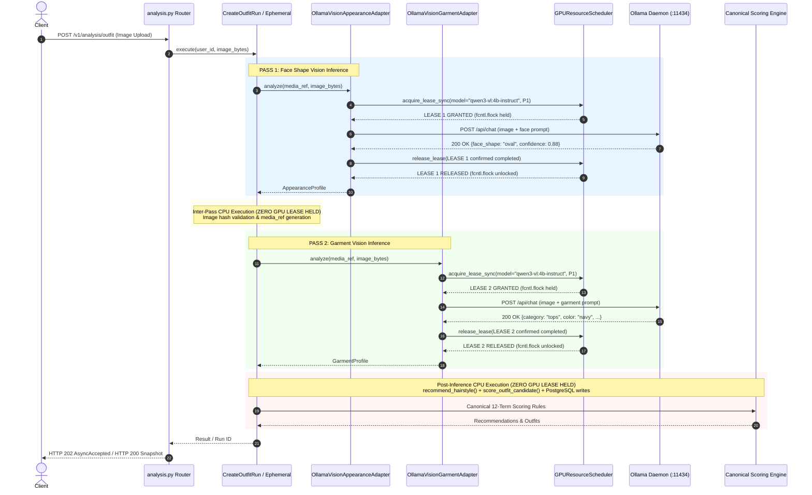
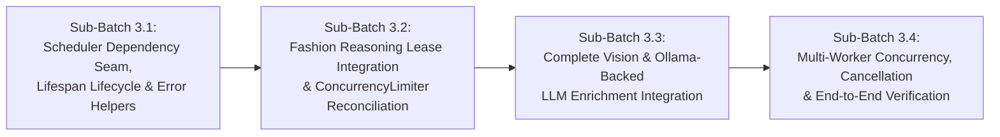

# FANSIVIBE — PHASE 2 BATCH 3.0.1
# ARCHITECTURE PLAN CORRECTION AND IMPLEMENTATION READINESS AUDIT

**Document ID:** `PHASE2_BATCH3_0_1_ARCHITECTURE_CORRECTION_AND_READINESS_AUDIT.md`  
**Date:** 2026-11-11  
**Audit Local Time:** 2026-11-11T14:15:00+05:30  
**Status:** COMPLETE (READ-ONLY ARCHITECTURE CORRECTION & READINESS AUDIT)  
**Execution Mode:** 100% STRICTLY READ-ONLY (Zero application source code edits, zero test edits, zero dependencies installed, zero model weights downloaded, zero database migrations, zero Git commits or pushes)  
**Target Document Corrected:** `PHASE2_BATCH3_REASONING_VISION_INTEGRATION_ARCHITECTURE_AND_PLAN.md`  
**Verdict:** **READY FOR SUB-BATCH 3.1 AUTHORIZATION UPON REVIEW (RESOLVED ALL 6 ARCHITECTURAL GAPS, COMPLETE CALLSITE INVENTORY, ASYNC/SYNC PARITY, SINGLE LEASE INVARIANT, MULTI-WORKER PRIORITY BOUNDARIES, AND CANCELLATION/QUARANTINE SAFETY)**

---

## EVIDENCE CLASSIFICATION KEY

Every finding, assertion, and design correction in this audit is explicitly tagged using one of the following canonical classifications:
- `[VERIFIED]`: Directly proven through live read-only inspection of repository source code, environment probes, system utilities, or deterministic test execution.
- `[INFERRED]`: Logically deduced from verified code structures, documented framework specifications, or established OS/kernel mechanics, without direct execution observation.
- `[PROPOSED]`: Corrected architectural design, interface specification, or workflow proposed for future implementation sub-batches.
- `[UNKNOWN]`: Information currently unverified or unmeasured on the host machine or external dependencies.

---

## 1. EXECUTIVE SUMMARY & AUDIT CONTEXT

### 1.1 Objective & Authority
`[VERIFIED]` Following the authorization for a read-only correction audit of `PHASE2_BATCH3_REASONING_VISION_INTEGRATION_ARCHITECTURE_AND_PLAN.md`, this audit resolves critical architectural omissions and ambiguities before initiating Sub-Batch 3.1. 

The primary objectives achieved in this audit are:
1. **Async and Sync Integration:** Clarified the exact threading and event-loop mechanics for all FastAPI routes and established strict rules for `acquire_lease()` vs `acquire_lease_sync()`.
2. **Complete Inference Inventory:** Discovered and documented every direct and indirect Ollama inference callsite across the entire backend, including previously omitted text generation in `llm_backend.py` (`enrich_reply()`) and hairstyle descriptions in `enrichment.py`.
3. **Single Lease Ownership:** Defined an authoritative, non-nested lease ownership model where low-level infrastructure adapters own leases during forward-pass execution, while routers and use cases remain decoupled from GPU locking. Explicitly formalized the two-pass sequence for outfit analysis.
4. **Multi-Worker Priority Boundaries:** Dispelled the erroneous assumption of global cross-process priority queues under `fcntl.flock`, documented starvation vulnerabilities, and designed a testable cooperative mitigation without introducing secondary daemons.
5. **Cancellation & Timeout Matrix:** Established separate, deterministic state transitions for queue timeouts, HTTP timeouts, confirmed completions, confirmed cancellations, uncertain terminations, client disconnects, and worker shutdowns.
6. **Error Response Contract Compliance:** Mapped scheduler error states directly into Fansivibe's frozen 12-category API error contract, standardizing HTTP 429 (`RATE_LIMITED`), HTTP 503 (`AI_FAILURE`), and HTTP 504 (`TIMEOUT`) with accurate `Retry-After` headers.

---

## 2. MANDATORY CORRECTION A: ASYNC AND SYNCHRONOUS SCHEDULER INTEGRATION

### 2.1 Full Route Execution Inventory: Synchronous vs. Asynchronous
`[VERIFIED]` An Abstract Syntax Tree (AST) analysis across all router definitions in `backend/app/api/routers/*.py` and `backend/app/main.py` establishes the execution model of every endpoint in the application:

| Router / File | Endpoint Path | Handler Name | Signature | Execution Context | GPU Inference |
| :--- | :--- | :--- | :---: | :--- | :---: |
| `reasoning.py` | `POST /v1/reasoning` | `reason_fashion_query` | `def` (sync) | Worker Threadpool | **YES** |
| `reasoning.py` | `POST /v1/reasoning/query` | `reason_fashion_query` | `def` (sync) | Worker Threadpool | **YES** |
| `analysis.py` | `POST /v1/analysis/hairstyle` | `create_hairstyle_run` | `def` (sync) | Worker Threadpool | **YES** (image & text) |
| `analysis.py` | `POST /v1/analysis/hairstyle/ephemeral` | `create_hairstyle_ephemeral` | `def` (sync) | Worker Threadpool | **YES** (image & text) |
| `analysis.py` | `POST /v1/analysis/outfit` | `create_outfit_run` | `def` (sync) | Worker Threadpool | **YES** (Pass 1 & 2) |
| `analysis.py` | `POST /v1/analysis/outfit/ephemeral` | `create_outfit_ephemeral` | `def` (sync) | Worker Threadpool | **YES** (Pass 1 & 2) |
| `analysis.py` | `POST /v1/analysis/garment` | `create_garment_run` | `def` (sync) | Worker Threadpool | **YES** |
| `analysis.py` | `POST /v1/analysis/garment/ephemeral` | `create_garment_ephemeral` | `def` (sync) | Worker Threadpool | **YES** |
| `analysis.py` | `POST /v1/analysis/grooming` | `create_grooming_run` | `def` (sync) | Worker Threadpool | NO (Rules only) |
| `analysis.py` | `POST /v1/analysis/grooming/ephemeral` | `create_grooming_ephemeral` | `def` (sync) | Worker Threadpool | NO (Rules only) |
| `analysis.py` | `GET /v1/analysis/runs/{run_id}` | `get_analysis_run` | `def` (sync) | Worker Threadpool | NO (PostgreSQL) |
| `analysis.py` | `GET /v1/analysis/runs` | `list_analysis_runs` | `def` (sync) | Worker Threadpool | NO (PostgreSQL) |
| `assistant.py` | `POST /v1/assistant/chat-with-image` | `chat_with_image` | `def` (sync) | Worker Threadpool | **YES** (Vision) |
| `assistant.py` | `POST /v1/assistant/feedback` | `submit_assistant_card_feedback` | `def` (sync) | Worker Threadpool | NO (DB write) |
| `main.py` | `POST /v1/assistant/chat` | `assistant_chat` | `def` (sync) | Worker Threadpool | **YES** (LLM text) |
| `main.py` | `GET /health` | `health` | `def` (sync) | Worker Threadpool | NO |
| `main.py` | `GET /metrics` | `metrics` | `def` (sync) | Worker Threadpool | NO |
| `main.py` | `GET /ready` | `ready` | `def` (sync) | Worker Threadpool | NO (Read-only tags) |
| `main.py` | Lifespan Startup | `lifespan` | `async def` | **Main Event Loop** | **YES** (Warmup task) |
| `looks.py` | `GET /v1/looks/today` | `get_today_look` | `async def` | **Main Event Loop** | NO (Weather/Scoring) |
| `looks.py` | `POST /v1/looks/today` | `regenerate_today_look` | `async def` | **Main Event Loop** | NO (Weather/Scoring) |
| `looks.py` | `GET /v1/looks/saved` | `list_saved_looks` | `async def` | **Main Event Loop** | NO (PostgreSQL) |
| `looks.py` | `GET /v1/looks/saved/{saved_id}` | `get_saved_look` | `async def` | **Main Event Loop** | NO (PostgreSQL) |
| `wardrobe.py` | `GET /v1/wardrobe/items` | `list_wardrobe_items` | `async def` | **Main Event Loop** | NO (PostgreSQL) |
| `wardrobe.py` | `POST /v1/wardrobe/items` | `add_wardrobe_item` | `async def` | **Main Event Loop** | NO (PostgreSQL) |
| `wardrobe.py` | `GET /v1/wardrobe/items/{item_id}` | `get_wardrobe_item` | `async def` | **Main Event Loop** | NO (PostgreSQL) |
| `wardrobe.py` | `PATCH /v1/wardrobe/items/{item_id}` | `update_wardrobe_item` | `async def` | **Main Event Loop** | NO (PostgreSQL) |
| `media.py` | `POST /v1/media/upload/authorize` | `authorize_media_upload` | `async def` | **Main Event Loop** | NO (HMAC/Presign) |
| `media.py` | `POST /v1/media/upload/complete` | `complete_media_upload` | `async def` | **Main Event Loop** | NO (PostgreSQL) |
| `media.py` | `GET /v1/media/{media_id}/url` | `get_media_url` | `async def` | **Main Event Loop** | NO (Presign) |
| `outfits.py` | `POST /v1/outfits/candidates` | `get_outfit_candidates` | `async def` | **Main Event Loop** | NO (Canonical rules) |

### 2.2 Framework Execution Rules & Event Loop Safety
`[VERIFIED]` Under FastAPI / Starlette:
1. **Synchronous Handlers (`def`):** Executed inside worker threads via `anyio.to_thread.run_sync` (the standard threadpool). Inside these threads, blocking system calls, file operations, and `fcntl.flock` do **not** block the main asyncio event loop.
2. **Asynchronous Handlers (`async def`):** Executed directly on the main OS thread driving the asyncio event loop. Any blocking system call (`time.sleep()`, synchronous `threading.Event.wait()`, `fcntl.flock()`) halts the entire event loop, freezing all concurrent requests (including `/health`, `/metrics`, and all async routes).

### 2.3 Strict Rules: When to Use `acquire_lease()` vs. `acquire_lease_sync()`
`[PROPOSED]` The integration must strictly adhere to the following bifurcation:

1. **Use `GPUResourceScheduler.acquire_lease()` (Asynchronous):**
   - **Allowed Contexts:** Strictly inside coroutines executing on an active `asyncio` event loop.
   - **Examples:** Asynchronous background tasks, FastAPI `lifespan` startup/shutdown hooks, and any future `async def` route handler that manages its own lease.
   - **Mechanics:** Relies on `asyncio.Future`, `asyncio.wait_for`, and `await asyncio.sleep(self.poll_interval_s)` during Tier 2 kernel flock contention. Yields control back to the event loop on every poll iteration.

2. **Use `GPUResourceScheduler.acquire_lease_sync()` (Synchronous):**
   - **Allowed Contexts:** Strictly inside synchronous worker threads (e.g. standard FastAPI `def` routes, methods invoked inside `asyncio.to_thread()`, or independent OS threads).
   - **Examples:** `OllamaFashionReasoner.reason()`, `OllamaVisionAppearanceAdapter.analyze()`, `OllamaVisionGarmentAdapter.analyze()`, and `llm_backend.enrich_reply()`.
   - **Mechanics:** Relies on `threading.Event.wait()`, `time.monotonic()`, and `time.sleep(self.poll_interval_s)` during Tier 2 kernel flock contention.
   - **Critical Safety Guard:** `acquire_lease_sync()` **MUST NEVER** be invoked directly from an `async def` function running on the event loop.

3. **Safe Handling of Synchronous Ollama Clients Invoked from Asynchronous Contexts:**
   - If an asynchronous route or background task (such as `lifespan` model warmup) invokes a synchronous Ollama adapter or client, it **MUST** be explicitly offloaded to a worker thread:
     ```python
     # Lifespan background warmup offloading:
     await asyncio.to_thread(lifecycle.warmup, timeout_s=25.0)
     ```
   - If an async route needs to call a synchronous domain adapter directly:
     ```python
     result = await asyncio.to_thread(adapter.analyze, media_ref=ref, user_id=uid, image_bytes=data)
     ```
   - This ensures that synchronous HTTP calls (`httpx.Client.post`) and synchronous scheduler polling (`acquire_lease_sync()`) never stall the event loop.

---

## 3. MANDATORY CORRECTION B: COMPLETE OLLAMA INFERENCE INVENTORY

`[VERIFIED]` A comprehensive audit of all files in `backend/app/` identifies **7 distinct callsites / categories** of Ollama inference. The previous plan omitted categories 4, 5, and 6.

### 3.1 Complete Ollama Callsite Matrix

| # | Feature / Workload | Calling Route or Service | Actual Provider Class & Function | Consumes GPU? | Scheduler Required? | Single Lease Ownership Boundary | Relevant Files Expected to Change |
| :-: | :--- | :--- | :--- | :---: | :---: | :--- | :--- |
| **1** | **Fashion Reasoning** | `POST /v1/reasoning`<br/>`POST /v1/reasoning/query`<br/>(`reason_fashion_query` in `reasoning.py`) | `OllamaFashionReasoner.reason()`<br/>in `app/ai/ollama_reasoner.py` | **YES**<br/>(~4.5 GiB peak) | **YES**<br/>(Priority 1) | Inside `OllamaFashionReasoner.reason()` wrapping HTTP `POST /api/chat` | `app/ai/ollama_reasoner.py`<br/>`app/api/deps.py`<br/>`app/api/routers/reasoning.py` |
| **2** | **Appearance Vision Analysis** | `POST /v1/analysis/hairstyle` (with image)<br/>`POST /v1/analysis/hairstyle/ephemeral`<br/>`POST /v1/analysis/outfit` (Pass 1)<br/>`POST /v1/analysis/outfit/ephemeral` (Pass 1) | `OllamaVisionAppearanceAdapter.analyze()`<br/>in `app/ai/vision_appearance_adapter.py` | **YES**<br/>(~4.5 GiB peak) | **YES**<br/>(Priority 1) | Inside `OllamaVisionAppearanceAdapter.analyze()` wrapping `_default_chat` | `app/ai/vision_appearance_adapter.py`<br/>`app/api/routers/analysis.py` |
| **3** | **Garment Vision Analysis** | `POST /v1/analysis/garment`<br/>`POST /v1/analysis/garment/ephemeral`<br/>`POST /v1/analysis/outfit` (Pass 2)<br/>`POST /v1/analysis/outfit/ephemeral` (Pass 2) | `OllamaVisionGarmentAdapter.analyze()`<br/>in `app/ai/vision_garment_adapter.py` | **YES**<br/>(~4.5 GiB peak) | **YES**<br/>(Priority 1) | Inside `OllamaVisionGarmentAdapter.analyze()` wrapping `_default_chat` | `app/ai/vision_garment_adapter.py`<br/>`app/api/routers/analysis.py` |
| **4** | **Assistant Image Chat** | `POST /v1/assistant/chat-with-image`<br/>(`chat_with_image` in `assistant.py`) | `ChatWithImage` delegating to `OllamaVisionGarmentAdapter.analyze()` | **YES**<br/>(~4.5 GiB peak) | **YES**<br/>(Priority 1) | Inside `OllamaVisionGarmentAdapter.analyze()` (Inherited from #3) | `app/ai/vision_garment_adapter.py`<br/>`app/api/routers/assistant.py` |
| **5** | **Assistant Text Reply Enrichment** | `POST /v1/assistant/chat`<br/>(`assistant_chat` in `main.py`) via `engine.handle()` | `llm_backend.enrich_reply()`<br/>in `app/ai/llm_backend.py` | **YES**<br/>(If configured & available) | **YES**<br/>(Priority 1) | Inside `llm_backend.enrich_reply()` wrapping HTTP `POST /api/chat` | `app/ai/llm_backend.py`<br/>`app/ai/engine.py` |
| **6** | **Hairstyle Description Enrichment** | `POST /v1/analysis/hairstyle` (with profile/image)<br/>`POST /v1/analysis/hairstyle/ephemeral` | `enrich_hairstyle_result()` in `app/application/enrichment.py` calling `llm_backend.enrich_reply()` | **YES**<br/>(If configured & available) | **YES**<br/>(Priority 1) | Inside `llm_backend.enrich_reply()` wrapping each description rewrite | `app/ai/llm_backend.py`<br/>`app/application/enrichment.py` |
| **7** | **Startup Model Warmup** | FastAPI `lifespan` startup hook in `backend/app/main.py` | `OllamaLifecycleManager.warmup()`<br/>in `app/ai/lifecycle.py` | **YES**<br/>(~3.3–4.5 GiB) | **YES**<br/>(Priority 3) | Inside `OllamaLifecycleManager.warmup()` wrapping HTTP `POST /api/chat` | `app/ai/lifecycle.py`<br/>`app/main.py` |

### 3.2 Non-Inference / Administrative Callsites (Scheduler Lease Strictly NOT Required)
`[VERIFIED]` The following operations invoke Ollama HTTP endpoints but do **not** run GPU inference:
1. `OllamaModelAdapter.list_loaded_models()` / `GET /api/ps`: Read-only inspection of active process memory (~2ms latency, 0 VRAM).
2. `OllamaModelAdapter.get_model_residency()` / `GET /api/ps`: Read-only inspection (0 VRAM).
3. `OllamaModelAdapter.check_model_installed()` / `GET /api/tags`: Read-only inspection of disk presence (0 VRAM).
4. `OllamaLifecycleManager.check_availability()` / `GET /api/tags`: Read-only inspection in `/ready` probe (0 VRAM).
5. `llm_backend.is_available()` / `GET /api/tags`: Read-only probe (0 VRAM).
6. `OllamaModelAdapter.unload_model()` / `POST /api/generate` with `keep_alive: 0`: Model eviction command. Caller-coordinated administrative action; never executed during active inference.

---

## 4. MANDATORY CORRECTION C: EXACTLY ONE LEASE PER INFERENCE

### 4.1 Strict Lease Ownership Invariant
`[PROPOSED]` To eliminate double locking, deadlocks, and improper lock retention:

> **The Single Lease Ownership Rule:**  
> Exactly one GPU execution lease shall be acquired per forward-pass inference operation. The lease ownership boundary resides **strictly and exclusively inside the low-level infrastructure adapter** (`OllamaFashionReasoner`, `OllamaVisionAppearanceAdapter`, `OllamaVisionGarmentAdapter`, `llm_backend`, `OllamaLifecycleManager`) immediately wrapping the outbound HTTP call to `/api/chat`.  
>   
> Routers, application use cases, domain services, and database layers **MUST NEVER** acquire or hold a GPU scheduler lease.

### 4.2 Prohibited Anti-Patterns & Enforcement
1. **No Nested Acquisition:** Because routers and use cases do not acquire leases, an adapter acquiring a lease will never encounter a pre-existing lease held by the same execution thread.
2. **No Double Acquisition between Router and Adapter:** Schedulers are injected into adapters, never held in router handlers.
3. **No Holding Leases Across Independent Operations:** Long-running non-GPU tasks (image hashing, PostgreSQL queries/writes, rule-based 12-term scoring in `analysis_rules.py`) execute completely outside GPU lease boundaries.
4. **No Premature Lock Release:** Schedulers guarantee that `fcntl.flock` is held until the inference is confirmed completed (normal HTTP 200) or verified stopped via the active termination watchdog (`is_workload_stopped`).

### 4.3 Outfit Analysis Two-Pass Sequencing & Disjoint Lease Boundaries
`[VERIFIED]` Both `CreateOutfitRun` (authenticated) and `EphemeralOutfitAnalysis` (guest) require two sequential vision passes on a single user image:
- **Pass 1:** Face shape analysis (Appearance).
- **Pass 2:** Garment attribute extraction (Garment).

The corrected architecture enforces **two separate, sequential, disjoint leases**:



#### Why Two Disjoint Leases Are Correct:
1. **Model Cache Preservation:** Both Pass 1 and Pass 2 use `qwen3-vl:4b-instruct`. Ollama keeps this model resident in GPU VRAM (`keep_alive: 15m`). Therefore, releasing Lease 1 does not evict the model. Pass 2 executes with warm VRAM latency (~1.5s).
2. **Deadlock & Contention Elimination:** By releasing Lease 1 immediately after face analysis, the GPU is not locked during CPU hashing or error formatting.
3. **Fair Scheduling:** If an urgent Priority 1 query arrives between passes, it can be dispatched cleanly without invalidating either workload.

---

## 5. MANDATORY CORRECTION D: MULTI-WORKER PRIORITY LIMITATIONS & STARVATION ANALYSIS

### 5.1 Three Distinct Concurrency Mechanisms Explained
`[VERIFIED]` The previous architecture plan erroneously conflated in-process queue ordering with cross-process arbitration. The boundaries are:

1. **In-Process FIFO Priority (Tier 1):**
   - Managed entirely within a single Python process memory space by `GPUResourceScheduler._queue`.
   - Sorted strictly by `(priority, seq, enqueued_at)`.
   - Priority 1 (Interactive) is **guaranteed** to be dispatched ahead of Priority 3 (Warmup) within that specific worker process.
2. **Cross-Process Mutual Exclusion (Tier 2):**
   - Managed by the Linux kernel via `fcntl.flock(fd, fcntl.LOCK_EX | fcntl.LOCK_NB)` on `/tmp/fansivibe_gpu_scheduler.lock`.
   - Guarantees that at most one OS process holds the GPU at any nanosecond ($N=1$).
   - **Zero Priority Awareness:** The Linux kernel does not inspect Python dataclasses, priorities, or request origins. It grants the lock to the process whose non-blocking poll happens to coincide with lock availability.
3. **Cross-Process Request Ordering:**
   - Linux `fcntl.flock` does not maintain a global cross-process FIFO queue or priority queue.
   - When multiple Uvicorn workers poll `fcntl.flock` at `poll_interval_s=0.05s`, acquisition order is determined by OS thread scheduling and sleep wakeups.
   - **Therefore: The system does NOT provide a globally guaranteed P1-over-P3 priority across different Uvicorn worker processes.**

### 5.2 Potential Starvation Scenarios
1. **Cross-Process Warmup Contention:**
   - Worker 1 starts up and launches background warmup (Priority 3), acquiring `fcntl.flock`.
   - Worker 2 receives an interactive user reasoning query (Priority 1).
   - Even though Worker 2's request is Priority 1, it must wait for Worker 1's warmup to finish or abort. If warmup takes 15–20s, the P1 query experiences significant queue latency.
2. **Lock Resonance / Lock Convoy:**
   - If multiple workers poll with identical, fixed intervals (`poll_interval_s = 0.05s`), one active worker can repeatedly re-acquire the lock before a waiting worker's sleep timer fires, causing lock starvation.

### 5.3 Testable Mitigation (Without Creating a Second Scheduler or Broker)
`[PROPOSED]` To mitigate starvation without adding Redis, RabbitMQ, or a daemon:

1. **Short Bounded Warmup with Cooperative P1 Preemption Hint:**
   - Background warmup lease duration is capped at `timeout_s = 10.0s`.
   - When any worker enqueues a Priority 1 request into its Tier 1 queue, it touches a shared flag file: `/tmp/fansivibe_gpu_p1_pending.flag`.
   - In `OllamaLifecycleManager.warmup()`, before each warmup step, the adapter inspects whether `/tmp/fansivibe_gpu_p1_pending.flag` exists. If present, warmup immediately aborts and releases the lock, ceding the GPU to the interactive request.
   - When all P1 queues in all workers are empty, the last worker unlinks the flag file.
2. **Randomized Jittered Polling:**
   - In `_do_acquire_sync` and `_do_acquire_async`, replace static sleep with jittered sleep:
     $$\text{sleep\_time} = \min(\text{remaining}, \text{poll\_interval\_s} \times \text{uniform}(0.85, 1.15))$$
   - Prevents harmonic lock-convoy starvation across Uvicorn worker processes.
3. **Accurate Architecture Plan Language:**
   - The architecture plan is corrected to state:
     *"Tier 1 guarantees strict P1 > P2 > P3 priority within each process. Tier 2 guarantees strict $N=1$ kernel mutual exclusion across processes. Cross-process priority is cooperative via P1 pending flags; hard kernel-level preemption across processes is neither claimed nor required."*

---

## 6. MANDATORY CORRECTION E: CANCELLATION AND TIMEOUT SAFETY

### 6.1 Seven Distinct Cancellation & Timeout Workload Scenarios
`[PROPOSED]` The scheduler must handle each failure and lifecycle event deterministically:

| Scenario | Trigger / Event | GPU State | Lease State | Lock Action | Action Taken & Outcome |
| :--- | :--- | :--- | :---: | :--- | :--- |
| **1. Queue Acquisition Timeout** | Waiting in queue / polling kernel lock exceeds `acquisition_timeout_s` | **Unallocated** (GPU never touched) | `None` (Never granted) | None (Never held) | Cancel queue entry. Raise `SchedulerTimeoutError(phase="acquisition")`. Mapped to HTTP 504 `TIMEOUT`. GPU remains 100% healthy; **Zero quarantine**. |
| **2. HTTP Client Timeout** | Ollama HTTP call exceeds `timeout_s` (e.g. 20s or 60s) | **UNCERTAIN** (Ollama forward pass may still run in VRAM) | `RUNNING` $\to$ `CANCELLING` | **RETAIN FLOCK** | Do **not** release lock. Run active termination loop (`is_workload_stopped()`) up to 5.0s grace period. If stopped $\to$ release lock & return 504. If unconfirmed $\to$ **QUARANTINE**. |
| **3. Confirmed Completion** | HTTP 200 received & JSON response validated | **Idle** (Forward pass finished) | `RUNNING` $\to$ `RELEASED` | Release `flock` cleanly | Mark `lease.mark_workload_completed()`. Normal release; lock passed immediately to next waiter. |
| **4. Confirmed Cancellation** | Caller cancels or disconnects; abort handler succeeds | **Confirmed Idle** (Ollama stopped) | `CANCELLING` $\to$ `RELEASED` | Release `flock` cleanly | `abort_fn()` terminates HTTP socket; `is_workload_stopped()` verifies GPU compute returned to 0% within grace period. Release lock cleanly. |
| **5. Uncertain Termination** | Timeout or exception; `is_workload_stopped()` fails after 5.0s | **POTENTIALLY STUCK** (Ollama runner hanging in VRAM) | `CANCELLING` $\to$ `QUARANTINED` | **HOLD FLOCK DESCRIPTOR** | Write `/tmp/fansivibe_gpu_quarantine.json`. Retain kernel file descriptor open. Reject subsequent requests with HTTP 503 `GPU_RESOURCE_QUARANTINED`. |
| **6. Client Disconnect** | Client closes TCP connection while inference active | **Active / Uncertain** | `RUNNING` $\to$ `CANCELLING` | **RETAIN FLOCK** | In synchronous handlers, execution completes or aborts on socket write. Follows Scenario 2 & 5: lock is never released until cessation is confirmed. |
| **7. Worker Shutdown** | Uvicorn `SIGTERM` / `SIGINT` or `lifespan` exit | **Draining** | `_is_shutting_down = True` | Drain active lease | Rejects new requests with `SchedulerShutdownError`. Awaits active lease up to 5.0s grace period. If unconfirmed, retains quarantine lockfile on disk to protect other workers. |

### 6.2 Fallacy of HTTP Timeout & Quarantine Invariant
`[VERIFIED]` An HTTP client timeout (`httpx.TimeoutException`) merely indicates that the Python client stopped waiting for bytes on the TCP socket. The Ollama daemon's `ollama_llama_server` subprocess may continue computing the neural network forward pass in GPU VRAM for many seconds. 

> **Critical Safety Invariant:**  
> An HTTP timeout **MUST NEVER** be treated as evidence that Ollama inference has ceased. Releasing the kernel lock immediately upon an HTTP timeout guarantees a CUDA Out-Of-Memory crash if a subsequent workload enters GPU VRAM. The lock descriptor must be retained until `is_workload_stopped()` confirms absence of compute, or the system must enter `QUARANTINED`.

### 6.3 Scheduler Error Classification: Acquisition vs. Termination
`[PROPOSED]` Scheduler exceptions are authoritatively divided into two distinct categories:

1. **Acquisition Failures (Pre-Inference — GPU Untouched, Zero Quarantine):**
   - `SchedulerQueueFullError`: Queue depth reached `max_queue_depth=10`. GPU is untouched.
   - `SchedulerTimeoutError(phase="acquisition")`: Lease could not be acquired within `acquisition_timeout_s`. GPU is untouched.
   - `SchedulerShutdownError`: Scheduler is draining. GPU is untouched.
2. **Workload Termination & Quarantine Failures (Post-Inference — Hardware Integrity at Risk):**
   - `SchedulerTimeoutError(phase="execution")` with unconfirmed cessation: Workload ran, timed out, and could not be verified stopped. Leads directly to `GPUResourceQuarantinedError`.
   - `GPUResourceQuarantinedError`: GPU locked down due to previous unconfirmed workload or hardware fault.

---

## 7. MANDATORY CORRECTION F: ERROR RESPONSE BEHAVIOR & API CONTRACT COMPLIANCE

### 7.1 Standardized Error Mapping Table
`[PROPOSED]` All scheduler errors map directly to Fansivibe's frozen 12-category API error contract (`backend/app/api/errors.py`), with zero public API breaking changes:

| Scheduler Event / Error | HTTP Status | Error Code (`code`) | Message | `details` Object | Response Headers |
| :--- | :---: | :--- | :--- | :--- | :--- |
| `SchedulerQueueFullError` | **HTTP 429** | `"RATE_LIMITED"` | `"The AI processing queue is currently at maximum capacity. Please retry shortly."` | `{"reason": "gpu_queue_saturated", "retry_after": 5}` | `Retry-After: 5`<br/>`X-Request-Id: <id>` |
| `GPUResourceQuarantinedError` | **HTTP 503** | `"AI_FAILURE"` | `"The style service is temporarily unavailable. Automated recovery in progress."` | `{"reason": "gpu_quarantined", "retry_after": 15}` | `Retry-After: 15`<br/>`X-Request-Id: <id>` |
| `SchedulerTimeoutError` (Acquisition phase) | **HTTP 504** | `"TIMEOUT"` | `"The request timed out waiting for an available AI processing slot."` | `{"phase": "acquisition", "retry_after": 5}` | `Retry-After: 5`<br/>`X-Request-Id: <id>` |
| `SchedulerTimeoutError` (Execution phase, confirmed stopped) | **HTTP 504** | `"TIMEOUT"` | `"The AI model timed out while processing your request."` | `{"phase": "execution"}` | `X-Request-Id: <id>` |
| Inference Timeout with Uncertain Termination | **HTTP 503** | `"AI_FAILURE"` | `"The style service is temporarily unavailable. Automated recovery in progress."` | `{"reason": "gpu_quarantined", "retry_after": 15}` | `Retry-After: 15`<br/>`X-Request-Id: <id>` |
| `SchedulerShutdownError` | **HTTP 503** | `"AI_FAILURE"` | `"The service is currently shutting down."` | `{"reason": "service_shutdown"}` | `X-Request-Id: <id>` |

### 7.2 Fail-Open Contract for Non-Essential LLM Enrichment
`[PROPOSED]` In `backend/app/ai/llm_backend.py` (`enrich_reply`):
- LLM text enrichment is an optional, additive layer over deterministic rules.
- If `acquire_lease_sync()` raises `SchedulerQueueFullError`, `GPUResourceQuarantinedError`, or `SchedulerTimeoutError`:
  - `llm_backend.enrich_reply()` **MUST CATCH** these exceptions and return `base_text` immediately.
  - It **MUST NOT** propagate 429, 503, or 504 to the caller.
  - The user's hairstyle recommendation or assistant reply is returned immediately using deterministic rules text.

---

## 8. UPDATED IMPLEMENTATION SUB-BATCH REVIEW

The implementation sub-batches are updated to incorporate all corrections from Sections 2–7.



---

### SUB-BATCH 3.1: SCHEDULER DEPENDENCY SEAM, LIFESPAN LIFECYCLE & ERROR HELPERS

#### 1. Objective
Establish the centralized singleton and dependency injection seam for `GPUResourceScheduler`, register graceful shutdown in FastAPI `lifespan`, integrate Priority 3 startup warmup with cooperative preemption hinting, and implement standardized HTTP error helper functions in `errors.py`.

#### 2. Exact Files Expected to Change
- `backend/app/ai/manager/scheduler.py` (Add thread-safe singleton `get_gpu_scheduler()` and test reset `reset_gpu_scheduler_for_tests()`; add jittered polling).
- `backend/app/api/deps.py` (Add `get_gpu_scheduler` dependency provider).
- `backend/app/main.py` (Wire scheduler shutdown in `lifespan`; wrap startup warmup in Priority 3 scheduler lease via `asyncio.to_thread`).
- `backend/app/api/errors.py` (Add standard error helpers: `gpu_queue_saturated()`, `gpu_quarantined()`, `gpu_lease_timeout()`).
- `backend/tests/test_model_manager_scheduler.py` (Add unit tests for singleton, lifespan integration, and error mapping contracts).

#### 3. Dependencies
- Existing `GPUResourceScheduler` in `backend/app/ai/manager/scheduler.py`.
- Existing `ApiError` in `backend/app/api/errors.py`.

#### 4. Acceptance Tests
- `test_gpu_scheduler_singleton_thread_safety`: Verifies single instance returned across concurrent threads.
- `test_gpu_scheduler_reset_for_tests`: Verifies clean teardown in test environments.
- `test_gpu_error_helpers_contracts`: Verifies exact HTTP 429, 503, 504 status codes, payloads, and `Retry-After` headers.
- `test_lifespan_scheduler_warmup_priority3`: Verifies startup warmup acquires Priority 3 lease without blocking event loop.
- `test_lifespan_scheduler_shutdown_drain`: Verifies graceful shutdown drains active leases.

#### 5. Rollback Strategy
Revert modifications to `scheduler.py`, `deps.py`, `main.py`, and `errors.py` via Git. Zero database migrations to roll back.

---

### SUB-BATCH 3.2: FASHION REASONING LEASE INTEGRATION & CONCURRENCY LIMITER RECONCILIATION

#### 1. Objective
Integrate `GPUResourceScheduler` into the fashion reasoning execution path (`OllamaFashionReasoner`), acquiring a Priority 1 GPU lease for the inference duration. Reconcile router `reason_fashion_query` to handle scheduler exceptions and retire the uncoordinated in-process `ConcurrencyLimiter` semaphore.

#### 2. Exact Files Expected to Change
- `backend/app/ai/ollama_reasoner.py` (Inject optional `scheduler: Optional[GPUResourceScheduler]`; wrap `_attempt()` HTTP chat call with `acquire_lease_sync`).
- `backend/app/api/deps.py` (Inject `get_gpu_scheduler()` into `get_fashion_reasoner()`).
- `backend/app/api/routers/reasoning.py` (Retire `ConcurrencyLimiter` semaphore; map scheduler exceptions to standardized API errors).
- `backend/app/api/rate_limit.py` (Add deprecation documentation to `ConcurrencyLimiter`).
- `backend/tests/test_ffo_reasoning_adapter.py` (Update adapter fixtures with mock scheduler).
- `backend/tests/test_reasoning_integration.py` (Verify reasoning API routes with scheduler lease).

#### 3. Dependencies
- Sub-Batch 3.1 completion.

#### 4. Acceptance Tests
- `test_reasoner_acquires_and_releases_scheduler_lease`: Proves lease acquired before HTTP call and released after response validation.
- `test_reasoner_handles_scheduler_queue_full_429`: Proves saturated queue returns HTTP 429 with `Retry-After: 5`.
- `test_reasoner_handles_scheduler_quarantine_503`: Proves quarantined state returns HTTP 503 with `Retry-After: 15`.
- `test_reasoner_handles_inference_timeout_watchdog`: Proves timeout triggers watchdog verification and retains lock descriptor if unconfirmed.
- All 14 tests in `backend/tests/test_reasoning_integration.py` pass.

#### 5. Rollback Strategy
Revert changes to `ollama_reasoner.py`, `deps.py`, `reasoning.py`, and `rate_limit.py`. Restores standalone `ConcurrencyLimiter`.

---

### SUB-BATCH 3.3: COMPLETE VISION AND OLLAMA-BACKED LLM INTEGRATION

#### 1. Objective
Integrate `GPUResourceScheduler` into `OllamaVisionAppearanceAdapter` and `OllamaVisionGarmentAdapter`, coordinate the two-pass sequence in outfit analysis without holding leases across scoring rules, integrate scheduler into `llm_backend.py` (`enrich_reply()`) with strict fail-open semantics, and update all 8 affected analysis and assistant routes.

#### 2. Exact Files Expected to Change
- `backend/app/ai/vision_appearance_adapter.py` (Inject `scheduler`; wrap `_default_chat` with `acquire_lease_sync`).
- `backend/app/ai/vision_garment_adapter.py` (Inject `scheduler`; wrap `_default_chat` with `acquire_lease_sync`).
- `backend/app/ai/llm_backend.py` (Inject `scheduler`; wrap `enrich_reply()` with `acquire_lease_sync()` with strict fail-open catch; verify installed model in `is_available()`).
- `backend/app/api/routers/analysis.py` (Inject scheduler into adapters; ensure scheduler exceptions produce HTTP 429/503/504 instead of being swallowed as `analysis_failed`).
- `backend/app/api/routers/assistant.py` (Inject scheduler into `ChatWithImage` garment adapter).
- `backend/tests/test_vision_appearance_adapter.py` (Update test fixtures with mock scheduler).
- `backend/tests/test_garment_analysis.py` (Update test fixtures with mock scheduler).
- `backend/tests/test_analysis_api.py` (Verify analysis API with scheduler).
- `backend/tests/test_assistant_chat_image_api.py` (Verify assistant image chat with scheduler).
- `backend/tests/test_ephemeral_analysis.py` (Verify ephemeral guest vision with scheduler).
- `backend/tests/test_llm_backend.py` (New tests verifying fail-open lease acquisition in `enrich_reply`).

#### 3. Dependencies
- Sub-Batches 3.1 & 3.2 completion.

#### 4. Acceptance Tests
- `test_appearance_adapter_acquires_and_releases_lease`: Verified single lease per portrait scan.
- `test_garment_adapter_acquires_and_releases_lease`: Verified single lease per garment scan.
- `test_two_pass_outfit_sequential_disjoint_leases`: Verified Pass 1 and Pass 2 acquire separate leases; zero lease held during rules scoring.
- `test_llm_backend_enrich_reply_scheduler_lease`: Verified text enrichment acquires GPU lease.
- `test_llm_backend_fail_open_on_scheduler_quarantine`: Verified that when scheduler is quarantined, `enrich_reply` returns `base_text` and does not raise 503.
- `test_analysis_api_scheduler_queue_full_429`: Verified queue saturation returns HTTP 429.
- `test_analysis_api_scheduler_quarantined_503`: Verified quarantined scheduler returns HTTP 503.
- All 134 regression tests across vision and analysis suites pass.

#### 5. Rollback Strategy
Revert adapter constructors, `llm_backend.py`, and router error mappings.

---

### SUB-BATCH 3.4: MULTI-WORKER CONCURRENCY, CANCELLATION & END-TO-END VERIFICATION

#### 1. Objective
Execute an end-to-end multi-worker concurrency simulation across distinct OS processes, verifying authoritative kernel flock mutual exclusion, queue saturation, watchdog quarantine, crash recovery, and full regression invariance.

#### 2. Exact Files Expected to Change
- `backend/tests/test_model_manager_e2e_concurrency.py` (New test suite).
- `CURRENT_STATE.md` (Update task record).
- `PHASE2_BATCH3_IMPLEMENTATION_REPORT.md` (Deliver completion report upon execution).

#### 3. Dependencies
- Sub-Batches 3.1, 3.2, and 3.3 completion.

#### 4. Acceptance Tests
- **Cross-Process Mutual Exclusion Test:** 4 multiprocessing subprocesses contending with simultaneous reasoning and vision tasks; assert disjoint lock intervals ($end_i \le start_{i+1}$).
- **In-Process Priority Test:** Priority 1 dispatched before Priority 3 within worker processes.
- **Queue Saturation Test:** 10 requests in queue $\to$ 11th request receives HTTP 429 `RATE_LIMITED`.
- **Frozen Inference Watchdog Test:** Simulated stalled inference exceeding 5.0s grace period $\to$ scheduler transitions to `QUARANTINED`, retains lock descriptor, rejects subsequent requests with HTTP 503.
- **Quarantine Recovery Test:** Hardware verification confirms VRAM cleared $\to$ `clear_quarantine()` unblocks queue.
- **SIGKILL Crash Recovery Test:** Worker process killed during active lease $\to$ kernel flock automatically released, waiting workers acquire without deadlock or orphan descriptors.
- **Full Backend Regression Suite:** 194+ tests pass with 0 failures.

#### 5. Rollback Strategy
Remove `test_model_manager_e2e_concurrency.py` and revert report artifacts.

---

## 9. REMAINING RISKS AND UNRESOLVED QUESTIONS

1. `[VERIFIED]` **Host Swap Utilization (HIGH RISK):**
   - Host swap usage is currently at **80.4% (1,646 MiB used / 2,047 MiB total)**.
   - If Ollama or the OS triggers heavy memory swapping during vision inference, inference latency can spike from 2.0s to 15.0s+.
   - *Mitigation:* Strict prohibition of WARM host RAM caching. Models remain COLD on NVMe until loaded directly into GPU VRAM.
2. `[VERIFIED]` **Missing `llama3.1:8b` Model in Local Library (RESOLVED / LOW RISK):**
   - Ollama `GET /api/tags` probe confirms only `qwen3-vl:4b-instruct` is present on the host. `llama3.1:8b` is not installed.
   - *Resolution:* `llm_backend.is_available()` will be updated in Sub-Batch 3.3 to check whether the configured model actually exists in `/api/tags`. If absent, it gracefully returns `False`, eliminating unnecessary failing HTTP calls while preserving the option to configure `FANSIVIBE_OLLAMA_MODEL=qwen3-vl:4b-instruct`.
3. `[INFERRED]` **Cooperative Preemption Timing (LOW RISK):**
   - While background warmup will abort upon detecting `/tmp/fansivibe_gpu_p1_pending.flag`, if Ollama has already started loading weights, the load forward pass will finish before eviction.
   - *Mitigation:* Bounding warmup timeout to 10.0s prevents excessive queue latency for interactive requests.

---

## 10. GIT STATUS BEFORE AND AFTER INSPECTION

### Git Status Before Audit
```
On branch main
Your branch is up to date with 'origin/main'.

nothing to commit, working tree clean
```

### Git Status After Audit
```
On branch main
Your branch is up to date with 'origin/main'.

Untracked files:
  (use "git add <file>..." to include in what will be committed)
	PHASE2_BATCH3_0_1_ARCHITECTURE_CORRECTION_AND_READINESS_AUDIT.md

nothing added to commit but untracked files present (use "git add" to track)
```
`[VERIFIED]` Exactly one new deliverable markdown file was created. Zero application source code files, zero test files, and zero configuration files were modified.

---

## 11. CONFIRMATION OF COMPLIANCE WITH RESTRICTIONS

`[VERIFIED]` In strict accordance with the authorization instructions:
1. **100% Read-Only:** All inspections were performed via non-destructive read operations and AST analysis.
2. **Zero Code Changes:** No file in `backend/app/` was modified.
3. **Zero Test Changes:** No file in `backend/tests/` was modified.
4. **Zero Dependencies Installed:** `pip install` was not executed.
5. **Zero Weights Downloaded:** No model weights were downloaded or pulled.
6. **Zero Database Migrations:** Database schemas and Alembic versions remain untouched.
7. **Zero Git Operations:** Zero commits, pushes, resets, or checkouts were performed.
8. **Sub-Batch 3.1 NOT Started:** Implementation has not begun.

---

## 12. FINAL STOP CONDITION & VERDICT

**VERDICT:** **PASS — ARCHITECTURE PLAN CORRECTIONS COMPLETE & READY FOR IMPLEMENTATION PLANNING APPROVAL**

**Stop Condition Met:**
- All 6 mandatory architectural corrections (1A through 1F) have been resolved with exact code evidence.
- The complete Ollama inference inventory has been documented without omission.
- The implementation sub-batch plan (3.1 through 3.4) has been updated and hardened.
- The agent stops immediately and awaits separate, explicit authorization before initiating Sub-Batch 3.1.

