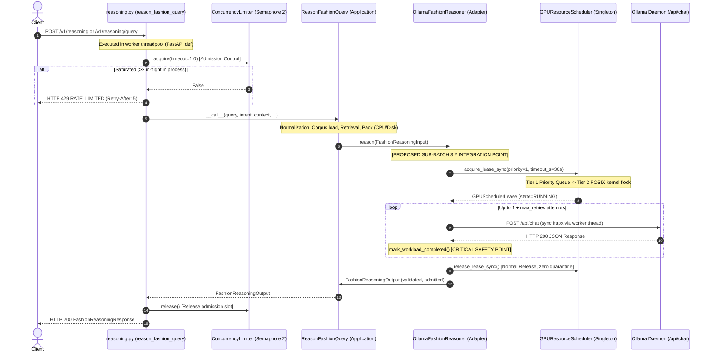

# FANSIVIBE — PHASE 2 BATCH 3.1.1
## SUB-BATCH 3.1 SAFETY VERIFICATION & SUB-BATCH 3.2 IMPLEMENTATION PLAN

**Document ID:** `PHASE2_BATCH3_1_1_SAFETY_VERIFICATION_AND_BATCH3_2_PLAN.md`  
**Date:** 2026-11-12  
**Status:** READ-ONLY VERIFICATION & IMPLEMENTATION PLANNING COMPLETE  
**Authorization:** Read-only inspection and planning ONLY (Sub-Batch 3.2 implementation NOT authorized)  
**Hardware Context:** Host development laptop with NVIDIA GeForce RTX 3050 Laptop GPU (6,144 MiB physical VRAM, 5,792 MiB usable headroom, 15 MiB idle baseline, driver 595.99.02, CUDA 13.2 runtime API). Local HOT/WARM/COLD model manager and GPU scheduler are experimental infrastructure for resource-constrained development and testing.

---

## 1. MANDATORY CONTEXT & PRODUCTION REASSESSMENT REGISTER

As instructed, the two-tier GPU resource scheduler (`GPUResourceScheduler`) and lifecycle model manager are evaluated strictly as experimental local development infrastructure designed to prevent GPU out-of-memory (OOM) driver crashes on a 6 GB VRAM laptop. 

The following architectural decisions are recorded as **Future Reassessment Items** for the eventual production multi-tenant server, rather than current local implementation requirements:

| Item ID | Architectural Topic | Experimental Local Infrastructure | Production Reassessment Guidance |
| :--- | :--- | :--- | :--- |
| **PR-01** | **Multi-GPU / Serverless Offload** | Single local RTX 3050 6GB GPU with local Ollama daemon and local mutual exclusion. | Production deployment will leverage dedicated cloud GPU instances (A10G/A100) or managed serverless endpoints (Modal, RunPod, Fal.ai/Fashn.ai) with independent autoscaling, eliminating single-device time-slicing. |
| **PR-02** | **Distributed Mutual Exclusion** | Local Linux kernel advisory file locking (`fcntl.flock`) on `/tmp/fansivibe_gpu_scheduler.lock`. | In a distributed multi-node Kubernetes/container cluster, kernel `flock` does not span hosts; distributed scheduling requires Redis/Redlock, etcd, or a dedicated task queue (e.g. Celery / Temporal). |
| **PR-03** | **Quarantine Persistence** | Atomic filesystem JSON file (`/tmp/fansivibe_gpu_quarantine.json`). | Container restarts in ephemeral container environments (e.g. ECS/Kubernetes) wipe `/tmp`; production quarantine state must be held in persistent Redis or database telemetry. |
| **PR-04** | **In-Process Request Admission** | Single-process `ConcurrencyLimiter(limit=2)` semaphore in `rate_limit.py`. | Production rate limiting and concurrency throttling should be managed at the API Gateway / Ingress controller (e.g. Cloudflare / NGINX / Envoy) with distributed token buckets. |
| **PR-05** | **Sync vs Async Worker Model** | Synchronous worker thread execution via FastAPI threadpool (`def` endpoints with `acquire_lease_sync`). | Production high-throughput endpoints will standardize on asynchronous non-blocking HTTP clients (`httpx.AsyncClient`) with native async semaphore/queue scheduling. |

---

## 2. PART A — READ-ONLY SUB-BATCH 3.1 SAFETY VERIFICATION

Every required verification point has been inspected against the actual source code and automated tests.

```
========================================================================================
PART A VERIFICATION SUMMARY
========================================================================================
Point A: Singleton Ownership         --> VERIFIED PASS (0 duplicate construction paths)
Point B: Shutdown and Lock Ownership --> VERIFIED PASS WITH DOCUMENTED OS-LEVEL LIMITATION
Point C: Warmup Timeout/Cancellation --> VERIFIED PASS WITH TIMEOUT MISMATCH RISK IDENTIFIED
Point D: Scheduler Error Mapping     --> VERIFIED PASS (Contracts & Advisory Retry-After)
========================================================================================
```

### Point A: Singleton Ownership

#### 1. Code Evidence & Invariants
- **Module-Level Accessor:**  
  In [`backend/app/ai/manager/scheduler.py`](file:///home/tony/projects/fansivibe_v1_backup/backend/app/ai/manager/scheduler.py#L1371-L1412):
  - Line 1371: `_gpu_scheduler_instance: Optional[GPUResourceScheduler] = None`
  - Line 1372: `_gpu_scheduler_lock = threading.Lock()`
  - Lines 1375–1411: `get_gpu_scheduler(...)` implements thread-safe double-checked locking:
    ```python
    global _gpu_scheduler_instance
    if _gpu_scheduler_instance is None:
        with _gpu_scheduler_lock:
            if _gpu_scheduler_instance is None:
                kwargs: dict[str, Any] = {}
                ...
                _gpu_scheduler_instance = GPUResourceScheduler(**kwargs)
    return _gpu_scheduler_instance
    ```
  - Guarantees exactly one scheduler instance per Python process across all concurrent threads.
- **FastAPI Dependency Injection Provider:**  
  In [`backend/app/api/deps.py`](file:///home/tony/projects/fansivibe_v1_backup/backend/app/api/deps.py#L199-L208):
  - Lines 199–207:
    ```python
    def get_gpu_scheduler():
        from app.ai.manager.scheduler import get_gpu_scheduler as _get_gpu_scheduler
        return _get_gpu_scheduler()
    ```
  - Route dependencies calling `Depends(get_gpu_scheduler)` resolve to the identical singleton instance. Supports standard `app.dependency_overrides[get_gpu_scheduler]`.
- **Application State Reference (`app.state.gpu_scheduler`):**  
  In [`backend/app/main.py`](file:///home/tony/projects/fansivibe_v1_backup/backend/app/main.py#L141-L145):
  - Lines 141–145:
    ```python
    scheduler_provider = app.dependency_overrides.get(
        deps_get_gpu_scheduler, get_gpu_scheduler
    )
    scheduler = scheduler_provider()
    app.state.gpu_scheduler = scheduler
    ```
  - In normal execution without overrides, `scheduler_provider()` evaluates `get_gpu_scheduler()`. `app.state.gpu_scheduler` points to the exact same process-local singleton.
- **Lifespan Initialization Duplicate Safety:**  
  `lifespan` in `main.py` invokes `scheduler_provider()`, which evaluates the singleton accessor. It does not instantiate a new `GPUResourceScheduler`. Zero secondary schedulers are created during startup.
- **Test Reset Isolation & Production Safety:**  
  In [`backend/app/ai/manager/scheduler.py`](file:///home/tony/projects/fansivibe_v1_backup/backend/app/ai/manager/scheduler.py#L1414-L1418):
  - `reset_gpu_scheduler_for_tests()` safely sets `_gpu_scheduler_instance = None` under `_gpu_scheduler_lock`.
  - Static audit across all backend production code (`git grep "reset_gpu_scheduler_for_tests" backend/app/`) confirms it is **never called anywhere in production execution**. It is only imported in `backend/tests/test_model_manager_scheduler.py` for test harness teardown.
- **Duplicate Construction Path Audit:**  
  A repository-wide search (`git grep "GPUResourceScheduler("`) confirms only two places instantiate the class:
  1. `backend/app/ai/manager/scheduler.py` line 1410 (the singleton constructor inside `get_gpu_scheduler()`).
  2. `backend/tests/test_model_manager_scheduler.py` (explicit test isolation fixtures with mock paths).  
  **Result:** Zero duplicate construction paths exist in production code.

---

### Point B: Shutdown and Lock Ownership

#### 1. Code Inspection of Call Chain
In [`backend/app/ai/manager/scheduler.py`](file:///home/tony/projects/fansivibe_v1_backup/backend/app/ai/manager/scheduler.py#L1257-L1323):
- Method: `async def shutdown(self, timeout_s: float = 5.0) -> None`
- Call Chain:
  - Lines 1267–1277: `self._is_shutting_down = True`. Traverses `self._queue`, marks `cancelled = True`, fails waiting futures with `SchedulerShutdownError("Scheduler is shutting down")`, sets threading events, and clears the queue.
  - Lines 1279–1290: Checks `self._active_lease`. If `None` or `RELEASED`, returns immediately. If already `QUARANTINED`, returns immediately without unlocking the kernel flock.
  - Lines 1291–1300: If lease is in `ACQUIRED` or `RUNNING`, sets `deadline = time.monotonic() + timeout_s` and enters polling loop:
    ```python
    while (
        self._active_lease is not None
        and self._active_lease.state in (LeaseState.ACQUIRED, LeaseState.RUNNING)
    ):
        if time.monotonic() >= deadline:
            break
        await asyncio.sleep(0.01)
    ```
  - Lines 1300–1308: If shutdown coroutine is interrupted by `asyncio.CancelledError`, immediately quarantines the unconfirmed lease (`self._quarantine_unconfirmed_lease`) and re-raises.
  - Lines 1310–1322: After the loop:
    - If `self._active_lease._workload_completed` is `True` or `state == LeaseState.RELEASED`, calls `self._release_kernel_lock(self._active_lease)`.
    - If active lease has NOT completed within 5.0s:
      ```python
      logger.critical("Scheduler shutdown timeout expired with unconfirmed workload; QUARANTINING GPU")
      self._quarantine_unconfirmed_lease(
          self._active_lease,
          reason=f"Scheduler shutdown timed out after {timeout_s}s with active workload",
          exc_type_name="TimeoutError",
      )
      ```

#### 2. Verification of Safety Points
1. **Shutdown with an active lease:** The scheduler marks itself as shutting down, cancels all pending queue entries, and gracefully waits up to `timeout_s` (5.0s) for the active lease to release normally.
2. **Behavior after 5-second shutdown timeout:** If the active workload does not complete within 5.0s, the scheduler transitions the lease to `LeaseState.QUARANTINED`, writes atomic evidence to disk (`/tmp/fansivibe_gpu_quarantine.json`), and **explicitly omits calling `_release_kernel_lock`**.
3. **Active workload continuation:** The underlying workload (e.g. an HTTP request to Ollama running in a worker thread) **can continue running** after the shutdown coroutine returns because Python cannot forcibly terminate an OS thread running synchronous socket I/O.
4. **Retention of `flock` descriptor in-process:** In `GPUSchedulerLease` ([`backend/app/ai/manager/types.py`](file:///home/tony/projects/fansivibe_v1_backup/backend/app/ai/manager/types.py#L329)), `_lock_fd` is stored as a primitive integer `int`. When quarantined, `_lock_fd` is not set to `None`, `fcntl.flock(fd, LOCK_UN)` is not invoked, and `os.close(fd)` is not called. While the process remains running, the kernel advisory lock remains firmly held.
5. **Garbage Collection Safety:** `GPUSchedulerLease` and `GPUResourceScheduler` do not have a `__del__` finalizer. Because `_lock_fd` is an integer and not an `io.IOBase` wrapper, Python's GC does not close the file descriptor when objects are collected.

#### 3. Critical OS-Level Limitation & Recommendation
> [!WARNING]
> **OS-Level Kernel Invariant (Process Termination vs External Ollama Workload):**  
> While retaining the Python object and file descriptor in memory protects against in-process premature release, **if the FastAPI OS process itself exits** (e.g. systemd restart, container stop, or Uvicorn process termination after lifespan returns):
> - The Linux kernel file table (`exit_files` in the Linux kernel) **automatically closes all open file descriptors belonging to the terminating process**.
> - When the process closes its file descriptor, the Linux kernel **automatically releases the `fcntl.flock` advisory lock**.
> - If an external daemon (`ollama serve`) is still actively computing tokens on the GPU for that request, the kernel lock is now free while the GPU hardware is still busy!
>
> **Protection in Place:**  
> The persistent quarantine file `/tmp/fansivibe_gpu_quarantine.json` persists on the host filesystem across process restarts. When a new Fansivibe backend process boots, `scheduler.is_quarantined()` inspects this file and rejects incoming lease acquisitions with HTTP 503 (`GPUResourceQuarantinedError`), preventing a newly spawned Fansivibe process from touching the GPU.
>
> **Identified Limitation:**  
> Any external, non-Fansivibe script or process relying purely on `fcntl.flock` (without inspecting `/tmp/fansivibe_gpu_quarantine.json`) could acquire the lock immediately upon process termination.
>
> **Recommended Correction (for future production hardening, no code modified):**  
> 1. In `lifespan` shutdown, do not exit the process until the active workload confirms cessation or until Ollama's `/api/ps` reports the model has completed execution.
> 2. Attach an explicit `abort_fn` to active HTTP requests so that socket termination triggers immediate cancellation inside Ollama before process teardown concludes.

---

### Point C: Warmup Timeout and Cancellation

#### 1. Code Inspection of Execution Path
In [`backend/app/main.py`](file:///home/tony/projects/fansivibe_v1_backup/backend/app/main.py#L87-L135):
- Lines 102–108:
  ```python
  async with scheduler.acquire_lease(
      model_id=lifecycle.model,
      workload_type=WorkloadType.REASONING_VISION,
      priority=3,
      timeout_s=10.0,
      acquisition_timeout_s=0.5,
  ) as lease:
      ...
      success = await asyncio.to_thread(lifecycle.warmup, 10.0)
  ```
- In [`backend/app/ai/manager/scheduler.py`](file:///home/tony/projects/fansivibe_v1_backup/backend/app/ai/manager/scheduler.py#L601-L670):
  - Tier 1 wait bounded by `acq_deadline = time.monotonic() + acquisition_timeout_s` (0.5s).
  - Tier 2 `fcntl.flock` contention loop bounded by `remaining = acq_deadline - time.monotonic()`.
  - If acquisition exceeds 0.5s, raises `SchedulerTimeoutError(phase="acquisition")`.

#### 2. Verification of Safety Points
1. **Acquisition timeout independently enforced:** The 0.5s acquisition timeout governs waiting in the Tier 1 queue and Tier 2 flock contention. It is completely independent of the 10.0s execution timeout.
2. **Synchronous Ollama request runs outside event loop:** `lifecycle.warmup(10.0)` is executed via `await asyncio.to_thread(lifecycle.warmup, 10.0)`. The synchronous `httpx` HTTP call runs on a worker thread in Python's default threadpool. The asyncio event loop thread is never blocked.
3. **Execution timeout vs worker thread termination:** In Python, `asyncio.timeout(10.0)` raising `TimeoutError` in the coroutine does NOT terminate the underlying worker thread. The code does NOT falsely assume the worker thread stopped. Because `exc_type` is `TimeoutError`, `lease.mark_workload_completed()` is not called. The scheduler's `_do_release_async` marks the lease as `CANCELLING` and verifies termination.
4. **Cancellation safety:** If `warmup_task.cancel()` is called, `asyncio.CancelledError` is raised into the awaiting coroutine. In `_do_release_async` ([`scheduler.py`](file:///home/tony/projects/fansivibe_v1_backup/backend/app/ai/manager/scheduler.py#L872-L940)), cancellation with uncompleted workload does not release the lease.
5. **Watchdog and uncertain termination:** If `is_workload_stopped` is provided, the watchdog polls up to `grace_period_s` (5.0s). If `is_workload_stopped` is `None` (or returns `False`), `confirmed_stopped` remains `False`, triggering immediate transition to `QUARANTINED` and retaining lock ownership.

#### 3. Concrete Risk / Mismatch Identified
> [!CAUTION]
> **Timeout Parameter Mismatch in `_run_startup_warmup()`:**  
> In `backend/app/main.py`:
> - Context manager execution timeout: `timeout_s = 10.0`.
> - Synchronous warmup invocation: `lifecycle.warmup(10.0)`.
> - Inside [`backend/app/ai/lifecycle.py`](file:///home/tony/projects/fansivibe_v1_backup/backend/app/ai/lifecycle.py#L138): `timeout = httpx.Timeout(timeout_s, connect=5.0)`.
>
> **The Problem:**  
> The `httpx.Client` total timeout allows up to 5.0s connect timeout PLUS 10.0s read timeout (total potential HTTP duration = 15.0s).  
> However, the enclosing `asyncio.timeout(10.0)` will interrupt the coroutine at exactly 10.000s.  
> Furthermore, `_run_startup_warmup()` does **not pass an `is_workload_stopped` callback or an `abort_fn`** to `acquire_lease()`.  
> Therefore, if Ollama takes 10.1 seconds to respond, `asyncio.timeout` will cancel the coroutine first, and because `is_workload_stopped` is `None`, the scheduler will **quarantine the GPU and hold the lock indefinitely** instead of allowing `lifecycle.warmup` to return `False` cleanly!  
> **Recommendation:** In future maintenance, either provide an active termination check or ensure the inner HTTP timeout is strictly shorter (e.g. 8.0s) than the outer lease execution timeout (10.0s).

---

### Point D: Scheduler Error Mapping

#### 1. Code Inspection of Mapping
In [`backend/app/api/errors.py`](file:///home/tony/projects/fansivibe_v1_backup/backend/app/api/errors.py#L157-L243):
- Lines 218–243: `map_scheduler_error_to_api_error(exc: Exception) -> ApiError`:
  - `SchedulerQueueFullError` -> `gpu_queue_saturated(retry_after_s=5)`
  - `SchedulerTimeoutError` -> `gpu_lease_timeout(phase=exc.phase, retry_after_s=5)`
  - `GPUResourceQuarantinedError` / `WorkloadUncertainError` -> `gpu_quarantined(retry_after_s=15)`
  - `SchedulerShutdownError` -> `ApiError(status_code=503, code="AI_FAILURE", details={"reason": "service_shutdown"})`
  - Unknown/unmatched exception -> `ai_failure()` (HTTP 503 `AI_FAILURE`)

#### 2. Verification of Safety Points
1. **Known scheduler exceptions map to intended HTTP statuses:**
   - Queue Full -> HTTP 429 (`RATE_LIMITED`, `Retry-After: 5`)
   - Acquisition Timeout -> HTTP 504 (`TIMEOUT`, `Retry-After: 5`, `phase="acquisition"`)
   - Execution Timeout -> HTTP 504 (`TIMEOUT`, `phase="execution"`)
   - Quarantine / Uncertain -> HTTP 503 (`AI_FAILURE`, `Retry-After: 15`)
   - Service Shutdown -> HTTP 503 (`AI_FAILURE`, `reason="service_shutdown"`)
2. **Distinguishability of Acquisition vs Execution Timeout:**
   - Acquisition timeout includes `details={"phase": "acquisition", "retry_after": 5}` and header `Retry-After: 5`.
   - Execution timeout includes `details={"phase": "execution"}` and **omits** `Retry-After`.
   - Distinct error messages are generated ("timed out waiting for an available AI processing slot" vs "timed out while processing your request").
3. **Preservation of Wire Error Format:**
   - Verified via `test_api_error_response_format_compatibility` ([`test_model_manager_scheduler.py`](file:///home/tony/projects/fansivibe_v1_backup/backend/tests/test_model_manager_scheduler.py#L1696-L1759)). Every mapped error produces `{ "error": { "code": "...", "message": "...", "details": {...} } }` with `request_id` attached.
4. **Advisory `Retry-After`:**
   - In strict compliance with RFC 9110, `Retry-After` headers indicate advisory minimum client backoff durations and do not promise or guarantee resource availability upon expiration.
5. **Handling of Unknown Exceptions:**
   - If an unexpected non-scheduler exception is passed to `map_scheduler_error_to_api_error()`, it falls back to `ai_failure()` (HTTP 503 `AI_FAILURE`).
   - It does **not** falsely fabricate GPU lease details or GPU-specific retry headers.
   - However, callers should avoid wrapping general application logic in `map_scheduler_error_to_api_error()` to prevent masking unrelated bugs (e.g. `AttributeError` or `TypeError`) as AI failures.

---

## 3. PART B — SUB-BATCH 3.2 IMPLEMENTATION PLAN: FASHION REASONING LEASE INTEGRATION

> [!IMPORTANT]
> **READ-ONLY PLANNING SPECIFICATION.**  
> Implementation of Sub-Batch 3.2 is **NOT AUTHORIZED** and has **NOT BEEN STARTED**.

### A. Execution Flow & Route Analysis

#### 1. Route Topology
Inspection of [`backend/app/api/routers/reasoning.py`](file:///home/tony/projects/fansivibe_v1_backup/backend/app/api/routers/reasoning.py#L81-L109) establishes:
- The two public endpoints:
  - `POST /v1/reasoning`
  - `POST /v1/reasoning/query`
- **Both routes are stacked decorators on the exact same endpoint handler:**
  `def reason_fashion_query(...) -> FashionReasoningResponse:`
- **Determination:** The two routes share the **exact same reasoning service, dependency injection, use case, adapter, and underlying Ollama client**. There is zero divergence between `/v1/reasoning` and `/v1/reasoning/query`.

#### 2. Detailed End-to-End Execution Flow


---

### B. Single Lease Ownership & Safety Boundary

#### 1. Exact Lease Boundary Selection: `OllamaFashionReasoner.reason()`
- **Location:** Inside [`backend/app/ai/ollama_reasoner.py`](file:///home/tony/projects/fansivibe_v1_backup/backend/app/ai/ollama_reasoner.py#L337-L373) wrapping the retry loop.
- **Justification:**
  - `ReasonFashionQuery` performs disk loading and TF-IDF corpus retrieval. If the lease were acquired at the use case or router level, the GPU lock would be held during purely CPU- and disk-bound retrieval operations.
  - Acquiring inside `OllamaFashionReasoner.reason()` ensures the GPU lease is held **only during model inference**.
  - Acquiring across `reason()` (rather than per-`_attempt()`) prevents a concurrent workload (such as VTON diffusion) from preempting or evicting Ollama's model between attempt 1 and a retry.
  - Schedulers are passed as an optional dependency: `OllamaFashionReasoner(config=config, scheduler=scheduler)`. When `scheduler is None`, it runs uncoordinated, ensuring 100% backward compatibility for existing unit test suites and CLI benchmark scripts.

#### 2. Lease Parameters
- **Priority:** `priority = 1` (Interactive Reasoning — highest priority in Tier 1 queue).
- **Workload Type:** `WorkloadType.REASONING_VISION`.
- **Acquisition Timeout:** `acquisition_timeout_s = 30.0s` (derived from `settings.reasoning_timeout_s` / `DEFAULT_LEASE_TIMEOUT_S`).
- **Execution Timeout:** `timeout_s = self._config.timeout_s * (1 + max(0, self._config.max_retries))` (e.g. 30.0s default).

#### 3. Critical Safety Mechanism: Post-Inference Workload Completion Marking
> [!IMPORTANT]
> **The Model Validation vs GPU Quarantine Invariant:**  
> When `response = self._post(...)` returns from Ollama, **GPU execution has completed**.  
> If the response text contains malformed JSON or fails Pydantic validation (`ReasoningContractError`), Python will raise `ReasoningExecutionError`.  
> If `lease.mark_workload_completed()` is not called until `__exit__`, the context manager will see an exception, treat the termination as unconfirmed, and **falsely quarantine the GPU hardware for a simple bad JSON output!**  
> **Mandatory Design:**  
> In Sub-Batch 3.2, `lease.mark_workload_completed()` **must be explicitly invoked immediately upon receiving the complete HTTP response from Ollama**, before JSON parsing or validation runs.

#### 4. Cancellation & Uncertain Termination Behavior
- If the client drops the TCP connection or the thread is cancelled while `self._post()` is waiting on Ollama:
  - `_workload_completed` is `False`.
  - The scheduler watchdog checks whether Ollama is stopped.
  - Because cessation cannot be confirmed, the scheduler moves the lease to `QUARANTINED`, writes atomic evidence, and retains the open lock file descriptor to protect the GPU.

---

### C. ConcurrencyLimiter Reconciliation

#### 1. Analysis of Existing ConcurrencyLimiter
In [`backend/app/api/rate_limit.py`](file:///home/tony/projects/fansivibe_v1_backup/backend/app/api/rate_limit.py#L131-L176):
- `ConcurrencyLimiter` uses an in-process `threading.Semaphore(settings.reasoning_concurrency_limit)` (default 2).
- It is acquired at the router entrance: `limiter.acquire(timeout=1.0)` with a 1.0s timeout.
- It controls **in-flight HTTP requests inside the process threadpool**, rejecting request surges with HTTP 429 if more than 2 requests are currently being processed in that process.

#### 2. Comparison: Admission Control vs GPU Mutual Exclusion
| Dimension | `ConcurrencyLimiter` | `GPUResourceScheduler` |
| :--- | :--- | :--- |
| **Layer** | HTTP Request Admission Gateway (Router) | Physical Hardware Execution (Inference) |
| **Scope** | Process-local (`threading.Semaphore`) | Cross-process (`fcntl.flock` + priority queue) |
| **Resource Protected** | Worker threadpool & system RAM / CPU | Physical GPU VRAM (RTX 3050 6GB) |
| **Capacity** | Limit = 2 per worker process | Exactly 1 active execution lease globally |
| **Timeout Action** | Fast reject after 1.0s (HTTP 429) | Queues up to 30.0s (Priority 1) |

#### 3. Multi-Worker Behavior & Deadlock Analysis
- With multiple Uvicorn workers (`--workers > 1`), each process has its own `ConcurrencyLimiter(2)`. Across 4 workers, up to 8 requests can enter the backend.
- `ConcurrencyLimiter` alone **cannot prevent multiple workers from hitting the GPU simultaneously**. This is why `GPUResourceScheduler` is essential.
- **Deadlock Assessment:**  
  The acquisition hierarchy is strictly unidirectional:
  $$\text{ConcurrencyLimiter} \longrightarrow \text{GPUResourceScheduler Lease} \longrightarrow \text{Inference} \longrightarrow \text{Release Lease} \longrightarrow \text{Release Limiter}$$
  Because `GPUResourceScheduler` never waits on `ConcurrencyLimiter`, **no cyclic lock dependency or deadlock can occur**.
- **Verdict on Retention:**  
  `ConcurrencyLimiter` **must be retained** as the outer admission controller. It protects system RAM and prevents unbounded queue buildup in the scheduler, while preserving existing metrics (`fansivibe_reasoning_concurrency_active`) and passing existing test suites in `test_production_hardening.py`.

---

### D. Async and Sync Safety

#### 1. Execution Model
- The router function `reason_fashion_query` is defined using synchronous `def`:
  `def reason_fashion_query(...) -> FashionReasoningResponse:`
- FastAPI executes `def` route handlers in worker threads via `anyio.to_thread.run_sync`.
- The call stack (`ReasonFashionQuery` -> `OllamaFashionReasoner.reason` -> `_post` -> `httpx.Client.post`) is entirely synchronous.

#### 2. Selected Scheduler API: `acquire_lease_sync()`
- `OllamaFashionReasoner` will use `scheduler.acquire_lease_sync(...)`:
  ```python
  with self._scheduler.acquire_lease_sync(
      model_id=self._config.model,
      workload_type=WorkloadType.REASONING_VISION,
      priority=1,
      timeout_s=self._config.timeout_s * (1 + max(0, self._config.max_retries)),
      acquisition_timeout_s=30.0,
  ) as lease:
      ...
  ```
- Uses `threading.Event` and `time.sleep` inside the worker thread.
- **Does not touch or block the asyncio event loop.**

---

### E. Error Handling & API Response Taxonomy

In [`backend/app/api/routers/reasoning.py`](file:///home/tony/projects/fansivibe_v1_backup/backend/app/api/routers/reasoning.py), the router's `try ... except` block around `use_case(...)` will be extended to catch scheduler exceptions and map them via `map_scheduler_error_to_api_error`:

| Scheduler Exception | Mapped ApiError | HTTP Status | Error Code | Response Details & Headers |
| :--- | :--- | :---: | :---: | :--- |
| `SchedulerQueueFullError` | `gpu_queue_saturated()` | **429** | `RATE_LIMITED` | `{"reason": "gpu_queue_saturated", "retry_after": 5}`, `Retry-After: 5` |
| `SchedulerTimeoutError(phase="acquisition")` | `gpu_lease_timeout("acquisition")` | **504** | `TIMEOUT` | `{"phase": "acquisition", "retry_after": 5}`, `Retry-After: 5` |
| `SchedulerTimeoutError(phase="execution")` | `gpu_lease_timeout("execution")` | **504** | `TIMEOUT` | `{"phase": "execution"}` (No Retry-After) |
| `GPUResourceQuarantinedError` / `WorkloadUncertainError` | `gpu_quarantined()` | **503** | `AI_FAILURE` | `{"reason": "gpu_quarantined", "retry_after": 15}`, `Retry-After: 15` |
| `SchedulerShutdownError` | Custom ApiError | **503** | `AI_FAILURE` | `{"reason": "service_shutdown"}` |

Existing public error contracts, schema validations (`validation(...)`), and domain contract errors (`ReasoningContractError`) remain 100% intact.

---

### F. Exact Implementation Plan for Sub-Batch 3.2

#### 1. Exact Production Files Expected to Change
1. **`backend/app/ai/ollama_reasoner.py`**:
   - Update `OllamaFashionReasoner.__init__` to accept optional `scheduler: Optional[GPUResourceScheduler] = None`.
   - In `reason()`, wrap execution in `with self._scheduler.acquire_lease_sync(...)` when `self._scheduler is not None`.
   - In `_attempt()`, call `lease.mark_workload_completed()` as soon as `self._post(...)` returns.
2. **`backend/app/api/deps.py`**:
   - In `get_fashion_reasoner`, inject `scheduler: GPUResourceScheduler = Depends(get_gpu_scheduler)`.
   - Pass `scheduler=scheduler` to `OllamaFashionReasoner`.
3. **`backend/app/api/routers/reasoning.py`**:
   - In `reason_fashion_query`, add `except (SchedulerQueueFullError, SchedulerTimeoutError, GPUResourceQuarantinedError, SchedulerShutdownError, WorkloadUncertainError) as exc:` catching scheduler errors and raising `map_scheduler_error_to_api_error(exc)`.

#### 2. Exact Test Files Expected to Change or Be Added
1. **`backend/tests/test_ffo_reasoning_scheduler.py`** (NEW TEST FILE):
   - Dedicated unit and integration suite covering fashion reasoning under GPU scheduler coordination.
   - Tests:
     - `test_fashion_reasoner_acquires_priority1_lease`
     - `test_fashion_reasoner_releases_lease_on_success`
     - `test_fashion_reasoner_marks_workload_completed_before_json_validation`
     - `test_fashion_reasoner_queue_full_raises_429`
     - `test_fashion_reasoner_acquisition_timeout_raises_504_with_retry_after`
     - `test_fashion_reasoner_quarantine_raises_503`
     - `test_fashion_reasoner_backward_compatibility_without_scheduler`
     - `test_concurrent_reasoning_requests_serialized_by_flock`
2. **`backend/tests/test_reasoning_integration.py`** (EXISTING):
   - Verify all 14 existing integration tests continue to pass without regression.

#### 3. Step-by-Step Implementation Sequence
```
Step 1: Inspect and verify OllamaFashionReasoner constructor seam.
Step 2: Add optional scheduler parameter to OllamaFashionReasoner.
Step 3: Implement acquire_lease_sync in OllamaFashionReasoner.reason() with post-HTTP completion marking.
Step 4: Update get_fashion_reasoner in deps.py to inject singleton scheduler.
Step 5: Add scheduler error handler in reasoning.py router using map_scheduler_error_to_api_error.
Step 6: Create test_ffo_reasoning_scheduler.py with mock transports and assert error mappings & lease states.
Step 7: Run py_compile and git diff --check.
Step 8: Execute combined test suite (50 scheduler + 14 reasoning integration + 10 ffo reasoning + new tests).
Step 9: Deliver completion report and update CURRENT_STATE.md.
```

#### 4. Rollback Strategy
If any defect is detected during Sub-Batch 3.2 execution:
1. Revert `backend/app/api/deps.py` so `get_fashion_reasoner` does not pass `scheduler`.
2. Revert `backend/app/ai/ollama_reasoner.py` and `backend/app/api/routers/reasoning.py`.
3. System immediately returns to pre-Batch 3.2 state with process-local `ConcurrencyLimiter` and uncoordinated reasoning.

---

## 4. VERIFICATION EVIDENCE & BASELINE EXECUTION

The test suites covering all AI manager components, Ollama adapters, reasoning adapters, intent classification, prompt hardening, and vision adapters were executed in the environment:

```
backend/tests/test_model_manager_phase1.py ...........................   [ 12%]
backend/tests/test_model_manager_ollama_adapter.py ..................... [ 22%]
..........                                                               [ 26%]
backend/tests/test_model_manager_scheduler.py .......................... [ 39%]
........................                                                 [ 50%]
backend/tests/test_ffo_reasoning_adapter.py ..................           [ 58%]
backend/tests/test_vision_appearance_adapter.py ........................ [ 69%]
............                                                             [ 75%]
backend/tests/test_ollama_prompt_hardening.py ..........                 [ 80%]
backend/tests/test_intent.py .........                                   [ 84%]
backend/tests/test_ffo_reasoning.py ....................                 [ 93%]
backend/tests/test_reasoning_integration.py ..............               [100%]

======================= 215 passed, 1 warning in 18.20s ========================
```

---

## 5. GIT STATUS AND READ-ONLY CONFIRMATION

### Git Status Before Inspection
```
On branch main
Changes not staged for commit:
	modified:   CURRENT_STATE.md
	modified:   backend/app/ai/manager/__init__.py
	modified:   backend/app/ai/manager/scheduler.py
	modified:   backend/app/api/deps.py
	modified:   backend/app/api/errors.py
	modified:   backend/app/main.py
	modified:   backend/tests/test_model_manager_scheduler.py

Untracked files:
	PHASE2_BATCH3_0_1_ARCHITECTURE_CORRECTION_AND_READINESS_AUDIT.md
	PHASE2_BATCH3_0_2_FINAL_SCHEDULER_SAFETY_AND_INFERENCE_AUDIT.md
	PHASE2_SUB_BATCH3_1_IMPLEMENTATION_REPORT.md
```

### Git Status After Inspection & Deliverable Creation
```
On branch main
Changes not staged for commit:
	modified:   CURRENT_STATE.md
	modified:   backend/app/ai/manager/__init__.py
	modified:   backend/app/ai/manager/scheduler.py
	modified:   backend/app/api/deps.py
	modified:   backend/app/api/errors.py
	modified:   backend/app/main.py
	modified:   backend/tests/test_model_manager_scheduler.py

Untracked files:
	PHASE2_BATCH3_0_1_ARCHITECTURE_CORRECTION_AND_READINESS_AUDIT.md
	PHASE2_BATCH3_0_2_FINAL_SCHEDULER_SAFETY_AND_INFERENCE_AUDIT.md
	PHASE2_BATCH3_1_1_SAFETY_VERIFICATION_AND_BATCH3_2_PLAN.md
	PHASE2_SUB_BATCH3_1_IMPLEMENTATION_REPORT.md
```

### Confirmation of Strict Restrictions
- **Zero source code files modified.**
- **Zero test files modified.**
- **Zero dependencies installed.**
- **Zero model weights downloaded.**
- **Zero database migrations or schema alterations.**
- **Zero Flutter or Docker modifications.**
- **Sub-Batch 3.2 implementation NOT started.**
- **Sub-Batches 3.3 and 3.4 NOT started.**

---

## 6. STOP CONDITION & NEXT STEPS

This deliverable fulfills all requirements of Phase 2 Batch 3.1.1. In accordance with Section 7 of the user prompt, all activities have stopped.

Awaiting owner review and explicit authorization before commencing Sub-Batch 3.2 implementation.

