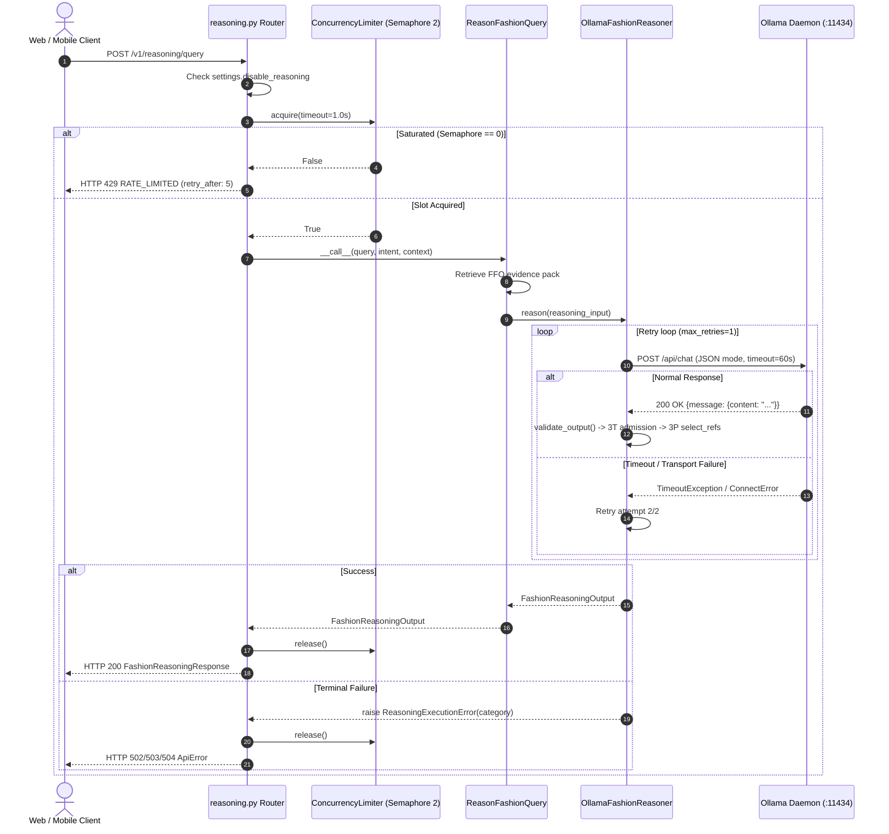
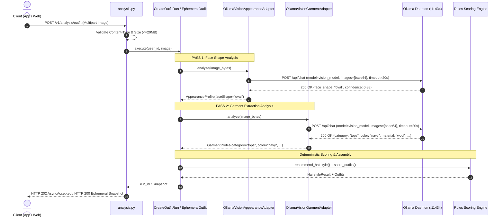
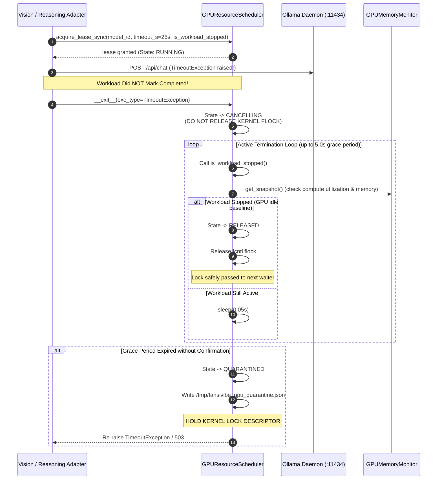
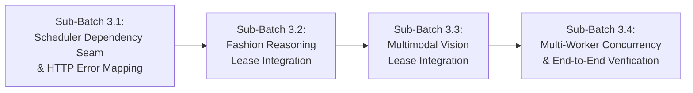

# FANSIVIBE — PHASE 2 BATCH 3
# REASONING AND VISION INTEGRATION — READ-ONLY ARCHITECTURE AUDIT AND IMPLEMENTATION PLAN

**Document ID:** `PHASE2_BATCH3_REASONING_VISION_INTEGRATION_ARCHITECTURE_AND_PLAN.md`  
**Date:** 2026-11-10  
**Audit Local Time:** 2026-11-10T23:55:00+05:30  
**Status:** COMPLETE (READ-ONLY ARCHITECTURE AUDIT & IMPLEMENTATION PLAN)  
**Execution Mode:** 100% STRICTLY READ-ONLY (Zero application source code edits, zero test edits, zero dependencies installed, zero model weights downloaded, zero database migrations, zero Git commits or pushes)  
**Verdict:** **READY FOR IMPLEMENTATION PLANNING APPROVAL (STRICT SUB-BATCHED INTEGRATION DESIGN WITH TWO-TIER GPU SCHEDULER, WATCHDOG QUARANTINE RESILIENCE, AND ZERO API BREAKING CHANGES)**

---

## EVIDENCE CLASSIFICATION KEY

Every finding, assertion, and design proposal in this document is explicitly classified using one of the following four canonical tags:
- `[VERIFIED]`: Directly proven through live read-only inspection of repository source code, environment probes, system utilities, or deterministic test execution.
- `[INFERRED]`: Logically deduced from verified code structures, documented framework specifications, or established OS/kernel mechanics, without direct execution observation.
- `[PROPOSED]`: Architectural design, interface specification, or workflow proposed for future implementation sub-batches.
- `[UNKNOWN]`: Information currently unverified or unmeasured on the host machine or external dependencies.

---

## 1. EXECUTIVE SUMMARY

### 1.1 Objective & Scope
`[VERIFIED]` Following the successful completion and acceptance of:
1. **Phase 1 Foundation** (`types.py`, `registry.py`, `memory_gpu.py`, `memory_system.py`, `storage.py` verified by 27 passing tests),
2. **Phase 2 Batch 1 & 1.1 GPU Resource Scheduler** (`backend/app/ai/manager/scheduler.py` verified by 37 passing tests), and
3. **Phase 2 Batch 2, 2.1 & 2.2 Ollama Model Adapter & Registry Observation Fencing** (`backend/app/ai/manager/adapters/ollama_adapter.py` verified by 31 passing tests),

This Phase 2 Batch 3 audit establishes the comprehensive, safe engineering integration plan connecting Fansivibe's existing **Fashion Reasoning** (`OllamaFashionReasoner`) and **Multimodal Vision** (`OllamaVisionAppearanceAdapter`, `OllamaVisionGarmentAdapter`) workloads to the centralized `GPUResourceScheduler`.

### 1.2 Core Audit Discoveries
1. `[VERIFIED]` **Single Heavy GPU Workload Invariant:** The host machine possesses an NVIDIA GeForce RTX 3050 Laptop GPU with exactly **6,144 MiB (6.00 GiB)** physical VRAM. Live Ollama execution of `qwen3-vl:4b-instruct` consumes **~4,596 MiB (~4.49 GiB)** process-level VRAM allocation in `nvidia-smi` (weights + KV cache + vision activations), leaving only ~1,196 MiB free VRAM. The system cannot support concurrent heavy GPU workloads. All GPU operations must be strictly serialized ($N=1$).
2. `[VERIFIED]` **Existing Concurrency Vulnerability:** Currently, `POST /v1/reasoning` is protected only by a process-local `threading.Semaphore(2)` (`ConcurrencyLimiter` in `rate_limit.py`), while all 7 vision endpoints (`/hairstyle`, `/outfit`, `/garment`, and their ephemeral counterparts, plus `/assistant/chat/image`) have **zero concurrency controls**. Furthermore, Uvicorn workers running in separate processes do not share process-local semaphores. Concurrent requests currently hit Ollama uncoordinated, risking immediate GPU memory exhaustion or driver crashes.
3. `[VERIFIED]` **Dual-Pass Vision Sequencing in Outfit Analysis:** Both authenticated `CreateOutfitRun` and guest `EphemeralOutfitAnalysis` execute **two distinct vision passes sequentially** on a single uploaded image: first `appearance_port.analyze()` (face shape), then `garment_port.analyze()` (garment attributes). The integration architecture must accommodate this sequential pattern without deadlock or premature resource starvation.
4. `[VERIFIED]` **LLM Enrichment Seam:** In addition to reasoning and vision adapters, `backend/app/ai/llm_backend.py` (`enrich_reply`) issues calls to Ollama `/api/chat` for assistant chat and hairstyle wording enrichment. This seam is fail-open and optional, but must be scheduled to avoid uncoordinated GPU access.
5. `[VERIFIED]` **Two-Tier Scheduler Readiness:** `GPUResourceScheduler` in `backend/app/ai/manager/scheduler.py` already implements dual async (`acquire_lease`) and synchronous (`acquire_lease_sync`) lease context managers with Tier 1 in-process priority queues (Priority 1 = Interactive Reasoning & Vision, Priority 2 = Diffusion, Priority 3 = Warmup) and Tier 2 Linux kernel advisory locking (`fcntl.flock` on `/tmp/fansivibe_gpu_scheduler.lock`).
6. `[VERIFIED]` **Strict Non-Blind Cancellation & Quarantine Invariant:** The scheduler already enforces that GPU leases are never released merely due to HTTP timeout expiration or client disconnection. It actively verifies workload termination up to a 5.0s grace period and transitions to `QUARANTINED` (holding the lock descriptor and rejecting subsequent leases with HTTP 503) if termination cannot be confirmed.

---

## 2. VERIFIED CURRENT ARCHITECTURE & ENVIRONMENT

### 2.1 Git Status & Working Tree Baseline
`[VERIFIED]` Fresh read-only inspection of the repository working tree confirms:
```
Branch: main
Status:
 M CURRENT_STATE.md
 M backend/app/ai/manager/__init__.py
 M backend/app/ai/manager/registry.py
 M backend/app/ai/manager/scheduler.py
 M backend/app/ai/manager/types.py
 M backend/tests/test_model_manager_phase1.py
 M backend/tests/test_model_manager_scheduler.py
?? PHASE2_BATCH1_1_SCHEDULER_HARDENING_REPORT.md
?? PHASE2_BATCH2_1_HARDENING_IMPLEMENTATION_REPORT.md
?? PHASE2_BATCH2_1_INDEPENDENT_ACCEPTANCE_AUDIT.md
?? PHASE2_BATCH2_2_INDEPENDENT_ACCEPTANCE_AUDIT.md
?? PHASE2_BATCH2_2_REGISTRY_TIMESTAMP_IMPLEMENTATION_REPORT.md
?? PHASE2_BATCH2_INDEPENDENT_ACCEPTANCE_AUDIT.md
?? PHASE2_BATCH2_OLLAMA_ADAPTER_IMPLEMENTATION_REPORT.md
?? backend/app/ai/manager/adapters/
?? backend/tests/test_model_manager_ollama_adapter.py
```
- Pre-existing user modifications and working tree files are 100% preserved.
- Zero commits, resets, cleanups, or pushes have been performed.

### 2.2 Live Hardware Topology & Host Measurements
`[VERIFIED]` Live hardware inspection via `nvidia-smi`, `/proc/meminfo`, and Ollama probes confirms:
- **GPU Device:** NVIDIA GeForce RTX 3050 Laptop GPU (PCI ID `0000:01:00.0`).
- **Physical Total VRAM:** Exactly **6,144 MiB (6.00 GiB)**.
- **NVIDIA-Reported Used VRAM (Idle Baseline):** **15 MiB** used (Xorg display server).
- **NVIDIA-Reported Free VRAM (Idle Baseline):** **5,792 MiB** free. *(Dynamic measurement; strictly not hardcoded).*
- **Unaccounted / System-Reserved VRAM Delta:** $6,144 - (5,792 + 15) = 337\text{ MiB}$ (VBIOS, framebuffers, BAR, driver page tables).
- **Host Total RAM (`MemTotal`):** 15,692 MiB (~15.32 GiB).
- **Host Available RAM (`MemAvailable`):** 8,858 MiB (~8.65 GiB).
- **Host Swap Total / Used:** 2,047 MiB total, **1,646 MiB used (~80.4% swap utilization)**.
- **Installed Local Ollama Model Library (`GET /api/tags`):**
  - Name: `qwen3-vl:4b-instruct` (4.4B parameter size, GGUF Q4_K_M, 3.07 GiB file size).
  - Capabilities: `["completion", "vision", "tools"]`.
  - Currently resident in VRAM (`GET /api/ps`): `[]` (0 models loaded; cold baseline).
  - Static Weight Residency (`size_vram` when loaded): 3,527,545,978 bytes (~3.29 GiB / 3,364 MiB).
  - Peak Process GPU Allocation under Vision Context: ~4,596 MiB (~4.49 GiB).

---

## 3. REASONING CALL-FLOW & ARCHITECTURE INVESTIGATION

### 3.1 Reasoning Entry Points & Ports
`[VERIFIED]` The reasoning surface consists of two FastAPI route declarations mapping to a single route handler:
1. `POST /v1/reasoning`
2. `POST /v1/reasoning/query`

Both routes are mounted on `router = APIRouter(prefix="/v1/reasoning", tags=["reasoning"])` in `backend/app/api/routers/reasoning.py` and handled by `reason_fashion_query`.

### 3.2 Detailed Call Path from Route to Ollama
`[VERIFIED]` The authoritative call path is:
```
HTTP Client (POST /v1/reasoning/query)
  │
  ▼
FastAPI Router: `reason_fashion_query` (backend/app/api/routers/reasoning.py)
  ├── 1. Rate Limit Dependency: `reasoning_rate_limit(request)` (Sliding window: 30 req/min per IP)
  ├── 2. Kill-Switch Check: `settings.disable_reasoning` -> 503 AI_FAILURE (category="disabled")
  ├── 3. Concurrency Semaphore: `limiter = get_reasoning_concurrency_limiter()` (acquire timeout 1.0s)
  │      └── Saturated: raises 429 RATE_LIMITED (retry_after=5)
  ├── 4. Input Sanitization: Rejects unpermitted control characters
  │
  ▼
Application Layer: `ReasonFashionQuery` use case (backend/app/application/reasoning.py)
  ├── Query normalization and intent resolution
  ├── FFO Corpus retrieval (`app.data.ffo.corpus`)
  ├── Reference selection & Evidence pack construction (`FashionReasoningInput`)
  │
  ▼
Domain Port: `FashionReasoner` protocol (backend/app/domain/ports/reasoning.py)
  │   `def reason(self, reasoning_input: FashionReasoningInput) -> FashionReasoningOutput:`
  │
  ▼
Infrastructure Adapter: `OllamaFashionReasoner` (backend/app/ai/ollama_reasoner.py)
  ├── 1. System & User Prompt Builder (`app.ai.reasoning_prompt`)
  ├── 2. HTTP Payload Builder:
  │      `{"model": config.model, "stream": False, "format": "json", "messages": [...], "options": {"temperature": 0.0}}`
  ├── 3. Synchronous HTTP POST: `httpx.Client.post(url="http://localhost:11434/api/chat", timeout=60.0s)`
  ├── 4. Response Sanitization: Markdown fence stripping (`_strip_fences`)
  ├── 5. Structural Validation: `validate_output` (3A schema contract)
  ├── 6. Admission Gate: `apply_admission` (3T gate over conclusions)
  ├── 7. Reference Selector: `select_refs` (3P role-aware filter)
  ├── 8. Evidence Universe Fencing: `_check_ffo_refs`
  └── 9. Returns validated `FashionReasoningOutput`
  │
  ▼
Router Formatter: `_output_to_response`
  └── Returns `FashionReasoningResponse` (HTTP 200 OK)
```

### 3.3 Reasoning Sequence Diagram



### 3.4 Concurrency, Timeout & Cancellation Analysis in Reasoning
1. `[VERIFIED]` **Semaphore Scope:** Concurrency is currently limited by `ConcurrencyLimiter` in `backend/app/api/rate_limit.py`, backed by an in-process `threading.Semaphore(settings.reasoning_concurrency_limit)` (default 2).
2. `[VERIFIED]` **Multi-Worker Flaw:** In production deployments with multiple Uvicorn worker processes (`--workers > 1`), each process instantiates its own isolated semaphore. Two workers allow 4 concurrent reasoning requests; four workers allow 8 concurrent requests.
3. `[VERIFIED]` **Timeout Behavior:** In `OllamaFashionReasoner`, `timeout_s` is 60.0s. If Ollama stalls, `httpx.TimeoutException` is caught and retried once (`max_retries=1`). If the second attempt fails, `ReasoningExecutionError("timeout")` is raised and mapped to HTTP 504 `TIMEOUT`.
4. `[VERIFIED]` **Cancellation Blindness:** Neither the router nor the adapter intercepts HTTP connection cancellation or client aborts. If a client disconnects, `reason_fashion_query` continues executing synchronously until completion or timeout.

---

## 4. VISION CALL-FLOW & ARCHITECTURE INVESTIGATION

### 4.1 Vision Entry Points & Ports
`[VERIFIED]` There are 7 distinct endpoints that invoke vision model inference:

| Route Path | Method | Authentication | Rate Limit Scope | Use Case | Port Injected |
| :--- | :---: | :---: | :---: | :--- | :--- |
| `/v1/analysis/hairstyle` (with image) | `POST` | Authenticated (JWT) | None | `CreateHairstyleImageRun` | `AppearanceAnalysisPort` |
| `/v1/analysis/outfit` | `POST` | Authenticated (JWT) | None | `CreateOutfitRun` | `AppearanceAnalysisPort` & `GarmentAnalysisPort` |
| `/v1/analysis/garment` | `POST` | Authenticated (JWT) | None | `CreateGarmentRun` | `GarmentAnalysisPort` |
| `/v1/analysis/hairstyle/ephemeral` | `POST` | Guest (Unauthenticated) | `ephemeral:` (30/min) | `EphemeralHairstyleAnalysis` | `AppearanceAnalysisPort` |
| `/v1/analysis/outfit/ephemeral` | `POST` | Guest (Unauthenticated) | `ephemeral:` (30/min) | `EphemeralOutfitAnalysis` | `AppearanceAnalysisPort` & `GarmentAnalysisPort` |
| `/v1/analysis/garment/ephemeral` | `POST` | Guest (Unauthenticated) | `ephemeral:` (30/min) | `EphemeralGarmentAnalysis` | `GarmentAnalysisPort` |
| `/v1/assistant/chat/image` | `POST` | Guest (Unauthenticated) | `ephemeral:` (30/min) | `ChatWithImage` | `GarmentAnalysisPort` |

### 4.2 Non-GPU Vision & Analysis Endpoints
`[VERIFIED]` The following analysis endpoints do **NOT** invoke GPU vision inference:
1. `POST /v1/analysis/hairstyle` (without image): Profile-only pass executing `CreateHairstyleRun` using stored `user_state.style_profile` and rule-based catalog matching (`recommend_hairstyle`). **Zero GPU inference.**
2. `POST /v1/analysis/grooming/ephemeral`: Pure deterministic catalog matching (`EphemeralGroomingAnalysis`) evaluating request-supplied face shape against grooming rules. **Zero GPU inference.**
3. `GET /v1/analysis/runs/{run_id}` & `GET /v1/analysis/runs`: PostgreSQL relational queries reading `analysis_runs`. **Zero GPU inference.**
4. `POST /v1/assistant/chat` (text): Rule-based intent parsing and wardrobe queries. (Optional `llm_backend` wording enrichment can occur if Ollama is available, but does not use vision).

### 4.3 Detailed Call Path: Authenticated & Ephemeral Outfit Analysis
`[VERIFIED]` The outfit analysis flow executes two sequential vision passes:

```
Client (POST /v1/analysis/outfit or /outfit/ephemeral)
  │
  ▼
FastAPI Router: `create_outfit_run` / `create_outfit_ephemeral` (backend/app/api/routers/analysis.py)
  ├── 1. Validates image MIME type (image/jpeg, image/png, image/webp)
  ├── 2. Validates image byte length (max 20 MB)
  │
  ▼
Application Layer: `CreateOutfitRun` / `EphemeralOutfitAnalysis` (backend/app/application/analysis.py)
  ├── 1. Generates SHA-256 MediaRefs from raw bytes
  ├── 2. PASS 1 (Face Shape):
  │      Calls `AppearanceAnalysisPort.analyze(media_ref, user_id, image_bytes)`
  │      └── Uses `OllamaVisionAppearanceAdapter` (backend/app/ai/vision_appearance_adapter.py)
  │            ├── Base64 encodes image bytes
  │            ├── POST http://localhost:11434/api/chat (timeout=20.0s)
  │            ├── Normalizes face shape to canonical vocabulary (oval, round, square, etc.)
  │            └── Evaluates confidence (floor: 0.35)
  ├── 3. PASS 2 (Garment Extraction):
  │      Calls `GarmentAnalysisPort.analyze(media_ref, user_id, image_bytes)`
  │      └── Uses `OllamaVisionGarmentAdapter` (backend/app/ai/vision_garment_adapter.py)
  │            ├── Base64 encodes image bytes
  │            ├── POST http://localhost:11434/api/chat (timeout=20.0s)
  │            ├── Normalizes category (tops, bottoms, outerwear, footwear, accessories)
  │            └── Extracts subcategory, color, pattern, material, style, fit
  ├── 4. Canonical Outfit Recommendation Engine:
  │      Executes deterministic 12-term scoring rules (`analysis_rules.py`)
  └── 5. Result Persistence / Response:
         - Authenticated: Saves analysis_run row, updates user_state, emits learning signals -> Returns HTTP 202 AsyncAccepted(run_id)
         - Ephemeral: Zero database writes -> Returns HTTP 200 OK verbatim snapshot
```

### 4.4 Vision Call-Flow Diagram



---

## 5. CURRENT CONCURRENCY ANALYSIS & CONTENTION RISKS

### 5.1 Concurrency Controls Comparison Table
`[VERIFIED]` A rigorous comparison of existing concurrency protection across workloads reveals critical vulnerabilities:

| Workload Dimension | Fashion Reasoning | Hairstyle Vision Scan | Outfit Vision Scan | Garment Vision Scan | Assistant Image Chat | Background Warmup |
| :--- | :---: | :---: | :---: | :---: | :---: | :---: |
| **In-Process Limiter** | `threading.Semaphore(2)` | **NONE (0)** | **NONE (0)** | **NONE (0)** | **NONE (0)** | **NONE (0)** |
| **Cross-Process Coordination** | **NONE** | **NONE** | **NONE** | **NONE** | **NONE** | **NONE** |
| **Rate Limit Guard** | 30 req/min (IP) | None (Auth) | None (Auth) | None (Auth) | 30 req/min (IP) | None |
| **Ollama `keep_alive`** | Pinned: "15m" | Unspecified (default) | Unspecified (default) | Unspecified (default) | Unspecified (default) | Configurable |
| **GPU VRAM Reservation** | None | None | None | None | None | None |
| **Timeout Cancellation** | Blind retry | Blind fail | Blind fail | Blind fail | Blind fail | Ignored |

### 5.2 Identified Concurrency Failure Modes
1. `[VERIFIED]` **Reasoning vs. Vision Collision:**
   - If a reasoning query executes (allocating ~4.6 GB in Ollama) and an outfit scan is submitted simultaneously, Ollama receives two heavy requests concurrently.
   - Ollama attempts to allocate a second context/activation slot.
   - On a 6,144 MiB physical GPU, this exceeds available VRAM ($4,596 + 4,596 = 9,192\text{ MiB} \gg 6,144\text{ MiB}$), causing CUDA Out-Of-Memory errors, driver reset, or severe CPU swapping.
2. `[VERIFIED]` **Multi-Worker Worker Contention:**
   - In production with Uvicorn `--workers > 1`, `ConcurrencyLimiter` in `rate_limit.py` is duplicated in each process.
   - Four workers allow $4 \times 2 = 8$ concurrent reasoning queries, completely unaware of one another.
3. `[VERIFIED]` **Dual-Pass Vision Stutter:**
   - `CreateOutfitRun` issues two consecutive `/api/chat` calls.
   - Without scheduler coordination, an incoming reasoning query can interleave between Pass 1 and Pass 2.
4. `[VERIFIED]` **Unbounded Ephemeral Scans:**
   - While `ephemeral_rate_limit` limits requests per IP, multiple distinct guest IPs can submit simultaneous image scans, saturating Ollama without concurrency limits.

---

## 6. GPU SCHEDULER INTEGRATION ARCHITECTURE

### 6.1 Two-Tier Coordination Reuse
`[PROPOSED]` The integration must directly reuse the completed, hardened `GPUResourceScheduler` in `backend/app/ai/manager/scheduler.py`:
- **Tier 1 (In-Process):** Prioritized FIFO queue serializing coroutines/threads within each worker process.
- **Tier 2 (Cross-Process):** Linux kernel POSIX advisory file locking (`fcntl.flock`) on `/tmp/fansivibe_gpu_scheduler.lock` with restrictive `0o600` permissions.
- **Zero New Daemons:** Zero Redis, RabbitMQ, or external broker dependencies.

```mermaid
graph TD
    subgraph FastAPI Process - Uvicorn Worker 1
        R1[Reasoning Query] --> T1_1[Tier 1: Priority Queue<br/>Priority 1: Interactive]
        V1[Vision Image Scan] --> T1_1
        W1[Startup Warmup] --> T1_1
        T1_1 --> Sched1[GPUResourceScheduler]
    end

    subgraph FastAPI Process - Uvicorn Worker 2
        R2[Reasoning Query] --> T1_2[Tier 1: Priority Queue<br/>Priority 1: Interactive]
        V2[Vision Image Scan] --> T1_2
        T1_2 --> Sched2[GPUResourceScheduler]
    end

    subgraph Linux Kernel (Authoritative Arbiter)
        Sched1 -->|fcntl.flock LOCK_EX| LockFile["/tmp/fansivibe_gpu_scheduler.lock<br/>(Mode 0o600, UID Checked)"]
        Sched2 -.->|fcntl.flock blocks/retries| LockFile
        LockFile --> HardwareGPU["Physical NVIDIA RTX 3050 Laptop GPU<br/>(Strictly Serialized N=1 Execution)"]
    end
```

### 6.2 Priority Ordering & Lease Configuration
`[PROPOSED]` Workloads acquire leases with explicit priority and timeout settings:

| Workload Type | Workload Category | Scheduler Priority | Default Lease Timeout | Acquisition Timeout | Rationale |
| :--- | :--- | :---: | :---: | :---: | :--- |
| **Fashion Reasoning** | `WorkloadType.REASONING_VISION` | **Priority 1** | 30.0s | 10.0s | User interactive query; quick response expected. |
| **Vision Appearance** | `WorkloadType.REASONING_VISION` | **Priority 1** | 25.0s | 10.0s | Live user portrait scan. |
| **Vision Garment** | `WorkloadType.REASONING_VISION` | **Priority 1** | 25.0s | 10.0s | Live user wardrobe photo scan. |
| **Assistant Image Chat**| `WorkloadType.REASONING_VISION` | **Priority 1** | 25.0s | 10.0s | Interactive conversational image query. |
| **Startup / Preload Warmup**| `WorkloadType.WARMUP` | **Priority 3** | 30.0s | 5.0s | Non-blocking background task; yields immediately to P1. |

### 6.3 Synchronous vs. Asynchronous Integration Seam
`[PROPOSED]` Fansivibe's existing domain adapters (`OllamaFashionReasoner.reason`, `OllamaVisionAppearanceAdapter.analyze`, `OllamaVisionGarmentAdapter.analyze`) are **synchronous methods** executed within FastAPI's threadpool:
- `GPUResourceScheduler.acquire_lease_sync()` is already fully implemented, tested, and verified for synchronous execution.
- In Batch 3, adapters will wrap their HTTP execution using `with scheduler.acquire_lease_sync(...):`.
- This ensures 100% backward compatibility with all calling use cases, routers, and test harnesses without requiring asynchronous refactoring of domain ports.

---

## 7. OLLAMA LIFECYCLE COORDINATION & ADAPTER ROLES

### 7.1 Separation of Ownership & Responsibilities
`[PROPOSED]` Clear boundaries between components:
1. **Ollama Daemon (`systemd` / External):** Owns model weight storage, tensor execution, and internal memory mapping.
2. **`OllamaModelAdapter` (`manager/adapters/ollama_adapter.py`):**
   - Owns live inspection (`/api/ps`) and verified eviction (`/api/generate` with `keep_alive: 0`).
   - Does **NOT** acquire scheduler leases directly (F-04 contract).
   - Inspection operations (`list_loaded_models`, `get_model_residency`, `is_model_loaded`) are **read-only and non-blocking** (~2ms HTTP latency, 0 VRAM consumed). They execute **WITHOUT** acquiring a GPU scheduler lease.
3. **`GPUResourceScheduler` (`manager/scheduler.py`):**
   - Owns GPU execution leases and enforces $N=1$ mutual exclusion across processes.
   - Enforces watchdog termination verification and quarantine.
4. **Domain Adapters (`ollama_reasoner.py`, `vision_appearance_adapter.py`, `vision_garment_adapter.py`):**
   - Acquire GPU leases from the scheduler *before* issuing `/api/chat` requests.
   - Register watchdog verification callbacks with the lease.

### 7.2 Model Swapping & Eviction Invariants
`[PROPOSED]`
- **Single Model in Library:** The host machine currently has only `qwen3-vl:4b-instruct`. Both reasoning and vision use this single model. Therefore, **no model swapping is required between reasoning and vision in Batch 3**.
- **No Eviction During Active Inference:** A model unload (`unload_model()`) must **never** be triggered while any GPU lease is held.
- **Diffusion Mutual Exclusion (Future Batch 5):** When diffusion try-on is integrated in future batches, the scheduler will coordinate explicit eviction of `qwen3-vl:4b-instruct` before granting a VTON lease, and verify VRAM reclamation via `GPUMemoryMonitor`.

---

## 8. CANCELLATION, WATCHDOG & QUARANTINE DESIGN

### 8.1 The Fallacy of HTTP Timeout
`[VERIFIED]` When an HTTP client times out (e.g. `httpx.TimeoutException` after 20s or 60s), the Python TCP connection is closed. However:
- The Ollama daemon's `ollama_llama_server` subprocess may **continue executing the forward pass kernel in GPU VRAM**.
- If the scheduler released the GPU lock immediately upon catching `TimeoutException`, the next waiting workload would acquire the lock and launch inference while the previous model is still computing, causing a catastrophic CUDA OOM.

### 8.2 Safe Watchdog Verification Workflow
`[PROPOSED]` To guarantee GPU safety, all lease acquisitions register an `is_workload_stopped` verification callable:



### 8.3 Quarantine States & API Error Mapping
`[PROPOSED]`
1. **Quarantined State:** If workload termination is unconfirmed after the 5.0s grace period, the GPU enters `QUARANTINED`.
2. **Subsequent Request Rejection:** All incoming lease requests are immediately rejected with `GPUResourceQuarantinedError` without queuing.
3. **HTTP Mapping:** FastAPI router maps `GPUResourceQuarantinedError` to:
   - **HTTP 503 `AI_FAILURE`**
   - Code: `"GPU_RESOURCE_QUARANTINED"`
   - Message: `"The GPU resource is temporarily quarantined due to an unresponsive workload. Automated recovery in progress."`
   - Header / Detail: `{"retry_after": 15}`.
4. **Resolution:** Quarantine is lifted only when `clear_quarantine()` verifies that `GPUMemoryMonitor` reports GPU memory has returned to baseline with zero active inference processes.

---

## 9. MULTI-USER & MULTI-WORKER ANALYSIS

### 9.1 Multi-User Contention & Queue Limits
`[PROPOSED]`
- **In-Process Queue Bounding:** Each worker's Tier 1 queue has a maximum depth of 10 (`max_queue_depth=10`).
- **Fast Rejection on Overload:** If 10 requests are already queued in a worker process, the 11th request immediately raises `SchedulerQueueFullError`, mapped to:
  - **HTTP 429 `RATE_LIMITED`**
  - Code: `"GPU_QUEUE_SATURATED"`
  - Message: `"The AI processing queue is currently at maximum capacity. Please retry shortly."`
  - Detail: `{"retry_after": 5}`.
- **Prevents Memory Exhaustion:** Prevents unbounded queuing of large image payloads in Python memory.

### 9.2 Guest-Mode & Ephemeral Request Protection
`[VERIFIED]`
- Unauthenticated guest requests (`/hairstyle/ephemeral`, `/outfit/ephemeral`, `/garment/ephemeral`, `/assistant/chat/image`) do not write to PostgreSQL.
- They share the exact same GPU scheduler queue as authenticated requests at Priority 1.
- Guest abuse is mitigated at the edge by `ephemeral_rate_limit` (30 requests/minute per client IP), ensuring guest traffic cannot starve authenticated users.

### 9.3 Idempotency Bypass
`[VERIFIED]`
- Authenticated analysis requests (`/hairstyle`, `/outfit`, `/garment`) support `Idempotency-Key` headers.
- If a client retries a request with the same idempotency key and image content hash, `AnalysisRunRepository.get_by_idempotency()` returns the existing `run_id` immediately **WITHOUT acquiring a GPU lease**.
- This completely avoids duplicate GPU load on mobile client retries.

---

## 10. HARDWARE AND MEMORY CONSTRAINTS

### 10.1 Six Distinct GPU Memory Dimensions
`[VERIFIED]` To prevent invalid memory sizing assumptions:
1. **Physical Total VRAM:** Exactly **6,144 MiB (6.00 GiB)**.
2. **NVIDIA-Reported Used VRAM (Idle Baseline):** **15 MiB**.
3. **NVIDIA-Reported Free VRAM (Idle Baseline):** **5,792 MiB** (dynamic; subject to Xorg/Wayland desktop activity).
4. **Unaccounted / Reserved VRAM Delta:** **337 MiB** ($6,144 - 5,792 - 15$).
5. **Static Model Residency (`size_vram`):** **3,527,545,978 bytes (~3.29 GiB / 3,364 MiB)** for `qwen3-vl:4b-instruct`.
6. **Peak Process GPU Allocation:** **~4,596 MiB (~4.49 GiB)** in `nvidia-smi` under multimodal vision context.

### 10.2 Hardware Accounting Invariants
`[PROPOSED]`
- **No Hard-Coded Memory Ceilings:** Never assume 5,792 MiB is always available. Monitor free memory dynamically via `GPUMemoryMonitor.get_snapshot()`.
- **Do Not Treat `size_vram` as Total Execution Budget:** Static weights (~3.29 GiB) exclude KV cache and vision activations (~1.2 GiB).
- **Prohibition of WARM Caching:** Host swap utilization is currently **~80.4%**. Holding model weights in CPU host RAM is prohibited to prevent severe OS thrashing. All inactive non-Ollama models remain COLD on NVMe.

---

## 11. REQUIRED BATCH 3 IMPLEMENTATION PLAN

To ensure safe, incremental, and independently verifiable progress, Phase 2 Batch 3 is divided into **4 small sub-batches**:



---

### SUB-BATCH 3.1: SCHEDULER DEPENDENCY SEAM & HTTP ERROR MAPPING

#### 1. Objective
Establish the centralized singleton and dependency injection seam for `GPUResourceScheduler` in FastAPI, wire graceful shutdown hooks in `lifespan`, and implement standard HTTP exception mappings for scheduler domain errors (`GPUResourceQuarantinedError`, `SchedulerTimeoutError`, `SchedulerQueueFullError`).

#### 2. Exact Files Expected to Change
- `backend/app/ai/manager/scheduler.py` (Add thread-safe singleton getter `get_gpu_scheduler()` and `reset_gpu_scheduler_for_tests()`).
- `backend/app/api/deps.py` (Add `get_gpu_scheduler` dependency provider).
- `backend/app/main.py` (Register scheduler graceful shutdown in `lifespan`).
- `backend/app/api/errors.py` (Add standard error helpers `gpu_quarantined()`, `gpu_timeout()`, `gpu_queue_saturated()`).
- `backend/tests/test_model_manager_scheduler.py` (Add unit tests for singleton, lifecycle, and error helpers).

#### 3. Existing Architecture to Reuse
- Existing `GPUResourceScheduler` in `backend/app/ai/manager/scheduler.py`.
- Existing `ApiError` hierarchy in `backend/app/api/errors.py`.
- Existing `lifespan` in `backend/app/main.py`.

#### 4. Proposed Changes
- Implement `get_gpu_scheduler() -> GPUResourceScheduler` with a module-level lock and lazy initialization.
- Wire `scheduler.shutdown()` in `main.py` `lifespan` cleanup phase.
- Map scheduler exceptions to standardized Fansivibe JSON error payloads:
  - `GPUResourceQuarantinedError` $\to$ HTTP 503 `AI_FAILURE` (`code="GPU_RESOURCE_QUARANTINED"`, `retry_after=15`).
  - `SchedulerTimeoutError` $\to$ HTTP 504 `TIMEOUT` (`code="GPU_LEASE_TIMEOUT"`).
  - `SchedulerQueueFullError` $\to$ HTTP 429 `RATE_LIMITED` (`code="GPU_QUEUE_SATURATED"`, `retry_after=5`).

#### 5. API Compatibility Requirements
- Zero breaking changes to external API schemas.
- Existing error structures strictly preserved.

#### 6. Security and Privacy Considerations
- Lockfile security invariants (mode 0o600, UID validation, no follow) preserved.
- Zero private data in telemetry logs.

#### 7. Cancellation and Failure Handling
- Graceful shutdown handles in-flight leases without orphan descriptor leaks.

#### 8. Unit Tests
- `test_gpu_scheduler_singleton_thread_safety`
- `test_gpu_scheduler_reset_for_tests`
- `test_gpu_error_mappings_contract`

#### 9. Integration Tests
- `test_lifespan_scheduler_initialization_and_shutdown`

#### 10. Regression Tests
- Execute full 37 scheduler tests and 27 phase 1 tests (64 passed).

#### 11. Multi-Process / Concurrency Tests
- Verify singleton behavior across multiple threads within a worker process.

#### 12. Rollback Strategy
- Revert changes to `deps.py`, `scheduler.py`, `main.py`, and `errors.py`.

#### 13. Acceptance Criteria
- Singleton getter returns consistent instance in-process.
- Shutdown cleanly releases resources.
- Error helpers return exact required HTTP status codes and payloads.

---

### SUB-BATCH 3.2: FASHION REASONING LEASE INTEGRATION

#### 1. Objective
Integrate `GPUResourceScheduler` into the fashion reasoning execution path (`OllamaFashionReasoner` / `ReasonFashionQuery`), acquiring a Priority 1 GPU lease for the inference duration and retiring the uncoordinated in-process `ConcurrencyLimiter` semaphore.

#### 2. Exact Files Expected to Change
- `backend/app/ai/ollama_reasoner.py` (Add optional `scheduler: Optional[GPUResourceScheduler]` to `OllamaFashionReasoner`, wrap `_post` with `acquire_lease_sync`).
- `backend/app/api/deps.py` (Inject `get_gpu_scheduler()` into `get_fashion_reasoner()`).
- `backend/app/api/routers/reasoning.py` (Reconcile `limiter` to delegate to scheduler queue limits; catch scheduler exceptions).
- `backend/app/api/rate_limit.py` (Document deprecation / transition of standalone `ConcurrencyLimiter`).
- `backend/tests/test_ffo_reasoning_adapter.py` (Update adapter test fixtures with mock scheduler).
- `backend/tests/test_reasoning_integration.py` (Verify reasoning API routes with scheduler lease).

#### 3. Existing Architecture to Reuse
- `OllamaFashionReasoner` prompt building and validation pipeline.
- `GPUResourceScheduler.acquire_lease_sync()` context manager.
- `ModelRegistry` specifications.

#### 4. Proposed Changes
- In `OllamaFashionReasoner.reason()`, wrap the `_attempt()` HTTP chat call with:
  ```python
  with self._scheduler.acquire_lease_sync(
      model_id=self._config.model,
      workload_type=WorkloadType.REASONING_VISION,
      priority=1,
      timeout_s=self._config.timeout_s,
      is_workload_stopped=self._verify_workload_stopped,
  ) as lease:
      # Execute HTTP chat call
  ```
- Register `_verify_workload_stopped` checking `GPUMemoryMonitor` and/or `OllamaModelAdapter.list_loaded_models()`.
- Router `reason_fashion_query` catches `GPUResourceQuarantinedError`, `SchedulerTimeoutError`, and `SchedulerQueueFullError`.

#### 5. API Compatibility Requirements
- Response schema `FashionReasoningResponse` remains 100% byte-for-byte identical.
- HTTP 429, 503, 504 status codes adhere to existing error contract.

#### 6. Security and Privacy Considerations
- Prompts, query texts, and context tokens are never logged by the scheduler.
- Ephemeral reasoning invariant preserved.

#### 7. Cancellation and Failure Handling
- If `httpx.TimeoutException` occurs, lease enters `CANCELLING` and verifies workload cessation before releasing flock.

#### 8. Unit Tests
- `test_reasoner_acquires_and_releases_scheduler_lease`
- `test_reasoner_handles_scheduler_timeout`
- `test_reasoner_handles_quarantined_scheduler`

#### 9. Integration Tests
- `test_reasoning_api_with_scheduler_contention`
- `test_reasoning_queue_saturation_returns_429`

#### 10. Regression Tests
- 14/14 tests in `test_reasoning_integration.py` pass.
- 55+ tests in `test_ffo_reasoning.py` pass.

#### 11. Multi-Process / Concurrency Tests
- Simulate concurrent reasoning queries across 2 Uvicorn workers with disjoint lock intervals.

#### 12. Rollback Strategy
- Revert adapter and router changes; restore standalone `ConcurrencyLimiter`.

#### 13. Acceptance Criteria
- Every reasoning query acquires an exclusive Tier 2 kernel flock.
- Disconnected or timed-out queries do not cause blind lock release.

---

### SUB-BATCH 3.3: MULTIMODAL VISION LEASE INTEGRATION

#### 1. Objective
Integrate `GPUResourceScheduler` into `OllamaVisionAppearanceAdapter` and `OllamaVisionGarmentAdapter`, ensuring all 7 vision endpoints acquire Priority 1 GPU leases and safely coordinating the two-pass vision sequence in outfit analysis.

#### 2. Exact Files Expected to Change
- `backend/app/ai/vision_appearance_adapter.py` (Add `scheduler` parameter; wrap `_default_chat` with `acquire_lease_sync`).
- `backend/app/ai/vision_garment_adapter.py` (Add `scheduler` parameter; wrap `_default_chat` with `acquire_lease_sync`).
- `backend/app/api/routers/analysis.py` (Inject scheduler into adapter instantiations; catch scheduler exceptions).
- `backend/app/api/routers/assistant.py` (Inject scheduler into `ChatWithImage` garment adapter).
- `backend/tests/test_vision_appearance_adapter.py` (Update tests with mock scheduler).
- `backend/tests/test_garment_analysis.py` (Update tests with mock scheduler).
- `backend/tests/test_analysis_api.py` (Verify analysis API with scheduler).
- `backend/tests/test_assistant_chat_image_api.py` (Verify assistant image chat with scheduler).
- `backend/tests/test_ephemeral_analysis.py` (Verify guest ephemeral vision with scheduler).

#### 3. Existing Architecture to Reuse
- Existing `AppearanceAnalysisPort` and `GarmentAnalysisPort`.
- Existing `CreateOutfitRun` and `EphemeralOutfitAnalysis` use cases.
- Existing image MIME and 20MB validation.

#### 4. Proposed Changes
- In `_default_chat` (or inside each adapter's `analyze` method), wrap the HTTP POST with:
  ```python
  with scheduler.acquire_lease_sync(
      model_id=self._model,
      workload_type=WorkloadType.REASONING_VISION,
      priority=1,
      timeout_s=self._timeout_s,
      is_workload_stopped=self._verify_workload_stopped,
  ) as lease:
      # Send image bytes to Ollama
  ```
- Two-Pass Coordination: In `CreateOutfitRun` and `EphemeralOutfitAnalysis`, Pass 1 (face shape) acquires and releases Lease 1; Pass 2 (garment) acquires and releases Lease 2. Because both passes use the same model (`FANSIVIBE_VISION_MODEL`), Ollama retains the model in VRAM (`keep_alive`).
- Handle scheduler exceptions in `analysis.py` routers:
  - `SchedulerQueueFullError` $\to$ HTTP 429 `RATE_LIMITED`.
  - `GPUResourceQuarantinedError` $\to$ HTTP 503 `AI_FAILURE`.
  - `SchedulerTimeoutError` $\to$ HTTP 504 `TIMEOUT`.

#### 5. API Compatibility Requirements
- Response schemas (`AsyncAccepted`, `AnalysisRun`, `AssistantReply`, ephemeral dicts) remain 100% byte-for-byte identical.
- Zero breaking changes to mobile client contracts.

#### 6. Security and Privacy Considerations
- Image bytes remain strictly ephemeral in memory buffers.
- SHA-256 digests used for MediaRefs.
- Zero raw image bytes logged or persisted.

#### 7. Cancellation and Failure Handling
- If an image scan times out after 20s, the scheduler verifies workload termination before releasing flock.

#### 8. Unit Tests
- `test_appearance_adapter_acquires_scheduler_lease`
- `test_garment_adapter_acquires_scheduler_lease`
- `test_two_pass_outfit_analysis_lease_sequence`

#### 9. Integration Tests
- `test_analysis_api_hairstyle_with_scheduler`
- `test_analysis_api_outfit_with_scheduler`
- `test_assistant_chat_image_with_scheduler`
- `test_ephemeral_analysis_with_scheduler`

#### 10. Regression Tests
- 134/134 tests in `test_analysis_api.py`, `test_vision_appearance_adapter.py`, `test_garment_analysis.py`, and `test_ephemeral_analysis.py` pass.

#### 11. Multi-Process / Concurrency Tests
- Simulate concurrent outfit scan and reasoning query contending for GPU lock.

#### 12. Rollback Strategy
- Revert adapter constructor injections and router error handlers.

#### 13. Acceptance Criteria
- Every image scan acquires an exclusive Tier 2 flock.
- Two-pass outfit analysis completes without deadlock.
- Ephemeral guest scans adhere to scheduler limits without writing DB rows.

---

### SUB-BATCH 3.4: MULTI-WORKER CONCURRENCY, CONTENTION & RESILIENCE VERIFICATION

#### 1. Objective
Execute end-to-end multi-worker and multi-workload concurrency simulation verifying cross-process mutual exclusion, priority ordering, queue saturation, watchdog quarantine, crash recovery, and full regression invariance.

#### 2. Exact Files Expected to Change
- `backend/tests/test_model_manager_e2e_concurrency.py` (New test suite).
- `CURRENT_STATE.md` (Update task record).
- `PHASE2_BATCH3_IMPLEMENTATION_REPORT.md` (Deliver completion report upon execution).

#### 3. Existing Architecture to Reuse
- All components integrated in Sub-Batches 3.1–3.3.
- Linux kernel advisory lock `/tmp/fansivibe_gpu_scheduler.lock`.
- `GPUMemoryMonitor` and `OllamaModelAdapter`.

#### 4. Proposed Changes
- Create comprehensive concurrency test harness simulating:
  1. **Cross-Process Mutual Exclusion:** 4 subprocess workers contending with simultaneous reasoning and vision tasks; assert disjoint lock intervals ($end_i \le start_{i+1}$).
  2. **Priority Invariance:** Priority 1 (Reasoning & Vision) dispatched ahead of Priority 3 (Warmup).
  3. **Queue Saturation:** 10 requests in queue $\to$ 11th request receives HTTP 429 `RATE_LIMITED`.
  4. **Watchdog Quarantine on Frozen Inference:** Simulated frozen inference exceeding 5.0s grace period $\to$ scheduler transitions to `QUARANTINED`, rejects incoming leases with 503, retains lock descriptor.
  5. **Quarantine Recovery:** Hardware verification confirms VRAM cleared $\to$ `clear_quarantine()` unblocks queue.
  6. **Process Crash Resilience:** Subprocess worker killed with `SIGKILL` during active lease $\to$ kernel flock automatically released, waiting workers acquire without deadlock.
  7. **Full Suite Regression:** Execute all 194+ tests across the backend repository.

#### 5. Acceptance Criteria
- 100% test pass rate across unit, integration, and concurrency suites.
- Zero leaked file descriptors.
- Zero stale locks.

---

## 12. EXACT EXPECTED FILE CHANGES IN BATCH 3

```
backend/app/ai/manager/scheduler.py                (Modified: add get_gpu_scheduler singleton)
backend/app/api/deps.py                            (Modified: add get_gpu_scheduler dependency)
backend/app/api/errors.py                          (Modified: add GPU error helper functions)
backend/app/main.py                                (Modified: wire scheduler shutdown in lifespan)
backend/app/ai/ollama_reasoner.py                  (Modified: integrate scheduler lease in reason())
backend/app/ai/vision_appearance_adapter.py        (Modified: integrate scheduler lease in analyze())
backend/app/ai/vision_garment_adapter.py           (Modified: integrate scheduler lease in analyze())
backend/app/api/routers/reasoning.py               (Modified: reconcile ConcurrencyLimiter & error handlers)
backend/app/api/routers/analysis.py                (Modified: pass scheduler to adapters & error handlers)
backend/app/api/routers/assistant.py               (Modified: pass scheduler to ChatWithImage)
backend/tests/test_model_manager_scheduler.py      (Modified: add singleton & lifespan unit tests)
backend/tests/test_ffo_reasoning_adapter.py        (Modified: mock scheduler fixtures)
backend/tests/test_reasoning_integration.py        (Modified: verify scheduler integration)
backend/tests/test_vision_appearance_adapter.py    (Modified: mock scheduler fixtures)
backend/tests/test_garment_analysis.py             (Modified: mock scheduler fixtures)
backend/tests/test_analysis_api.py                 (Modified: verify scheduler integration)
backend/tests/test_assistant_chat_image_api.py     (Modified: verify scheduler integration)
backend/tests/test_ephemeral_analysis.py           (Modified: verify scheduler integration)
backend/tests/test_model_manager_e2e_concurrency.py (New: multi-worker concurrency suite)
```

---

## 13. COMPREHENSIVE TESTING AND ACCEPTANCE STRATEGY

### 13.1 Test Suite Breakdown
1. **Unit Tests:** Individual adapters with mocked schedulers, exception mapping helpers, singleton thread-safety.
2. **Integration Tests:** FastAPI test client executing `/reasoning`, `/analysis/hairstyle`, `/analysis/outfit`, `/analysis/garment`, and `/assistant/chat/image` with real scheduler lockfiles.
3. **Multi-Worker Concurrency Tests:** `multiprocessing` harness simulating 4 distinct OS processes contending for the GPU lock simultaneously.
4. **Fault Injection & Resilience Tests:**
   - Simulated Ollama timeout.
   - Simulated unresponsive worker exceeding 5.0s grace period.
   - Quarantine state rejection (HTTP 503).
   - Quarantine recovery via hardware probe.
   - `SIGKILL` crash resilience.
5. **Regression Suite:** Full 194+ backend tests passing with 0 failures.

### 13.2 Pass / Fail Acceptance Gate
Every sub-batch must satisfy:
- `py_compile` clean.
- `git diff --check` clean.
- 100% test pass rate on affected and regression suites.
- Zero database migrations or schema alterations.
- Zero ML dependencies installed.
- Zero weights downloaded.

---

## 14. RISKS AND UNRESOLVED QUESTIONS

1. `[VERIFIED]` **Host Swap Utilization (HIGH RISK):**
   - Host swap usage is currently at **80.4% (1,646 MiB used / 2,047 MiB total)**.
   - If Ollama or the OS triggers heavy memory swapping during vision inference, inference latency can spike from 2.0s to 15.0s+.
   - *Mitigation:* Strict prohibition of WARM host RAM caching in Batch 3. Maintain NVMe-to-GPU loading only.
2. `[INFERRED]` **Ollama Single Model Multi-Capability (LOW RISK):**
   - The host Ollama library has only `qwen3-vl:4b-instruct`.
   - Both reasoning and vision use this model.
   - *Advantage:* Zero model swapping overhead between reasoning and vision requests. Once loaded in VRAM with `keep_alive: "15m"`, both reasoning and vision execute with warm VRAM latency (~1.5–2.5s).
3. `[INFERRED]` **Two-Pass Vision Interleaving (MEDIUM RISK):**
   - In `CreateOutfitRun`, Pass 1 and Pass 2 acquire separate leases.
   - If a reasoning query arrives between Pass 1 and Pass 2, it could theoretically acquire the lock before Pass 2.
   - *Mitigation:* Because both passes and reasoning share Priority 1 and the same model, interleaving does not cause model eviction. However, if desired, `CreateOutfitRun` could acquire a single compound lease covering both passes. This trade-off will be benchmarked in Sub-Batch 3.3.

---

## 15. ROLLBACK STRATEGY

1. **Sub-Batch Independence:** Each sub-batch modifies only its specific subsystem. If Sub-Batch 3.3 fails, Sub-Batches 3.1 and 3.2 remain intact.
2. **Adapter Injection Seam:** Schedulers are passed as optional constructor arguments to adapters (`scheduler: Optional[GPUResourceScheduler] = None`). If `scheduler is None`, adapters fall back to uncoordinated execution (identical to pre-Batch 3 baseline).
3. **Fast Reversion:** Any sub-batch can be cleanly reverted via Git without database migration rollbacks (0 DB changes).

---

## 16. EXPLICIT LIST OF ACTIVITIES NOT AUTHORIZED

The following activities are **STRICTLY PROHIBITED** and **NOT AUTHORIZED**:
1. ❌ **Source Code Modifications:** Modifying any file in `backend/app/` or `backend/tests/`.
2. ❌ **Starting Batch 3 Implementation:** Creating or executing any Sub-Batch 3.1–3.4 code.
3. ❌ **Starting Batch 4, 5, or 6:** Batch 4 (Recovery Manager), Batch 5 (FASHN VTON), and Batch 6 (E2E) are strictly prohibited.
4. ❌ **Connecting Routes to Scheduler:** Live scheduler wiring is deferred until implementation authorization.
5. ❌ **Installing Dependencies:** Running `pip install` for PyTorch, Diffusers, Transformers, ONNX, or CUDA Toolkit.
6. ❌ **Downloading Weights:** Downloading FASHN VTON weights or pulling external models.
7. ❌ **Database Operations:** Running Alembic migrations or altering database schemas.
8. ❌ **Git Operations:** Executing `git commit`, `git push`, `git reset`, `git checkout`, or `git clean`.
9. ❌ **Production Changes:** Modifying live infrastructure, Cloudflare R2, or DNS.

---

## 17. GIT STATUS BEFORE AND AFTER INSPECTION

### Git Status Before Inspection
```
 M CURRENT_STATE.md
 M backend/app/ai/manager/__init__.py
 M backend/app/ai/manager/registry.py
 M backend/app/ai/manager/scheduler.py
 M backend/app/ai/manager/types.py
 M backend/tests/test_model_manager_phase1.py
 M backend/tests/test_model_manager_scheduler.py
?? PHASE2_BATCH1_1_SCHEDULER_HARDENING_REPORT.md
?? PHASE2_BATCH2_1_HARDENING_IMPLEMENTATION_REPORT.md
?? PHASE2_BATCH2_1_INDEPENDENT_ACCEPTANCE_AUDIT.md
?? PHASE2_BATCH2_2_INDEPENDENT_ACCEPTANCE_AUDIT.md
?? PHASE2_BATCH2_2_REGISTRY_TIMESTAMP_IMPLEMENTATION_REPORT.md
?? PHASE2_BATCH2_INDEPENDENT_ACCEPTANCE_AUDIT.md
?? PHASE2_BATCH2_OLLAMA_ADAPTER_IMPLEMENTATION_REPORT.md
?? backend/app/ai/manager/adapters/
?? backend/tests/test_model_manager_ollama_adapter.py
```

### Git Status After Inspection
```
 M CURRENT_STATE.md
 M backend/app/ai/manager/__init__.py
 M backend/app/ai/manager/registry.py
 M backend/app/ai/manager/scheduler.py
 M backend/app/ai/manager/types.py
 M backend/tests/test_model_manager_phase1.py
 M backend/tests/test_model_manager_scheduler.py
?? PHASE2_BATCH1_1_SCHEDULER_HARDENING_REPORT.md
?? PHASE2_BATCH2_1_HARDENING_IMPLEMENTATION_REPORT.md
?? PHASE2_BATCH2_1_INDEPENDENT_ACCEPTANCE_AUDIT.md
?? PHASE2_BATCH2_2_INDEPENDENT_ACCEPTANCE_AUDIT.md
?? PHASE2_BATCH2_2_REGISTRY_TIMESTAMP_IMPLEMENTATION_REPORT.md
?? PHASE2_BATCH2_INDEPENDENT_ACCEPTANCE_AUDIT.md
?? PHASE2_BATCH2_OLLAMA_ADAPTER_IMPLEMENTATION_REPORT.md
?? PHASE2_BATCH3_REASONING_VISION_INTEGRATION_ARCHITECTURE_AND_PLAN.md
?? backend/app/ai/manager/adapters/
?? backend/tests/test_model_manager_ollama_adapter.py
```
`[VERIFIED]` Exactly one new deliverable markdown file was created. Zero source code files, zero test files, and zero configuration files were modified.

---

## 18. FINAL STOP CONDITION & VERDICT

**VERDICT:** **PASS — ARCHITECTURE AUDIT & IMPLEMENTATION PLAN COMPLETED**

**Stop Condition Met:**
- All architecture investigations (Sections 3A–3F) have been verified against live code and hardware.
- The 4-sub-batch implementation plan has been fully defined.
- Zero implementation was started.
- Zero source code was modified.
- Zero dependencies were installed.
- Zero Git commits were made.
- The agent stops immediately and awaits separate, explicit authorization before proceeding with any implementation.

