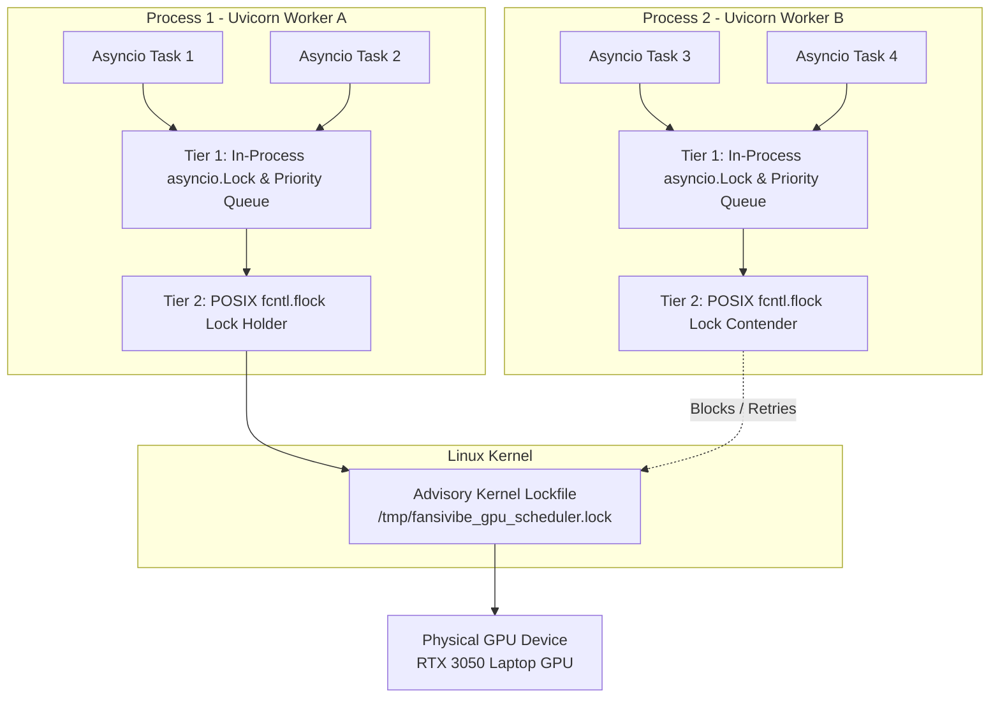
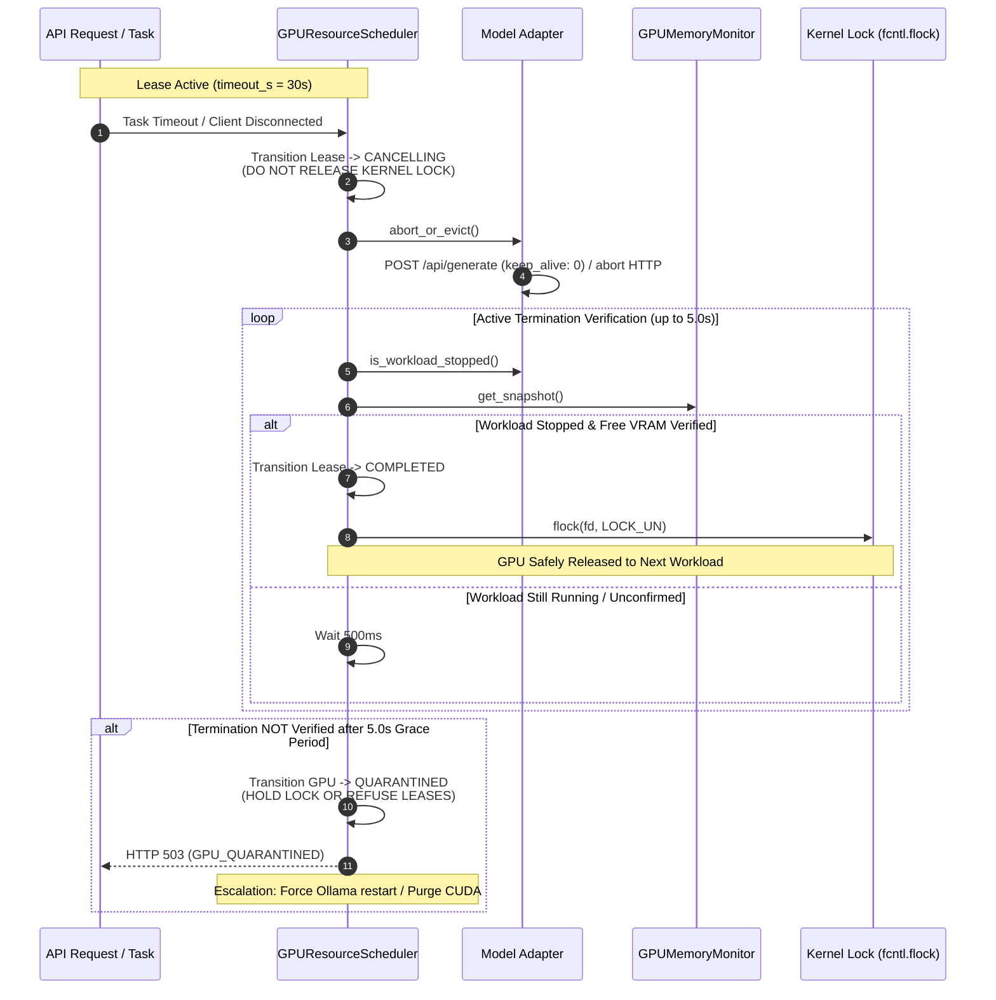
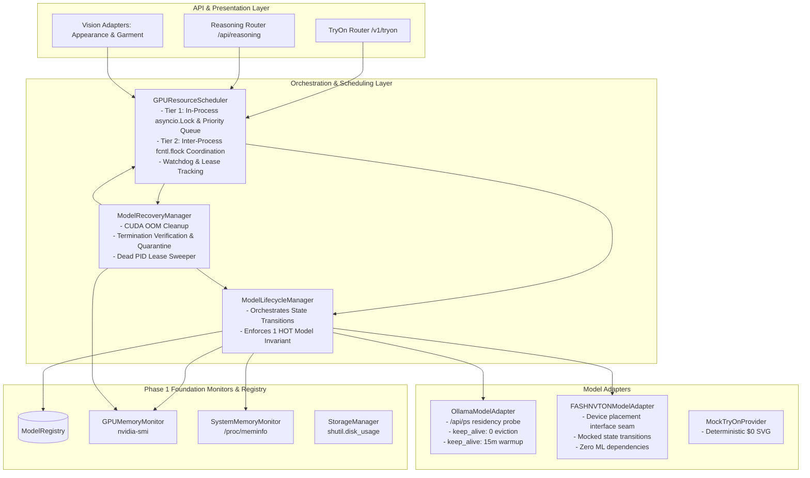
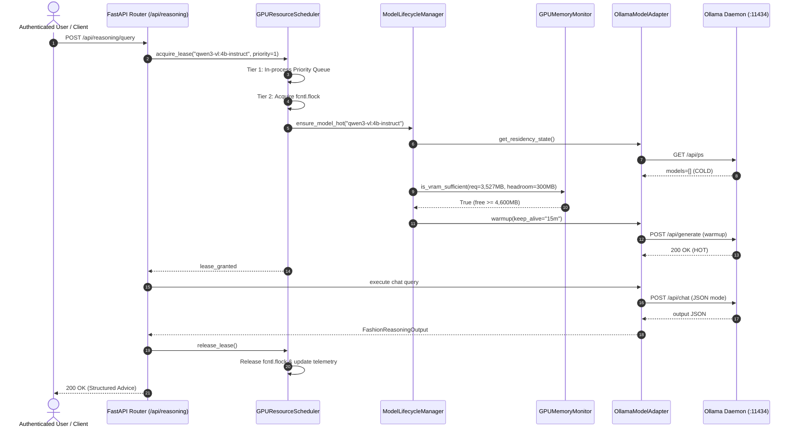

# FANSIVIBE — SHARED HOT / WARM / COLD AI MODEL RESOURCE MANAGER
# PHASE 2: READ-ONLY ARCHITECTURE AUDIT AND IMPLEMENTATION PLAN (CORRECTED)

**Document ID:** `SHARED_HOT_WARM_COLD_AI_MODEL_MANAGER_PHASE2_ARCHITECTURE_AND_IMPLEMENTATION_PLAN.md`  
**Date:** 2026-11-10  
**Status:** COMPLETE (CORRECTED READ-ONLY ARCHITECTURE AUDIT & IMPLEMENTATION PLAN)  
**Execution Mode:** 100% READ-ONLY (Zero code changes, zero dependencies installed, zero model weights downloaded, zero database migrations, zero Git commits)  
**Verdict:** **READY FOR PHASE 2 IMPLEMENTATION PLANNING APPROVAL (WITH AUDITED CROSS-PROCESS SCHEDULING, QUARANTINE RESILIENCE, AND DOCUMENTED HARDWARE & LEGAL RESTRICTIONS)**

---

## 1. EXECUTIVE SUMMARY

### 1.1 Objective & Context
Following the formal acceptance of Phase 1 foundation components (`backend/app/ai/manager/` containing `types.py`, `registry.py`, `memory_gpu.py`, `memory_system.py`, and `storage.py` validated by 18/18 passing tests in `backend/tests/test_model_manager_phase1.py`), this Phase 2 architecture audit and implementation plan establishes the authoritative engineering design for integrating:
1. **Ollama Qwen3-VL 4B (`qwen3-vl:4b-instruct`)** for multimodal vision and fashion reasoning.
2. **FASHN VTON v1.5 (`fashn-vton-v1.5`)** interface seam and feasibility assessment for local virtual try-on diffusion.
3. **A Shared HOT / WARM / COLD Model Management Architecture** spanning GPU VRAM, host system RAM, and persistent NVMe storage.
4. **A Cross-Process GPU Resource Scheduler & Concurrency Arbiter** providing verified mutual exclusion across asyncio tasks, threads, multiple Uvicorn workers, and backend processes using a reliable two-tier coordination mechanism (intra-process `asyncio.Lock` + inter-process POSIX kernel `fcntl.flock`).
5. **Fail-Safe Watchdog, Safe Cancellation & Quarantine Semantics** guaranteeing that GPU leases are never released merely due to timeout expiration, and that unresponsive or uncertain workloads are quarantined until hardware release is verified.
6. **Dynamic Memory Safety Policies** protecting against CUDA Out-Of-Memory (OOM) crashes, system RAM exhaustion, and swap thrashing.
7. **Legal & Provenance Risk Classification** separating repository, weight, dependency, dataset licenses, and commercial uncertainty.

### 1.2 Core Architectural & Hardware Findings

#### 1. Rigorous GPU Memory Accounting
To prevent flawed capacity assumptions, six distinct GPU memory metrics are authoritatively separated:
- **Physical Total VRAM:** Exactly **6,144 MiB** (6.00 GiB) physically fabricated on the host NVIDIA GeForce RTX 3050 Laptop GPU.
- **NVIDIA-Reported Used VRAM:** Dynamic quantity reported by NVML / `nvidia-smi` as currently allocated (e.g., **15 MiB** at idle baseline, where Xorg consumes ~4 MiB).
- **NVIDIA-Reported Free VRAM:** Dynamic quantity reported by NVML / `nvidia-smi` as available at an instant (e.g., **5,792 MiB** observed during an idle probe). **Crucially: Free VRAM varies dynamically with desktop environments, display servers (Xorg/Wayland), external monitors, and driver state. 5,792 MiB is NEVER hardcoded or treated as a guaranteed usable capacity.**
- **Unaccounted or Unavailable VRAM:** The difference between Physical Total and reported `(Used + Free)`, observed at $6,144 - (5,792 + 15) = 337\text{ MiB}$. This memory is unavailable to userland processes and is consumed by VBIOS allocations, display controller framebuffers, page tables, BAR space, or driver context. **It must NOT be claimed as definitively or immutably hardware-reserved**, as driver updates or display configuration changes can alter this delta.
- **Process-Level GPU Allocation:** The physical VRAM allocated by the OS to a specific process PID (e.g., Ollama's `ollama_llama_server` runner PID). Under multimodal vision context with Qwen3-VL 4B, this allocation reaches **~4,596 MiB (~4.49 GiB)** in `nvidia-smi` due to static weights, dynamic KV cache, attention buffers, and context tokens.
- **Ollama-Reported Model Residency:** The value reported by Ollama's `/api/ps` (`size_vram = 3,527,545,978 bytes` / ~3.29 GiB). This reflects **only the static model tensor weights** loaded into VRAM. It strictly excludes runtime activations, KV cache, and driver scratch space. Treating `size_vram` as the total memory ceiling is strictly prohibited.

#### 2. Single Heavy GPU Workload Invariant
When Qwen3-VL 4B is active with vision context, process allocation is ~4,596 MiB, leaving only ~1,196 MiB free VRAM. FASHN VTON v1.5 weights alone require ~2.0 GB, with published inference requirements of ~8 GB VRAM. Therefore, **Qwen3-VL 4B and FASHN VTON v1.5 cannot simultaneously reside in GPU VRAM**. The maximum concurrent heavy GPU inference workload on this host is strictly **1**.

#### 3. HOT / WARM / COLD Semantics Reality
- **Ollama Models (`qwen3-vl:4b-instruct`):** Ollama operates out-of-process as an external HTTP daemon. When resident, it is **HOT** in VRAM. When evicted via `POST /api/generate` with `keep_alive: 0`, Ollama terminates its runner process and frees VRAM. Ollama **does not support an application-controllable WARM state in host RAM**. While the OS page cache may retain disk blocks, treating OS page cache as a deterministic WARM state is forbidden. Ollama models transition strictly between **HOT** and **COLD**.
- **PyTorch Models (`fashn-vton-v1.5`):** PyTorch can genuinely support **COLD** (NVMe safetensors/ONNX files), **WARM** (tensors in CPU host RAM via `pipeline.to("cpu")`), and **HOT** (tensors in GPU VRAM via `pipeline.to("cuda")`). However, on this host (15.3 GiB RAM, ~8.7 GiB available, and **~79-90% swap utilization**), holding 2-4 GiB in a permanent WARM cache creates severe system swap thrashing risk. WARM caching must be dynamically swap-gated and force-demoted to COLD under memory pressure.

#### 4. FASHN VTON v1.5 Hardware Feasibility
- **Published Guidance vs. Host Hardware:** Official published guidance for FASHN VTON v1.5 specifies an approximately **8 GB VRAM** requirement for inference. The host GPU possesses **6 GB physical VRAM**.
- **Classification:** Standard local execution is classified as:
  **UNSUPPORTED BY PUBLISHED REQUIREMENTS AND UNVERIFIED ON OUR MACHINE.**
- **Empirical Restraint:** We **do not claim a definite Out-Of-Memory error without an empirical benchmark** conducted under controlled test conditions.
- **Mitigation Restraint:** We **do not assume that CPU offloading or quantization solves the memory limitation**. Upstream does not ship with built-in CPU offload or quantization pipelines; CPU offloading introduces severe PCIe bus transfer latency (potentially 30–60+ seconds per frame), and quantization is unverified regarding visual fidelity and activation memory bounds.
- **Production Recommendation:** Local execution remains an unverified experimental track; production virtual try-on continues to recommend **Option C (Hybrid Cloud / Remote Serverless GPU)**.

#### 5. FASHN Licensing & Provenance Review
- Legal and provenance dimensions are strictly separated:
  1. *Official Repository License:* Apache-2.0.
  2. *Model Weight License:* Apache-2.0.
  3. *Third-Party Dependency Licenses:* DWPose / ONNX Runtime (MIT / Apache-2.0), YOLOX.
  4. *Training Dataset Licenses:* VITON-HD (`CC BY-NC 4.0` - Non-Commercial) and DressCode (YNAP Non-Commercial academic license).
  5. *Training Data Provenance:* Trained on 18 million clothing/person pairs, incorporating academic non-commercial research datasets.
  6. *Commercial-Use Legal Uncertainty:* The extent to which training on non-commercial datasets legally taints or encumbers downstream model weights remains an evolving, unsettled question in copyright and AI law across jurisdictions. We do not assert automatic legal contamination as an established legal fact, but recognize substantial litigation risk and contract breach exposure.
- **Authoritative Decision:**
  **COMMERCIAL DEPLOYMENT NOT CLEARED — LEGAL AND PROVENANCE REVIEW REQUIRED.**

#### 6. Cross-Process GPU Scheduling & Watchdog Safety
- Process-local `asyncio.Lock` is insufficient when multiple Uvicorn workers (`workers > 1`), background workers, or separate backend processes can access the GPU.
- **Coordination Mechanism:** A two-tier coordination architecture is established:
  - *Tier 1 (Intra-process):* An `asyncio.Lock` + FIFO priority queue within each process to serialize asynchronous coroutines and manage request priorities.
  - *Tier 2 (Inter-process):* A POSIX kernel advisory file lock (`fcntl.flock`) on a dedicated lockfile (`/tmp/fansivibe_gpu_scheduler.lock`) held exclusively during active GPU leases.
- **Kernel Guarantees:** Linux kernel automatically releases `fcntl.flock` if a process crashes, segfaults, receives SIGKILL, or restarts, providing zero stale locks and complete crash recovery without external coordination daemons (e.g. Redis).
- **Cancellation & Watchdog Safety:** A scheduler must **never release a GPU lease merely because its timeout expired**. The scheduler initiates cancellation, actively verifies that the underlying process has stopped and VRAM has been reclaimed, and **quarantines** uncertain or unresponsive workloads to prevent catastrophic concurrent GPU allocations.

#### 7. Strict Implementation Batch Boundaries
- Phase 2 implementation is partitioned into **6 small, independently testable batches**.
- **Batch 5 Restrictions:** Batch 5 may define only the `FASHNVTONModelAdapter` interface and mocked unit tests. It must **not** install ML dependencies, download model weights, run inference, claim real model compatibility, or modify production try-on behaviour.

---

## 2. VERIFIED CURRENT ARCHITECTURE & ENVIRONMENT

### 2.1 Git Repository & Working Tree Status
A fresh inspection of the repository working tree reveals:
```
Branch: main
Status:
 M CURRENT_STATE.md
?? backend/app/ai/manager/
?? backend/tests/test_model_manager_phase1.py
```
- Pre-existing user modifications and working tree files are 100% preserved.
- No Git commits, pushes, resets, or stashes have been performed.

### 2.2 Live Hardware Topology & Measurements

Simultaneous, live hardware inspection was executed on the host system:

1. **GPU Subsystem (`nvidia-smi` / NVML):**
   - **Device:** NVIDIA GeForce RTX 3050 Laptop GPU (Device ID `00000000:01:00.0`, PCI Bus ID `0000:01:00.0`)
   - **Driver Version:** 595.99.02 | **Driver CUDA Version:** 13.2 | **CUDA Toolkit (`nvcc`):** Not installed
   - **Physical Total VRAM:** Exactly **6,144 MiB** (6.00 GiB).
   - **NVIDIA-Reported Used VRAM (Idle Baseline):** **15 MiB** used (Xorg desktop display server: ~4 MiB).
   - **NVIDIA-Reported Free VRAM (Idle Baseline):** **5,792 MiB** free. *(Dynamic measurement; subject to change based on display server activity, external screens, and OS compositors; NOT a guaranteed fixed constant).*
   - **Unaccounted or Unavailable VRAM:** $6,144 - (5,792 + 15) = 337\text{ MiB}$. Difference between physical total and reported (used + free). May include VBIOS allocations, page tables, display framebuffers, or driver overhead. Must not be asserted as definitively hardware-reserved.
   - **Process-Level Allocation (Ollama Qwen3-VL 4B active):** **4,619 MiB used, 1,189 MiB free** reported by `nvidia-smi`.
   - **Ollama-Reported Model Residency:** **3,527,545,978 bytes (~3.29 GiB)** reported by `/api/ps` (`size_vram`). Reflects static weights only; does not include runtime KV cache or vision activations (~1.2 GiB overhead).

2. **Host System Memory (`/proc/meminfo`):**
   - **Total RAM (`MemTotal`):** 16,069,160 kB (~15.32 GiB)
   - **Free RAM (`MemFree`):** 5,922,644 kB (~5.65 GiB)
   - **Available RAM (`MemAvailable`):** 9,148,172 kB (~8.72 GiB)
   - **Total Swap (`SwapTotal`):** 2,097,148 kB (~2.00 GiB)
   - **Free Swap (`SwapFree`):** 444,704 kB (~434 MiB)
   - **Swap In Use:** 1,652,444 kB (~1.58 GiB, **78.8% swap utilization**).

3. **Storage Subsystem (`df -h /`):**
   - **Mount Point:** `/` on `/dev/nvme0n1p2` (PCIe NVMe SSD)
   - **Total Capacity:** 468 GB | **Used:** 89 GB | **Available:** 357 GB (20% utilization)
   - Read throughput: $\ge 2.5\text{ GB/s}$ sequential read.

4. **Installed Python Packages (`backend/.venv`):**
   - Zero machine learning packages installed: `torch`, `diffusers`, `transformers`, `onnx`, `onnxruntime`, and `safetensors` are absent.

### 2.3 Existing AI & Inference Architecture
1. **Ollama External Daemon:** Runs externally at `http://localhost:11434`. Model library contains `qwen3-vl:4b-instruct` (GGUF Q4_K_M, 3.07 GiB file size, 4.4B parameter size).
2. **Fashion Reasoning (`backend/app/ai/ollama_reasoner.py`):**
   - Implements `FashionReasoner` port over Ollama `/api/chat` in JSON mode.
   - Configured via `ReasoningConfig` (env `FANSIVIBE_OLLAMA_*`, timeout 60.0s, keep_alive "15m").
   - Protected by route-level `ConcurrencyLimiter` (default limit = 2).
3. **Appearance Vision Analysis (`backend/app/ai/vision_appearance_adapter.py`):**
   - Implements `AppearanceAnalysisPort` (`ADAPTER_ID = "ollama-vision-v1"`).
   - Sends base64 image bytes to Ollama `/api/chat` with JSON prompt for face shape classification.
   - Flaw: Does not pass explicit `keep_alive` (falls back to Ollama default). Does not synchronize with concurrency limiter.
4. **Garment Vision Analysis (`backend/app/ai/vision_garment_adapter.py`):**
   - Implements `GarmentAnalysisPort` (`ADAPTER_ID = "ollama-garment-v1"`).
   - Reuses `_default_chat` from appearance adapter without concurrency arbitration.
5. **Virtual Try-On Domain & Presentation (`backend/app/application/tryon.py`, `backend/app/api/routers/tryon.py`):**
   - Implements `TryOnProvider` protocol with `MockTryOnProvider` ($0 in-memory SVG mock, zero DB writes, zero ML dependencies).
   - Job store is process-local and thread-safe (`_JOBS`, `_IDEMPOTENCY`, `_QUOTA`).
   - Image bytes are SHA-256 hashed and discarded; raw images are never persisted.

### 2.4 Concurrency Risks Across Process Boundaries
- **Multi-Worker Vulnerability:** If Uvicorn runs with multiple worker processes (`workers > 1`), a process-local `asyncio.Lock` does not prevent workers from concurrently issuing GPU workloads.
- **Multi-Process Collisions:** Background tasks, maintenance scripts, or test runners executing concurrently can trigger simultaneous Ollama queries or diffusion tasks.
- **Uncoordinated Eviction:** No cross-process arbiter coordinates eviction (`keep_alive: 0`) before a diffusion task starts, nor restores Ollama afterward.

---

## 3. PHASE 1 INTEGRATION ASSESSMENT

### 3.1 Review of Phase 1 Deliverables
Phase 1 implemented 5 foundational modules under `backend/app/ai/manager/`:
1. `types.py` (250 lines): Enums (`ModelState`, `WorkloadType`, `ModelProviderType`), immutable snapshots (`GPUMemorySnapshot`, `SystemMemorySnapshot`, `StorageSnapshot`), and typed exceptions (`InsufficientVRAMError`, `InsufficientRAMError`, `InvalidStateTransitionError`, `ModelNotFoundError`, `HardwareMonitoringError`, `DependencyUnavailableError`).
2. `registry.py` (139 lines): Thread-safe `ModelRegistry` initialized with 3 default models:
   - `qwen3-vl:4b-instruct`: Verified, `min_vram_bytes = 3,527,545,978` (~3.29 GiB static residency).
   - `fashn-vton-v1.5`: Strictly marked `is_verified = False`, `min_vram_bytes = None`, `min_ram_bytes = None` (no fabricated values).
   - `mock-vton`: Verified, `min_vram_bytes = 0`, `min_ram_bytes = 0`.
3. `memory_gpu.py` (128 lines): Observational `GPUMemoryMonitor` querying `nvidia-smi` with mockable runner and 300 MiB safety headroom.
4. `memory_system.py` (123 lines): Observational `SystemMemoryMonitor` parsing Linux `/proc/meminfo` with 500 MiB headroom and memory pressure detection.
5. `storage.py` (113 lines): Observational `StorageManager` inspecting filesystem capacity via `shutil.disk_usage` and dynamically detecting Ollama model directory.

### 3.2 Verification & Test Results
- **Isolated Unit & Live Hardware Tests:** `backend/tests/test_model_manager_phase1.py` contains 18 tests covering contracts, calculations, exceptions, thread safety, and live hardware probes (`nvidia-smi`, `/proc/meminfo`, `/`).
- **Execution Evidence:** 18/18 tests pass in 2.88s.
- **Regression Invariance:** 73 pre-existing backend tests pass with 100% success.
- **Observational Boundary Invariant:** All Phase 1 monitors are strictly read-only. Zero lifecycle state mutations, zero process signals, and zero background threads were introduced.

---

## 4. OLLAMA ADAPTER DESIGN

### 4.1 Process Ownership & Communication Model
- **Boundary Rule:** The Fansivibe backend **does NOT manage the Ollama OS process or systemd service**. Ollama is treated as an external managed inference daemon running locally at `http://localhost:11434`.
- **Communication Protocol:** All interactions occur via HTTP using `httpx.AsyncClient` or `httpx.Client`.
- **API Endpoints Utilized:**
  1. `GET /api/tags`: Probes model availability and metadata on disk.
  2. `GET /api/ps`: Inspects currently resident models, VRAM usage (`size_vram`), and expiration (`expires_at`).
  3. `POST /api/chat`: Executes chat and multimodal vision inference. Accepts `keep_alive` parameter.
  4. `POST /api/generate`: Used for model management:
     - **Preload/Warmup:** `{"model": "qwen3-vl:4b-instruct", "keep_alive": "15m"}`
     - **Explicit Eviction:** `{"model": "qwen3-vl:4b-instruct", "keep_alive": 0}` (returns `done_reason: "unload"`, instantly freeing VRAM).

### 4.2 Lifecycle Observation Without Duplication
Instead of maintaining an independent, desynchronized internal model state, `OllamaModelAdapter` queries Ollama's authoritative state via `/api/ps`:
```python
# Ollama /api/ps payload structure:
{
  "models": [
    {
      "name": "qwen3-vl:4b-instruct",
      "model": "qwen3-vl:4b-instruct",
      "size": 3295636231,
      "size_vram": 3527545978,
      "expires_at": "2026-11-10T21:19:48.137733609+05:30"
    }
  ]
}
```
If `models` contains `qwen3-vl:4b-instruct`, the adapter reports `ModelState.HOT`. If absent, it reports `ModelState.COLD`. The adapter synchronizes this status back to the centralized `ModelRegistry`.

### 4.3 Proposed `OllamaModelAdapter` Interface
```python
class OllamaModelAdapter:
    """Manages Ollama model residency, warmup, eviction, and inference routing."""

    def __init__(
        self,
        base_url: str = "http://localhost:11434",
        model_name: str = "qwen3-vl:4b-instruct",
        default_keep_alive: str = "15m",
        http_client: Optional[httpx.AsyncClient] = None,
    ) -> None: ...

    async def get_residency_state(self) -> ModelState:
        """Inspect /api/ps. Returns ModelState.HOT if resident, else ModelState.COLD."""
        ...

    async def warmup(self, timeout_s: float = 30.0) -> bool:
        """Load model into GPU VRAM with keep_alive pinned."""
        ...

    async def evict(self, timeout_s: float = 10.0) -> bool:
        """Evict model from GPU VRAM using keep_alive: 0. Verify VRAM release."""
        ...

    async def chat(
        self,
        messages: list[dict],
        format_json: bool = False,
        timeout_s: float = 60.0,
    ) -> dict:
        """Execute chat inference with managed keep_alive under scheduler lease."""
        ...
```

### 4.4 Preserving Existing Application Contracts
The adapter does not modify existing domain ports (`FashionReasoner`, `AppearanceAnalysisPort`, `GarmentAnalysisPort`). Instead:
- Existing adapters (`OllamaFashionReasoner`, `OllamaVisionAppearanceAdapter`, `OllamaVisionGarmentAdapter`) will acquire an execution lease from `GPUResourceScheduler` before issuing their HTTP requests.
- This ensures zero breaking changes to calling services while enforcing centralized GPU mutual exclusion.

---

## 5. FASHN VTON v1.5 FEASIBILITY & LICENSING ASSESSMENT

### 5.1 Model Architecture & Pipeline
- **Backbone Architecture:** Multimodal Diffusion Transformer (MMDiT) with **972 Million parameters**.
- **Generation Space:** Direct **pixel-space RGB generation** (unlike Latent Diffusion / SDXL, it does not rely on a separate latent VAE compression backbone).
- **Sub-Pipelines & Dependencies:**
  1. **DWPose:** Pose keypoint estimation via `onnxruntime-gpu` (or CPU fallback).
  2. **YOLOX:** Person/face bounding box detection (ONNX).
  3. **MMDiT Transformer:** Diffusion backbone (`model.safetensors` ~2.0 GB).
- **Inference Entrypoint:** Upstream `TryOnPipeline(weights_dir="./weights", device="cuda")` executing 30 diffusion timesteps.

### 5.2 Hardware Guidance vs. Host Reality Analysis

| Dimension | Published Guidance | Host RTX 3050 Laptop Reality | Compatibility Status |
| :--- | :--- | :--- | :--- |
| **Model Weights** | ~2.0 GB (`bfloat16`) | Fits in free VRAM (~5.79 GB observed) | Weights fit in physical storage |
| **Full Inference VRAM** | **~8 GB VRAM** (published requirement) | **6,144 MiB physical VRAM** | **Unsupported by published guidance; unverified on machine** |
| **Pose Estimation (DWPose)** | ~1.0 GB VRAM (`onnxruntime-gpu`) | High memory contention with MMDiT | Requires CPU fallback evaluation |
| **Sequential CPU Offload** | Not supported out-of-the-box by upstream | Custom engineering required | Feasibility and latency unverified |
| **Host System RAM** | ~4-6 GB required for WARM staging | 8.7 GiB available, **78.8% swap used** | High risk of swap thrashing |

### 5.3 Technical Feasibility Classification: Local Inference on 6GB VRAM
1. **Classification:** Normal local execution is classified as:
   **UNSUPPORTED BY PUBLISHED REQUIREMENTS AND UNVERIFIED ON OUR MACHINE.**
2. **Empirical Restraint (No Assumed OOM):** While the published 8 GB requirement exceeds the 6 GB physical capacity, we **do not claim a definite Out-Of-Memory error without an empirical benchmark**. Real peak memory consumption depends on batch size (1), inference resolution ($512 \times 384$ vs $1024 \times 768$), attention backend (SDPA / FlashAttention), and precision (BF16 vs FP16).
3. **Mitigation Restraint (No Assumed Solutions):** We **do not assume CPU offload or quantization solves the memory limitation**:
   - Upstream FASHN VTON v1.5 does not provide sequential CPU offloading or 4-bit/8-bit quantization out-of-the-box.
   - CPU offload requires shuttling transformer blocks across the PCIe Gen4 x4/x8 interface, which can introduce prohibitive 30–60+ second latencies per try-on generation.
   - Quantization can induce severe garment texture and silhouette artifacts and does not reduce peak activation tensors during full-resolution pixel-space diffusion.
4. **Mandatory Invariant:** Local execution remains an experimental seam. Production architecture continues to recommend **Option C (Hybrid Cloud / Remote Serverless GPU)**.

### 5.4 Licensing & Provenance Assessment

To ensure rigorous legal analysis, the licensing dimensions are strictly separated:

1. **Official Repository License:** The code in `fashn-AI/fashn-vton-1.5` is published under the **Apache-2.0** license.
2. **Model Weight License:** The pre-trained weights published by FASHN AI are distributed with an **Apache-2.0** license assertion.
3. **Third-Party Dependency Licenses:**
   - DWPose: MMPose / OpenMMLab ecosystem (Apache-2.0 or academic depending on the exact model release).
   - YOLOX: Apache-2.0.
   - ONNX Runtime: MIT.
4. **Training Dataset Licenses:**
   - **VITON-HD:** Licensed under Creative Commons Attribution-NonCommercial 4.0 International (**CC BY-NC 4.0**).
   - **DressCode:** Licensed under an academic **Non-Commercial Research License** (YNAP agreement).
5. **Training-Data Provenance:** Upstream documentation confirms the model was trained on 18 million clothing/person pairs, incorporating academic datasets (VITON-HD and DressCode). The exact proportion and filtering pipeline of commercial vs. non-commercial data are not publicly verified.
6. **Commercial-Use Legal Uncertainty:**
   - Whether training a machine learning model on non-commercial datasets legally taints or encumbers downstream model weights is an **unsettled, evolving question in copyright and IP law**.
   - We **do not assert that training on non-commercial datasets automatically makes resulting weights legally contaminated** as an established statutory fact (as fair use, intermediate copying doctrine, and the legal status of weights as derivative works vary across jurisdictions).
   - However, the contractual terms of research datasets and potential exposure to breach-of-contract or copyright litigation create **critical commercial legal risk**.

#### Authoritative Licensing Decision
```
COMMERCIAL DEPLOYMENT NOT CLEARED — LEGAL AND PROVENANCE REVIEW REQUIRED.
```

#### Evidence Required Before Production Approval
1. **Written Legal Clearance:** A formal legal review and opinion from qualified intellectual property counsel on the commercial use of weights derived from mixed/non-commercial datasets under relevant jurisdictions.
2. **Upstream Provenance Documentation:** Formal clarification or certification from FASHN AI regarding training data lineage and commercial indemnification.
3. **Third-Party Detector Audit:** Independent verification of all pre-trained weights utilized for pose estimation and bounding box detection (DWPose, YOLOX).
4. **Commercial Fallback Strategy:** Clear terms for adopting an indemnified enterprise commercial API (e.g. Fashn.ai commercial API or Fal.ai) for commercial production.

---

## 6. HOT / WARM / COLD STATE MODEL

### 6.1 State Definitions
- **HOT:** Model weights, layers, and execution contexts reside in GPU VRAM and are ready for immediate inference execution.
- **WARM:** Model weights reside in verified host system RAM (CPU memory). Promotion to GPU can occur over PCIe bus without reading files from NVMe storage.
- **COLD:** Model files exist on persistent NVMe storage. Zero bytes allocated in system RAM or GPU VRAM.

### 6.2 Model Support Matrix

| Model | HOT Supported? | WARM Supported? | COLD Supported? | Technical Explanation |
| :--- | :---: | :---: | :---: | :--- |
| **Qwen3-VL 4B** (Ollama) | **YES** | **NO** | **YES** | Ollama loads directly into VRAM (`HOT`) or unloads completely (`COLD`). Ollama has no API to pin weights in host RAM. OS page cache cannot be treated as a deterministic WARM state. |
| **FASHN VTON v1.5** (PyTorch) | **YES** | **CONDITIONALLY** | **YES** | Model weights can reside in Python host RAM via `pipeline.to("cpu")` (`WARM`) and promote via `.to("cuda")` (`HOT`). However, WARM state is disabled if host swap utilization exceeds 70%. |
| **Mock Try-On** (In-Memory SVG) | N/A | N/A | N/A | $0 stateless computation. Zero VRAM and zero RAM footprint. Always available. |

### 6.3 State Transition Table

| Current State | Target State | Model | Preconditions & Checks | Action / Mechanism | Error Recovery |
| :--- | :--- | :--- | :--- | :--- | :--- |
| **COLD** | **HOT** | Ollama Qwen | `GPUFree >= 4,600 MiB` + scheduler lease | `POST /api/generate` (`keep_alive: 15m`) | If VRAM insufficient, evict other models or raise `InsufficientVRAMError`. |
| **HOT** | **COLD** | Ollama Qwen | Lease released + idle timeout or eviction request | `POST /api/generate` (`keep_alive: 0`) | Verify VRAM drops via `GPUMemoryMonitor`. |
| **COLD** | **WARM** | FASHN VTON | `RAMAvail >= 4.0 GiB` AND `SwapUsed < 70%` | Load weights from NVMe into CPU host RAM | If RAM low or swap high, reject promotion; remain `COLD`. |
| **WARM** | **HOT** | FASHN VTON | `GPUFree >= 5,500 MiB` + scheduler lease | `pipeline.to("cuda")` over PCIe | If CUDA OOM, call `torch.cuda.empty_cache()` and fallback to `WARM`. |
| **HOT** | **WARM** | FASHN VTON | Lease expired / try-on completed | `pipeline.to("cpu")` + `torch.cuda.empty_cache()` | If host RAM pressured, demote directly to `COLD`. |
| **WARM** | **COLD** | FASHN VTON | Swap pressure > 70% or manual eviction | `del pipeline; gc.collect()` | Reclaim host RAM. |
| **COLD** | **WARM** | Ollama Qwen | **ILLEGAL** | **DISALLOWED** | Raise `InvalidStateTransitionError`. |

---

## 7. CROSS-PROCESS SHARED GPU SCHEDULER ARCHITECTURE

### 7.1 Cross-Process Mutual Exclusion Guarantee
Fansivibe's deployment topology may involve multiple concurrency domains:
- **Multiple Asyncio Tasks:** Concurrent HTTP requests within a single Python event loop.
- **Multiple Threads:** Background worker threads or concurrent FastAPI threads.
- **Multiple Uvicorn Workers:** Production deployments running Uvicorn with `--workers > 1`.
- **Multiple Backend Processes:** Ad-hoc maintenance scripts, background cron jobs, or separate test processes.
- **Backend Restarts & Crashes:** Unplanned server restarts, unhandled exceptions, or process terminations.

**Limitation of `asyncio.Lock`:** A standard `asyncio.Lock` operates strictly within a single Python process and event loop. It provides **zero protection across Uvicorn worker processes or independent backend processes**.

### 7.2 Two-Tier Coordination Mechanism
To establish reliable, zero-overhead coordination without introducing new external daemons (such as Redis), the scheduler employs a **Two-Tier Coordination Architecture**:



#### Tier 1: Process-Local Asyncio Lock & Priority Queue
- Within each worker process, an `asyncio.Lock` and prioritized FIFO queue coordinate coroutines.
- This prevents multiple coroutines in the same process from thrashing the kernel file lock and enables deterministic priority sorting (Interactive Reasoning > Diffusion > Warmup).

#### Tier 2: POSIX Kernel Advisory File Lock (`fcntl.flock`)
- Inter-process mutual exclusion is enforced by the Linux kernel via `fcntl.flock(fd, fcntl.LOCK_EX | fcntl.LOCK_NB)`.
- **Lockfile Location:** `/tmp/fansivibe_gpu_scheduler.lock` (configurable via `FANSIVIBE_GPU_LOCKFILE`).
- **Kernel-Guaranteed Crash Recovery:** 
  - In Linux, `fcntl.flock` locks are associated with the file table entry in the operating system kernel.
  - If a worker process crashes, segfaults, receives `SIGKILL`, or is restarted, **the Linux kernel automatically and immediately closes the file descriptor and releases the lock**.
  - **Zero stale locks can survive a dead process.** No external heartbeat sweeps or TTL expiration logic are required for crash cleanup.

#### Lock Ownership & Lease Metadata
While holding `fcntl.flock`, the active process writes atomic lease metadata into an adjacent descriptor file (`/tmp/fansivibe_gpu_lease.json` via write-and-atomic-rename):
```json
{
  "lease_id": "lease-8f3a1c0d",
  "holder_pid": 142857,
  "holder_worker": "uvicorn-worker-1",
  "model_id": "qwen3-vl:4b-instruct",
  "workload_type": "REASONING_VISION",
  "acquired_at": 1731254400.123,
  "timeout_s": 30.0,
  "state": "ACTIVE"
}
```
Non-holding processes can read this file to report accurate queue telemetry, estimated wait times, and inspect the holder PID's liveness (`os.kill(pid, 0)`).

### 7.3 Request Prioritization & Queuing Policy
Requests are queued within Tier 1 using a 3-tier priority structure:
1. **Priority 1 (Interactive Vision & Reasoning):** Short duration (1.5s – 8.0s), high user interactivity (Today outfit generation, live garment scanning, styling chat). Lease timeout: 15.0s.
2. **Priority 2 (Virtual Try-On Diffusion):** Heavy execution (15.0s – 45.0s), asynchronous background polling. Lease timeout: 60.0s.
3. **Priority 3 (Background Warmup & Preloading):** Non-blocking; yields immediately if any Priority 1 or 2 request arrives. Lease timeout: 30.0s.

**Queue Limits & Fast Rejection:** The process-level queue has a maximum depth (default 10). If full, incoming requests are rejected immediately with HTTP 429 `RATE_LIMITED` (`Retry-After: 5`), avoiding unmetered memory growth.

### 7.4 Cancellation, Watchdog Safety & Quarantine Semantics

#### Critical Safety Invariant
> **A GPU scheduler must NEVER release a GPU lease merely because its timeout expired.**

If a workload times out or a client disconnects, releasing the lock blindly while the underlying inference process or Ollama runner is still executing kernels in GPU VRAM will cause the next workload to collide, resulting in a fatal CUDA OOM or driver crash.

#### Safe Cancellation Workflow


#### Step-by-Step Cancellation & Quarantine Protocol
1. **Cancellation Trigger:** Initiated by task timeout, client disconnect (`request.is_disconnected()`), or manual cancellation.
2. **Lock Retention:** The scheduler transitions the lease to `CANCELLING`. The kernel lock `fcntl.flock` remains **strictly held**.
3. **Abort / Eviction Signal:** The adapter issues an abort signal to the inference engine (e.g. aborting the HTTP stream, issuing `POST /api/generate` with `keep_alive: 0` to Ollama, or signaling a worker sub-process).
4. **Active Termination Verification Loop:**
   - The scheduler polls at 500ms intervals (up to a 5.0s grace period).
   - *Verification Criteria:*
     1. The client inference coroutine or thread has terminated.
     2. Ollama `/api/ps` confirms no model is actively computing or model is unloaded.
     3. `GPUMemoryMonitor` verifies that free VRAM has returned to the expected idle/baseline level.
   - If verification succeeds, the lease is marked `COMPLETED` and the kernel lock is released.
5. **Workload Quarantine (Uncertain or Unresponsive State):**
   - If after 5.0s termination cannot be confirmed (e.g., Ollama is unresponsive, or GPU memory remains allocated to an unknown PID):
     - The GPU resource is marked **`QUARANTINED`**.
     - The scheduler **refuses to grant any GPU leases** to queued or incoming requests.
     - Incoming requests receive HTTP 503 `AI_FAILURE` with error code `GPU_RESOURCE_QUARANTINED` and `Retry-After: 15`.
   - **Escalation Actions during Quarantine:**
     - For Ollama: Attempt daemon health check, send force-eviction command, or flag operational monitoring for daemon restart.
     - For PyTorch: Execute `torch.cuda.empty_cache()` and force-kill orphaned worker processes.
   - **Quarantine Resolution:**
     - The quarantine is lifted **ONLY** when `GPUMemoryMonitor` independently confirms that VRAM has returned to the idle baseline with zero heavy workloads active.

---

## 8. DYNAMIC MEMORY SAFETY POLICY

### 8.1 Real-Time VRAM Safety Rule
Before any model promotion or heavy inference lease is granted:
$$\text{Free VRAM} \ge \text{Estimated Model VRAM} + \text{Safety Headroom (300 MiB)}$$
- If free VRAM is insufficient, the scheduler initiates eviction of idle models.
- If free VRAM remains insufficient after eviction, the request is rejected with `InsufficientVRAMError` (mapped to HTTP 503 `AI_FAILURE`).

### 8.2 Swap-Gated Host RAM Policy
Due to observed high host swap usage (~79-90%):
- **WARM Caching Prohibition:** If `SystemMemoryMonitor` reports `swap_used_pct >= 70%` OR `available_ram < 3.0 GiB`, **no models may be cached in host RAM**.
- In this pressured state, all inactive models must immediately be demoted to **COLD** (NVMe storage).
- Reading 2.0 GB of weights from the NVMe SSD takes less than 0.8 seconds ($2.5\text{ GB/s}$ read throughput), whereas paging 2.0 GB in and out of Linux swap causes multi-second system freezes and UI stutter.

---

## 9. COMPONENT RESPONSIBILITIES AND INTERFACES

### 9.1 Component Architecture Diagram



### 9.2 Component Responsibility Table

| Component | Layer | Primary Responsibility | Reused or New? |
| :--- | :--- | :--- | :--- |
| `ModelRegistry` | Foundation | Maintains verified specifications, requirements, and residency states. | Phase 1 (Reused) |
| `GPUMemoryMonitor` | Foundation | Observational VRAM and utilization telemetry via `nvidia-smi`. | Phase 1 (Reused) |
| `SystemMemoryMonitor` | Foundation | Observational host RAM and swap pressure telemetry via `/proc/meminfo`. | Phase 1 (Reused) |
| `StorageManager` | Foundation | Observational NVMe storage capacity and model weight path validation. | Phase 1 (Reused) |
| `GPUResourceScheduler` | Orchestration | Two-tier cross-process mutual exclusion (`fcntl.flock`), priority queue, watchdog. | **Phase 2 (New)** |
| `ModelLifecycleManager` | Orchestration | Coordinates state transitions (COLD/WARM/HOT) and automated model swapping. | **Phase 2 (New)** |
| `ModelRecoveryManager` | Resilience | Termination verification, quarantine enforcement, OOM recovery, dead PID cleanup. | **Phase 2 (New)** |
| `OllamaModelAdapter` | Adapter | HTTP bridge to Ollama `/api/ps`, `/api/chat`, and `keep_alive: 0` eviction. | **Phase 2 (New)** |
| `FASHNVTONModelAdapter` | Adapter | Interface seam adhering to `TryOnProvider` for device placement (Batch 5 restricted). | **Phase 2 (New)** |

### 9.3 Detailed Python Method Signatures

#### A. `GPUResourceScheduler` (`backend/app/ai/manager/scheduler.py`)
```python
@dataclass(frozen=True)
class GPUSchedulerLease:
    lease_id: str
    model_id: str
    workload_type: WorkloadType
    priority: int
    holder_pid: int
    acquired_at: float
    timeout_s: float

class GPUResourceScheduler:
    def __init__(
        self,
        lifecycle_manager: ModelLifecycleManager,
        lockfile_path: str = "/tmp/fansivibe_gpu_scheduler.lock",
        max_queue_depth: int = 10,
    ) -> None: ...

    async def acquire_lease(
        self,
        model_id: str,
        workload_type: WorkloadType,
        priority: int = 1,
        timeout_s: float = 30.0,
    ) -> AsyncContextManager[GPUSchedulerLease]:
        """Asynchronously acquire exclusive cross-process GPU execution lease.
        
        1. Checks quarantine state (raises 503 if GPU is quarantined).
        2. Queues in Tier 1 in-process priority queue.
        3. Acquires Tier 2 inter-process POSIX fcntl.flock in non-blocking loop with timeout.
        4. Writes atomic lease metadata.
        5. Grants lease to caller.
        """
        ...

    async def release_lease(
        self,
        lease: GPUSchedulerLease,
        aborted: bool = False,
    ) -> None:
        """Release GPU lease after actively verifying workload cessation."""
        ...

    def is_quarantined(self) -> bool:
        """Check if GPU is quarantined due to unresponsive or uncertain workload."""
        ...

    def get_queue_status(self) -> dict[str, Any]:
        """Return active lease, quarantine status, queue depth, and telemetry."""
        ...
```

#### B. `ModelLifecycleManager` (`backend/app/ai/manager/lifecycle.py`)
```python
class ModelLifecycleManager:
    def __init__(
        self,
        registry: ModelRegistry,
        gpu_monitor: GPUMemoryMonitor,
        system_monitor: SystemMemoryMonitor,
        ollama_adapter: OllamaModelAdapter,
        fashn_adapter: Optional[FASHNVTONModelAdapter] = None,
    ) -> None: ...

    async def ensure_model_hot(self, model_id: str) -> None:
        """Promote target model to HOT. If another model is HOT, evict it first."""
        ...

    async def evict_model(self, model_id: str, target_state: ModelState = ModelState.COLD) -> None:
        """Demote model from HOT to WARM (if RAM permits) or COLD."""
        ...

    async def get_current_hot_model(self) -> Optional[str]:
        """Return the model ID currently resident in GPU VRAM, or None."""
        ...
```

#### C. `ModelRecoveryManager` (`backend/app/ai/manager/recovery.py`)
```python
class ModelRecoveryManager:
    def __init__(
        self,
        scheduler: GPUResourceScheduler,
        lifecycle_manager: ModelLifecycleManager,
        gpu_monitor: GPUMemoryMonitor,
    ) -> None: ...

    async def verify_and_reclaim_gpu(
        self,
        lease: GPUSchedulerLease,
        grace_period_s: float = 5.0,
    ) -> bool:
        """Actively verify that an aborted workload stopped before unlocking.
        
        If unconfirmed after grace period, places GPU in QUARANTINED state.
        """
        ...

    async def handle_cuda_oom(self, model_id: str, exc: Exception) -> None:
        """Emergency cleanup on CUDA OOM: empty cache, force eviction, release lease."""
        ...

    async def sweep_dead_pid_leases(self) -> int:
        """Inspect lease metadata; clean up metadata if holder PID is dead."""
        ...
```

---

## 10. DATA FLOW AND STATE-TRANSITION DIAGRAMS

### 10.1 Normal API Request Lifecycle



---

## 11. FAILURE RECOVERY & RESILIENCE

### 11.1 CUDA Out-Of-Memory (OOM) Recovery
1. **Detection:** Catch `torch.cuda.OutOfMemoryError` or process exit signals.
2. **Immediate Eviction:** Invoke cache purges and model demotion.
3. **Hardware Health Verification:** Query `GPUMemoryMonitor.get_snapshot()` to ensure free VRAM returns to baseline.
4. **Lease Cleanup:** Safely close and release the lease.
5. **Caller Response:** Return HTTP 503 `AI_FAILURE` with `Retry-After: 10`.

### 11.2 Quarantine State Management
- If a task times out or fails to terminate within the 5.0s grace period, `ModelRecoveryManager` transitions the GPU to `QUARANTINED`.
- During quarantine:
  - New leases are rejected with HTTP 503 `GPU_RESOURCE_QUARANTINED`.
  - Recovery manager initiates active remediation (force Ollama eviction, purge in-process contexts).
  - Periodic background probe tests if VRAM is restored. Only when VRAM restoration is verified is quarantine lifted.

### 11.3 Dead-PID Lease Recovery
- While `fcntl.flock` is automatically dropped by the kernel when a process dies, adjacent metadata files may remain.
- The scheduler checks `os.kill(holder_pid, 0)`: if the recorded PID is dead, stale metadata is purged without blocking new leases.

---

## 12. SECURITY AND PRIVACY CONSIDERATIONS

1. **OW-1 Ownership Isolation:** Every try-on job and inference request is bound to the verified `user_id` extracted from the cryptographically validated JWT session. Client-supplied IDs are never trusted.
2. **Ephemeral Image Invariant:** User images (portraits and garment photos) are streamed directly into memory buffers, hashed via SHA-256 for digest verification, and strictly discarded. Zero raw image bytes are written to disk, database, or logs.
3. **Zero PII Logging:** Prompts, model completions, face shapes, and biometric labels are excluded from all logging streams.
4. **Guest Protection:** Unauthenticated guest users are strictly barred from try-on generation (HTTP 401). Guest reasoning queries are governed by a dedicated sliding-window IP rate limit (`ephemeral_rate_limit_per_minute = 30`).

---

## 13. IMPLEMENTATION BATCHES

The proposed work is structured into **6 focused, sequential batches**.

### Batch 1: Cross-Process Shared GPU Scheduler (Two-Tier Locking & Priority Queues)
- **Objective:** Implement `GPUResourceScheduler` providing two-tier mutual exclusion (Tier 1 `asyncio.Lock` + Tier 2 `fcntl.flock`), FIFO priority queues, timeouts, cancellation hooks, and lease metadata tracking.
- **Files Created:**
  - `backend/app/ai/manager/scheduler.py`
  - `backend/tests/test_model_manager_scheduler.py`
- **Dependencies & Prerequisites:** Phase 1 types and registry. Zero ML dependencies.
- **Testing:** Concurrency unit tests verifying cross-process locking simulation, priority queue ordering, queue saturation rejection (HTTP 429), and kernel lock cleanup.
- **Acceptance Criteria:** Deterministic concurrency tests pass under simulated multi-task and multi-process contention.

### Batch 2: Ollama Model Lifecycle Adapter & Eviction Harness
- **Objective:** Implement `OllamaModelAdapter` with real HTTP interaction to `/api/ps`, `/api/chat`, and `/api/generate` (`keep_alive: 0` eviction).
- **Files Created:**
  - `backend/app/ai/manager/adapters/ollama_adapter.py`
  - `backend/tests/test_model_manager_ollama_adapter.py`
- **Dependencies & Prerequisites:** `httpx`. Local Ollama daemon running.
- **Testing:** Integration tests verifying state probing, warmup pinning, and VRAM eviction.
- **Acceptance Criteria:** Calling `evict()` verified to drop Ollama VRAM usage via live `GPUMemoryMonitor`.

### Batch 3: Unification of Existing Vision & Reasoning Adapters
- **Objective:** Wrap `OllamaFashionReasoner`, `OllamaVisionAppearanceAdapter`, and `OllamaVisionGarmentAdapter` to acquire scheduler leases prior to execution.
- **Files Modified:**
  - `backend/app/ai/ollama_reasoner.py`
  - `backend/app/ai/vision_appearance_adapter.py`
  - `backend/app/ai/vision_garment_adapter.py`
  - `backend/app/api/routers/reasoning.py`
- **Dependencies & Prerequisites:** Batches 1 & 2.
- **Testing:** Full backend regression suite (73+ tests).
- **Acceptance Criteria:** All existing vision and reasoning endpoints execute successfully through the central GPU scheduler.

### Batch 4: Dynamic Memory Safety, Quarantine Watchdog & Recovery Manager
- **Objective:** Implement `ModelRecoveryManager` with termination verification, quarantine states, swap-gated memory caching, and CUDA OOM handling.
- **Files Created:**
  - `backend/app/ai/manager/recovery.py`
  - `backend/tests/test_model_manager_recovery.py`
- **Dependencies & Prerequisites:** Batches 1–3.
- **Testing:** Fault injection tests simulating unresponsive tasks, task timeouts, synthetic OOM exceptions, and quarantine lifting.
- **Acceptance Criteria:** System refuses to release leases on simple timeout; successfully quarantines unresponsive workloads and unblocks queue only upon verified memory reclamation.

### Batch 5: FASHN VTON Adapter Interface & Mocked Tests (STRICTLY RESTRICTED)
- **Objective:** Implement `FASHNVTONModelAdapter` interface adhering to the `TryOnProvider` protocol and mocked unit tests.
- **Mandatory Strict Restrictions:**
  - **MUST NOT install ML dependencies** (no PyTorch, Diffusers, ONNX Runtime, Transformers, or CUDA Toolkit).
  - **MUST NOT download model weights** (no weights downloaded from Hugging Face or external mirrors).
  - **MUST NOT run inference** (zero diffusion forward passes or GPU kernel executions).
  - **MUST NOT claim real model compatibility** (local compatibility on 6GB GPU remains unverified).
  - **MUST NOT modify production try-on behaviour** (production try-on continues to route through existing contracts and `MockTryOnProvider` without disruption).
- **Files Created:**
  - `backend/app/ai/manager/adapters/fashn_adapter.py`
  - `backend/tests/test_model_manager_fashn_adapter.py`
- **Testing:** Mocked unit tests verifying state transition contracts (`COLD` $\to$ `WARM` $\to$ `HOT` $\to$ `COLD`) using test doubles.
- **Acceptance Criteria:** Adapter interface conforms to domain port and passes mocked lifecycle tests with zero external packages.

### Batch 6: End-to-End Multi-Worker Concurrency & Resilience Verification
- **Objective:** Execute end-to-end multi-worker concurrency simulation testing concurrent reasoning, vision scans, and try-on requests with fault injection.
- **Files Created:**
  - `backend/tests/test_model_manager_e2e_concurrency.py`
- **Dependencies & Prerequisites:** Batches 1–5.
- **Testing:** Multi-worker simulation verifying serialized execution across separate processes, crash recovery, and quarantine handling.
- **Acceptance Criteria:** 100% test pass rate across unit, integration, and regression suites.

---

## 14. REVISED COMPREHENSIVE TESTING STRATEGY

### 14.1 Simulated vs. Live Test Matrix

| Test Suite | Scope | Target Environment | Mocking Level |
| :--- | :--- | :--- | :--- |
| `test_model_manager_scheduler.py` | Two-tier locking, priority queue, timeout cancellation | Local Python unit test | Mocked lockfile & async timers |
| `test_model_manager_ollama_adapter.py` | Ollama HTTP protocol & eviction | Local Ollama daemon | Live HTTP / Mockable client |
| `test_model_manager_recovery.py` | Termination verification, quarantine, OOM recovery | Local Python unit test | Fault injection / Mocked monitors |
| `test_model_manager_fashn_adapter.py` | Adapter interface & state transitions | Local Python unit test | 100% Mocked (Zero ML packages) |
| `test_model_manager_e2e_concurrency.py` | Cross-process concurrency & worker contention | Backend test harness | Live scheduler + mocked model adapters |
| `test_live_hardware_probes.py` | VRAM & Meminfo telemetry | Host Linux OS / GPU | 100% Live observational probes |

### 14.2 Revised Acceptance Criteria Verification
- **Cross-Process Mutual Exclusion:** Under simulated multi-worker execution (simulating multiple Uvicorn workers contending for GPU), exactly one process/task may hold an active GPU lease at any time.
- **Non-Blind Timeout Release:** When a lease times out, the scheduler must **never** immediately release the lock to waiting workloads; it must transition through termination verification, and trigger `QUARANTINED` status if the workload does not stop within the grace period.
- **Zero Stale Locks on Crash:** If a process holding `fcntl.flock` is killed with `SIGKILL`, the kernel lock must immediately be acquirable by competing processes without deadlocking.
- **Dynamic VRAM Safety:** Allocation safety checks must evaluate dynamic `free_vram` from `nvidia-smi` rather than assuming a hard-coded 5,792 MiB ceiling.
- **Batch 5 Purity:** Zero machine learning dependencies installed; zero weights downloaded; zero modification to production try-on routing.

---

## 15. RISKS AND UNRESOLVED QUESTIONS

1. **Hardware Feasibility Limitation (HIGH):** FASHN VTON v1.5 published guidance specifies ~8 GB VRAM. The host GPU possesses 6 GB physical VRAM. Standard local execution is unsupported by published requirements and unverified on our machine. Production virtual try-on requires Option C (Hybrid Cloud / Serverless GPU).
2. **Host Swap Pressure Risk (HIGH):** Host swap utilization is currently ~79-90%. Caching multi-gigabyte models in host RAM (WARM state) risks severe OS thrashing. WARM state must be strictly swap-gated (<70% swap usage).
3. **Legal & Provenance Uncertainty (HIGH):** Training generative models on non-commercial datasets (VITON-HD, DressCode) creates substantial commercial litigation and contract risk. Commercial production requires legal clearance, dataset provenance audit, or adoption of an indemnified commercial API.
4. **Quarantine Escalation Boundaries (MEDIUM):** In the event of an unresponsive Ollama generation, recovering from a quarantined state may require restarting the Ollama systemd daemon (`systemctl restart ollama`), which requires appropriate OS service permissions.

---

## 16. EXACT FILES EXPECTED TO CHANGE IN FUTURE IMPLEMENTATION

```
backend/app/ai/manager/scheduler.py                 (New)
backend/app/ai/manager/lifecycle.py                 (New)
backend/app/ai/manager/recovery.py                  (New)
backend/app/ai/manager/adapters/__init__.py         (New)
backend/app/ai/manager/adapters/ollama_adapter.py   (New)
backend/app/ai/manager/adapters/fashn_adapter.py    (New: strictly restricted interface & mocks)
backend/app/ai/ollama_reasoner.py                   (Modified: Lease integration)
backend/app/ai/vision_appearance_adapter.py         (Modified: Lease integration)
backend/app/ai/vision_garment_adapter.py            (Modified: Lease integration)
backend/app/api/routers/reasoning.py                (Modified: Centralized limiter)
backend/tests/test_model_manager_scheduler.py       (New)
backend/tests/test_model_manager_ollama_adapter.py  (New)
backend/tests/test_model_manager_recovery.py        (New)
backend/tests/test_model_manager_fashn_adapter.py   (New)
backend/tests/test_model_manager_e2e_concurrency.py (New)
```

---

## 17. EXPLICIT LIST OF ACTIVITIES REQUIRING SEPARATE AUTHORIZATION

The following activities are strictly prohibited during planning and require separate, explicit authorization before execution:
1. **Source Code Edits:** Creating or editing any files in `backend/app/` or `backend/tests/`.
2. **Dependency Installation:** Running `pip install` for PyTorch, Diffusers, ONNX Runtime, CUDA Toolkit, or any ML package.
3. **Model Weight Downloads:** Pulling FASHN VTON weights (~2 GB) or downloading models via huggingface-cli/git-lfs.
4. **Database Operations:** Creating or executing Alembic migrations or altering database schemas.
5. **Git Operations:** Executing `git commit`, `git push`, `git checkout`, `git reset`, or `git clean`.
6. **Production or Cloud Deployment:** Modifying cloud services, Cloudflare R2, DNS, or paid external APIs.

---

## 18. VERDICT & NEXT STEPS

**Classification:** **READY FOR PHASE 2 IMPLEMENTATION PLANNING APPROVAL (WITH AUDITED CROSS-PROCESS SCHEDULING, QUARANTINE RESILIENCE, AND DOCUMENTED HARDWARE & LEGAL RESTRICTIONS)**

**Stop Condition Met:** All corrections required by the audit have been incorporated into this deliverable. No source code, dependencies, or database records were modified. The agent stops immediately and awaits separate, explicit authorization before proceeding with any implementation batches.
