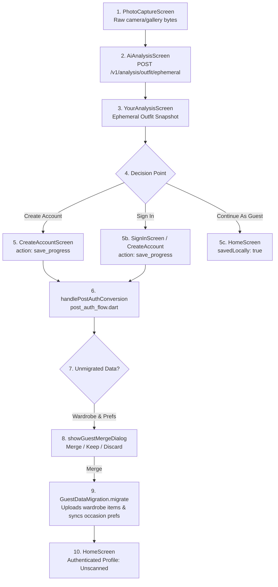

# FANSIVIBE — STAGE 1D: BATCH 1B GUEST PREVIEW DISCLOSURE REPORT

## 1. D10 Approval Reference

- **Decision ID**: **D10 — Guest Appearance Migration**
- **Approved Policy**: **Option A APPROVED**
- **Core Principles**:
  1. Initial guest photo analysis is strictly an ephemeral preview.
  2. Guest appearance analysis is not automatically migrated into the authenticated Person Model or PostgreSQL `user_state.style_profile`.
  3. Users who want a personalized profile must register or sign in and complete an authenticated scan.
  4. Users may continue exploring Fansivibe without an account.
  5. Zero automatic guest appearance snapshot replay or biometric migration.
- **Scope Restriction**: Authentication system is not redesigned; existing wardrobe and occasion preference migration behavior remains fully functional.

---

## 2. Initial Git Status & Preserved Batch 1A Changes

At the start of Batch 1B, the working tree contained the verified modifications from Batch 1A:
- **Repository**: `/home/tony/projects/fansivibe_v1_backup`
- **Branch**: `main`
- **Committed Baseline HEAD**: `97f6ded99d3f3e67b477616380320058cd396f48`
- **Preserved Batch 1A Modifications**:
  - `backend/app/domain/services/analysis_rules.py` (Zero-fabrication face shape: removed `_DEFAULT_FACE_SHAPE = "oval"`)
  - `backend/app/domain/services/grooming_rules.py` (Zero-fabrication grooming: removed `_DEFAULT_FACE_SHAPE = "oval"`)
  - `backend/app/ai/tools.py` (Zero-fabrication AI tools fallback: removed `"oval"` fallback in `recommend_hairstyle`)
  - `backend/app/domain/ports/repositories.py` (CAS & field-level provenance repository interface)
  - `backend/app/infrastructure/db/repositories.py` (Optimistic concurrency control with `version = version + 1`, `_provenance_{attr}`, protected confirmed user truth)
  - `backend/tests/test_analysis_rules.py` (Unit tests for zero-fabrication face shape)
  - `backend/tests/test_grooming_engine.py` (Unit tests for zero-fabrication grooming scoring)
  - `backend/tests/test_c09_style_profile_merge.py` (8 CAS & provenance unit tests)
  - `newproject/flutter_application_1/lib/features/outfit_builder/presentation/outfit_recommendation_screen.dart` (Metric badge label updated from `Style Score Impact` to `Ensemble Match`)
  - `newproject/flutter_application_1/test/outfit_builder_screens_test.dart` (Widget tests updated for `Ensemble Match`)
- **Preserved Untracked Stage 1 Documentation**:
  - `STAGE1_SPEC_TO_CODE_AUDIT.md`
  - `STAGE1_EXISTING_CAPABILITIES.md`
  - `STAGE1_GAP_ANALYSIS.md`
  - `STAGE1_GAP_ANALYSIS_FINAL.md`
  - `STAGE1_ARCHITECTURE_RISK_REPORT.md`
  - `STAGE1_IMPLEMENTATION_BLUEPRINT.md`
  - `STAGE1_BATCH1_PREIMPLEMENTATION_REVIEW.md`
  - `STAGE1_BATCH1A_IMPLEMENTATION_REPORT.md`

All Batch 1A changes were verified and preserved intact throughout Batch 1B.

---

## 3. Existing Guest Flow & Data Boundary Audit

A comprehensive trace of the guest lifecycle was performed:



### Data Boundary Classification:
1. **Raw Photo Bytes**: Stored only in volatile widget memory (`widget.imageBytes`) on `YourAnalysisScreen`. Disposed immediately when leaving the screen or retaking the photo. Zero server-side raw photo retention.
2. **Ephemeral Snapshot**: Stored locally in `LocalStorage.pendingEphemeralResult` for 24h with transient `sourceRunId` stripped. Used strictly for `hasCachedOutfitPreview()` and local preview rendering.
3. **Guest Data Migration (`guest_data_migration.dart`)**:
   - Explicitly transfers:
     - `learning.wardrobe`: device `local-*` items uploaded to `WardrobeRepository.createItem` with server-minted UUIDs.
     - `learning.preferredOccasions`: synced via `AssistantClient.syncPreferredOccasion`.
   - Explicitly **EXCLUDES**:
     - Face appearance profile (`faceShape`, `skinTone`, `bodyType`).
     - Legacy analysis blob.
     - Style type / vibe.
     - Learning signals (M10 sole-writer rules).
4. **Post-Authentication State**:
   - `handlePostAuthConversion` displays `'Account ready.'` on completion of `save_progress`.
   - Zero false claims indicating that the guest photo scan was migrated.
   - User profile requires an authenticated scan to populate `user_state.style_profile`.

---

## 4. Exact Disclosure Implementation

### 4.1 Primary Implementation File
`newproject/flutter_application_1/lib/features/onboarding/presentation/screens/your_analysis_screen.dart`

### 4.2 Disclosure Component: `_buildGuestPreviewDisclosure()`
Implemented as an accessible, prominent inline card directly above the conversion action buttons (`Create Account`, `Continue Without Account`, `Sign In to Continue`, `Retake Photo`):

```dart
Widget _buildGuestPreviewDisclosure() {
  return Container(
    width: double.infinity,
    padding: const EdgeInsets.all(FansivibeSpacing.md),
    decoration: BoxDecoration(
      color: FansivibeColors.surfaceContainerLow,
      borderRadius: FansivibeRadius.mdBorder,
      border: Border.all(
        color: FansivibeColors.primary.withValues(alpha: 0.25),
      ),
    ),
    child: Column(
      crossAxisAlignment: CrossAxisAlignment.start,
      children: [
        Row(
          children: [
            Icon(
              Icons.info_outline_rounded,
              size: 20,
              color: FansivibeColors.primary,
            ),
            SizedBox(width: FansivibeSpacing.sm),
            Expanded(
              child: Text(
                'Your style preview is temporary',
                style: FansivibeTypography.titleLargeWithFamily.copyWith(
                  fontSize: 16,
                  fontWeight: FontWeight.w600,
                  color: FansivibeColors.textPrimary,
                ),
              ),
            ),
          ],
        ),
        SizedBox(height: FansivibeSpacing.sm),
        Text(
          'Your guest scan gives you a preview of your style analysis. '
          'It is not saved as your personal profile.\n\n'
          'Create an account or sign in, then complete an authenticated scan '
          'to personalize your Fansivibe profile.\n\n'
          'You can also continue exploring without an account.',
          style: FansivibeTypography.bodyMediumWithFamily.copyWith(
            color: FansivibeColors.secondary,
            fontSize: 13,
            height: 1.45,
          ),
        ),
      ],
    ),
  );
}
```

### 4.3 Semantic Meaning Preservation:
1. **Meaning 1 (Temporary Preview)**:
   - Header: `"Your style preview is temporary"`
   - Body: `"Your guest scan gives you a preview of your style analysis."`
2. **Meaning 2 (Not Saved as Personal Profile)**:
   - Body: `"It is not saved as your personal profile."`
3. **Meaning 3 (Authenticated Scan Needed for Personalization)**:
   - Body: `"Create an account or sign in, then complete an authenticated scan to personalize your Fansivibe profile."`
4. **Meaning 4 (Continue Without Account Preserved)**:
   - Body: `"You can also continue exploring without an account."`

### 4.4 Authentication Gate
The card is conditionally rendered using `if (!AuthSession.isAuthenticated)`:
- Unauthenticated guest users see the disclosure before making a sign-in or registration decision.
- Authenticated users do not see guest preview warnings.

### 4.5 Supporting Copy Refinements
1. **Top Banner**:
   Updated from `"Guest preview ready — this first look ran on your photo. Create an account for the full personalized analysis."` to `"Guest preview ready — your style preview is temporary. Complete an authenticated scan after signing in to personalize your profile."`. Preserved honest empty state `"Nothing has been analyzed yet"`.
2. **Preview Card Footer**:
   Updated to `"Create an account and complete an authenticated scan to unlock your full personalized profile, history, and recommendations."`.
3. **Status Card Step 2**:
   Updated to `"Complete an authenticated scan for face shape and style matches."` to eliminate any false implication that the guest photo is queued for background ingestion.

---

## 5. Files Modified

| Component | File Path | Nature of Modification |
| :--- | :--- | :--- |
| **Flutter UI** | `newproject/flutter_application_1/lib/features/onboarding/presentation/screens/your_analysis_screen.dart` | Added `AuthSession` import; added prominent `_buildGuestPreviewDisclosure()` inline card above action buttons; updated banner and step copy to reinforce D10 authenticated scan requirement; guarded disclosure with `!AuthSession.isAuthenticated`. |
| **Flutter Tests** | `newproject/flutter_application_1/test/your_analysis_screen_test.dart` | Added test group `D10 Guest Preview Disclosure` with 6 dedicated widget and migration regression tests covering all 8 specified verification criteria. |
| **Repository Tracker** | `CURRENT_STATE.md` | Logged completion of Task STAGE1D-BATCH-1B. |

---

## 6. Migration Behavior Verification

Verification confirms that the existing implementation strictly obeys D10 Option A:
1. **Zero Biometric / Appearance Migration**:
   - `GuestDataMigration.migrate()` transfers only `wardrobe` entries and `preferredOccasions`.
   - Appearance profile (`faceShape`, `skinTone`, `bodyType`) is excluded by design (`guest_data_migration.dart:52-57`).
2. **Zero Snapshot Replay**:
   - `post_auth_flow.dart` does not replay `LocalStorage.pendingEphemeralResult`.
3. **Supported Migration Intact**:
   - Device wardrobe items (`local-*`) and occasion preferences continue to be migrated cleanly via `showGuestMergeDialog`.
4. **No False Claims**:
   - Post-auth snackbar states `"Account ready."` rather than claiming appearance analysis was saved.
5. **Clear Authenticated Path**:
   - After signing in, user lands on Home/Profile where authenticated scanning flows are available.

---

## 7. Tests Added and Executed

### 7.1 New Tests in `test/your_analysis_screen_test.dart`

```dart
group('D10 Guest Preview Disclosure', () {
  // Test 1, 2, 3: Disclosure visibility, preview meaning, authenticated scan instruction
  testWidgets('1 & 2 & 3. guest preview disclosure is visible with required temporary preview copy', ...);

  // Test 4: Create Account button navigates to RouteNames.createAccount
  testWidgets('4. Create Account navigation still works', ...);

  // Test 5: Sign In to Continue button navigates to account conversion
  testWidgets('5. Sign In navigation still works from disclosure screen', ...);

  // Test 6: Continue Without Account persists savedLocally and navigates to /home
  testWidgets('6. Continue Without Account still works from disclosure screen', ...);

  // Test 7: Disclosure suppressed when AuthSession.isAuthenticated is true
  testWidgets('7. disclosure is not incorrectly shown to authenticated users', ...);

  // Test 8: GuestDataMigration does not migrate appearance data or replay snapshots
  testWidgets('8. guest-to-authenticated transition does not imply appearance data migration', ...);
});
```

### 7.2 Execution Results

#### Flutter Test Execution
Command:
```bash
flutter test test/your_analysis_screen_test.dart test/guest_preview_test.dart test/guest_auth_conversion_test.dart test/guest_save_continuation_test.dart test/guest_step3_test.dart test/outfit_builder_screens_test.dart
```
Output:
```text
00:06 +116: All tests passed!
```
- `test/your_analysis_screen_test.dart`: **20/20 passed** (14 baseline + 6 new D10 tests)
- `test/guest_preview_test.dart`: **12/12 passed**
- `test/guest_auth_conversion_test.dart`: **35/35 passed**
- `test/guest_save_continuation_test.dart`: **2/2 passed**
- `test/guest_step3_test.dart`: **8/8 passed**
- `test/outfit_builder_screens_test.dart`: **39/39 passed**
- **Total Flutter tests**: **116 passed, 0 failed, 0 skipped**.

#### Backend Test Execution (Verifying Batch 1A Intact)
Command:
```bash
backend/.venv/bin/pytest backend/tests/test_analysis_rules.py backend/tests/test_c09_style_profile_merge.py backend/tests/test_grooming_engine.py
```
Output:
```text
======================== 117 passed, 1 skipped in 0.66s ========================
```
- `backend/tests/test_analysis_rules.py`: **75 passed**
- `backend/tests/test_c09_style_profile_merge.py`: **19 passed, 1 DB-conditional skipped**
- `backend/tests/test_grooming_engine.py`: **23 passed**
- **Total Backend tests**: **117 passed, 1 skipped, 0 failed**.

---

## 8. Flutter Static Analysis Results

Command:
```bash
flutter analyze lib/features/onboarding/presentation/screens/your_analysis_screen.dart test/your_analysis_screen_test.dart lib/features/outfit_builder/presentation/outfit_recommendation_screen.dart test/outfit_builder_screens_test.dart
```
Output:
```text
Analyzing 4 items...
No issues found! (ran in 1.1s)
```
Static analysis is 100% clean across all modified Flutter source and test files.

---

## 9. Remaining Risks

1. **User Discovery of Authenticated Scan**:
   - Users continuing past registration must find the authenticated scan trigger on Home or Profile. While the navigation paths exist, future onboarding work could provide a post-auth prompt offering an immediate scan.
2. **Device-Local Snapshot Expiry**:
   - Guest snapshot expires after 24 hours via `peekPendingEphemeralResult`. Users who return as guests after 24h will find an empty cache and must capture a fresh photo. This fails safely and matches product intent.

---

## 10. Final Git Status and Diff Summary

### Git Status
```text
 M CURRENT_STATE.md
 M backend/app/ai/tools.py
 M backend/app/domain/ports/repositories.py
 M backend/app/domain/services/analysis_rules.py
 M backend/app/domain/services/grooming_rules.py
 M backend/app/infrastructure/db/repositories.py
 M backend/tests/test_analysis_rules.py
 M backend/tests/test_c09_style_profile_merge.py
 M backend/tests/test_grooming_engine.py
 M newproject/flutter_application_1/lib/features/onboarding/presentation/screens/your_analysis_screen.dart
 M newproject/flutter_application_1/lib/features/outfit_builder/presentation/outfit_recommendation_screen.dart
 M newproject/flutter_application_1/test/outfit_builder_screens_test.dart
 M newproject/flutter_application_1/test/your_analysis_screen_test.dart
?? STAGE1_ARCHITECTURE_RISK_REPORT.md
?? STAGE1_BATCH1A_IMPLEMENTATION_REPORT.md
?? STAGE1_BATCH1B_GUEST_DISCLOSURE_REPORT.md
?? STAGE1_BATCH1_PREIMPLEMENTATION_REVIEW.md
?? STAGE1_EXISTING_CAPABILITIES.md
?? STAGE1_GAP_ANALYSIS.md
?? STAGE1_GAP_ANALYSIS_FINAL.md
?? STAGE1_IMPLEMENTATION_BLUEPRINT.md
?? STAGE1_SPEC_TO_CODE_AUDIT.md
```

### Git Diff Stat
```text
 CURRENT_STATE.md                                   |   4 +
 backend/app/ai/tools.py                            |  16 +-
 backend/app/domain/ports/repositories.py           |  11 +-
 backend/app/domain/services/analysis_rules.py      |  17 +-
 backend/app/domain/services/grooming_rules.py      |  11 +-
 backend/app/infrastructure/db/repositories.py      | 192 +++++++++--
 backend/tests/test_analysis_rules.py               |  48 ++-
 backend/tests/test_c09_style_profile_merge.py      | 355 ++++++++++++++++++++-
 backend/tests/test_grooming_engine.py              |  29 +-
 .../presentation/screens/your_analysis_screen.dart |  63 +++-
 .../presentation/outfit_recommendation_screen.dart |   6 +-
 .../test/outfit_builder_screens_test.dart          |   4 +-
 .../test/your_analysis_screen_test.dart            | 328 +++++++++++++++++++
 13 files changed, 1020 insertions(+), 64 deletions(-)
```

### Whitespace Verification
`git diff --check` passed with 0 errors.

---

*End of Fansivibe Stage 1D Batch 1B Implementation Report.*
