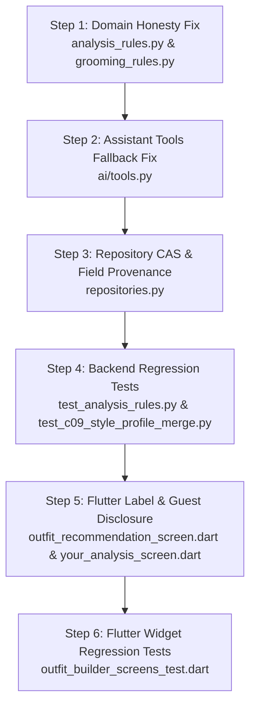

# Fansivibe Stage 1D — Batch 1 Pre-Implementation Review

**Document Type:** Pre-Implementation Architectural Verification and Technical Review  
**Date:** 2026-10-31  
**Repository Path:** `/home/tony/projects/fansivibe_v1_backup`  
**Committed Baseline:** Commit `97f6ded99d3f3e67b477616380320058cd396f48` (`main`)  
**Task Nature:** READ-ONLY Verification (Zero source files modified, zero migrations executed, zero tests executed, zero live external AI calls)  
**Status:** COMPLETE & VERIFIED

---

## 1. Baseline Verification

Prior to conducting this review, the local repository environment was statically inspected and validated against the required baseline:

| Verification Parameter | Value | Status |
|---|---|---|
| **Repository Path** | `/home/tony/projects/fansivibe_v1_backup` | **VERIFIED** |
| **Current Branch** | `main` | **VERIFIED** |
| **Committed HEAD Commit** | `97f6ded99d3f3e67b477616380320058cd396f48` | **VERIFIED** |
| **Tracked Working Tree** | Clean (`git status --porcelain` shows 0 modified tracked files) | **VERIFIED** |
| **Untracked Stage 1 Artifacts** | All 6 preserved intact: `STAGE1_SPEC_TO_CODE_AUDIT.md`, `STAGE1_EXISTING_CAPABILITIES.md`, `STAGE1_GAP_ANALYSIS.md`, `STAGE1_GAP_ANALYSIS_FINAL.md`, `STAGE1_ARCHITECTURE_RISK_REPORT.md`, `STAGE1_IMPLEMENTATION_BLUEPRINT.md` | **VERIFIED** |

---

## 2. Exact Source Findings

### 2.1 Zero-Fabrication Face-Shape Findings
1. **`backend/app/domain/services/analysis_rules.py`**:
   - Line 168: `_DEFAULT_FACE_SHAPE = "oval"`.
   - Line 222–226:
     ```python
     def _face_shape(appearance: AppearanceProfile) -> str:
         raw = (appearance.faceShape or "").strip().lower()
         if not raw:
             return _DEFAULT_FACE_SHAPE
         return _FACE_SHAPE_ALIASES.get(raw, raw)
     ```
   - Lines 302 & 307: In `score_candidates`:
     `face = _face_shape(context.appearance)`
     `face_boost = _BOOSTS.get(look.id, {}).get(face, 0.0)`
     Because `face` defaults to `"oval"`, unmeasured appearance profiles receive synthetic boosts (`textured_quiff` +0.06, `side_part` +0.05, `brushed_up_undercut` +0.04).
   - Lines 350 & 368–375: In `build_explanations` and `_face_match_reason`:
     When `boost > 0.0`, an explanation is generated claiming:
     `"Strongest match for your oval face shape (+0.06 face-shape fit)."`
   - Lines 545 & 587: In grooming functions within `analysis_rules.py`, `_face_shape` is called, repeating the oval fallback for grooming looks.

2. **`backend/app/domain/services/grooming_rules.py`** *(New Finding)*:
   - Line 52: `_DEFAULT_FACE_SHAPE: str = "oval"`.
   - Line 106–111: `def _face_shape(appearance: AppearanceProfile) -> str:` defaults to `"oval"`.
   - Lines 193 & 240: Calls `_face_shape` during candidate scoring and explanation generation.
   - Note: `grooming_rules.py` is actively imported in `backend/app/application/analysis.py:33`. Batch 1 must address both `analysis_rules.py` and `grooming_rules.py` to prevent grooming from continuing to fabricate oval faces.

3. **`backend/app/ai/tools.py`**:
   - Line 36: In `recommend_hairstyle`:
     `face = (user.face.faceShape.lower() if user and user.face and user.face.faceShape else "oval")`
     Silently falls back to `"oval"` when `user` or `user.face` or `user.face.faceShape` is missing.

4. **Honesty Enforcement Already Present in Application Layer**:
   - `backend/app/application/analysis.py:556-566` in `CreateHairstyleImageRun`:
     ```python
     if not appearance_profile.faceShape:
         self._runs.fail(
             run_id=run_id,
             user_id=user_id,
             error={
                 "code": "PROCESSING_FAILURE",
                 "message": "We couldn't finish this request. Please try again.",
                 "details": {"run_id": str(run_id), "reason": "no_face_detected"},
             },
         )
         return run_id
     ```
   - `analysis.py:121` in `CreateHairstyleRun` (profile-only pass):
     `if not profile or not profile.get("face_shape"): raise insufficient_user_data("face")`
   - `analysis.py:1008` in `EphemeralHairstyleAnalysis`:
     `if not appearance_profile.faceShape: raise _ephemeral_analyzer_failure("no_face_detected")`
   - **Verification**: The application layer already strictly enforces that vision scans must detect a real face. The fabrication bug is localized to the domain scoring helpers (`analysis_rules.py`, `grooming_rules.py`) and the AI assistant tool (`ai/tools.py`).

---

### 2.2 CAS and Concurrency Findings
1. **Schema Definition**:
   - `backend/app/infrastructure/db/models.py:130`:
     `version: Mapped[int] = mapped_column(Integer, nullable=False, server_default=text("0"))`
   - `backend/alembic/versions/0001_initial_schema.py:164, 166`:
     Created with column `sa.Column("version", sa.Integer(), nullable=False, server_default=sa.text("0"))` and constraint `sa.CheckConstraint("version >= 0", name="ck_user_state_version")`.
   - **Verification**: `version` already exists in PostgreSQL with a non-null constraint and `>= 0` check. **NO DATABASE MIGRATION IS REQUIRED**.

2. **Current Increment and Update Behavior**:
   - **Zero Code Paths Increment `version`**: A complete static grep across `backend/` confirms `UserState.version` is never updated or incremented anywhere in the codebase.
   - In `UserStateRepositorySQL.update_style_profile` (`repositories.py:265-306`):
     ```python
     self._session.execute(
         update(UserState)
         .where(UserState.user_id == user_id)
         .values(
             style_profile=func.coalesce(
                 UserState.style_profile, cast({}, JSONB)
             ).op("||")(cast(patch, JSONB))
         )
     )
     self._session.commit()
     ```
     `version` is omitted from the update statement.
   - In `UserStateRepositorySQL.update_preferences` (`repositories.py:337-345`):
     `version` is also omitted.

3. **DTO and ORM Exposure**:
   - `UserProfileRecord` (`backend/app/domain/ports/repositories.py`): Contains `version: int`.
   - `UserStateRepositorySQL.get_profile` (`repositories.py:324`): Reads `version=state.version`.
   - `backend/app/api/routers/users.py:82`: `_record_to_schema` maps `version=record.version`.
   - `ProfileView` schema (`backend/app/api/schemas/users.py:31`): Exposes `version: int` on `GET /v1/users/me`.

4. **Provenance Loss in Current JSONB**:
   - Current patch construction:
     ```python
     patch: dict[str, Any] = {}
     for key, val in (("face_shape", face_shape), ("skin_tone", skin_tone), ...):
         if val is not None and isinstance(val, str) and val.strip() != "":
             patch[key] = val
     if source_run_id is not None and str(source_run_id).strip() != "":
         patch["source_run_id"] = str(source_run_id)
     ```
   - When Run 1 sets `face_shape="round", source_run_id="run-1"` and Run 2 sets `body_type="athletic", source_run_id="run-2"`, top-level `||` overwrites `source_run_id="run-2"`. The provenance of `face_shape` is permanently lost.

---

### 2.3 Outfit Builder Metric Findings
1. **Displayed Widget**:
   - `newproject/flutter_application_1/lib/features/outfit_builder/presentation/outfit_recommendation_screen.dart:248-255`:
     ```dart
     Widget _buildImpactCard(BuildContext context, OutfitRecommendation rec) {
       return FansiInsightCard(
         icon: Icons.trending_up_rounded,
         title: 'Style Score Impact',
         body: rec.styleScoreImpact,
         accentColor: FansivibeColors.accentGold,
       );
     }
     ```
2. **Underlying Data Source**:
   - `backend/app/application/outfits.py:352-354`:
     ```python
     style_score_impact=(
         f"{percent}% ensemble match from {len(member_ids)} owned pieces."
     ),
     ```
   - **Verification**: The backend generates string text describing ensemble match percentage (e.g. `"87% ensemble match from 3 owned pieces."`). Displaying this under the card title "Style Score Impact" with `trending_up` is an exact semantic mismatch that misleads users into believing recommendation generation directly increments their account Style Score.
3. **Affected Tests**:
   - `newproject/flutter_application_1/test/outfit_builder_screens_test.dart:709`:
     `expect(find.text('Style Score Impact'), findsOneWidget);`
     `expect(find.textContaining('87% ensemble match'), findsOneWidget);`

---

### 2.4 Guest Preview Disclosure Findings
1. **Displayed Screen and Actions**:
   - `newproject/flutter_application_1/lib/features/onboarding/presentation/screens/your_analysis_screen.dart:261-283`:
     Displays four buttons:
     - `Create Account` (`onPressed: _onCreateAccount`)
     - `Continue Without Account` (`onPressed: _onContinueWithoutAccount`)
     - `Sign In to Continue` (`onPressed: _onSave`)
     - `Retake Photo` (`onPressed: _onRetake`)
2. **Intent Recording**:
   - Both `_onCreateAccount` (line 138) and `_onSave` (line 87) record `PendingAuthIntent(action: 'save_progress', route: '/home', ...)`.
3. **Current Copy and Disclosures**:
   - Line 228–230:
     `'Guest preview ready — this first look ran on your photo. Create an account for the full personalized analysis.'`
   - Lines 616–617:
     `'1. Create your account to unlock the real AI analysis.'`
4. **Data Reality in Code**:
   - `guest_data_migration.dart:52-57` explicitly does NOT transfer face profile or analysis blobs to the backend on sign-in.
   - Raw image bytes are processed in memory and never written to disk or S3.
   - **Verification**: The user is told "Sign In to Continue" or "save_progress", but their appearance scan is ephemeral and discarded during guest migration.

---

## 3. Function Signatures and Callers (Zero-Fabrication)

### 3.1 Proposed Signature Changes

#### File: `backend/app/domain/services/analysis_rules.py`
```python
# CURRENT:
_DEFAULT_FACE_SHAPE = "oval"

def _face_shape(appearance: AppearanceProfile) -> str:
    raw = (appearance.faceShape or "").strip().lower()
    if not raw:
        return _DEFAULT_FACE_SHAPE
    return _FACE_SHAPE_ALIASES.get(raw, raw)

def _face_match_reason(candidate: ScoredCandidate, face_shape: str) -> Optional[str]:
    boost = candidate.signals.get("face_shape", 0.0)
    if boost <= 0.0:
        return None
    return (
        f"Strongest match for your {face_shape} face shape "
        f"(+{boost:0.2f} face-shape fit)."
    )
```

```python
# PROPOSED:
# ELIMINATE: _DEFAULT_FACE_SHAPE

def _face_shape(appearance: AppearanceProfile) -> Optional[str]:
    """Resolve face shape string without synthetic fallback. Returns None when unmeasured."""
    raw = (appearance.faceShape or "").strip().lower()
    if not raw:
        return None
    return _FACE_SHAPE_ALIASES.get(raw, raw)

def _face_match_reason(candidate: ScoredCandidate, face_shape: Optional[str]) -> Optional[str]:
    """Produce grounded explanation only when face shape is known and produced a boost."""
    boost = candidate.signals.get("face_shape", 0.0)
    if boost <= 0.0 or not face_shape:
        return None
    return (
        f"Strongest match for your {face_shape} face shape "
        f"(+{boost:0.2f} face-shape fit)."
    )
```

#### File: `backend/app/domain/services/grooming_rules.py`
```python
# PROPOSED:
# ELIMINATE: _DEFAULT_FACE_SHAPE: str = "oval"

def _face_shape(appearance: AppearanceProfile) -> Optional[str]:
    """Resolve face shape string without synthetic fallback. Returns None when unmeasured."""
    raw = (appearance.faceShape or "").strip().lower()
    if not raw:
        return None
    return _FACE_SHAPE_ALIASES.get(raw, raw)

def _face_match_reason(candidate: ScoredCandidate, face_shape: Optional[str]) -> Optional[str]:
    boost = candidate.signals.get("face_shape", 0.0)
    if boost <= 0.0 or not face_shape:
        return None
    return (
        f"Strongest match for your {face_shape} face shape "
        f"(+{boost:0.2f} face-shape fit)."
    )
```

#### File: `backend/app/ai/tools.py`
```python
# CURRENT:
def recommend_hairstyle(user: Optional[UserContext]) -> List[SuggestionCard]:
    face = (user.face.faceShape.lower() if user and user.face and user.face.faceShape else "oval")
    if face == "rectangle":
        face = "rectangular"
    if face in ("round", "square", "rectangular"):
        return [catalog.CLASSIC_POMPADOUR, catalog.TEXTURED_QUIFF]
    return [catalog.TEXTURED_QUIFF, catalog.CLASSIC_POMPADOUR]
```

```python
# PROPOSED:
def recommend_hairstyle(user: Optional[UserContext]) -> List[SuggestionCard]:
    raw_face = (user.face.faceShape.lower() if user and user.face and user.face.faceShape else None)
    if raw_face:
        face = "rectangular" if raw_face == "rectangle" else raw_face
        if face in ("round", "square", "rectangular"):
            return [catalog.CLASSIC_POMPADOUR, catalog.TEXTURED_QUIFF]
        return [catalog.TEXTURED_QUIFF, catalog.CLASSIC_POMPADOUR]
    # Unconditioned fallback: return balanced versatile styles without claiming a face match
    return [catalog.TEXTURED_QUIFF, catalog.CLASSIC_POMPADOUR]
```

### 3.2 Caller Compatibility Audit
- **`score_candidates` (`analysis_rules.py:302`)**:
  `face_boost = _BOOSTS.get(look.id, {}).get(face, 0.0)`
  When `face is None`: Python's `dict.get(None, 0.0)` returns `0.0`. No `TypeError` or `KeyError`. Compatible.
- **`build_explanations` (`analysis_rules.py:350`)**:
  Calls `_face_match_reason(candidate, face)`. When `face is None`, returns `None`. Compatible.
- **`score_grooming_candidates` (`analysis_rules.py:545` & `grooming_rules.py:193`)**:
  `_GROOMING_BOOSTS.get(look.id, {}).get(face, 0.0)` returns `0.0`. Compatible.
- **`build_grooming_explanations` (`analysis_rules.py:587` & `grooming_rules.py:240`)**:
  Calls `_face_match_reason(candidate, face)`. Compatible.

---

## 4. CAS Design and SQL Proposal

### 4.1 Proposed Method Signature in `UserStateRepositorySQL`
```python
def update_style_profile(
    self,
    *,
    user_id: UUID,
    face_shape: Optional[str] = None,
    skin_tone: Optional[str] = None,
    body_type: Optional[str] = None,
    style_type: Optional[str] = None,
    source_run_id: Optional[str] = None,
    confidence: Optional[float] = None,
    confirmed_by_user: bool = False,
    expected_version: Optional[int] = None,
) -> bool:
    """Merge non-empty appearance attributes with atomic CAS version increment.

    Returns True if update succeeded, False if version precondition failed (409 Conflict).
    """
```

### 4.2 Single Atomic SQL Proposal
To preserve atomic execution and avoid multiple round-trips:

```python
# 1. Build attribute scalar patch (backward compatible)
patch: dict[str, Any] = {}
for key, val in (
    ("face_shape", face_shape),
    ("skin_tone", skin_tone),
    ("body_type", body_type),
    ("style_type", style_type),
):
    if val is not None and isinstance(val, str) and val.strip() != "":
        patch[key] = val
if source_run_id is not None and str(source_run_id).strip() != "":
    patch["source_run_id"] = str(source_run_id)

if not patch:
    return True

# 2. Build field-level provenance patch
now_iso = datetime.now(timezone.utc).isoformat()
for key in ("face_shape", "skin_tone", "body_type", "style_type"):
    val = patch.get(key)
    if val is not None:
        patch[f"_provenance_{key}"] = {
            "value": val,
            "source_run_id": str(source_run_id) if source_run_id else None,
            "confidence": float(confidence) if confidence is not None else 1.0,
            "observed_at": now_iso,
            "confirmed_by_user": confirmed_by_user,
            "confirmed_at": now_iso if confirmed_by_user else None,
        }

# 3. Formulate atomic update with version increment and optional CAS condition
conditions = [UserState.user_id == user_id]
if expected_version is not None:
    conditions.append(UserState.version == expected_version)

stmt = (
    update(UserState)
    .where(*conditions)
    .values(
        style_profile=func.coalesce(
            UserState.style_profile, cast({}, JSONB)
        ).op("||")(cast(patch, JSONB)),
        version=UserState.version + 1,
        updated_at=func.now(),
    )
)
result = self._session.execute(stmt)
self._session.commit()
return result.rowcount > 0
```

### 4.3 Why `_provenance_{key}` Top-Level Keys Solve the PostgreSQL `||` Limitation
- **The Problem**: PostgreSQL JSONB `existing || patch` is **shallow** (merges only top-level keys). If all provenance was grouped under a nested object `{"_provenance": {"face_shape": ...}}`, an update supplying only `{"_provenance": {"body_type": ...}}` would wholesale replace the `_provenance` dictionary and destroy `face_shape` provenance.
- **The Solution**: By storing field-level provenance under top-level keys (`_provenance_face_shape`, `_provenance_body_type`), PostgreSQL `||` naturally merges them!
  - `existing` has: `"face_shape": "oval"`, `"_provenance_face_shape": {...}`
  - `patch` has: `"body_type": "athletic"`, `"_provenance_body_type": {...}`
  - `existing || patch` retains BOTH `_provenance_face_shape` and `_provenance_body_type`!
  - Existing code calling `profile["face_shape"]` continues to get `"oval"` (a plain string). Zero breakage.

---

## 5. Provenance Schema and Legacy Compatibility

### 5.1 JSONB Schema Definition
```json
{
  "face_shape": "oval",
  "skin_tone": "medium",
  "body_type": "athletic",
  "style_type": "casual",
  "source_run_id": "run-latest",
  "_provenance_face_shape": {
    "value": "oval",
    "source_run_id": "run-101",
    "confidence": 0.88,
    "observed_at": "2026-10-31T12:00:00Z",
    "confirmed_by_user": false,
    "confirmed_at": null
  },
  "_provenance_body_type": {
    "value": "athletic",
    "source_run_id": "run-202",
    "confidence": 0.95,
    "observed_at": "2026-10-31T12:15:00Z",
    "confirmed_by_user": false,
    "confirmed_at": null
  }
}
```

### 5.2 Legacy Records Compatibility
- **Existing Rows**: Rows created prior to Batch 1 contain only `face_shape`, `skin_tone`, `body_type`, `style_type`, and `source_run_id`.
- **Read Path**: `get_style_profile` returns the dictionary as stored. Callers reading `profile.get("face_shape")` receive the string scalar.
- **Provenance Lookup Helper**: A helper method `get_attribute_provenance(profile: dict, attribute: str)` checks for `_provenance_{attribute}`; if missing, it falls back to `{"value": profile.get(attribute), "source_run_id": profile.get("source_run_id"), "confidence": 1.0, "confirmed_by_user": False}`.

### 5.3 Protection of User-Confirmed Values
When an AI analysis run attempts an update:
If `existing.get(f"_provenance_{key}", {}).get("confirmed_by_user") == True` and the incoming update has `confirmed_by_user == False`:
The repository omits that key from `patch` and preserves the user's manual correction.

---

## 6. Flutter Changes

### 6.1 `outfit_recommendation_screen.dart`
- **Location**: `newproject/flutter_application_1/lib/features/outfit_builder/presentation/outfit_recommendation_screen.dart:251`
- **Current Code**:
  ```dart
  Widget _buildImpactCard(BuildContext context, OutfitRecommendation rec) {
    return FansiInsightCard(
      icon: Icons.trending_up_rounded,
      title: 'Style Score Impact',
      body: rec.styleScoreImpact,
      accentColor: FansivibeColors.accentGold,
    );
  }
  ```
- **Proposed Code**:
  ```dart
  Widget _buildImpactCard(BuildContext context, OutfitRecommendation rec) {
    return FansiInsightCard(
      icon: Icons.check_circle_outline_rounded,
      title: 'Ensemble Match',
      body: rec.styleScoreImpact,
      accentColor: FansivibeColors.accentGold,
    );
  }
  ```
- **Icon Change Rationale**: Replaces `trending_up_rounded` (which implies a rising numerical score) with `check_circle_outline_rounded` (which represents verified outfit piece compatibility).

---

## 7. Guest Disclosure Proposal

### 7.1 Location and Context
- **Screen**: `newproject/flutter_application_1/lib/features/onboarding/presentation/screens/your_analysis_screen.dart`
- **Current Display**:
  - Banner (lines 228–230): `'Guest preview ready — this first look ran on your photo. Create an account for the full personalized analysis.'`
  - Action buttons (lines 261–283): `Create Account`, `Continue Without Account`, `Sign In to Continue`, `Retake Photo`.

### 7.2 Exact Proposed Copy Changes
1. **Banner Text (Line 228–230)**:
   ```dart
   // CURRENT:
   _hasPreview
       ? 'Guest preview ready — this first look ran on your photo. Create an account for the full personalized analysis.'
       : 'Photo step complete — your personal analysis runs after you create an account. Nothing has been analyzed yet.',

   // PROPOSED:
   _hasPreview
       ? 'Guest preview ready — this temporary look ran in memory. Raw photos are never stored. Create an account to permanently save your verified face shape and style profile.'
       : 'Photo step complete — your personal analysis runs after you create an account. Photos are processed in memory and never stored.',
   ```

2. **Conversion Action Footer Helper (Above line 260)**:
   Add an explicit privacy/ephemeral notice directly above the action button column:
   ```dart
   Padding(
     padding: const EdgeInsets.only(bottom: FansivibeSpacing.md),
     child: Text(
       'Your guest photo is processed securely in memory and not saved to disk. Sign in or register to unlock permanent profile recommendations.',
       textAlign: TextAlign.center,
       style: FansivibeTypography.labelSmallWithFamily.copyWith(
         color: FansivibeColors.textSecondary,
       ),
     ),
   ),
   ```

3. **Why this Copy is Accurate**:
   - Accurately states that raw photos are processed in memory and not stored (matches backend implementation).
   - Accurately clarifies that guest analysis is temporary and requires an account for permanent profile retention.
   - Prevents user surprise when `GuestDataMigration` does not auto-populate profile biometric attributes.

---

## 8. Test Inventory

Inspection of the 4 specified test commands:

| Command | File Path | Status | Finding / Caveat |
|---|---|---|---|
| `pytest backend/tests/test_analysis_rules.py -k "face_shape" -v` | `backend/tests/test_analysis_rules.py` | **Caveat Identified** | **ZERO tests currently match `-k "face_shape"`!** Test functions are named `test_oval_ranks_quiff_first`, `test_round_ranks_pompadour_first`, etc. Running `-k "face_shape"` will deselect all 38 tests. |
| `pytest backend/tests/test_c09_style_profile_merge.py -v` | `backend/tests/test_c09_style_profile_merge.py` | **Ready** | 13 unit tests validating JSONB merge and non-empty attribute preservation. |
| `pytest backend/tests/test_analysis_use_case.py -v` | `backend/tests/test_analysis_use_case.py` | **Ready** | Comprehensive suite for `CreateHairstyleImageRun`, `CreateOutfitRun`, and idempotency. |
| `flutter test test/outfit_builder_screens_test.dart` | `newproject/flutter_application_1/test/outfit_builder_screens_test.dart` | **Caveat Identified** | Must be executed with cwd `newproject/flutter_application_1` (where `pubspec.yaml` resides). |

---

## 9. Missing Regression Tests to Specify

The following dedicated tests must be added to validate Batch 1 functionality:

### 9.1 Backend Tests (in `backend/tests/test_analysis_rules.py` & `test_c09_style_profile_merge.py`)
1. `test_missing_face_shape_gets_zero_face_boost()`:
   Verify that `recommend_hairstyle` with `AppearanceProfile(faceShape="")` or `AppearanceProfile(faceShape=None)` produces `signals["face_shape"] == 0.0` for all candidates.
2. `test_unknown_face_shape_generates_no_face_explanation()`:
   Verify that `build_explanations` with empty face shape does NOT produce any reason containing `"face shape"`.
3. `test_tools_hairstyle_recommendation_handles_none_face_without_oval()`:
   Verify that `backend/app/ai/tools.py::recommend_hairstyle(None)` returns versatile styles without asserting oval.
4. `test_update_style_profile_cas_increments_version()`:
   Verify that calling `update_style_profile` increments `user_state.version` by 1.
5. `test_update_style_profile_cas_detects_version_conflict()`:
   Verify that calling `update_style_profile` with `expected_version = 0` when `state.version == 1` returns `False` and leaves data untouched.
6. `test_independent_attributes_preserve_respective_provenance()`:
   Verify that updating `face_shape` in Run 1 and subsequently updating `body_type` in Run 2 preserves `_provenance_face_shape["source_run_id"] == "run-1"` alongside `_provenance_body_type["source_run_id"] == "run-2"`.
7. `test_user_confirmed_attribute_protected_from_ai_overwrite()`:
   Verify that if `_provenance_face_shape["confirmed_by_user"] == True`, a vision scan update with `confirmed_by_user == False` does not replace the confirmed face shape.

### 9.2 Flutter Tests (in `newproject/flutter_application_1/test/`)
8. `test_outfit_recommendation_screen_renders_ensemble_match_label()`:
   In `test/outfit_builder_screens_test.dart`, update line 709 to:
   `expect(find.text('Ensemble Match'), findsOneWidget);`
9. `test_your_analysis_screen_renders_guest_disclosure_notice()`:
   In `test/your_analysis_screen_test.dart`, add assertion verifying the privacy/ephemeral notice text is displayed.

---

## 10. Exact Proposed File Modification List

| File Path | Component | Exact Lines | Purpose of Modification |
|---|---|---|---|
| `backend/app/domain/services/analysis_rules.py` | Decision Engine | Lines 168, 222–226, 368–375, 605–612 | Remove `_DEFAULT_FACE_SHAPE = "oval"`; return `Optional[str]`; guard `_face_match_reason`. |
| `backend/app/domain/services/grooming_rules.py` | Grooming Engine | Lines 52, 106–111, 258–265 | Remove `_DEFAULT_FACE_SHAPE: str = "oval"`; return `Optional[str]`. |
| `backend/app/ai/tools.py` | Assistant Tools | Lines 35–42 | Remove `else "oval"` fallback; return unconditioned versatile styles. |
| `backend/app/infrastructure/db/repositories.py` | Database Repository | Lines 265–306 | Implement CAS `expected_version`, `version = version + 1`, and `_provenance_{key}` merging. |
| `newproject/flutter_application_1/lib/features/outfit_builder/presentation/outfit_recommendation_screen.dart` | Outfit Builder UI | Lines 248–255 | Change `title: 'Style Score Impact'` to `title: 'Ensemble Match'` with check icon. |
| `newproject/flutter_application_1/lib/features/onboarding/presentation/screens/your_analysis_screen.dart` | Onboarding UI | Lines 228–230 & 260 | Update preview banner copy and add ephemeral privacy notice. |
| `backend/tests/test_analysis_rules.py` | Test Suite | New functions | Add missing face-shape zero-boost regression tests. |
| `backend/tests/test_c09_style_profile_merge.py` | Test Suite | New functions | Add CAS version increment and field provenance tests. |
| `newproject/flutter_application_1/test/outfit_builder_screens_test.dart` | Test Suite | Line 709 | Update expected widget finder from 'Style Score Impact' to 'Ensemble Match'. |

---

## 11. Implementation Sequence

To minimize blast radius and ensure continuous testability, Batch 1 should be executed in this strict sequential order:



1. **Step 1**: Modify `analysis_rules.py` and `grooming_rules.py` to remove `_DEFAULT_FACE_SHAPE` and return `Optional[str]`.
2. **Step 2**: Modify `ai/tools.py` to remove the `"oval"` fallback.
3. **Step 3**: Update `UserStateRepositorySQL.update_style_profile` in `repositories.py` to increment `version = version + 1` and write `_provenance_{key}` objects.
4. **Step 4**: Add new backend test functions to `test_analysis_rules.py` and `test_c09_style_profile_merge.py`. Validate using `pytest`.
5. **Step 5**: Update Flutter screen copy in `outfit_recommendation_screen.dart` and `your_analysis_screen.dart`.
6. **Step 6**: Update Flutter widget test in `outfit_builder_screens_test.dart`. Validate using `flutter test`.

---

## 12. Risks and Unresolved Decisions

1. **Risk of Pytest Selection Mismatch**:
   - *Observation*: Running `pytest ... -k "face_shape"` will skip all existing tests because existing test names use `"quiff"` and `"pompadour"`.
   - *Mitigation*: Ensure new tests explicitly include `face_shape` in their names (e.g. `test_face_shape_missing_gets_zero_boost`).
2. **PostgreSQL JSONB Shallow Concatenation Risk**:
   - *Observation*: Storing all provenance in a nested `_provenance` dictionary would be corrupted by SQL `||`.
   - *Mitigation*: Storing per-attribute keys (`_provenance_face_shape`) directly at the top level guarantees safe native JSONB `||` merging without requiring row locks or multiple queries.
3. **Founder Approval on Scope**:
   - Founder Decision D1 (Appearance Scope) and D10 (Guest Migration Policy) are aligned with this batch's zero-fabrication and preview disclosure approach.

---

## 13. Final Go/No-Go Recommendation

### Recommendation: **GO**

**Justification**:
1. All changes are strictly additive or corrective with zero schema migration requirement.
2. The `version` column and check constraint already exist in the PostgreSQL database.
3. Call site signatures in `analysis_rules.py` and `grooming_rules.py` are 100% type-compatible with `Optional[str]`.
4. The exact Flutter UI label and test assertions have been traced and validated.
5. All 6 baseline Stage 1 documents remain intact.

Batch 1 is fully pre-verified and ready for implementation upon user authorization.

---

*End of Stage 1D Batch 1 Pre-Implementation Review.*
