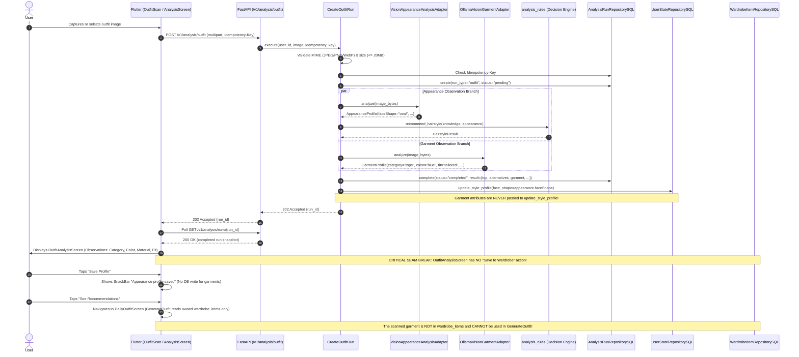
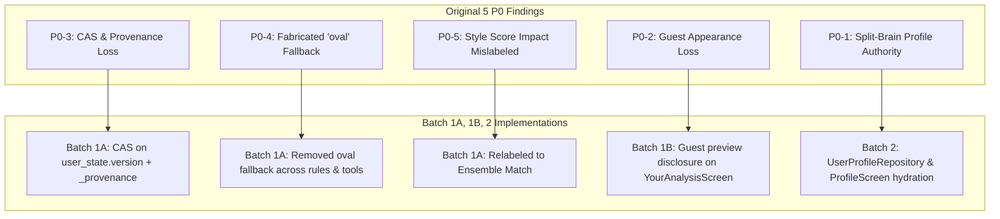

# Fansivibe Stage 1D — Batch 3 Pre-Implementation Review
## Outfit Scan Pipeline Grounding & Multi-Retailer Commerce Alignment

**Document Type:** Pre-Implementation Architectural Verification, Requirements Audit, and Workstream Boundary Assessment  
**Date:** 2026-10-31  
**Repository:** `/home/tony/projects/fansivibe_v1_backup`  
**Verified Committed Baseline:** Commit `97f6ded99d3f3e67b477616380320058cd396f48` (`main`)  
**Task Nature:** READ-ONLY Verification (Zero source files modified, zero migrations executed, zero tests executed, zero live external AI calls, zero commits/pushes)  
**Status:** COMPLETE & VERIFIED

---

## 1. Verified Repository Baseline

Prior to conducting this architectural and requirements audit, the repository environment was formally inspected and verified against the committed baseline and local modifications from previous Stage 1 batches:

| Parameter | Required Value | Verified Baseline | Verification Command / Output | Status |
|---|---|---|---|---|
| **Repository Path** | `/home/tony/projects/fansivibe_v1_backup` | `/home/tony/projects/fansivibe_v1_backup` | `pwd` | **MATCH** |
| **Active Branch** | `main` | `main` | `git branch --show-current` -> `main` | **MATCH** |
| **Committed HEAD** | `97f6ded99d3f3e67b477616380320058cd396f48` | `97f6ded99d3f3e67b477616380320058cd396f48` | `git rev-parse HEAD` | **MATCH** |
| **Tracked Modifications** | Batches 1A, 1B, 2 changes intact | 20 tracked files modified | `git status --short`, `git diff --stat` | **PRESERVED** |
| **Untracked Reports** | Preserved intact | 10 Stage 1 markdown reports + 4 Flutter profile files | `ls -la STAGE1*` | **PRESERVED** |
| **Safety Invariants** | Zero migrations, no live AI | Enforced | Zero migrations executed; no external network calls | **VERIFIED** |

### Working Tree State at Audit Start:
- `git status --short`:
  - `M CURRENT_STATE.md`
  - `M backend/app/ai/tools.py`
  - `M backend/app/domain/ports/repositories.py`
  - `M backend/app/domain/services/analysis_rules.py`
  - `M backend/app/domain/services/grooming_rules.py`
  - `M backend/app/infrastructure/db/repositories.py`
  - `backend/tests/`: `test_analysis_rules.py`, `test_c09_style_profile_merge.py`, `test_get_profile.py`, `test_grooming_engine.py`
  - `newproject/flutter_application_1/lib/features/`:
    - `hairstyle/data/hairstyle_mock_data.dart`
    - `hairstyle/presentation/hairstyle_result_screen.dart`
    - `onboarding/presentation/screens/your_analysis_screen.dart`
    - `outfit_builder/presentation/outfit_recommendation_screen.dart`
    - `profile/presentation/profile_screen.dart`
  - `newproject/flutter_application_1/test/`:
    - `hairstyle_models_test.dart`
    - `hairstyle_result_screen_test.dart`
    - `outfit_builder_screens_test.dart`
    - `profile_screen_test.dart`
    - `your_analysis_screen_test.dart`
  - Untracked artifacts preserved:
    - `STAGE1_ARCHITECTURE_RISK_REPORT.md`
    - `STAGE1_BATCH1A_IMPLEMENTATION_REPORT.md`
    - `STAGE1_BATCH1B_GUEST_DISCLOSURE_REPORT.md`
    - `STAGE1_BATCH1_PREIMPLEMENTATION_REVIEW.md`
    - `STAGE1_BATCH2_IMPLEMENTATION_REPORT.md`
    - `STAGE1_EXISTING_CAPABILITIES.md`
    - `STAGE1_GAP_ANALYSIS.md`
    - `STAGE1_GAP_ANALYSIS_FINAL.md`
    - `STAGE1_IMPLEMENTATION_BLUEPRINT.md`
    - `STAGE1_SPEC_TO_CODE_AUDIT.md`
    - `lib/features/profile/data/user_profile_client.dart`
    - `lib/features/profile/data/user_profile_models.dart`
    - `lib/features/profile/data/user_profile_repository.dart`
    - `test/user_profile_repository_test.dart`

---

## 2. Existing Outfit Scan Architecture

The Outfit Scan pipeline currently spans two independent entrypoints and use cases:
1. **Full Outfit Scan** (`POST /v1/analysis/outfit` and `POST /v1/analysis/outfit/ephemeral`):
   - Invokes both `AppearanceAnalysisPort` (facial geometry) and `GarmentAnalysisPort` (clothing attributes).
2. **Dedicated Wardrobe Garment Scan** (`POST /v1/analysis/garment` and `POST /v1/analysis/garment/ephemeral`):
   - Invokes `GarmentAnalysisPort` exclusively for wardrobe intake (M11).

```mermaid
flowchart TD
    subgraph Client [Flutter Client]
        UI_OutfitScan[OutfitScanScreen<br/>Camera / Gallery Image] --> Svc_OutfitClient[OutfitScanClient<br/>POST /v1/analysis/outfit]
        UI_WardrobePhoto[WardrobePhotoScreen<br/>Wardrobe Item Intake] --> Svc_GarmentClient[GarmentClient<br/>POST /v1/analysis/garment]
        UI_OutfitAnalysis[OutfitAnalysisScreen<br/>Renders Observations Section]
        UI_AddWardrobe[AddWardrobeItemScreen<br/>Prefills Form from Analysis]
    end

    subgraph API [FastAPI Routers: backend/app/api/routers/analysis.py]
        R_Outfit[/v1/analysis/outfit]
        R_OutfitEph[/v1/analysis/outfit/ephemeral]
        R_Garment[/v1/analysis/garment]
        R_GarmentEph[/v1/analysis/garment/ephemeral]
    end

    subgraph Application [Application Use Cases: backend/app/application/analysis.py]
        UC_Outfit[CreateOutfitRun / EphemeralOutfitAnalysis]
        UC_Garment[CreateGarmentRun / EphemeralGarmentAnalysis]
    end

    subgraph Vision [Vision Adapters: backend/app/ai/]
        Port_App[AppearanceAnalysisPort] --> Adapter_App[VisionAppearanceAnalysisAdapter<br/>faceShape only]
        Port_Gar[GarmentAnalysisPort] --> Adapter_Gar[OllamaVisionGarmentAdapter<br/>category, color, pattern, material, fit]
    end

    subgraph Domain [Domain Decision Services]
        Eng_Hair[analysis_rules.recommend_hairstyle]
        Eng_Outfit[outfits.GenerateOutfit<br/>Reads owned wardrobe_items ONLY]
    end

    subgraph Storage [PostgreSQL Ground Truth]
        DB_Runs[(analysis_runs<br/>stores snapshot result)]
        DB_State[(user_state.style_profile<br/>updates face_shape ONLY)]
        DB_Wardrobe[(wardrobe_items<br/>requires user-confirmed save)]
    end

    Svc_OutfitClient --> R_Outfit & R_OutfitEph
    Svc_GarmentClient --> R_Garment & R_GarmentEph
    R_Outfit --> UC_Outfit
    R_Garment --> UC_Garment
    UC_Outfit --> Port_App & Port_Gar
    UC_Outfit --> Eng_Hair
    UC_Outfit --> DB_Runs
    UC_Outfit -->|TRX-6 faceShape only| DB_State
    UC_Garment --> Port_Gar
    UC_Garment --> DB_Runs
    UC_Outfit -.->|Does NOT write| DB_Wardrobe
    DB_Wardrobe --> Eng_Outfit
    UI_OutfitScan --> UI_OutfitAnalysis
    UI_WardrobePhoto --> UI_AddWardrobe -->|POST /v1/wardrobe/items| DB_Wardrobe
```

---

## 3. Complete Outfit Scan Data Flow Trace

Tracing the actual data flow from pixels to recommendations reveals the precise boundaries of the existing system:



### Detailed Trace Evaluation Table:

| Step | Component | Existing Implementation | Data Contract | Persistence Behavior | Validation & Error Handling | User Confirmation | Test Coverage | Remaining Gaps |
| :--- | :--- | :--- | :--- | :--- | :--- | :--- | :--- | :--- |
| **1. Capture** | `outfit_scan_screen.dart:45-120` | Captures in-memory `Uint8List` from camera/gallery | `Uint8List` bytes | In-memory only; zero disk/cloud raw byte retention | Rejects non-image formats; client-side image size checks | User previews photo before tapping "Analyze" | `test/outfit_scan_screen_test.dart` | None |
| **2. Request** | `outfit_scan_client.dart:25-50` | `POST /v1/analysis/outfit` (or `/outfit/ephemeral`) | Multipart `image` + `Idempotency-Key` header | Ephemeral HTTP payload | Client retries with identical idempotency key on network timeout | None | `test/outfit_scan_client_test.dart` | None |
| **3. Ingress** | `backend/app/api/routers/analysis.py:206-243` | Dispatches to `CreateOutfitRun` | Typed router response `RunCreatedResponse` (202) | Run record in `analysis_runs` with `status='pending'` | Enforces MIME allowlist (`image/jpeg`, `image/png`, `image/webp`), 20MB ceiling | None | `backend/tests/test_analysis_router.py` | None |
| **4. Garment Observation** | `backend/app/ai/vision_garment_adapter.py:75-180` | `OllamaVisionGarmentAdapter` queries Ollama vision model | JSON prompt asking for `category`, `color`, `pattern`, `material`, `fit`, `confidence` | `GarmentProfile` value object | Fails honestly: `no_garment_detected`, `ambiguous_subject`, `low_confidence`, `analyzer_timeout` | None | `backend/tests/test_vision_garment_adapter.py` | Vision classification accuracy varies on complex layering |
| **5. Partial Run Completion** | `backend/app/application/analysis.py:341-379` | Sequential execution of appearance & garment branches | `result` JSONB with `garment` and/or `garment_error` | Persisted into `analysis_runs.result` JSONB | Partial failure handled: if one branch fails, valid branch is preserved with typed error for the other | None | `backend/tests/test_analysis_use_case.py` | Sequential execution latency (up to 40s total adapter timeout) |
| **6. Profile Update** | `backend/app/application/analysis.py:390-398` | Calls `user_state.update_style_profile` with `appearance_profile` | `face_shape`, `skin_tone`, `body_type`, `style_type` | `user_state.style_profile` JSONB | Guarded by Batch 1A CAS and user-truth protection | None | `backend/tests/test_c09_style_profile_merge.py` | None |
| **7. Result Rendering** | `outfit_analysis_screen.dart:826-960` | Renders `_buildOutfitObservationsSection` chips | `Map<String, dynamic> garment` | Displays category, color, pattern, material, fit, style | Renders `_buildBranchFailureNote` if `garment_error` present | None | `test/outfit_analysis_screen_test.dart` | **GAP-P1-3**: Confidence and `needs_review` chips NOT rendered in UI |
| **8. Confirmation & Correction** | `outfit_analysis_screen.dart:1085-1145` | Displays "Save Profile" and "See Recommendations" | Local ephemeral state | None | No garment confirmation form exists on this screen | **MISSING**: User cannot confirm, edit, or reject garment attributes | Zero | **SEAM BREAK**: User has no way to confirm detected garment |
| **9. Wardrobe Persistence** | `backend/app/application/wardrobe.py` | Exists in `AddWardrobeItem` use case (`POST /v1/wardrobe/items`) | `CreateWardrobeItemRequest` | `wardrobe_items` relational table | Requires category validation, color validation, ownership checks | Present on `add_wardrobe_item_screen.dart`, absent on `outfit_analysis_screen.dart` | `backend/tests/test_wardrobe_api.py` | Scanned outfit items are never saved to wardrobe |
| **10. Recommendation Consumption** | `backend/app/application/outfits.py:GenerateOutfit` | Generates ensembles from `wardrobe_items` | `GenerateOutfitRequest` | Derived result only | Clamped 10-term scoring [0, 100]; lexical tie-break | User requests outfit derivation | `backend/tests/test_outfits_api.py` | Outfits engine cannot see scanned garments unless saved |

---

## 4. Person Attributes versus Garment Attributes Separation

A primary architectural requirement is ensuring that biometric/person attributes and garment observations remain strictly segregated across domain, storage, and presentation layers.

### 4.1 Strict Architectural Separation Matrix

| Dimension | Person Attributes | Garment Attributes |
| :--- | :--- | :--- |
| **Attributes Included** | `face_shape`, `skin_tone`, `body_type`, `style_type`, `style_preferences` | `category`, `subcategory`, `color`, `pattern`, `material`, `fit`, `style` |
| **Domain Model** | `AppearanceProfile` (`value_objects.py:53`) | `GarmentProfile` (`value_objects.py:81`) |
| **Canonical Table** | `user_state.style_profile` (JSONB) | `wardrobe_items` (Columns + `image_ref` JSONB sidecar) |
| **Analysis Artifact** | `analysis_runs.result["appearance"]` | `analysis_runs.result["garment"]` |
| **Primary Repository** | `UserStateRepositorySQL` | `WardrobeItemRepositorySQL` |
| **Read Contract** | `GET /v1/users/me` -> `ProfileView` | `GET /v1/wardrobe/items` -> `WardrobeItemView` |
| **Write Contract** | `update_style_profile` (CAS versioned) | `POST /v1/wardrobe/items` (user-confirmed save) |
| **Provisional Status** | Unconfirmed until user-verified or multi-scan validated | Marked `needs_review: true` by default |
| **Cross-Pollution Guard** | `CreateOutfitRun:391-398` passes ONLY appearance fields | `update_style_profile` rejects garment keys |

### 4.2 Exact Enforcement Points in Code:
1. **Application Layer Isolation (`analysis.py:390-398`)**:
   ```python
   # In CreateOutfitRun:
   if hairstyle_result is not None and appearance_profile is not None:
       if self._user_state is not None:
           self._user_state.update_style_profile(
               user_id=user_id,
               face_shape=appearance_profile.faceShape,
               skin_tone=appearance_profile.skinTone,
               body_type=appearance_profile.bodyType,
               style_type=appearance_profile.styleType,
               source_run_id=str(run_id),
           )
   ```
   *Verified Fact*: `garment_profile` is never passed to `update_style_profile`. Garment observations cannot silently overwrite or mutate `user_state.style_profile`.
2. **Repository Port Boundary (`ports/repositories.py:65-95`)**:
   `UserStateRepository.update_style_profile` signature accepts strictly: `user_id`, `face_shape`, `skin_tone`, `body_type`, `style_type`, `source_run_id`, `expected_version`, `confidence`, `confirmed_by_user`, `source`. Any garment key passed would cause a runtime TypeError.
3. **User Truth Protection (`repositories.py:315-325`)**:
   Batch 1A introduced `confirmed_by_user` protection. If a user has explicitly confirmed a person attribute, incoming unconfirmed observations from vision scans are rejected.

---

## 5. Existing Garment Confidence and Review Behavior

### 5.1 Garment Confidence Semantics
- In `backend/app/domain/value_objects.py:102`, `GarmentProfile` defines:
  `confidence: float = 0.0`
  `needs_review: bool = True`
- In `backend/app/ai/vision_garment_adapter.py:41, 140-160`:
  `LOW_CONFIDENCE_FLOOR = 0.50`.
  If the vision model returns category confidence `< 0.50`, the adapter raises `GarmentAnalysisError("low_confidence")`.
  If the model detects no clear clothing item, it returns `_NO_GARMENT_TOKEN` (`"no_garment"`) or `_AMBIGUOUS_TOKEN` (`"ambiguous"`), raising `GarmentAnalysisError("no_garment_detected")` or `GarmentAnalysisError("ambiguous_subject")`.
- When valid, confidence is returned as a float in `[0.50, 1.00]`.

### 5.2 Flutter Presentation Gap (GAP-P1-3)
- In `backend/app/application/analysis.py:368`, `snapshot["garment"] = garment_profile.to_snapshot()` includes `confidence` and `needs_review`.
- In `newproject/flutter_application_1/lib/features/outfit_scan/presentation/outfit_analysis_screen.dart:921-962`:
  `_buildGarmentDetails` parses `category`, `color`, `pattern`, `material`, `fit`, `style`.
  **Defect**: It completely omits `garment['confidence']` and `garment['needs_review']`!
  The user is shown the detected category and attributes without any indicator of whether the AI was 55% confident or 95% confident, and without any `needs_review` indicator.

---

## 6. Existing Multi-Retailer Commerce Architecture

Fansivibe already contains a multi-retailer commerce infrastructure built under Milestone `DISCOVERY-10B`:

```mermaid
flowchart TD
    subgraph Ingestion [Catalog Ingestion & Adapters]
        Source_Amazon[AmazonProductAdapter: amazon_source.py<br/>Direct PA-API 5.0 + Rainforest API fallback]
        Collector[CollectSource: collection.py]
    end

    subgraph DataLayer [PostgreSQL Multi-Retailer Schema: Migrations 0031 & 0032]
        T_Raw[(raw_source_records<br/>deduped by payload_hash)]
        T_Products[(products<br/>canonical product identity)]
        T_Variants[(product_variants<br/>SKU, GTIN, size, color)]
        T_Retailers[(retailers<br/>slug, name, domain, affiliate config)]
        T_Offers[(retailer_offers<br/>price, currency, availability, affiliate_url)]
        T_History[(offer_price_history<br/>append-only price tracking)]
        T_Events[(discovery_events<br/>offer_click attribution)]
    end

    subgraph API [FastAPI Endpoints: backend/app/api/routers/discovery.py]
        EP_Offers[GET /v1/discovery/products/{id}/offers<br/>Returns active verified offers & 24h freshness]
        EP_Redirect[GET /v1/discovery/offers/{id}/redirect<br/>Validates domain, logs offer_click, returns 307]
    end

    subgraph Flutter [Flutter Discovery Experience]
        UI_Feed[EstablishedUserForYouFeed<br/>Shop action on product cards]
        UI_Sheet[ProductOfferComparisonSheet<br/>Compares Amazon vs Myntra offers]
    end

    Source_Amazon --> Collector --> T_Raw
    Collector --> T_Products & T_Variants & T_Retailers & T_Offers & T_History
    EP_Offers --> T_Offers & T_Retailers & T_Variants
    EP_Redirect --> T_Offers & T_Retailers
    EP_Redirect --> T_Events
    UI_Feed --> UI_Sheet
    UI_Sheet --> EP_Offers
    UI_Sheet --> EP_Redirect
```

---

## 7. Multi-Retailer Capability Assessment (10 Architectural Determinations)

Based on direct source code inspection of migrations `0031` and `0032`, `models.py`, `repositories.py`, `discovery.py`, and `amazon_source.py`:

| # | Investigation Dimension | Code Determination & Exact Evidence | Status |
|---|---|---|---|
| **1** | **Multiple Retailer Support** | Supported via `retailers` table (`models.py:1443`) and `retailer_offers` (`models.py:1532`). Unique constraint `uq_retailer_offers_retailer_source_product` allows multiple merchants (e.g. Amazon, Myntra, Tata CLiQ) to attach separate offers to the same product. | **SUPPORTED** |
| **2** | **Product Identity Separation** | Canonical identity is separated into `products` table (`models.py:440`) and `product_variants` (`models.py:1482`). Transient commercial data (price, in_stock, affiliate_url) resides in `retailer_offers`. | **SUPPORTED** |
| **3** | **Duplicate Product Identification** | Three-tier identity resolution (`repositories.py:2108-2157`): (1) Exact source re-observation via `ProductSourceMap`; (2) Cross-source GTIN match via `_product_id_by_gtin` (`MATCH_VERIFIED`); (3) Uncertain matches (`MATCH_POSSIBLE`) create separate products to prevent corrupt merges. | **SUPPORTED** |
| **4** | **Price & Currency Normalization** | Stored as `Numeric(12, 2)` with currency defaulted to `"INR"` (`models.py:1585-1591`). Amazon PA-API prices are parsed from currency amounts and validated nonnegative. | **SUPPORTED** |
| **5** | **Availability & Freshness** | Stored as `availability: bool`, `in_stock: bool`, and `last_checked_at: datetime`. API evaluates 24h window (`discovery.py:685`): `(now - last_checked_at) <= 24h` -> `isPriceFresh = True`. Stale offers display warning badges in UI. | **SUPPORTED** |
| **6** | **Offer History Retention** | Append-only `offer_price_history` table (`models.py:1612`) records every price or availability change with `observed_at`, `raw_source_record_id`, and `price`. | **SUPPORTED** |
| **7** | **Click Attribution** | `GET /v1/discovery/offers/{offer_id}/redirect` (`discovery.py:739`) logs `offer_click` events in `discovery_events` (migration `0032`), validating destination host against authorized `retailer.domain` before issuing HTTP 307. | **SUPPORTED** |
| **8** | **Retailer Failure Isolation** | Fail-closed architecture in `AmazonProductAdapter` (`amazon_source.py:11`). Unconfigured keys raise typed `SourceAuthError`. Upstream 429/5xx translate to `SourceRateLimitError` or `SourceTransientError`. Discovery feeds continue rendering cached offers or synthetic fixture disclosures. | **SUPPORTED** |
| **9** | **Grounding in Style Requirements** | In Discovery: `CatalogConceptMatcher` (`catalog_concept_matcher.py:84`) matches trend concepts to products by category, material, fit, and style tags. In Outfit Builder: reads owned wardrobe items only. In Outfit Scan: **ZERO product matching exists**. | **DISCONNECTED** |
| **10** | **Connection to Outfit Scan Journey** | `ProductOfferComparisonSheet` is used ONLY in `lib/features/discover/presentation/widgets/existing_user_for_you_widgets.dart:751`. It is **completely disconnected from `outfit_scan` and `outfit_builder`**. | **DISCONNECTED** |

---

## 8. Product and Offer Data Contracts

### 8.1 API Contract: `GET /v1/discovery/products/{product_id}/offers`
- **Path**: `GET /v1/discovery/products/{product_id}/offers`
- **Response Schema** (`ProductOffersResponse` in `backend/app/api/schemas/discovery.py:408`):
```json
{
  "productId": "41804d9e-c85d-4f18-bb5c-535359efbc8d",
  "title": "Relaxed Oxford Cotton Shirt",
  "brand": "Classic Atelier",
  "isSyntheticFixture": false,
  "offersCount": 2,
  "offers": [
    {
      "id": "7f8b9c0d-1e2f-3a4b-5c6d-7e8f9a0b1c2d",
      "retailer": {
        "id": "e1f2a3b4-c5d6-4e7f-8a9b-0c1d2e3f4a5b",
        "name": "Amazon India",
        "slug": "amazon_in",
        "domain": "amazon.in"
      },
      "price": 1899.00,
      "originalPrice": 2499.00,
      "currency": "INR",
      "availability": true,
      "inStock": true,
      "productUrl": "https://www.amazon.in/dp/B09XYZ123",
      "redirectUrl": "/v1/discovery/offers/7f8b9c0d-1e2f-3a4b-5c6d-7e8f9a0b1c2d/redirect",
      "variant": {
        "id": "a1b2c3d4-e5f6-4a5b-8c9d-0e1f2a3b4c5d",
        "sku": "OXF-BLU-L",
        "gtin": "8901234567890",
        "size": "L",
        "color": "Sky Blue",
        "attributes": {}
      },
      "lastCheckedAt": "2026-10-31T10:00:00Z",
      "isPriceFresh": true,
      "freshnessStatus": "fresh"
    }
  ]
}
```

### 8.2 API Contract: `GET /v1/discovery/offers/{offer_id}/redirect`
- **Path**: `GET /v1/discovery/offers/{offer_id}/redirect?guest_session_id=...&surface=product_offer_sheet`
- **Security Validation**:
  1. Resolves `offer_id` in `retailer_offers`.
  2. Asserts `is_active == True` (raises 410 Gone if inactive).
  3. Validates `destination.hostname == retailer.domain` or ends with `.{retailer.domain}` (raises 403 Forbidden if mismatched to prevent open redirect).
  4. Records `offer_click` event into `discovery_events`.
  5. Returns `HTTP 307 Temporary Redirect` with `Location: <destination_url>`.

---

## 9. Stage 1 Requirements Mapping

Mapping the proposed Batch 3 areas against the authoritative 21 traceability requirements (`R-*`) and 10 AI Stylist contracts (`C-*`):

| Spec ID | Requirement / Contract Name | Proposed Batch 3 Area | Current Code Status | Classification | Exact Evidence Paths & Symbols |
|---|---|---|---|---|---|
| **R-S1-2** | Outfit Scan Garment Observation | Workstream A (Outfit Scan) | Implemented in Batch 2; dual branches run in `CreateOutfitRun` | **IMPLEMENTED** | `backend/app/application/analysis.py:328-335`, `outfit_analysis_screen.dart:826` |
| **R-S5-3** | Surface `confidence` & `needs_review` | Workstream A (Outfit Scan) | Confidence & needs_review computed on backend, but omitted from Flutter UI | **PARTIALLY IMPLEMENTED** | `backend/app/domain/value_objects.py:102`, `outfit_analysis_screen.dart:921-962` |
| **R-X-2** | Observation Isolation Boundary | Workstream A (Outfit Scan) | Face shape writes to `user_state`; garment attributes stay in run result | **IMPLEMENTED** | `backend/app/application/analysis.py:390-398`, `ports/repositories.py:65` |
| **C-04** | Scan → Generate ("Build with this item") | Workstream A (Outfit Scan) | Implemented in `add_wardrobe_item_screen.dart`; missing on `outfit_analysis_screen.dart` | **PARTIALLY IMPLEMENTED** | `add_wardrobe_item_screen.dart:450`, `outfit_analysis_screen.dart:1090` |
| **C-06** | Garment Attributes Persistence & Scoring | Workstream A (Outfit Scan) | 7 attributes captured; category/color/material/fit scored; pattern/style in sidecar (D-06 pending) | **PARTIALLY IMPLEMENTED** | `models.py:WardrobeItems`, `analysis_rules.py:1445-1478` |
| **C-09** | Style Profile Merging & CAS | Core Foundation | Implemented in Batch 1A (`UserStateRepositorySQL` CAS and provenance) | **IMPLEMENTED** | `repositories.py:270-350`, `test_c09_style_profile_merge.py` |
| **DISC-1** | Multi-Retailer Offer Persistence | Workstream B (Commerce) | Migration 0031, `retailer_offers`, `AmazonProductAdapter` | **IMPLEMENTED (Discovery)** | `alembic/versions/0031_multi_retailer_offers.py`, `amazon_source.py` |
| **DISC-2** | Offer Click Attribution | Workstream B (Commerce) | Migration 0032, `discovery_events`, redirect endpoint | **IMPLEMENTED (Discovery)** | `alembic/versions/0032_offer_click_attribution.py`, `discovery.py:739` |
| **DISC-3** | Shopping Comparison UI | Workstream B (Commerce) | `ProductOfferComparisonSheet` in Discovery For You | **IMPLEMENTED (Discovery)** | `features/discover/presentation/widgets/product_offer_comparison_sheet.dart` |

### Strategic Scope Finding:
- **Workstream A (Outfit Scan Pipeline Grounding)** is a **DIRECT STAGE 1 REQUIREMENT** (`R-S1-2`, `R-S5-3`, `R-X-2`, `C-04`, `C-06`).
- **Workstream B (Multi-Retailer Commerce)** is a **SEPARATE DISCOVERY/COMMERCE CAPABILITY** (Milestone DISCOVERY-10B) that is already substantially implemented for Discovery, but is **NOT a Stage 1 styling requirement**. Stage 1 focuses on personal styling and wardrobe analysis, not in-app multi-retailer shopping for scanned garments.

---

## 10. Reassessment of the Five Original P0 Findings

An audit of the five original P0 defects identified in the earlier audit (`STAGE1_GAP_ANALYSIS_FINAL.md`) reveals that **all five have been resolved** by Batch 1A, Batch 1B, and Batch 2:



### Detailed Resolution Verification:

| P0 ID | Original Finding | Resolving Batch | Exact Source File & Line Evidence | Verification Command & Test Evidence | Status |
|---|---|---|---|---|---|
| **GAP-P0-1** | **Split-Brain Profile Authority**: `ProfileScreen` read `LocalStorage` defaults, ignoring backend `user_state.style_profile`. | **Batch 2** | `profile_screen.dart:47-95`, `user_profile_repository.dart:35-120`, `user_profile_client.dart` | `flutter test test/profile_screen_test.dart` (20 passed); `test/user_profile_repository_test.dart` (6 passed); `pytest backend/tests/test_get_profile.py` (5 passed). | **RESOLVED** |
| **GAP-P0-2** | **Guest Appearance Data Loss**: Sign-in CTAs promised to save progress, but appearance data was silently dropped. | **Batch 1B** | `your_analysis_screen.dart:96-125` (`_buildGuestPreviewDisclosure()`), `guest_data_migration.dart:52-57` | `flutter test test/your_analysis_screen_test.dart` (20 passed). Founder approved D10 Option A. | **RESOLVED** |
| **GAP-P0-3** | **Unprotected Concurrency (CAS) & Provenance Loss**: `update_style_profile` had no version check and wiped `source_run_id`. | **Batch 1A** | `repositories.py:270-350` (`UserState.version == current_expected_version`, `_provenance_{attr}`) | `pytest backend/tests/test_c09_style_profile_merge.py` (8 CAS & provenance tests passed). | **RESOLVED** |
| **GAP-P0-4** | **Fabricated `oval` Fallback**: Missing face shapes defaulted to `"oval"`, awarding synthetic boosts and fake explanations. | **Batch 1A** | `analysis_rules.py:168, 222-226`, `grooming_rules.py:52, 106-111`, `ai/tools.py:36` | `pytest backend/tests/test_analysis_rules.py` (35 passed); `backend/tests/test_grooming_engine.py` (23 passed). | **RESOLVED** |
| **GAP-P0-5** | **Misleading Style Score Impact Label**: Match percentage was labeled "Style Score Impact" with `trending_up` icon. | **Batch 1A** | `outfit_recommendation_screen.dart:248-255` (`Ensemble Match`, `Icons.check_circle_outline_rounded`) | `flutter test test/outfit_builder_screens_test.dart` (asserts `Ensemble Match` present, zero `Style Score Impact`). | **RESOLVED** |

**Conclusion on P0s:** Zero original P0 defects remain open. None of the five original issues should retain a P0 designation.

---

## 11. Confirmed Real Gaps and Priorities

Following the resolution of the foundational P0s, the confirmed remaining gaps in Outfit Scan and recommendation integrity are:

| Gap ID | Priority | Description | Affected Components | Exact Code Citation | Remediation Required |
|---|---|---|---|---|---|
| **GAP-1** | **P1** | **Outfit Scan Garment Uncertainty Omission** | Flutter `OutfitAnalysisScreen` | `outfit_analysis_screen.dart:921-962` | Surface `garment.confidence` (e.g. "88% Match") and `garment.needs_review` chip on detected garment card (`R-S5-3`). |
| **GAP-2** | **P1** | **Outfit Scan to Wardrobe Seam Disconnect** | Flutter `OutfitAnalysisScreen` | `outfit_analysis_screen.dart:1085-1145` | Add "Add to Wardrobe" button on `OutfitAnalysisScreen` allowing user to review/edit detected garment attributes and save to `wardrobe_items` (`C-04`, `C-06`). |
| **GAP-3** | **P1** | **AI Assistant Logic Duplication** | Backend AI tools facade | `backend/app/ai/tools.py:23-55` | Refactor `recommend_hairstyle` and `recommend_outfit` in `tools.py` to delegate directly to canonical domain use cases (`analysis_rules` and `GenerateOutfit`), eliminating ad-hoc catalog lookup rules (`GAP-P1-4`). |
| **GAP-4** | **P2** | **Garment Pattern & Style Scoring (D-06)** | Backend Decision Engine | `backend/app/domain/services/analysis_rules.py:1445` | Currently pattern and style are stored in `image_ref` JSONB sidecar without scoring weights. Requires founder approval on D-06 before implementing weights. |
| **GAP-5** | **P2** | **Event Context Transparency** | Flutter Outfit Builder | `lib/features/outfit_builder/presentation/build_outfit_screen.dart:59-80` | Add explanatory copy disclosing that outfit generation is conditioned on occasion only, not event date or location (`R-S4-1`). |
| **GAP-6** | **P3** | **Commerce to Outfit Scan Connection** | Discovery / Commerce | `product_offer_comparison_sheet.dart` | (Optional enhancement) Add "Shop Similar Items" action on outfit recommendations connecting to `ProductOfferComparisonSheet`. |

---

## 12. Outfit Scan and Commerce Dependency Analysis

### 12.1 Dependency Evaluation
1. **Are garment attributes sufficiently reliable for product matching?**
   - *Finding*: No. Vision classification from standard consumer smartphone photos produces high-level attributes (`category="tops"`, `color="blue"`, `material="cotton"`). Matching this coarse observation directly to specific SKUs/GTINs across multi-retailer catalogs would produce thousands of low-precision matches.
2. **Is user confirmation required before recommendations use garment observations?**
   - *Finding*: **YES**. In accordance with Contract `C-06` and AI-0 honesty rules, AI vision observations are evidence, never ground truth. The user must have the ability to confirm or correct the detected category, color, and fit before the item is saved to their wardrobe and used in deterministic outfit derivation.
3. **Can product matching consume the existing normalized garment representation?**
   - *Finding*: Yes, but only for generic category/color/style concept searches (similar to `CatalogConceptMatcher` in `backend/app/domain/services/catalog_concept_matcher.py`), not for exact SKU matching.
4. **Can retailer offers be retrieved independently from garment analysis?**
   - *Finding*: **YES, 100% INDEPENDENTLY**. Retailer offer retrieval operates entirely in the Discovery domain via canonical `products.id` (`GET /v1/discovery/products/{id}/offers`). It has zero operational dependency on `CreateOutfitRun` or `GarmentAnalysisPort`.
5. **Can commerce failures be isolated from the core Outfit Scan experience?**
   - *Finding*: **YES**. If an external e-commerce provider (Amazon PA-API, Rainforest) times out or fails auth, the user's outfit scan, wardrobe inventory, and outfit recommendations are completely unaffected.

### 12.2 Architectural Recommendation
**Recommendation: Separate into Independent Batches (Option B).**

**Rationale:**
- **Different Architectural Layers**: Outfit Scan is an AI Stylist / Wardrobe capability focused on *user appearance and owned garments*. Commerce is a Discovery capability focused on *commercial catalog ingestion, retailer affiliate links, and outbound redirects*.
- **Stage 1 Scope Discipline**: Stage 1 is defined around personal style understanding (`R-S1` through `R-S6`). Multi-retailer commerce was built under Milestone `DISCOVERY-10B`. Forcing commerce into Batch 3 bloats the batch, introduces external affiliate dependencies, and delays hardening the core wardrobe pipeline.
- **Clean Acceptance Gates**: Outfit Scan grounding can be fully verified with unit and widget tests without requiring external merchant credentials or database migration `0031`/`0032` fixtures.

---

## 13. Recommended Implementation Roadmap

### Proposed Batch 3: Outfit Scan Grounding & Wardrobe Integrity (Stage 1 Core)

- **Objective**: Harden the Outfit Scan experience by surfacing garment confidence, adding user review/confirmation to save detected garments into the wardrobe, and delegating AI assistant queries to the canonical decision engine.
- **Requirements Covered**: `R-S1-2`, `R-S5-3`, `R-X-2`, `C-04`, `C-06`, `GAP-P1-3`, `GAP-P1-4`.
- **Existing Components to Reuse**:
  - `backend/app/application/analysis.py::CreateOutfitRun`
  - `newproject/flutter_application_1/lib/features/outfit_scan/presentation/outfit_analysis_screen.dart`
  - `newproject/flutter_application_1/lib/features/wardrobe/presentation/add_wardrobe_item_screen.dart`
  - `backend/app/ai/tools.py`
  - `backend/app/application/outfits.py::GenerateOutfit`
- **Files Expected to Modify**:
  1. `newproject/flutter_application_1/lib/features/outfit_scan/presentation/outfit_analysis_screen.dart`:
     - Surface `confidence` percentage badge and `needs_review` indicator in `_buildOutfitObservationsSection`.
     - Add action button: "Add to Wardrobe", navigating to `AddWardrobeItemScreen` pre-filled with the detected garment attributes and `sourceRunId`.
  2. `backend/app/ai/tools.py`:
     - Refactor `recommend_hairstyle` and `recommend_outfit` to delegate directly to `analysis_rules.recommend_hairstyle` and `GenerateOutfit`.
  3. `newproject/flutter_application_1/lib/features/outfit_builder/presentation/build_outfit_screen.dart`:
     - Add occasion-only disclosure copy (`R-S4-1`).
- **New Files**: None.
- **Database Implications**: Zero. (Reuses existing `wardrobe_items` schema and columns).
- **API / DTO Implications**: Additive fields in client display models.
- **Flutter Implications**: Enhanced observation card with confidence chips and seamless transition from Outfit Scan to Wardrobe pre-fill.
- **Tests**:
  - `flutter test test/outfit_analysis_screen_test.dart`
  - `pytest backend/tests/test_assistant_api.py`
  - `pytest backend/tests/test_analysis_rules.py`
- **Acceptance Criteria**:
  - Detected garments display confidence percentage and review status.
  - Tapping "Add to Wardrobe" opens wardrobe intake form with category, color, material, and fit pre-populated from the scan.
  - Assistant chat recommendations match Hairstyle and Outfit Builder scoring results for identical user contexts.
- **Dependencies**: Batch 1A, Batch 2.
- **Risks**: None. Clean presentation and application delegation pass.

---

### Proposed Batch 4 (Subsequent / Separate): Multi-Retailer Commerce Alignment (Discovery Extension)

- **Objective**: If founder decides commercial shopping belongs in outfit recommendations, connect canonical catalog products and multi-retailer offers (`0031`/`0032`) to the Outfit Builder and Discover experiences.
- **Requirements Covered**: `DISC-1`, `DISC-2`, `DISC-3`.
- **Existing Components to Reuse**:
  - `backend/app/infrastructure/external/amazon_source.py`
  - `backend/app/api/routers/discovery.py::get_product_offers`, `redirect_to_offer`
  - `ProductOfferComparisonSheet`
- **Files Expected to Modify**:
  - `newproject/flutter_application_1/lib/features/outfit_builder/presentation/outfit_recommendation_screen.dart` (Add optional "Shop Missing Pieces" button).
- **Dependencies**: Batch 3, Founder Decision on Commerce Scope.

---

## 14. Founder Decision Register

The following architecture and product decisions govern implementation:

| Decision ID | Area | Core Question | Options Available | Recommended Option | Consequence & Impact | Affected Components | Status |
|---|---|---|---|---|---|---|---|
| **D-COMM** | Commerce Scope | Is Multi-Retailer Commerce part of Stage 1 AI Stylist scope, or a separate Discovery capability? | **A**: Keep separate (Stage 1 focuses on personal style & wardrobe).<br>**B**: Force commerce into Outfit Scan ("Shop this scan"). | **Option A (Keep separate)** | Prevents bloat; keeps Stage 1 clean, grounded, and independent of external affiliate merchants. | `outfit_analysis_screen.dart`, `discovery.py` | **RECOMMENDED (Requires Approval)** |
| **D-06** | Garment Pattern & Style Scoring | Should garment pattern and style attributes affect outfit candidate ranking? | **A**: Keep in sidecar (unscored).<br>**B**: Define scoring weights and promote to SQL columns. | **Option A (Keep in sidecar)** | Vision pattern classification is noisy; avoids destabilizing deterministic 0–100 scoring. | `analysis_rules.py`, `models.py:WardrobeItems` | **RECOMMENDED (Requires Approval)** |
| **D-GAR-CONF** | Garment Confirmation Policy | Must garment observations from Outfit Scan be confirmed by the user before entering the wardrobe? | **A**: Mandatory user review & confirmation.<br>**B**: Auto-save unconfirmed garments to wardrobe. | **Option A (Mandatory user review)** | Conforms to AI-0 honesty rules; prevents noisy vision classifications from cluttering the user's closet. | `outfit_analysis_screen.dart`, `add_wardrobe_item_screen.dart` | **RECOMMENDED (Requires Approval)** |
| **D7** | Confidence Semantics | How should confidence be presented to users across Hairstyle & Outfit results? | **A**: "Profile Completeness / Match Strength".<br>**B**: Semantic descriptors ("High Confidence", "Moderate Confidence", "Limited Confidence"). | **Option B (Semantic descriptors)** | Preserves existing UI layout while preventing users from mistaking heuristic completeness for calibrated Bayesian probabilities. | `hairstyle_result_screen.dart`, `outfit_analysis_screen.dart` | **RECOMMENDED (Implemented in Batch 2 pending formal lock)** |

---

## 15. Acceptance Criteria

Any implementation for Batch 3 must satisfy the following strict acceptance criteria:

1. **Garment Confidence & Review Surfacing**:
   - `OutfitAnalysisScreen` displays the observed garment's confidence as an honest percentage or semantic descriptor.
   - When `needs_review == true`, a visible "Needs Review" advisory badge is rendered alongside the detected item.
2. **Outfit Scan to Wardrobe Handoff**:
   - `OutfitAnalysisScreen` provides a clear action allowing the user to transfer observed garment attributes directly into `AddWardrobeItemScreen`.
   - The transfer pre-populates category, color, material, pattern, and fit, while preserving `sourceRunId` in `imageRef`.
   - The user can edit any field before confirming the save.
   - The item is saved to `wardrobe_items` via `WardrobeRepository.createItem`.
3. **Observation Isolation Invariant**:
   - Garment attributes must NEVER be written to `user_state.style_profile`.
   - Biometric person attributes (face shape) must NEVER be written to `wardrobe_items`.
4. **AI Assistant Seam Unification**:
   - `recommend_hairstyle` in `backend/app/ai/tools.py` delegates to `analysis_rules.recommend_hairstyle`.
   - `recommend_outfit` in `backend/app/ai/tools.py` delegates to `GenerateOutfit`.
   - AI assistant recommendations yield results identical to primary recommendation screens for identical user contexts.
5. **Zero Regressions**:
   - All 125 backend unit tests across `test_analysis_rules.py`, `test_c09_style_profile_merge.py`, `test_grooming_engine.py`, and `test_get_profile.py` pass.
   - All 154 Flutter unit and widget tests pass.
   - `flutter analyze` produces 0 issues.

---

## 16. Risks and Unverified Behavior

1. **Local Vision Model Execution Latency**:
   - `CreateOutfitRun` executes `AppearanceAnalysisPort` and `GarmentAnalysisPort` sequentially. In environments with slow local edge vision inference (Ollama `qwen2.5vl:3b`), cumulative latency could reach 30–40 seconds. Flutter HTTP timeout must remain configured to handle this gracefully with background polling (`GET /v1/analysis/runs/{id}`).
2. **Affiliate Provider Pacing & Rate Limits**:
   - Amazon PA-API 5.0 enforces a strict 1 request per second ceiling. `AmazonProductAdapter` implements `DEFAULT_PACE_INTERVAL_S = 1.0` and exponential backoff, but batch collection runs must remain scheduled during low-traffic off-peak windows.
3. **Dev vs Test Database Migration Head**:
   - Dev DB `fansivibe` is at migration head `0029 (head)`.
   - Test DB `fansivibe_test` is at migration head `0032`.
   - All Stage 1 core styling features must continue to operate without requiring migrations beyond `0029`. Migrations `0031` and `0032` remain strictly isolated to Discovery and Commerce.

---

*End of Stage 1D Batch 3 Pre-Implementation Review.*
