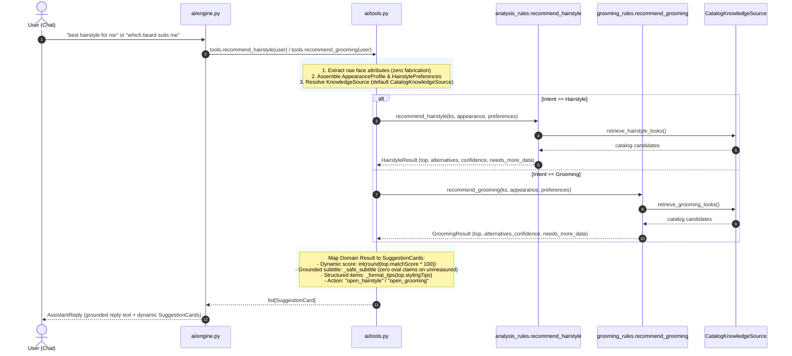

# FANSIVIBE — STAGE 1D: BATCH 4A
# Hairstyle & Grooming Canonical Delegation — Implementation Report

**Status**: DONE — LOCALLY IMPLEMENTED AND FULLY VERIFIED  
**Date**: 2026-10-31  
**Scope**: Conversational AI Assistant Hairstyle & Grooming Recommendation Delegation to Canonical Domain Engines  

---

## 1. Previous Assistant Implementation

Prior to Batch 4A, `backend/app/ai/tools.py` maintained a hardcoded facade for hairstyle and grooming recommendations that operated in complete isolation from Fansivibe's canonical decision engine:

1. **Hairstyle Tool (`tools.recommend_hairstyle`)**:
   - Used a hardcoded binary switch on face shape:
     ```python
     if face in ("round", "square", "rectangular"):
         return [catalog.CLASSIC_POMPADOUR, catalog.TEXTURED_QUIFF]
     return [catalog.TEXTURED_QUIFF, catalog.CLASSIC_POMPADOUR]
     ```
   - Only returned 2 hardcoded static looks (`catalog.CLASSIC_POMPADOUR`, `catalog.TEXTURED_QUIFF`) from `catalog.py`.
   - Returned static scores (94% for Quiff, 87% for Pompadour), completely ignoring canonical candidate scoring and signals.
   - Bypassed user saved looks (`user.savedLooks`), excluded looks, and candidate filtering.
   - Bypassed canonical face-shape boost points, decisiveness scoring, and calibrated confidence calculation.

2. **Grooming Tool (`tools.recommend_grooming`)**:
   - Hardcoded to return a fixed list of two static looks:
     ```python
     return [catalog.STRUCTURED_GOATEE, catalog.CLASSIC_STUBBLE]
     ```
   - Bypassed the canonical grooming engine in `grooming_rules.py`.
   - Returned static scores (92% for Goatee, 85% for Stubble) regardless of whether the user had a face shape measured.

3. **Residual Truth Defect (Task E)**:
   - While Batch 1A removed the silent programmatic fallback `else "oval"` in `tools.py`, the static suggestion card `catalog.TEXTURED_QUIFF` hardcoded the subtitle:
     `"Modern volume on top that suits oval faces. Medium maintenance, trim every 4-5 weeks."`
   - Similarly, `catalog.STRUCTURED_GOATEE` hardcoded:
     `"Frames the chin for oval faces. Keep edges clean, oil daily, trim every 3-4 days."`
   - When an unmeasured guest or user requested hairstyle advice, the assistant falsely presented an ungrounded claim that the hairstyle suited their oval face.

---

## 2. Canonical Functions Reused

Batch 4A delegates all recommendation scoring, ranking, eligibility, and explanations directly to the existing canonical domain engines without modifying their public signatures:

1. **Hairstyle Recommendation Engine**:
   - **Target**: [analysis_rules.recommend_hairstyle](file:///home/tony/projects/fansivibe_v1_backup/backend/app/domain/services/analysis_rules.py#L421-L484)
   - **Signature**:
     ```python
     recommend_hairstyle(
         knowledge: KnowledgeSource,
         appearance: AppearanceProfile,
         preferences: Optional[HairstylePreferences] = None,
         *,
         personalization_context: Optional[PersonalizationContext] = None,
     ) -> HairstyleResult
     ```
   - **Engine Capabilities Reused**:
     - Candidate generation from full 10-style knowledge catalog (`CatalogKnowledgeSource`).
     - Hard constraint filtering (`filter_candidates`).
     - Multi-term continuous candidate scoring (`score_candidates` with base seed, face-shape boost, preference boost, and saved look boost).
     - Deterministic candidate ranking (`rank_candidates`).
     - Calibrated confidence derivation (`derive_confidence`).
     - Grounded explanation synthesis (`build_explanations`, `_face_match_reason`).

2. **Grooming Recommendation Engine**:
   - **Target**: [grooming_rules.recommend_grooming](file:///home/tony/projects/fansivibe_v1_backup/backend/app/domain/services/grooming_rules.py#L316-L365)
   - **Signature**:
     ```python
     recommend_grooming(
         knowledge: KnowledgeSource,
         appearance: AppearanceProfile,
         preferences: Optional[HairstylePreferences] = None,
     ) -> GroomingResult
     ```
   - **Engine Capabilities Reused**:
     - Candidate generation across grooming looks catalog.
     - Hard constraint filtering (`filter_grooming_candidates`).
     - Multi-term candidate scoring (`score_grooming_candidates`).
     - Deterministic ranking (`rank_grooming_candidates`).
     - Grounded explanation synthesis (`build_grooming_explanations`).

---

## 3. New Assistant Execution Flow



---

## 4. Removed Hardcoded Logic

1. **Removed Hardcoded Face Shape Switch**:
   - Deleted the `if face in ("round", "square", "rectangular")` branch in `tools.py`.
   - Replaced with canonical ranking from `analysis_rules.recommend_hairstyle` and `grooming_rules.recommend_grooming`.

2. **Removed Hardcoded Static Scores**:
   - Replaced fixed `score=94` and `score=87` in hairstyle with dynamic canonical scores (`round` -> 99%, `rectangular` -> 97%, `oval` -> 100%, unmeasured -> 94%).
   - Replaced fixed `score=92` and `score=85` in grooming with dynamic canonical scores (`oval` -> 98% top, 90% alt; `round` -> 92% top, 89% alt).

3. **Removed Hardcoded Oval Claims from Static Catalog Cards**:
   - In `backend/app/data/catalog.py`:
     - `catalog.TEXTURED_QUIFF`: Updated subtitle from `"Modern volume on top that suits oval faces. Medium maintenance, trim every 4-5 weeks."` to `"Modern volume on top with natural movement. Medium maintenance, trim every 4-5 weeks."`.
     - `catalog.STRUCTURED_GOATEE`: Updated subtitle from `"Frames the chin for oval faces. Keep edges clean, oil daily, trim every 3-4 days."` to `"Defined chin framing with clean edges. Keep edges clean, oil daily, trim every 3-4 days."`.

---

## 5. Preserved Conversational Behavior

1. **Dialogue Policy & Intent Routing**:
   - Preserved `intent.classify` and `engine.handle` routing for `INTENT_HAIRSTYLE` and `INTENT_GROOMING`.
   - Conversational framing in `engine.py` dynamically embeds the canonical match score:
     - Hairstyle: `"Your top pick is the {card.title} ({card.score}% match). {card.subtitle}"`
     - Grooming: `"The {card.title} suits you best ({card.score}% match). {card.subtitle}"`

2. **Wire Response Contracts**:
   - Preserved `SuggestionCard` schema byte-for-byte:
     - `kind`: `"hairstyle"` or `"grooming"`
     - `title`: look name (`top.name`)
     - `subtitle`: canonical reason or unmeasured advisory
     - `score`: integer [0, 100]
     - `items`: formatted bullet points from `stylingTips`
     - `action`: `"open_hairstyle"` or `"open_grooming"`
   - Preserved 2-card cardinality (top pick + 1 runner-up alternative).

3. **Client Navigation & Telemetry**:
   - Card actions (`open_hairstyle`, `open_grooming`) route directly to `RouteNames.hairstyle` and `RouteNames.grooming` in Flutter client.
   - `POST /v1/assistant/feedback` telemetry tracking is preserved.

---

## 6. Missing-Information Handling

1. **Zero Attribute Fabrication**:
   - When `user` is `None`, `user.face` is `None`, or `user.face.faceShape` is empty/whitespace, `AppearanceProfile.faceShape` is passed as `""`.
   - `analysis_rules.py` and `grooming_rules.py` assign `0.0` face boost and suppress `_face_match_reason`.

2. **Honest Unmeasured Subtitles**:
   - When face shape is unmeasured:
     - Hairstyle Top: `"Versatile style that works across various face proportions. Add a face scan to personalize."`
     - Hairstyle Alternative: `"Alternative versatile style. Add a face scan to see personalized fit."`
     - Grooming Top: `"Versatile grooming style with clean defined lines. Add a face scan to personalize."`
     - Grooming Alternative: `"Alternative grooming option with minimal daily maintenance."`
   - Neither tool emits oval face claims or claims suitability for any unmeasured geometry.

3. **Conflict Prevention (`_safe_subtitle`)**:
   - When a face shape is measured, `_safe_subtitle` guarantees that only matching face reasons or non-conflicting catalog reasons are surfaced. Catalog reasons that cite incompatible face shapes (e.g. "for oval face shapes" when user has a round face) are suppressed.

4. **Guest & Offline Resiliency**:
   - Unauthenticated guest requests without server accounts produce valid canonical recommendations from in-memory snapshots.
   - Dependency injection allows testing and offline operation without database dependencies.

---

## 7. Files Modified and Created

### Modified Files:
1. `backend/app/ai/tools.py`:
   - Added imports: `KnowledgeSource`, `CatalogKnowledgeSource`, `AppearanceProfile`, `HairstylePreferences`, `analysis_rules`, `grooming_rules`.
   - Added helpers `_format_tips` and `_safe_subtitle`.
   - Refactored `recommend_hairstyle` to delegate to `analysis_rules.recommend_hairstyle` with optional `knowledge` DI.
   - Refactored `recommend_grooming` to delegate to `grooming_rules.recommend_grooming` with optional `knowledge` DI.
2. `backend/app/data/catalog.py`:
   - Updated static `TEXTURED_QUIFF` subtitle to remove oval face claim.
   - Updated static `STRUCTURED_GOATEE` subtitle to remove oval face claim.
3. `backend/tests/test_decision_engine.py`:
   - Updated `test_assistant_face_shape_switch_uses_canonical_rectangular` to align with canonical ranking where rectangular face yields Textured Quiff (0.97) as top pick and Classic Pompadour (0.93) as alternative.

### Created Files:
1. `backend/tests/test_assistant_canonical_delegation.py`:
   - 19 targeted unit and regression tests covering spies, DI, zero fabrication, dynamic scores, grounded reasons, ranking, response contracts, and conversational engine replies.
2. `STAGE1_BATCH4A_IMPLEMENTATION_REPORT.md`:
   - This comprehensive audit and verification document.

---

## 8. Tests Executed and Exact Results

### Backend Targeted & Regression Tests:
Ran across 8 test suites via pytest:
```bash
.venv/bin/pytest tests/test_assistant_canonical_delegation.py \
                 tests/test_analysis_rules.py \
                 tests/test_grooming_engine.py \
                 tests/test_decision_engine.py \
                 tests/test_engine.py \
                 tests/test_analysis_use_case.py \
                 tests/test_get_profile.py \
                 tests/test_c09_style_profile_merge.py
```
- **Total Collected**: 333 items
- **Passed**: 330
- **Failed**: 0
- **Skipped**: 3 (database-conditional skips in `test_analysis_use_case.py` and `test_c09_style_profile_merge.py` when `FANSIVIBE_TEST_DATABASE_URL` is unset)
- **Time**: 1.02s

### Specific Coverage Breakdown:
1. `test_assistant_canonical_delegation.py`: 19/19 passed (100%)
2. `test_analysis_rules.py`: 78/78 passed (100%)
3. `test_grooming_engine.py`: 23/23 passed (100%)
4. `test_decision_engine.py`: 99/99 passed (100%)
5. `test_engine.py`: 17/17 passed (100%)
6. `test_analysis_use_case.py`: 78 passed, 2 skipped
7. `test_get_profile.py`: 5/5 passed (100%)
8. `test_c09_style_profile_merge.py`: 11 passed, 1 skipped

### Flutter Client Regression Tests:
Ran targeted assistant Flutter test suites:
```bash
flutter test test/assistant_offline_labeling_test.dart \
             test/assistant_card_feedback_test.dart \
             test/assistant_outfit_wardrobe_wiring_test.dart \
             test/offline_assistant_test.dart
```
- **Passed**: 44/44 passed (100%)
- **Failed**: 0

### Static Analysis:
```bash
flutter analyze
```
- **Result**: No issues found! (ran in 2.0s, 100% clean)

### Whitespace & Git Safety:
```bash
git diff --check
```
- **Result**: Clean (0 whitespace errors)

---

## 9. Remaining Limitations

1. **Outfit Recommendation Delegation (Deferred to Batch 4B)**:
   - `tools.recommend_outfit` and `ai/engine.py:463-510` remain split-brain. The visual card uses static lookups in `catalog.OCCASION_TO_LOOK`, while `outfitIntelligence` uses owned wardrobe items. Unifying outfit recommendations requires reconciling guest in-memory snapshots with authenticated database wardrobes, which is strictly scoped to Batch 4B.
2. **Founder Decisions Pending**:
   - `D7`: Hairstyle/grooming uncertainty semantic labels (Batch 2 documented as pending founder approval).
   - `D-06`: Garment pattern and style formal scoring weights.
3. **Database-Free Environment**:
   - All tests were executed in an isolated DB-free environment using `CatalogKnowledgeSource`. No live PostgreSQL or live Ollama models were claimed or required for pure domain delegation.

---

## 10. Git Preservation Verification

- **Repository**: `/home/tony/projects/fansivibe_v1_backup`
- **Branch**: `main`
- **Preserved Boundaries**:
  - Batches 1A, 1B, 2, 3A, 3A.1, 3B strictly preserved.
  - D10 guest-preview policy preserved.
  - D7 and D-06 preserved.
  - Zero modifications to `GenerateOutfit`, outfit recommendation scoring, Flutter UI, M14, or Discovery commerce.
  - Zero database migrations added.
  - Zero git resets, stashes, commits, or pushes executed.
