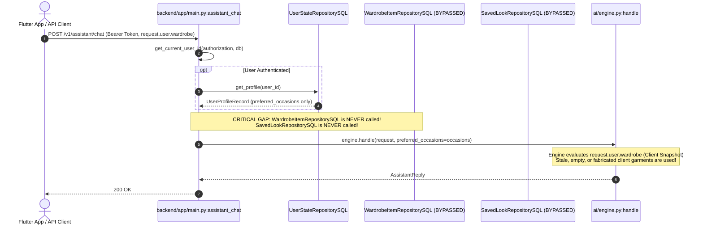
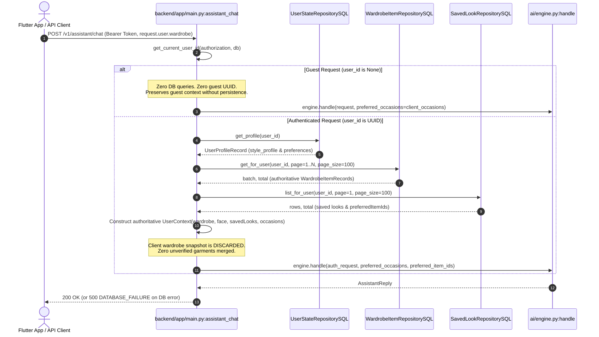

# FANSIVIBE — STAGE 1D: BATCH 4B.2 IMPLEMENTATION REPORT
## Authenticated Wardrobe and Profile Data Authority

### 1. Executive Summary

Batch 4B.2 establishes server-authoritative wardrobe and profile data authority for the Fansivibe conversational AI assistant (`POST /v1/assistant/chat`). 

Previously, while authenticated assistant chat turns resolved `preferred_occasions` from the database (STEP 11.10), they completely bypassed PostgreSQL wardrobe and saved-look repositories, relying exclusively on volatile, unverified client snapshots passed in `request.user.wardrobe`. Authenticated users with empty or stale local caches were presented with failed or degraded recommendations despite having full wardrobes in PostgreSQL.

With Batch 4B.2:
- **Server Data Authority**: Authenticated requests query `WardrobeItemRepositorySQL`, `SavedLookRepositorySQL`, and `UserStateRepositorySQL` using the server-validated identity.
- **Client Snapshot Precedence**: PostgreSQL is strictly authoritative for wardrobe and saved-look records. Client wardrobe snapshots can never overwrite, inject, or merge unverified garments into authenticated recommendations.
- **Fail-Closed Integrity**: Distinguishes genuine empty wardrobes (handled safely without fabricated garments) from repository/database failures (which fail closed with `500 DATABASE_FAILURE` rather than silently degrading to stale client data).
- **Guest Isolation (C-01 & D10 Option A)**: Unauthenticated requests bypass database queries entirely; zero guest rows, zero invented UUIDs, and zero guest appearance persistence.
- **No Dual Persistence Architecture**: Reuses existing domain repositories and canonical functions (`resolve_preferred_item_ids`) without adding tables or migrations.

---

### 2. Previous Authenticated Assistant Data Flow vs. New Authoritative Flow

#### 2.1 Previous Data Flow (As-Is State Before Batch 4B.2)

#### 2.2 New Authoritative Data Flow (Batch 4B.2)

---

### 3. Repository Methods Reused

Zero new tables, duplicate repositories, or alternate query mechanisms were introduced. Batch 4B.2 reuses existing established domain ports and infrastructure implementations:

| Repository / Domain Port | Method Reused | Purpose in Assistant Turn | Error & Edge Case Behavior |
|:---|:---|:---|:---|
| `WardrobeItemRepositorySQL` | `get_for_user(user_id, page, page_size)` | Loads owner wardrobe items in deterministic pages of 100 | Empty wardrobe returns `[]`; repository failure raises `500 DATABASE_FAILURE` |
| `SavedLookRepositorySQL` | `list_for_user(user_id, page, page_size)` | Reads owner saved looks in a single query | Missing rows or repository errors degrade safely to `[]` |
| `UserStateRepositorySQL` | `get_profile(user_id)` | Resolves `preferences.preferred_occasions` and `style_profile` | Missing profile returns `None`; falls back to client transient values if unmeasured |
| `analysis_rules` | `resolve_preferred_item_ids(saved_looks, user_id)` | Derives canonical preferred item UUIDs from saved outfits (`source_context == "outfit"`) | Ignores legacy/NULL/hairstyle/grooming rows; returns `frozenset` |

---

### 4. Client Snapshot Precedence & Fallback Rules

For authenticated requests:
1. **PostgreSQL Wardrobe Authority**:
   - The user's server wardrobe is strictly authoritative.
   - Client garments supplied in `request.user.wardrobe` are **never** merged into the authenticated context.
   - If the user has 0 items in PostgreSQL, their wardrobe context is `[]` (empty). Client garments cannot bypass server state.
2. **PostgreSQL Profile & Preferences Authority**:
   - Server `preferred_occasions` in `user_state.preferences` wins over client `preferredOccasions` when valid and non-empty.
   - Server appearance profile in `user_state.style_profile` (`face_shape`, `skin_tone`, `body_type`, `style_type`) wins over client `face` attributes.
3. **Transient Attribute Preservation**:
   - If server appearance attributes are unmeasured/empty (`None`), client transient face attributes from `request.user.face` are preserved for the turn so users can preview styles before saving.
   - Client messages (`request.messages`) are preserved as conversation turn history.
4. **Repository Failure Precedence (Fail-Closed)**:
   - If server wardrobe lookup fails (e.g. database connection dropped), the server **never** silently falls back to stale client wardrobe data.
   - Instead, it truthfully raises `500 DATABASE_FAILURE` (`ApiError`).

---

### 5. Saved-Look Integration & Single-Query Optimization

- `_load_authoritative_saved_looks` queries `SavedLookRepositorySQL.list_for_user` **once** per authenticated turn.
- A lightweight in-memory cache wrapper `_CachedSavedLooksWrapper` feeds the retrieved rows directly into canonical `resolve_preferred_item_ids`.
- This resolves `preferred_item_ids` (wardrobe item UUIDs from saved outfits) and extracts look titles/codes into `user.savedLooks` in a single SQL operation, avoiding N+1 roundtrips.
- The resolved `preferred_item_ids` are passed into `engine.handle(..., preferred_item_ids=preferred_item_ids)`.

---

### 6. Guest Isolation & D10 Option A Preservation

For unauthenticated / guest requests:
- `user_id` is resolved as `None`.
- `WardrobeItemRepositorySQL`, `SavedLookRepositorySQL`, and `UserStateRepositorySQL` are **never instantiated or queried** (0 SQL calls).
- Zero guest rows or guest UUIDs are generated or stored.
- Zero guest appearance or biometric data is persisted (`update_style_profile` is never invoked).
- Client context passes into `engine.handle` unchanged, preserving guest conversational functionality.

---

### 7. Repository & Error Handling Verification

- **Transaction Ownership**: `assistant_chat` is strictly read-only; it never calls `db.commit()`, `db.rollback()`, or `db.close()`, preserving FastAPI's request lifecycle transaction boundary.
- **Empty Wardrobe vs. Repository Failure**:
  - Empty wardrobe (`batch == []` and `total == 0`) returns `200 OK` with an empty wardrobe context. Zero products or fake items are fabricated.
  - Repository failure raises `database_failure()`, logging the root cause and returning typed JSON: `{"error": {"code": "DATABASE_FAILURE", "message": "..."}}`.
- **Garment ID & Ownership Preservation**:
  - Validated database UUIDs are preserved as `str(record.id)`.
  - Garment names, categories, colors, materials, and favorite flags are mapped directly to typed `WardrobeItem` models.
- **Pagination**:
  - Automatically iterates all pages of 100 for wardrobes exceeding 100 garments.

---

### 8. Regression Tests and Exact Results

16 dedicated regression tests were created in `backend/tests/test_authenticated_assistant_authority.py`:

| # | Test Name | Verified Contract | Result |
|:---:|:---|:---|:---:|
| 1 | `test_1_authenticated_wardrobe_from_server_repository` | Authenticated wardrobe loaded from server repo; client snapshot ignored | **PASS** |
| 2 | `test_2_client_snapshot_cannot_override_authenticated_wardrobe` | Client garments cannot override, append, or merge into server wardrobe | **PASS** |
| 3 | `test_3_saved_looks_loaded_for_correct_authenticated_user` | Saved looks and preferred item IDs loaded for authenticated identity | **PASS** |
| 4 | `test_4_profile_preferences_come_from_authoritative_user_state` | Server occasions and style profile override client snapshot | **PASS** |
| 5 | `test_5_user_identity_derived_from_validated_authentication` | Identity strictly derived from bearer token; never request fields | **PASS** |
| 6 | `test_6_empty_authenticated_wardrobe_handled_correctly` | Empty server wardrobe returns empty list without fabricating garments | **PASS** |
| 7 | `test_7_repository_failure_does_not_silently_use_stale_client_data` | Wardrobe repo failure fails closed with 500 DATABASE_FAILURE | **PASS** |
| 8 | `test_8_guest_requests_do_not_query_authenticated_wardrobe_repositories` | Guest requests make 0 repository queries | **PASS** |
| 9 | `test_9_guest_appearance_not_persisted` | Guest appearance data performs 0 database writes | **PASS** |
| 10 | `test_10_assistant_endpoint_contract_compatibility` | Response strictly matches AssistantReply contract | **PASS** |
| 11 | `test_11_batch4b1_adapters_remain_unchanged_and_functional` | Batch 4B.1 ephemeral adapters remain functional | **PASS** |
| 12 | `test_12_garment_id_and_ownership_preservation` | Genuine garment UUIDs and attributes preserved verbatim | **PASS** |
| 13 | `test_13_pagination_loads_all_pages_for_wardrobe` | Large wardrobes iterate multiple pages of 100 cleanly | **PASS** |
| 14 | `test_14_transient_client_face_preserved_when_server_unmeasured` | Transient client face preserved when server profile unmeasured | **PASS** |
| 15 | `test_15_server_face_overrides_conflicting_client_face` | Measured server face shape overrides conflicting client value | **PASS** |
| 16 | `test_16_saved_looks_error_degrades_safely` | Saved look repository failure degrades safely to empty lists | **PASS** |

#### Broader Test Suite Execution:
- **Assistant & Domain Regression Suite**: 289 passed, 1 skipped (DB-conditional) across 9 test files:
  - `tests/test_authenticated_assistant_authority.py`: 16 passed
  - `tests/test_guest_ephemeral_adapters.py`: 18 passed
  - `tests/test_assistant_canonical_delegation.py`: 19 passed
  - `tests/test_decision_engine.py`: 99 passed
  - `tests/test_assistant_chat_image_api.py`: 12 passed
  - `tests/test_get_profile.py`: 5 passed
  - `tests/test_analysis_rules.py`: 78 passed
  - `tests/test_c09_style_profile_merge.py`: 19 passed, 1 skipped
  - `tests/test_grooming_engine.py`: 23 passed
- **Analysis Suite**: 118 passed, 20 skipped (DB-conditional) across 4 test files (`test_analysis_use_case.py`, `test_garment_analysis.py`, `test_ephemeral_analysis.py`, `test_analysis_api.py`).
- **Wardrobe & Saved Looks Suite**: 28 passed, 171 skipped (DB-conditional) across 7 test files.
- **Flutter Assistant Test Suites**: 130 passed across 11 test files (`test/assistant_*.dart`, `test/guest_assistant_test.dart`, `test/offline_assistant_test.dart`).
- **Flutter Static Analysis**: `flutter analyze` passed with 0 issues found.
- **Git Whitespace Check**: `git diff --check` passed clean with 0 errors.

---

### 9. Files Modified and Created

#### Files Modified:
- `backend/app/main.py`:
  - Updated imports for `SavedLookRepository`, `WardrobeItemRepository`, `SavedLookRepositorySQL`, `WardrobeItemRepositorySQL`, `FaceData`, `UserContext`, `WardrobeItem`, `resolve_preferred_item_ids`, `database_failure`.
  - Implemented `_resolve_assistant_face` to resolve authoritative face data.
  - Implemented `_load_authoritative_wardrobe` with pagination, ownership preservation, and fail-closed error handling.
  - Implemented `_load_authoritative_saved_looks` with single-query caching and `resolve_preferred_item_ids`.
  - Updated `assistant_chat` to enforce authoritative data precedence for authenticated requests while preserving zero-DB guest execution.
- `CURRENT_STATE.md`:
  - Documented completion of Stage 1D Batch 4B.2.

#### Files Created:
- `backend/tests/test_authenticated_assistant_authority.py`:
  - 16 targeted unit and regression tests verifying authenticated data authority, client precedence, guest boundaries, and error contracts.
- `STAGE1_BATCH4B2_IMPLEMENTATION_REPORT.md`:
  - This implementation report.

---

### 10. Scope Boundaries and Preservations Verified

- **Tools Facade Untouched**: `tools.recommend_outfit` was not replaced (deferred to Batch 4B.3).
- **Recommendation Logic Untouched**: `GenerateOutfit` scoring, candidate generation, and `ai/engine.py` recommendation construction remain untouched.
- **Flutter Untouched**: Zero Flutter production or test files modified.
- **Database Schema Untouched**: Zero database migrations added; zero schema modifications.
- **Hairstyle & Grooming Delegation Intact**: Batch 4A delegation fully preserved.
- **Commerce & Trending Intact**: M14 and Discovery commerce untouched.
- **Guest Ephemeral Adapters Intact**: Batch 4B.1 adapters verified and functional.
- **Founder Decisions Preserved**: D10 Option A (guest privacy), D7 pending, D-06 pending.

---

### 11. Git Preservation Verification

- **Branch**: `main`
- **HEAD Commit**: `97f6ded99d3f3e67b477616380320058cd396f48`
- **Integrity**: All prior Stage 1 modifications (Batches 1A, 1B, 2, 3A, 3A.1, 3B, 4A, 4B.1) remain preserved in the working directory. Zero Git commits, pushes, resets, stashes, or cleans were executed.
