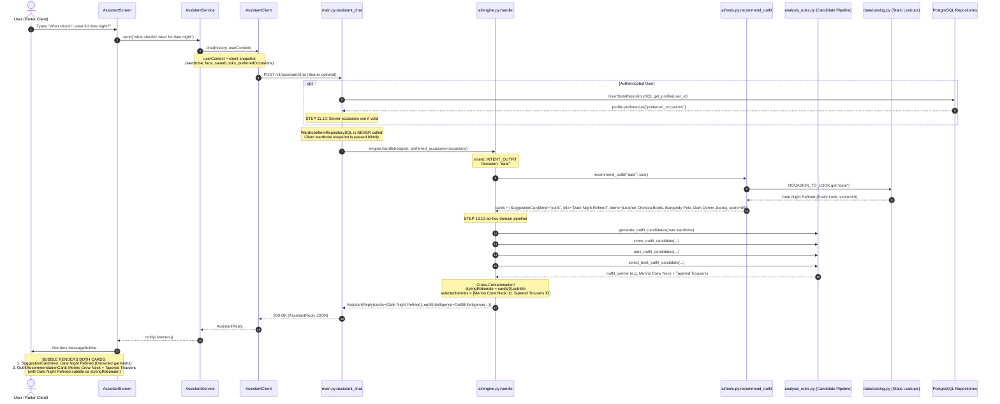

# FANSIVIBE — STAGE 1D: BATCH 4B
# Outfit Recommendation Canonical Delegation — Pre-Implementation Audit

## 1. Executive Summary

This pre-implementation review delivers a strictly read-only architectural audit of the Fansivibe conversational AI assistant's outfit recommendation pipeline. The objective is to eliminate the existing split-brain recommendation architecture and establish how the assistant can reuse Fansivibe's canonical `GenerateOutfit` domain use case without losing existing guest functionality or conversational capabilities.

### Core Audit Findings

1. **The Split-Brain Outfit Defect (Dual-Card Contradiction)**:
   When a user asks the conversational assistant for an outfit recommendation (e.g., "What should I wear to a date?"):
   - `tools.recommend_outfit(occasion, user)` in [`backend/app/ai/tools.py`](file:///home/tony/projects/fansivibe_v1_backup/backend/app/ai/tools.py#L63-L73) looks up a static mock look from [`backend/app/data/catalog.py`](file:///home/tony/projects/fansivibe_v1_backup/backend/app/data/catalog.py#L393-L432) (`catalog.OCCASION_TO_LOOK`, e.g., `Refined Office Ensemble` or `Date Night Refined`) and returns a [`SuggestionCard`](file:///home/tony/projects/fansivibe_v1_backup/backend/app/models/schemas.py#L51-L58) containing static garment names the user does not own (e.g., "Navy Textured Blazer - Outerwear", "Brown Leather Derbies - Footwear") with a hardcoded score (86%–91%).
   - Simultaneously, in [`backend/app/ai/engine.py:463-510`](file:///home/tony/projects/fansivibe_v1_backup/backend/app/ai/engine.py#L463-L510), lines added in Step 13.13 execute a separate domain pipeline (`generate_outfit_candidates → score_outfit_candidate → rank_outfit_candidates → select_best_outfit_candidate`) over the client's `user.wardrobe` snapshot to populate [`reply.outfitIntelligence.selectedItemIds`](file:///home/tony/projects/fansivibe_v1_backup/backend/app/models/schemas.py#L79-L88) with the user's actual wardrobe items (e.g., "Merino Crew Neck", "Tapered Trousers").
   - Consequently, the Flutter client's [`AssistantMessageBubble`](file:///home/tony/projects/fansivibe_v1_backup/newproject/flutter_application_1/lib/features/assistant/presentation/widgets/assistant_widgets.dart#L192-L263) renders **TWO CONFLICTING CARDS** in the same response: a [`SuggestionCardView`](file:///home/tony/projects/fansivibe_v1_backup/newproject/flutter_application_1/lib/features/assistant/presentation/widgets/assistant_widgets.dart#L271-L350) showing unowned catalog items, and an [`OutfitRecommendationCard`](file:///home/tony/projects/fansivibe_v1_backup/newproject/flutter_application_1/lib/features/assistant/presentation/widgets/outfit_recommendation_card.dart#L50-L79) showing owned wardrobe items.

2. **Styling Rationale Cross-Contamination**:
   In [`backend/app/ai/engine.py:484`](file:///home/tony/projects/fansivibe_v1_backup/backend/app/ai/engine.py#L484), `reply.outfitIntelligence.stylingRationale` is explicitly assigned:
   ```python
   stylingRationale = cards[0].subtitle if cards else ""
   ```
   The subtitle of the static catalog card (e.g., "A structured navy blazer over a cream oxford with charcoal trousers and brown derbies.") is applied directly to the user's completely different owned wardrobe garments (e.g., a green crew neck and khaki chinos). The user is presented an outfit composition of their own clothes, but the explanatory rationale describes clothes they do not own.

3. **Authenticated Data Authority Gap**:
   In the main chat entrypoint ([`POST /v1/assistant/chat` in `backend/app/main.py:291-324`](file:///home/tony/projects/fansivibe_v1_backup/backend/app/main.py#L291-L324)), authenticated requests resolve server-persisted preferred occasions via `UserStateRepositorySQL(db).get_profile(user_id)` (STEP 11.10), but **completely ignore** the server-persisted wardrobe ([`WardrobeItemRepositorySQL`](file:///home/tony/projects/fansivibe_v1_backup/backend/app/infrastructure/db/repositories.py#L290-L420)). The assistant executes solely against whatever volatile wardrobe snapshot the client sent in `request.user.wardrobe`. Authenticated users with stale or empty local storage receive degraded or failed recommendations even when their database wardrobe is fully populated.

4. **Guest Identity & Preview Preservation (Contract C-01 & Decision D10)**:
   Under Contract `C-01` and Decision `D10` (Option A), guest users must have access to assistant guidance, but **no guest database rows or guest UUIDs may be created**, and **no guest appearance or personal profile data may be persisted**. Canonical delegation can be achieved for guests via an ephemeral, in-memory repository adapter (`EphemeralWardrobeItemRepository`, `EphemeralUserStateRepository`) that conforms to the domain port interfaces without database writes.

5. **Conversational Input Alignment & Batch 3B Facts**:
   - `occasion` is genuinely consumed by recommendation scoring (+5.0 pts in `_occasion_points`).
   - `mood` is echoed in the response but has **0 scoring presence** in rules (Contract `C-02-M`).
   - `fit` is a soft +5 signal gated by `fit_confidence >= 0.6` (Contract `C-02-F`).
   - `color_palette` is a soft +5 signal over mapped palette sets (Contract `C-02-P`).
   - `date`, `time`, `location`, `weather`, and calendar events (`eventId`, `eventTitle`) are **not automatically consumed** by the recommendation engine.

6. **Batch 4A Confidence & Match Score Semantics**:
   Batch 4A mapped canonical `matchScore` into `SuggestionCard.score` (`int(round(matchScore * 100))`). In Flutter [`SuggestionCardView`](file:///home/tony/projects/fansivibe_v1_backup/newproject/flutter_application_1/lib/features/assistant/presentation/widgets/assistant_widgets.dart#L327), this is rendered honestly as `XX% match`, not as a calibrated probability or confidence. When face shape is unmeasured, the subtitle truthfully advises versatile styling without claiming oval or any other unmeasured face shape. Founder Decision `D7` remains pending.

---

## 2. Existing Assistant Outfit Flow

### 2.1 Complete Execution Flow: Conversational Message to Dual-Card Display



### 2.2 Wire Contract Payload Example (Current As-Is State)

```json
{
  "intent": "outfit",
  "text": "For date, I'd go with the Date Night Refined — Dark denim, a burgundy polo, and Chelsea boots for a memorable evening. Tap the card to build it.",
  "cards": [
    {
      "kind": "outfit",
      "title": "Date Night Refined",
      "subtitle": "Dark denim, a burgundy polo, and Chelsea boots for a memorable evening.",
      "score": 89,
      "items": [
        "Leather Chelsea Boots - Footwear",
        "Burgundy Polo - Tops",
        "Dark Denim Jeans - Bottoms"
      ],
      "action": "open_outfit"
    }
  ],
  "clarifications": [],
  "navigation": null,
  "outfitIntelligence": {
    "selectedItemIds": [
      "1",
      "9"
    ],
    "outfitComposition": {
      "topIds": ["1"],
      "bottomIds": ["9"],
      "outerwearIds": [],
      "footwearIds": [],
      "accessoryIds": [],
      "styleScore": 0
    },
    "occasion": "date",
    "stylingRationale": "Dark denim, a burgundy polo, and Chelsea boots for a memorable evening.",
    "compatibilityRationale": "",
    "confidence": 0.0,
    "explanation": "",
    "dataAvailability": "full"
  }
}
```

In this payload:
- `cards[0].items` lists static strings: `"Leather Chelsea Boots"`, `"Burgundy Polo"`, `"Dark Denim Jeans"`.
- `outfitIntelligence.selectedItemIds` lists the user's actual wardrobe item IDs: `"1"` (Merino Crew Neck) and `"9"` (Tapered Trousers).
- `outfitIntelligence.stylingRationale` asserts: `"Dark denim, a burgundy polo, and Chelsea boots for a memorable evening."`, describing items the user does not have in that selection.

---

## 3. Split-Brain Root Cause

The split-brain architecture arose from historical incremental evolution:

1. **Step 11 & Batch 4A Legacy**:
   `tools.recommend_outfit` in [`backend/app/ai/tools.py:63-73`](file:///home/tony/projects/fansivibe_v1_backup/backend/app/ai/tools.py#L63-L73) was created as a mock prototype:
   ```python
   def recommend_outfit(
       occasion: Optional[str], user: Optional[UserContext]
   ) -> List[SuggestionCard]:
       if occasion:
           card = catalog.OCCASION_TO_LOOK.get(occasion, catalog.REFINED_OFFICE)
           return [card]
       owned_casual = _owned(catalog.CASUAL_LOOK.items)
       owned_office = _owned(catalog.REFINED_OFFICE.items)
       return [catalog.CASUAL_LOOK if owned_casual >= owned_office else catalog.REFINED_OFFICE]
   ```
   While Batch 4A refactored `recommend_hairstyle` and `recommend_grooming` to delegate directly to canonical domain engines, `recommend_outfit` was explicitly deferred to Batch 4B.

2. **Step 13.13 Partial Integration**:
   Step 13.13 bolted the pure domain candidate ranking pipeline into [`backend/app/ai/engine.py:463-510`](file:///home/tony/projects/fansivibe_v1_backup/backend/app/ai/engine.py#L463-L510) to populate `reply.outfitIntelligence`, but left `cards = _cards_from([it], user, occasion)` at line 180 completely intact. It then copied `cards[0].subtitle` into `stylingRationale`.

3. **Flutter Presentation Architecture**:
   [`newproject/flutter_application_1/lib/features/assistant/presentation/widgets/assistant_widgets.dart:192-263`](file:///home/tony/projects/fansivibe_v1_backup/newproject/flutter_application_1/lib/features/assistant/presentation/widgets/assistant_widgets.dart#L192-L263) contains independent rendering blocks:
   ```dart
   if (message.cards.isNotEmpty) ...[
     for (final card in message.cards) ...[
       SuggestionCardView(card: card, onAction: ...),
     ],
   ],
   ...
   if (message.outfitIntelligence != null) ...[
     OutfitRecommendationCard(
       outfitIntelligence: message.outfitIntelligence!,
       wardrobeItems: resolveOutfitWardrobeItems(...),
       onSave: ...,
     ),
   ],
   ```
   Because both conditions are true, Flutter renders both widgets simultaneously.

---

## 4. Canonical GenerateOutfit Architecture

The canonical domain use case is [`GenerateOutfit` in `backend/app/application/outfits.py:362-450`](file:///home/tony/projects/fansivibe_v1_backup/backend/app/application/outfits.py#L362-L450).

### 4.1 Input and Dependency Contract

```python
class GenerateOutfit:
    def __init__(
        self,
        *,
        wardrobe_items: WardrobeItemRepository,
        user_state: UserStateRepository,
        feedback: Optional[FeedbackRepository] = None,
        saved_looks: Optional[SavedLookRepository] = None,
        wears: Optional[WearEventRepository] = None,
    ) -> None: ...

    def derive_with_reason(
        self,
        *,
        user_id: UUID,
        occasion: object,
        mood: object,
        fit: object,
        color_palette: object,
        seed: object = None,
        preferred_item_ids: object = None,
    ) -> tuple[Optional[OutfitRecommendation], Optional[str]]: ...
```

| Parameter | Type | Validation / Constraints | Behavior |
|:---|:---|:---|:---|
| `user_id` | `UUID` | Required UUID object | Scopes owner wardrobe, preferences, feedback, wears |
| `occasion` | `str` | 1..200 characters, non-empty | Filter/scoring occasion (+5.0 pts) |
| `mood` | `str` | 1..200 characters, non-empty | Context/echo only (0 scoring presence per C-02-M) |
| `fit` | `str` | 1..200 characters, non-empty | Soft +5 signal, gated by `fit_confidence >= 0.6` (C-02-F) |
| `color_palette` | `str` | 1..200 characters, non-empty | Soft +5 signal over `_PALETTE_COLOR_SETS` (C-02-P) |
| `seed` | `Optional[str]` | 1..200 characters or `None` | Deterministic variant selection via SHA-256 index |
| `preferred_item_ids` | `object` | List/Set of string/UUID IDs | +5 pts per preferred item (capped at +15 pts, C-03) |

### 4.2 Scoring Terms & Mathematical Composition

Scoring is executed by [`score_outfit_candidate` in `backend/app/domain/services/analysis_rules.py:1921-1978`](file:///home/tony/projects/fansivibe_v1_backup/backend/app/domain/services/analysis_rules.py#L1921-L1978):

1. **Coverage Points (`_coverage_points`, up to 35.0 pts)**: Base points for legal ensemble (tops + bottoms), plus additive bonuses for outerwear, footwear, accessories.
2. **Color Points (`_color_points`, up to 5.0 pts)**: Evaluates color compatibility, neutral balancing, monochrome/contrasting harmony.
3. **Material Points (`_material_points`, up to 5.0 pts)**: Evaluates texture and fabric pairings (e.g., denim + wool).
4. **Season Points (`_season_points`, up to 5.0 pts)**: Evaluates seasonal consistency of garments.
5. **Formality Points (`_formality_points`, up to 5.0 pts)**: Evaluates formality balance across pieces.
6. **Occasion Points (`_occasion_points`, up to 5.0 pts)**: Evaluates match against `[occasion] + preferred_occasions`.
7. **Palette Points (`_palette_points`, up to 5.0 pts)**: Soft signal over `_PALETTE_COLOR_SETS` (warm, cool, neutral).
8. **Fit Points (`_fit_points`, up to 5.0 pts)**: Soft signal gated by `fit_confidence >= 0.6`.
9. **Preference Points (`candidate_preference_points`, up to 15.0 pts)**: +5.0 pts per item present in `preferred_item_ids`.
10. **Favorite Points (`candidate_favorite_points`, up to 10.0 pts)**: Bonus for user-favorited garments.
11. **Feedback Points (`candidate_feedback_points`, +3.0 / -5.0 pts)**: Positive boost for items similar to previously liked looks; penalty for disliked looks.
12. **Wear Points (`candidate_wear_points`, up to 2.0 pts)**: Bonus for previously worn combinations.

**Total Score**: Composite sum 0..100 points, rescaled to `match_score = round(winner.score / 100, 4)`.

### 4.3 Grounded Evidence Explanations

[`_to_recommendation` in `outfits.py:220-360`](file:///home/tony/projects/fansivibe_v1_backup/backend/app/application/outfits.py#L220-L360) emits explanation reasons **only when the corresponding sub-score contributed (> 0)**:
- `"Picked for a {label} occasion"`
- `"Covers {count} categories: {covered}"`
- `"Matches your preferred palette"` (emitted only if `_palette_points > 0`)
- `"Matches your preferred fit"` (emitted only if `_fit_points > 0`)
- `"Uses an item you selected"` (emitted only if `preference > 0`)
- `"Includes your favorite {name}"` (emitted only if `favorite > 0`)
- `"Matches the selected occasion"` (emitted only if `_occasion_points > 0`)
- `"Similar to outfits you've liked"` (emitted only if `feedback > 0`)
- `"Reduced because of previous negative feedback"` (emitted only if `feedback < 0`)
- `"Previously worn combination"` (emitted only if `wear > 0`)

### 4.4 Domain Engine vs Conversational Adapter Responsibilities

| Responsibility | Domain Engine (`GenerateOutfit`) | Conversational Adapter (`tools.py` / `engine.py`) |
|:---|:---:|:---:|
| Candidate generation from wardrobe items | **YES** | NO |
| Multi-term candidate scoring (12 terms) | **YES** | NO |
| Candidate ranking & deterministic selection | **YES** | NO |
| Grounded reason generation | **YES** | NO |
| Calibrated match score calculation | **YES** | NO |
| Message intent classification & occasion parsing | NO | **YES** |
| Conversational clarifying dialogs | NO | **YES** |
| Conversational defaults (mood, fit, palette) | NO | **YES** |
| Data authority resolution (Auth DB vs Guest Snapshot) | NO | **YES** |
| Translation to `SuggestionCard` & `OutfitIntelligence` | NO | **YES** |
| Natural language response framing & LLM enrichment | NO | **YES** |

---

## 5. Authenticated Data Authority

### 5.1 The Current Defect in `main.py`

In [`backend/app/main.py:291-324`](file:///home/tony/projects/fansivibe_v1_backup/backend/app/main.py#L291-L324):
```python
@app.post("/v1/assistant/chat", response_model=AssistantReply)
def assistant_chat(
    request: AssistantRequest,
    db: Session = Depends(get_db),
    authorization: str | None = Header(default=None),
) -> AssistantReply:
    user_id: UUID | None = None
    try:
        user_id = get_current_user_id(authorization, db)
    except ApiError:
        user_id = None

    client_occasions = list(request.user.preferredOccasions) if request.user else []
    occasions = client_occasions
    if user_id is not None:
        try:
            record = UserStateRepositorySQL(db).get_profile(user_id=user_id)
        except Exception:
            record = None
        occasions = _resolve_assistant_occasions(record, client_occasions)
    return engine.handle(request, preferred_occasions=occasions)
```

Although `user_id` is authenticated and `db` is available:
- `WardrobeItemRepositorySQL(db)` is never queried.
- `SavedLookRepositorySQL(db)` is never queried to resolve `preferred_item_ids`.
- `FeedbackRepositorySQL(db)` and `WearEventRepositorySQL(db)` are never queried.
- `request.user.wardrobe` (client volatile snapshot) is passed directly to `engine.handle()`.

### 5.2 Resolution Architecture for Authenticated Users

When `user_id` is authenticated:
1. **Wardrobe Authority**: Query `WardrobeItemRepositorySQL(db).get_for_user(user_id=user_id, page=1, page_size=100)`. The server database is the authoritative source of truth.
2. **Profile & Preferences Authority**: Read `preferred_occasions` from `UserStateRepositorySQL(db)`.
3. **Saved Looks & Feedback Authority**: Read `FeedbackRepositorySQL(db)`, `SavedLookRepositorySQL(db)`, and `WearEventRepositorySQL(db)`.
4. **Preferred Item IDs**: Derive preferred wardrobe IDs from the owner's `saved_looks` via `resolve_preferred_item_ids`.

---

## 6. Guest Compatibility Analysis

### 6.1 Preservation of Contract C-01 & Decision D10

- **Contract C-01 (Locked)**:
  - Unauthenticated guests browse local wardrobe and discover feeds.
  - Anonymous server-side execution must **never** create database rows.
  - "Anonymous server analysis is EXPLICITLY OUT: no-user rows violate every FK/owner scope; TRX-6/signals/runs are all user-keyed; no session-scoped run concept exists."
- **Decision D10 (Option A — Disclose Preview Nature)**:
  - Style previews are temporary.
  - Guest appearance and profile information is **never** persisted to the server.
  - Zero risk of biometric leakage.

### 6.2 Ephemeral Adapter Solution

`GenerateOutfit` interacts with dependencies exclusively via domain port interfaces:
- [`WardrobeItemRepository`](file:///home/tony/projects/fansivibe_v1_backup/backend/app/domain/ports/repositories.py#L649-L700): calls only `get_for_user(user_id, page, page_size)`.
- [`UserStateRepository`](file:///home/tony/projects/fansivibe_v1_backup/backend/app/domain/ports/repositories.py#L500-L550): calls only `get_profile(user_id)`.

To support guests without creating a second recommendation engine:
1. Create a lightweight in-memory adapter [`EphemeralWardrobeItemRepository`](file:///home/tony/projects/fansivibe_v1_backup/backend/app/infrastructure/external/ephemeral_wardrobe.py) that implements `WardrobeItemRepository.get_for_user` by reading `request.user.wardrobe`.
2. Create an ephemeral adapter [`EphemeralUserStateRepository`](file:///home/tony/projects/fansivibe_v1_backup/backend/app/infrastructure/external/ephemeral_user_state.py) that returns `request.user.preferredOccasions`.
3. Pass `feedback=None`, `saved_looks=None`, `wears=None`.
4. Pass a transient sentinel `UUID` (e.g., `UUID("00000000-0000-0000-0000-000000000000")`) solely to satisfy Python type signatures. This UUID is never passed to SQL, never stored, and never emitted in response headers.
5. Execute the **identical canonical `GenerateOutfit` use case**!

This achieves 100% domain algorithm parity between authenticated users and guests with zero database writes, zero guest UUID generation, and zero duplicate scoring logic.

---

## 7. Input Mapping and Defaults

### 7.1 Input Comparison Matrix

| Input | `GenerateOutfitRequest` | Assistant Conversational Source | Safe Conversational Default |
|:---|:---|:---|:---|
| **Occasion** | Required string | Detected via `intent.detect_occasion(user_text)`. If absent, clarification options are presented. | Clarify if ambiguous; default `"casual"` if forced |
| **Mood** | Required string | Not parsed from message (C-02-M verified: 0 scoring presence) | `"versatile"` (valid 1..200 string) |
| **Fit** | Required string | Not parsed unless user specifies (C-02-F: soft +5 signal) | `"regular"` (valid 1..200 string) |
| **Color Palette** | Required string | Not parsed unless user specifies (C-02-P: soft +5 signal) | `"neutral"` (valid 1..200 string) |
| **Seed** | Optional string | `None` (selects top ranked winner at rank 0) | `None` |
| **Preferred Item IDs** | Optional list of IDs | Derived from `saved_looks` (auth) or explicit garment mentions | `frozenset()` |

### 7.2 Strict Confirmation of Batch 3B Verified Facts

- **Occasion**: Genuinely consumed by recommendation scoring (`_occasion_points` awards +5.0 pts).
- **Mood**: Transmitted in DTOs and echoed in prose, but has **0 scoring presence** in rules.
- **Date / Time / Location / Weather / Calendar**: Never collected in assistant chat, never sent to `GenerateOutfit`, and completely unconsumed by domain rules. The assistant must never claim to have tailored an outfit to current weather, calendar schedules, or physical locations.

---

## 8. Response Contract Recommendation

### 8.1 Unified Response Architecture

To eliminate the dual-card split-brain without breaking existing Flutter clients:

1. **Populate `reply.cards[0]` from the Canonical `OutfitRecommendation`**:
   - `kind = "outfit"`
   - `title = recommendation.title` (e.g., "Date Night Outfit" or "Refined Office Ensemble")
   - `subtitle = recommendation.reasons[0]` (e.g., "Picked for a date occasion. Covers 2 categories: tops, bottoms.")
   - `score = int(round(recommendation.match_score * 100))` (dynamic match score, e.g. 88% match)
   - `items = [f"{c.name} - {c.category.title()}" for c in recommendation.components]` (the user's **owned wardrobe pieces**)
   - `action = "open_outfit"`

2. **Populate `reply.outfitIntelligence` from the Same Canonical `OutfitRecommendation`**:
   - `selectedItemIds = [c.id for c in recommendation.components]` (exact same pieces)
   - `outfitComposition = OutfitComposition(topIds=..., bottomIds=..., styleScore=int(round(recommendation.match_score * 100)))`
   - `occasion = recommendation.selected_occasion`
   - `stylingRationale = recommendation.reasons[0]` (matches `cards[0].subtitle`!)
   - `compatibilityRationale = recommendation.color_harmony`
   - `confidence = recommendation.match_score`
   - `explanation = recommendation.occasion_match`
   - `dataAvailability = "full" | "partial" | "sparse"`

3. **Empty / Sparse Wardrobe Handling**:
   When `GenerateOutfit` returns `(None, "empty_wardrobe")` or `(None, "missing_required_category")`:
   - `reply.outfitIntelligence` remains `None` (preventing an empty `OutfitRecommendationCard` from rendering).
   - `reply.cards` returns an honest guidance card:
     - `title = "Build Your Wardrobe"`
     - `subtitle = "Add tops and bottoms to your wardrobe to get personalized outfit recommendations."`
     - `items = []`
     - `action = "open_wardrobe"`
   - Conversational text honestly explains: "You don't have enough items in your wardrobe yet. Add a few tops and bottoms and I'll create personalized outfits for you!"

---

## 9. Batch 4A Confidence-Label Verification

### 9.1 Verification of Implemented Batch 4A Semantics

| Component / Layer | Semantic Implementation | Verification Status |
|:---|:---|:---|
| **Backend `tools.py`** | `top_score = int(round(top.matchScore * 100))` | Derives directly from canonical `matchScore` |
| **Backend `engine.py`** | `f"Your top pick is the {cards[0].title} ({cards[0].score}% match). "` | Conversational prose uses "% match" |
| **Flutter `SuggestionCardView`** | `Text('${card.score}% match')` | UI displays "% match", NOT "% confident" or probability |
| **Unmeasured Face Shape** | `"Versatile style that works across various face proportions. Add a face scan to personalize."` | Truthfully informs user; suppresses face match reasons |
| **Founder Decision D7** | Confidence Definition remains **PENDING** | Presenting as "% match" conforms to D7 Option A/B pending resolution |

### 9.2 Observation on Existing `OutfitRecommendationCard`

In [`lib/features/assistant/presentation/widgets/outfit_recommendation_card.dart`](file:///home/tony/projects/fansivibe_v1_backup/newproject/flutter_application_1/lib/features/assistant/presentation/widgets/outfit_recommendation_card.dart):
- Line 224: `Text('${(widget.outfitIntelligence.confidence * 100).round()}% confident')`
- Line 371: `Text('Style Score: ${widget.outfitIntelligence.outfitComposition.styleScore}')`

While `SuggestionCardView` uses honest "% match", `OutfitRecommendationCard` has legacy labels ("% confident" and "Style Score"). In Batch 1A, Outfit Builder was relabeled to "Ensemble Match". A future Flutter alignment batch should reconcile `OutfitRecommendationCard` to use "Ensemble Match", preserving D7 pending boundaries.

---

## 10. Stage 1 Requirement Traceability

| ID | Requirement / Contract | Layer | Status Before Audit | Audit Classification | Finding & Traceability |
|:---|:---|:---|:---|:---:|:---|
| **GAP-P1-4** | Route Assistant Tools Through Decision Engine | AI Tools / Engine | Partially Implemented (4A) | **B** | Hairstyle & Grooming delegated in 4A; Outfit recommendation still uses static `catalog.OCCASION_TO_LOOK`. |
| **R-S2-2** | Mood & Occasion Request Scoping | Domain / AI Engine | Partially Implemented | **B** | Occasion is detected and scored (+5.0 pts); mood is context-only per Batch 3B; request-scoped, never persisted as durable personal goal. |
| **R-S3-1** | Preference & Style Identity Grounding | Application / Decision | Partially Implemented | **B** | `GenerateOutfit` consumes preferred occasions; assistant `tools.recommend_outfit` bypasses user preferences. |
| **R-S3-3** | Consistent Feedback & Saved Look Learning Loop | Application / AI Tools | Partially Implemented | **B** | `GenerateOutfit` consumes `feedback` and `saved_looks`; assistant tools completely ignore saved looks and feedback. |
| **R-S5-2** | Confidence Definition & Calibration | Domain / AI Tools | Partially Implemented | **B** | `GenerateOutfit` uses `match_score` (0..1 ensemble compatibility), not calibrated probability; Batch 4A mapped to `% match`; D7 pending. |
| **R-S5-3** | Uncertainty Primitives Surfacing | Result Surfaces | Partially Implemented | **B** | `OutfitIntelligence` contains `dataAvailability` and `confidence`; `SuggestionCard` has no uncertainty primitives. |
| **R-S6-1** | Shared Person Model Authority | Architecture | Partially Implemented | **B** | Batch 2 hydrated profile from server; assistant chat still accepts volatile client snapshot for wardrobe instead of reading DB. |
| **C-01** | Guest / Authenticated Identity Architecture | Architecture / Auth | Implemented | **A** | Gated boundaries strictly intact; guests use local wardrobe; server AI requires token; ephemeral adapter preserves zero-DB-write rule. |
| **C-02** | Mood / Fit / Color Palette Sub-contracts | Domain / Decision | Implemented (Domain) | **A (Domain) / B (Assistant)** | C-02-P (+5 palette), C-02-F (+5 fit), C-02-M (0 mood) verified in domain; assistant outfit tool currently ignores them. |
| **C-03** | Preferred Item IDs | Application / API | Partially Implemented | **B** | `GenerateOutfit` normalizes and scores C-03 IDs; assistant `main.py` entrypoint does not wire `preferred_item_ids`. |

*Classification Codes: A — Fully implemented; B — Partially implemented; C — Missing; D — Contradictory or incorrect; E — Requires verification.*

---

## 11. Implementation Risks

1. **Test Regressions on Historical Step 13 Contracts**:
   - `backend/tests/test_engine.py` asserts: `reply.cards[0].kind == "outfit"` and `"Date" in reply.cards[0].title`.
   - `backend/tests/test_decision_engine.py` asserts: `test_13_13_outfit_winner_selected_ids_owned`, `test_13_13_outfit_empty_wardrobe_static_fallback`, etc.
   - Mitigation: Ensure `tools.recommend_outfit` preserves `reply.cards[0].kind == "outfit"`, preserves occasion in title, and falls back gracefully when wardrobe is empty.

2. **Database Latency on Assistant Chat Turns**:
   - Querying `WardrobeItemRepositorySQL`, `UserStateRepositorySQL`, and `SavedLookRepositorySQL` during a chat turn introduces database queries.
   - Mitigation: Use owner-scoped indexed queries (`get_for_user`, `get_profile`) within the existing single DB session transaction (`Depends(get_db)`).

3. **Sparse & Empty Wardrobe Edge Cases**:
   - Users with 0 items, tops only, or bottoms only cannot form legal ensembles (`generate_outfit_candidates` yields 0 candidates).
   - Mitigation: When `GenerateOutfit` returns `(None, reason)`, the assistant must not crash or return a malformed response; it must return an honest conversational explanation and appropriate guidance card.

4. **Guest Preview & D10 Boundary Leakage**:
   - Risk: Creating temporary DB rows or leaking guest wardrobe data across sessions.
   - Mitigation: Ephemeral repositories must strictly hold client data in-memory for the duration of the request turn and perform zero SQL operations.

---

## 12. Recommended Implementation Batches

To guarantee zero regression and safe architectural progression, implementation should be divided into five tightly scoped batches:

### Batch 4B.1: Ephemeral Repository Adapter & Guest Compatibility
- Implement `EphemeralWardrobeItemRepository` and `EphemeralUserStateRepository` conforming to domain protocols.
- Add unit tests verifying `GenerateOutfit` operates seamlessly over in-memory snapshots without a database.
- Preserve zero-DB-write invariant for guests.

### Batch 4B.2: Authenticated Wardrobe & Preference Authority in Assistant Entrypoint
- Update `backend/app/main.py:assistant_chat`:
  - When authenticated, load authoritative wardrobe from `WardrobeItemRepositorySQL(db)`.
  - Resolve `preferred_item_ids` from `SavedLookRepositorySQL(db)`.
  - Inject SQL repositories for authenticated users; inject ephemeral repositories for guests.

### Batch 4B.3: Canonical Outfit Delegation in `tools.py` and `engine.py`
- Refactor `tools.recommend_outfit` to delegate to `GenerateOutfit`.
- Remove static catalog lookups (`catalog.OCCASION_TO_LOOK`) from the active recommendation path.
- Provide safe conversational defaults for `mood`, `fit`, `color_palette`.

### Batch 4B.4: Response Contract Harmonization & Dual-Card Elimination
- Harmonize `reply.cards[0]` and `reply.outfitIntelligence` to represent the exact same canonical recommendation.
- Derive `stylingRationale` and `subtitle` from canonical `recommendation.reasons`.
- Ensure empty and sparse wardrobes return honest empty states without card contradiction.

### Batch 4B.5: Comprehensive Regression & Contract Verification
- Run full backend pytest suites (330+ tests).
- Run full Flutter assistant test suites (44+ tests).
- Verify `git diff --check` and `flutter analyze`.

---

## 13. Required Regression Tests

### 13.1 Backend Test Specifications
1. **Delegation Spy Tests**: Verify `tools.recommend_outfit` invokes `GenerateOutfit.derive_with_reason` with validated inputs.
2. **Authenticated Authority Tests**: Verify that when a valid token is provided, the assistant uses database wardrobe items even if the client snapshot is empty.
3. **Guest Ephemeral Tests**: Verify that guests without tokens receive recommendations derived from their client snapshot without creating database rows.
4. **Coherence & Non-Contradiction Tests**: Verify that `cards[0].items` and `outfitIntelligence.selectedItemIds` refer to the identical wardrobe items.
5. **Rationale Grounding Tests**: Verify that `stylingRationale` never describes unowned catalog garments.
6. **Empty & Sparse Wardrobe Tests**: Verify that empty wardrobes return honest guidance cards without crashing or fabricating ensembles.

### 13.2 Flutter Test Specifications
1. **Dual-Card Coherence Widget Tests**: Verify that rendered cards in `MessageBubble` display the same outfit.
2. **Guest Save Flow Tests**: Verify that tapping Save on an assistant recommendation prompts guest sign-in (`takePendingAuthIntent`).
3. **Wardrobe Item Navigation Tests**: Verify that tapping item chips in `OutfitRecommendationCard` navigates to `WardrobeItemDetailsScreen` with the correct ID.

---

## 14. Exact Source File References

| File Path | Lines | Architectural Responsibility |
|:---|:---:|:---|
| [`backend/app/ai/tools.py`](file:///home/tony/projects/fansivibe_v1_backup/backend/app/ai/tools.py#L63-L73) | 63–73 | Current `recommend_outfit` tool facade (returns static catalog looks) |
| [`backend/app/ai/engine.py`](file:///home/tony/projects/fansivibe_v1_backup/backend/app/ai/engine.py#L180-L186) | 180–186 | Populates `cards` via `_cards_from([it], user, occasion)` |
| [`backend/app/ai/engine.py`](file:///home/tony/projects/fansivibe_v1_backup/backend/app/ai/engine.py#L463-L511) | 463–511 | Step 13.13 ad-hoc domain candidate pipeline & rationale assignment |
| [`backend/app/application/outfits.py`](file:///home/tony/projects/fansivibe_v1_backup/backend/app/application/outfits.py#L362-L450) | 362–450 | Canonical `GenerateOutfit` application use case |
| [`backend/app/application/outfits.py`](file:///home/tony/projects/fansivibe_v1_backup/backend/app/application/outfits.py#L453-L547) | 453–547 | Canonical `_derive_outfit` derivation logic |
| [`backend/app/domain/services/analysis_rules.py`](file:///home/tony/projects/fansivibe_v1_backup/backend/app/domain/services/analysis_rules.py#L1921-L1978) | 1921–1978 | Multi-term candidate scoring (`score_outfit_candidate`) |
| [`backend/app/main.py`](file:///home/tony/projects/fansivibe_v1_backup/backend/app/main.py#L291-L324) | 291–324 | `POST /v1/assistant/chat` entrypoint & occasion resolution |
| [`backend/app/models/schemas.py`](file:///home/tony/projects/fansivibe_v1_backup/backend/app/models/schemas.py#L51-L97) | 51–97 | Typed Pydantic schemas (`SuggestionCard`, `OutfitIntelligence`, `AssistantReply`) |
| [`backend/app/data/catalog.py`](file:///home/tony/projects/fansivibe_v1_backup/backend/app/data/catalog.py#L393-L432) | 393–432 | Static catalog lookups (`OCCASION_TO_LOOK`, `REFINED_OFFICE`, `CASUAL_LOOK`) |
| [`newproject/flutter_application_1/lib/features/assistant/presentation/widgets/assistant_widgets.dart`](file:///home/tony/projects/fansivibe_v1_backup/newproject/flutter_application_1/lib/features/assistant/presentation/widgets/assistant_widgets.dart#L192-L263) | 192–263 | `AssistantMessageBubble` dual-card rendering logic |
| [`newproject/flutter_application_1/lib/features/assistant/presentation/widgets/outfit_recommendation_card.dart`](file:///home/tony/projects/fansivibe_v1_backup/newproject/flutter_application_1/lib/features/assistant/presentation/widgets/outfit_recommendation_card.dart#L50-L79) | 50–79 | `OutfitRecommendationCard` presentation widget |

---

## 15. Git Preservation Verification

- **Current Branch**: `main`
- **Current HEAD**: `97f6ded99d3f3e67b477616380320058cd396f48`
- **Preservation Check**:
  - All existing modifications from Stage 1 Batches (1A, 1B, 2, 3A, 3A.1, 3B, 4A) remain present and undisturbed.
  - Zero source code changes made during this audit.
  - Zero database migrations added.
  - Zero Git commits, pushes, stashes, or resets performed.
  - Strictly read-only audit deliverable created: `STAGE1_BATCH4B_PREIMPLEMENTATION_REVIEW.md`.

---

## 16. Final Recommendation

The safest and most reliable implementation path to eliminate the split-brain recommendation architecture is:

1. **Step 1**: Build the **in-memory/ephemeral repository adapters** (`EphemeralWardrobeItemRepository`, `EphemeralUserStateRepository`) so `GenerateOutfit` can derive recommendations over client snapshots without any database writes.
2. **Step 2**: Update [`backend/app/main.py:assistant_chat`](file:///home/tony/projects/fansivibe_v1_backup/backend/app/main.py#L291-L324) to establish **server-persisted wardrobe authority** for authenticated users while cleanly routing guest requests through the ephemeral adapters.
3. **Step 3**: Refactor [`tools.recommend_outfit`](file:///home/tony/projects/fansivibe_v1_backup/backend/app/ai/tools.py#L63-L73) and [`engine.py`](file:///home/tony/projects/fansivibe_v1_backup/backend/app/ai/engine.py#L180-L186) to delegate outfit recommendations directly to `GenerateOutfit`, mapping the resulting ensemble into both `reply.cards[0]` and `reply.outfitIntelligence`.
4. **Step 4**: Align the explanation text and subtitles to use grounded domain reasons, eliminating static catalog lookups and cross-contamination.
5. **Step 5**: Execute full backend and Flutter regression suites to guarantee zero regression on existing contracts.
