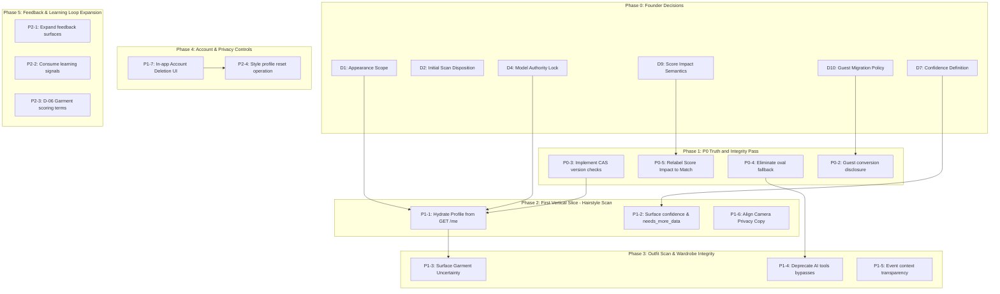

# Fansivibe Stage 1 — Gap Analysis

**Document Type:** Engineering Defect, Architecture Gap, and Priority Analysis  
**Date:** 2026-10-31  
**Repository:** `/home/tony/projects/fansivibe_v1_backup`  
**Committed Baseline:** Commit `97f6ded99d3f3e67b477616380320058cd396f48` (`main`)  
**Methodology:** Static requirement-to-code gap assessment against target requirements (R-S1-1 through R-X-2) and contracts (C-01 through C-10).

---

## 1. Executive Summary

This gap analysis defines the exact technical discrepancies between Fansivibe's target specifications and the verified codebase.

Importantly, commit `97f6ded` (Batch 2) successfully closed the previous P0 gap in Outfit Scan by wiring `GarmentAnalysisPort` into both `CreateOutfitRun` and `EphemeralOutfitAnalysis`. Garment observation is now functional.

The primary remaining gaps center on:
1. **Model Authority & Fragmentation**: User profile state is duplicated between client-local storage and backend relational tables without synchronization.
2. **Onboarding Data Continuity**: Guest onboarding scans are discarded upon user authentication without disclosure.
3. **Concurrency & Provenance**: Style profile updates lack compare-and-swap (CAS) version checks and per-attribute provenance.
4. **Honesty in Fallbacks & Uncertainty**: Hidden defaults (`oval` face shape) and omitted uncertainty primitives (`confidence`, `needs_more_data`) compromise system transparency.

Gaps are prioritized strictly into P0 (correctness/safety blockers), P1 (essential for first vertical slice), P2 (subsequent capabilities), and Deferred (requiring founder decisions).

---

## 2. P0 — Correctness, Data Integrity, and Safety Blockers

### P0-1: Split Authority on Person and Style Profile State
- **Description**: The Flutter application maintains profile attributes (`faceShape`, `skinTone`, `bodyType`, `styleType`) entirely within client-local storage (`LocalStorage.userProfile` and `LearningService.instance.face`). Meanwhile, the backend maintains `user_state.style_profile` and serves it via `GET /v1/users/me` (`ProfileView.styleProfile`). Flutter never requests or parses `ProfileView.styleProfile`.
- **Why It Is P0**: Violates single-source-of-truth principles. If a user logs in on a second device or updates their profile via web/API, the mobile application displays stale or empty local data.
- **Evidence**:
  - `newproject/flutter_application_1/lib/features/profile/presentation/profile_screen.dart:358-375`
  - `backend/app/api/routers/users.py:96-109`
- **Remediation Direction**: Hydrate `ProfileScreen` from `GET /v1/users/me`. Treat `LocalStorage` as a transient offline cache rather than the authoritative profile store.

### P0-2: Guest-to-Authenticated Conversion Discards Appearance Data
- **Description**: In the onboarding flow, guest users take a photo and receive an ephemeral preview with face and garment observations. The "Save My Progress" CTA records only a pending route intent (`PendingAuthIntent`). When the guest subsequently signs up or logs in, `GuestDataMigration` explicitly excludes face profile, style type, and analysis blobs from migration.
- **Why It Is P0**: Violates user trust and creates false save expectations. The user is told their progress is being saved, but their appearance analysis is permanently lost upon sign-in.
- **Evidence**:
  - `newproject/flutter_application_1/lib/features/auth/data/guest_data_migration.dart:52-57`
  - `newproject/flutter_application_1/lib/features/onboarding/presentation/screens/your_analysis_screen.dart:83-96`
- **Remediation Direction**: Either (A) provide explicit disclosure in the guest sign-in modal that appearance scans are preview-only and must be retaken once authenticated, or (B) implement durable snapshot replay under explicit user consent post-authentication.

### P0-3: Lack of Concurrency Control (CAS) on Style Profile Merging
- **Description**: `UserStateRepositorySQL.update_style_profile` executes a blind PostgreSQL `||` concatenation (`existing || patch`) without checking or incrementing `user_state.version`. If two analysis runs submit concurrently (e.g. simultaneous hairstyle and outfit scans), a last-writer-wins overwrite occurs without conflict detection. Furthermore, `source_run_id` is updated globally for the entire JSONB object, destroying provenance for surviving fields.
- **Why It Is P0**: Data integrity and auditability risk. Merged profiles can combine attributes from different runs with misleading provenance.
- **Evidence**:
  - `backend/app/infrastructure/db/repositories.py:265-306`
  - `backend/app/infrastructure/db/models.py:121-131`
- **Remediation Direction**: Enforce optimistic locking by including `WHERE user_state.version == expected_version` and incrementing `version = version + 1`. Introduce per-attribute provenance tracking within the JSONB payload.

### P0-4: Hidden `oval` Fallback for Missing Face Shapes
- **Description**: In `analysis_rules.py:168` and `backend/app/ai/tools.py:36`, when a user context has no measured face shape, scoring helpers silently fall back to `"oval"`. While `CreateHairstyleImageRun` rejects missing faces, other analysis and assistant paths score recommendations against an assumed oval face.
- **Why It Is P0**: Violates AI-0 honesty invariant by fabricating user physical attributes. A user whose face was not detected receives personalized cuts scored as if they were oval-faced.
- **Evidence**:
  - `backend/app/domain/services/analysis_rules.py:168`
  - `backend/app/ai/tools.py:36-39`
- **Remediation Direction**: Remove the hidden `"oval"` fallback. If face shape is missing, return an honest no-face result or a generic, non-geometry-conditioned recommendation.

### P0-5: "Style Score Impact" Metric Mislabeled in Outfit Builder
- **Description**: Outfit Builder result screens present the ensemble match percentage (`winner.match_percentage` or `c.score`) under the label "Style Score Impact". The actual Style Score is a usage/inventory metric (base 60 + wardrobe/saved look points) calculated in `learning.py:116-152`. Generating an outfit has zero causal effect on Style Score.
- **Why It Is P0**: Gives users a false causal interpretation of recommendation output.
- **Evidence**:
  - `backend/app/application/outfits.py:352-355`
  - `newproject/flutter_application_1/lib/features/outfit_builder/presentation/outfit_recommendation_screen.dart:225-251`
- **Remediation Direction**: Relabel the metric to "Ensemble Match" or compute an authentic before-and-after delta against the user's actual Style Score.

---

## 3. P1 — Essential Capabilities for First Vertical Slice

### P1-1: Hydrating Flutter Profile from Backend API
- **Description**: Flutter `ProfileScreen` must query `GET /v1/users/me` on mount, parse `ProfileView.styleProfile`, and render authoritative appearance attributes.
- **Target Surface**: `newproject/flutter_application_1/lib/features/profile/presentation/profile_screen.dart`.
- **Prerequisite**: P0-1.

### P1-2: Surfacing Uncertainty in Flutter Hairstyle Result Screen
- **Description**: `HairstyleAnalysisResult.fromRunResult` in `hairstyle_mock_data.dart` drops backend `confidence` and `needs_more_data`. Flutter must deserialize these fields and display evidence completeness and actionable guidance.
- **Target Surface**: `newproject/flutter_application_1/lib/features/hairstyle/data/hairstyle_mock_data.dart` and `hairstyle_result_screen.dart`.
- **Prerequisite**: None.

### P1-3: Surfacing Garment Uncertainty in Outfit Analysis Screen
- **Description**: While `outfit_analysis_screen.dart` renders garment category and colors, it does not display `garment.confidence` or flag items where `needs_review == true`.
- **Target Surface**: `newproject/flutter_application_1/lib/features/outfit_scan/presentation/outfit_analysis_screen.dart`.
- **Prerequisite**: Commit `97f6ded` (already wired).

### P1-4: Deprecating AI Assistant Recommendation Bypasses
- **Description**: `backend/app/ai/tools.py` contains hardcoded recommendation rules (`recommend_hairstyle`, `recommend_outfit`) that bypass `analysis_rules.py`. Assistant tools must call the canonical domain Decision Engine.
- **Target Surface**: `backend/app/ai/tools.py`.
- **Prerequisite**: None.

### P1-5: Event Context Transparency in Outfit Builder
- **Description**: Navigating from an event to Outfit Builder passes event ID, title, date, and location for display only, while only occasion is sent to the backend. The UI must clearly disclose that recommendations are conditioned on occasion only.
- **Target Surface**: `newproject/flutter_application_1/lib/features/outfit_builder/presentation/build_outfit_screen.dart`.
- **Prerequisite**: None.

### P1-6: Privacy Copy and Camera Consent Clarification
- **Description**: Camera permission copy stating "photos are not stored" is ambiguous. Text must distinguish ephemeral raw image byte processing from persistent derived feature storage (`user_state.style_profile`).
- **Target Surface**: `newproject/flutter_application_1/lib/features/onboarding/presentation/screens/camera_permission_screen.dart`.
- **Prerequisite**: None.

### P1-7: In-App Account Deletion UI
- **Description**: The backend provides `DELETE /v1/users/me` with full cascading deletion. Flutter settings/profile lacks a UI entry point to trigger account erasure.
- **Target Surface**: `newproject/flutter_application_1/lib/features/profile/presentation/profile_screen.dart`.
- **Prerequisite**: Backend endpoint already verified (`backend/app/api/routers/users.py:130-151`).

---

## 4. P2 — Important Subsequent Capabilities

### P2-1: Expanding Feedback Surfaces Beyond Saved Looks
- **Description**: Feedback (like/dislike) is currently captured only on `saved_looks_screen.dart`. Users cannot express feedback directly on generated recommendations or on look details screens.
- **Target Surface**: `outfit_recommendation_screen.dart`, `look_details_screen.dart`.
- **Prerequisite**: Feedback backend endpoint (`POST /v1/feedback/events`) already exists.

### P2-2: Consuming `learning_signals` in Recommendation Scoring
- **Description**: `learning_signals` records events (`look_saved`, `analysis_updated`, `outfit_selected`, `item_added`), but is write-only. It must be aggregated to inform recommendation ranking.
- **Target Surface**: `backend/app/application/learning.py`, `backend/app/domain/services/analysis_rules.py`.
- **Prerequisite**: None.

### P2-3: Scoring Garment Pattern and Style Attributes
- **Description**: Migration `0023` added `fit` and `fit_confidence` to `wardrobe_items`. Pattern and style remain in `image_ref` JSONB sidecar. Dedicated columns and scoring sub-terms should be evaluated.
- **Target Surface**: `backend/app/domain/services/analysis_rules.py`.
- **Prerequisite**: Founder Decision D-06.

### P2-4: In-App Style Profile Reset / Clear Control
- **Description**: Users cannot reset or clear individual appearance attributes without deleting their entire account.
- **Target Surface**: `newproject/flutter_application_1/lib/features/profile/presentation/profile_screen.dart`.
- **Prerequisite**: Backend endpoint for profile field erasure.

### P2-5: Style Score Explanation Transparency
- **Description**: Expose the formula or clear explanatory copy indicating that Style Score reflects wardrobe completeness and saved looks, not fashion competence.
- **Target Surface**: `newproject/flutter_application_1/lib/features/home/presentation/widgets/backend_summary_cards.dart`.
- **Prerequisite**: None.

---

## 5. Deferred Items (Requiring Founder Decisions or Missing Specs)

| Item | Topic | Current Repository Status | Why Deferred | Decision Needed From |
|---|---|---|---|---|
| **D5** | Goal & Desired Change Model | Absent in schema and UI | No approved specification exists for goals in Stage 1 | Founder / Product |
| **D-06** | Garment AI Attributes Scoring | Fit scored; pattern/style preserved in sidecar | Scoring weights for noisy vision attributes require owner sign-off | Founder / AI Lead |
| **D10** | Guest Appearance Migration | Excluded in `guest_data_migration.dart` | Privacy and consent rules for migrating biometric/face data | Founder / Privacy Lead |
| **D-SPEC-1** | Person Model Specification | Ad-hoc JSONB `style_profile` | Formal person ontology not yet authored | Architecture Lead |
| **D-SPEC-2** | Attribute Freshness & Revalidation | No TTLs or expiry triggers | Product lifecycle policy needed for appearance decay | Founder / Product |
| **D-SPEC-3** | Conflict Resolution Rules | Silent overwrite (latest string wins) | Rules needed for resolving scan vs self-report contradictions | Architecture Lead |

---

## 6. Implementation Dependencies and Sequence

### Sequencing Rules
1. **P0 truth fixes precede UI feature expansion**: Relabeling "Style Score Impact" and eliminating the hidden `oval` fallback must occur before adding new recommendation UI.
2. **Authority unification precedes multi-capability synchronization**: Hydrating Flutter from `GET /v1/users/me` is required before attempting to share appearance data between Hairstyle Scan and Outfit Builder.
3. **Decisions D-06 and D5 remain isolated**: Do not attempt to design a general goal engine or new scoring columns until the core hairstyle vertical slice is hardened and verified.

---
*End of Stage 1 Gap Analysis.*
