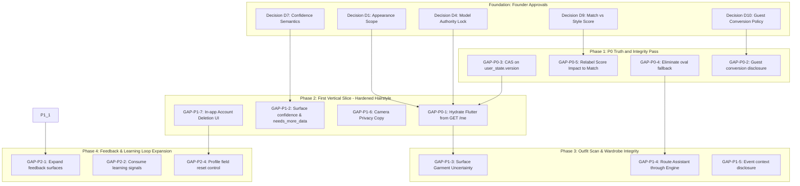

  # Fansivibe Stage 1B — Final Gap Analysis Report

**Document Type:** Authoritative Stage 1B Gap Analysis and Architecture Assessment  
**Date:** 2026-10-31  
**Repository:** `/home/tony/projects/fansivibe_v1_backup`  
**Verified Committed Baseline:** Commit `97f6ded99d3f3e67b477616380320058cd396f48` (`main`)  
**Working Tree State:** Clean tracked working tree (`git status --short` shows 0 modified tracked files; 4 untracked Stage 1 audit reports preserved)  
**Methodology:** Static code, schema, API router, migration, and documentation cross-audit. Zero database migrations executed, zero live AI services invoked, zero live external endpoints contacted.

---

## 1. Executive Summary

This document delivers **Stage 1B: Gap Analysis** for Fansivibe. It builds upon the Stage 1 Specification-to-Code Audit without restarting the audit, without redesigning the platform, and without modifying application code. Its singular purpose is to establish precisely what Fansivibe must change or build to satisfy the Stage 1 requirements while preserving and extending the existing codebase.

### Key Audit Confirmations
1. **Garment Analysis is Active (Batch 2 Verified)**: Outfit Scan now invokes both `AppearanceAnalysisPort` and `GarmentAnalysisPort` in `CreateOutfitRun` (`backend/app/application/analysis.py:328-335`) and `EphemeralOutfitAnalysis` (`analysis.py:1087-1094`). The Flutter client renders garment visual attributes and surfaces typed branch errors (`garment_error`, `appearance_error`). Older audit statements claiming Outfit Scan ignores clothing are confirmed outdated.
2. **Truth Containment is Grounded (Batch 1 Verified)**: Empty appearance fields (`skinTone`, `styleDna`) are suppressed in `hairstyle_result_screen.dart:229-247`, false progress claims ("Analyzing skin tone", "Applying Style DNA") have been eliminated from the primary hairstyle pipeline, and `rectangle` has been canonicalized to `rectangular` across scoring rules.
3. **Guest Cache Validation is Strengthened (Batch 3.1 Verified)**: `hasCachedOutfitPreview()` requires an authentic, renderable outfit preview before reporting valid cached analysis, preventing malformed stashes from claiming valid cache status (`newproject/flutter_application_1/lib/shared/utils/guest_mode.dart:220-228`).
4. **Deterministic Ranking is Real**: The 9-stage Decision Engine in `backend/app/domain/services/analysis_rules.py` enforces deterministic scoring and lexical tie-breaking (`score DESC`, `selected item count DESC`, `canonical item ID ASC`).

### Critical Architectural Deficiencies
Despite operational core engines, fundamental architectural and data-integrity gaps remain:
1. **Split-Brain Person Model Authority (P0-1)**: The Flutter application reads and writes user profile state from client-local storage (`LocalStorage.userProfile` and `LearningService.instance.face` in `profile_screen.dart:358-375`), completely ignoring the backend's authoritative `ProfileView.styleProfile` from `GET /v1/users/me`.
2. **Silent Guest Appearance Data Loss (P0-2)**: The guest onboarding scan gives users an ephemeral preview. The "Sign In to Continue" / "Save My Progress" CTA records only a pending route intent (`your_analysis_screen.dart:83-96`). During subsequent authentication, `GuestDataMigration` explicitly excludes face profile, style type, and analysis blobs without user disclosure (`guest_data_migration.dart:52-57`).
3. **Unprotected Concurrency and Provenance Loss (P0-3)**: `UserStateRepositorySQL.update_style_profile` merges non-empty attributes using PostgreSQL `||` without checking or incrementing `user_state.version` (`repositories.py:265-306`), creating a race condition on concurrent updates and overwriting object-level `source_run_id` for surviving fields.
4. **Fabricated Defaults in Fallback Paths (P0-4)**: When face shape is missing, helper functions in `analysis_rules.py:168` and `backend/app/ai/tools.py:36` silently fall back to `"oval"`, scoring recommendations against an unobserved face geometry and violating the AI-0 honesty invariant.
5. **Mislabeled Outfit Builder Metric (P0-5)**: Outfit recommendation screens present the ensemble candidate match percentage (`winner.match_percentage`) under the title "Style Score Impact" (`outfit_recommendation_screen.dart:225-251`), misleading users into believing recommendation generation causally improves their style score.

---

## 2. Verified Repository Baseline

Prior to performing this gap analysis, the local repository baseline was formally checked against the committed state:

| Parameter | Value | Verification Command / Output |
|---|---|---|
| **Repository Path** | `/home/tony/projects/fansivibe_v1_backup` | Absolute working directory verified |
| **Current Branch** | `main` | `git status` reports `On branch main`, up to date with `origin/main` |
| **Current HEAD Commit** | `97f6ded99d3f3e67b477616380320058cd396f48` | `git rev-parse HEAD` returns `97f6ded99d3f3e67b477616380320058cd396f48` |
| **Working Tree Status** | Clean tracked files | `git status --short` shows 0 modified tracked files. 4 untracked audit artifacts present (`STAGE1_SPEC_TO_CODE_AUDIT.md`, `STAGE1_EXISTING_CAPABILITIES.md`, `STAGE1_GAP_ANALYSIS.md`, `STAGE1_ARCHITECTURE_RISK_REPORT.md`) |
| **Baseline Match** | **CONFIRMED** | Commit matches the previous audit baseline exactly |

---

## 3. Requirement-Count Reconciliation

### The Discrepancy
- The Stage 1 Specification-to-Code Audit summary reported **21 traceability requirements plus 10 contracts = 31 total targets**.
- An earlier inventory noted **20 traceability requirements**.

### Source Matrix Audit and Enumeration
Direct static inspection of `FANSIVIBE_STAGE1_TRACEABILITY_MATRIX.md` (§3.3 Target requirement set, lines 153–176) reveals the authoritative source list:

| Subject Area | Subject Description | Requirement IDs | Count |
|---|---|---|---|
| **S1** | Current Appearance | `R-S1-1`, `R-S1-2`, `R-S1-3` | 3 |
| **S2** | Goals and Desired Change | `R-S2-1`, `R-S2-2` | 2 |
| **S3** | Preferences and Style Identity | `R-S3-1`, `R-S3-2`, `R-S3-3` | 3 |
| **S4** | Lifestyle, Context, Constraints | `R-S4-1`, `R-S4-2`, `R-S4-3` | 3 |
| **S5** | Observation, Evidence, Uncertainty | `R-S5-1`, `R-S5-2`, `R-S5-3` | 3 |
| **S6** | Reliable Person Model | `R-S6-1`, `R-S6-2`, `R-S6-3`, `R-S6-4`, `R-S6-5` | 5 |
| **R-X** | Cross-Cutting Rules | `R-X-1`, `R-X-2` | 2 |
| **SUBTOTAL REQUIREMENTS** | | | **21** |
| **C** | AI Stylist Product Contracts | `C-01` through `C-10` | **10** |
| **TOTAL SPECIFICATION SET** | | | **31** |

### Explanation of the Discrepancy
The numbered subjects S1 through S6 comprise **19 requirements** (3 + 2 + 3 + 3 + 3 + 5 = 19). In the earlier 20-count inventory:
1. `R-X-1` ("UI copy and progress labels must not claim work that did not execute") was included alongside the 19 subject requirements as item #20.
2. `R-X-2` ("Capability-specific observations must not silently become shared person facts") was either treated as a sub-clause of S6 (Reliable Person Model) or inadvertently omitted from the total count.
3. Alternatively, an arithmetic off-by-one in counting S1–S6 (assuming 20 instead of 19) occurred.

**Reconciliation Verdict:** The authoritative source matrix contains exactly **21 unique `R-*` requirements** and **10 `C-*` contracts**, yielding **31 distinct specification units**. Every requirement and contract retains its original identifier throughout this report.

---

## 4. Validated Requirement-by-Requirement Gap Table

### Classification Scheme
- **IMPLEMENTED (A)**: Code, schema, API, UI, and tests satisfy the requirement.
- **PARTIALLY IMPLEMENTED (B)**: Core logic exists, but critical attributes, UI presentation, or end-to-end integration are missing.
- **NOT IMPLEMENTED (C)**: Required functionality is absent in both backend and Flutter.
- **IMPLEMENTED DIFFERENTLY (D)**: Existing implementation diverges materially or uses an alternative mechanism from the specification.
- **NEEDS VERIFICATION (E)**: Static inspection cannot confirm runtime behavior.

---

### Detailed Findings for All 31 Requirements and Contracts

#### 1. R-S1-1: Real Appearance Observation and Attribute Identification
- **Exact Requirement**: Any capability claiming appearance analysis must use real observation models and clearly identify measured attributes.
- **Current Status**: **PARTIALLY IMPLEMENTED**
- **Current Implementation**: Hairstyle scan calls `VisionAppearanceAnalysisAdapter.analyze`, which calls Ollama vision to measure `face_shape`. However, the adapter explicitly hardcodes `skin_tone = ""`, `body_type = ""`, and `style_type = ""` (`backend/app/infrastructure/external/vision_appearance_adapter.py:229-236`). Outfit scan calls both appearance and garment adapters (`analysis.py:328-335`).
- **Evidence**: `backend/app/infrastructure/external/vision_appearance_adapter.py:229-236`; `backend/app/application/analysis.py:553-568`; `newproject/flutter_application_1/lib/features/hairstyle/presentation/hairstyle_result_screen.dart:223-247`.
- **What is Missing / Different**: Computer vision models for skin tone, body type, and style type are completely absent. UI hides empty attributes on Hairstyle Result, but does not state "Not measured" explicitly.
- **Root Cause**: Vision adapter was designed as a facial geometry extractor only; skin tone and body analysis were deferred.
- **Impact**: Users receive styling based on facial shape alone while the product marketing implies comprehensive appearance modeling.
- **Required Change**: Clarify appearance scope: either implement dedicated color/skin-tone extraction models or formally declare face shape as the sole Stage 1 appearance attribute.
- **Dependencies**: Founder Decision D1 (Appearance Scope).
- **Risk Without Resolution**: High risk of misleading users or attempting to implement unstable vision models on edge hardware.
- **Acceptance Criteria**: All appearance surfaces accurately declare which attributes were measured vs omitted.
- **Tests Required**: Backend vision adapter unit tests; Flutter result screen widget tests.
- **Confidence**: High.

#### 2. R-S1-2: Outfit Scan Garment Observation
- **Exact Requirement**: Outfit Scan must observe garments if it claims outfit analysis.
- **Current Status**: **IMPLEMENTED**
- **Current Implementation**: Resolved in Batch 2 (commit `97f6ded`). `CreateOutfitRun` executes `GarmentAnalysisPort.analyze` sequentially with `AppearanceAnalysisPort.analyze` (`analysis.py:328-335`). `EphemeralOutfitAnalysis` also calls garment analysis (`analysis.py:1087-1094`). `outfit_analysis_screen.dart:826-919` renders detected garment category, color, material, pattern, and fit with typed error handling.
- **Evidence**: `backend/app/application/analysis.py:328-340, 1087-1094`; `newproject/flutter_application_1/lib/features/outfit_scan/presentation/outfit_analysis_screen.dart:826-919`.
- **What is Missing / Different**: Garment observations are not written to a durable wardrobe or person model; garment confidence score is not surfaced as a separate metric.
- **Root Cause**: N/A (shipped in Batch 2).
- **Impact**: Satisfied for Stage 1 outfit scan analysis scope.
- **Required Change**: None for R-S1-2 core compliance.
- **Dependencies**: None.
- **Risk Without Resolution**: Low.
- **Acceptance Criteria**: Outfit Scan executes garment vision analysis and renders observed items.
- **Tests Required**: `backend/tests/test_analysis_use_case.py`; `test/outfit_analysis_screen_test.dart`.
- **Confidence**: High.

#### 3. R-S1-3: Honest Handling of Unmeasured Appearance Fields
- **Exact Requirement**: Appearance fields not measured must be hidden, labeled "Not measured", or removed.
- **Current Status**: **PARTIALLY IMPLEMENTED**
- **Current Implementation**: `hairstyle_result_screen.dart:229-247` hides empty rows (`if (result.skinTone.trim().isNotEmpty)`). In `outfit_analysis_screen.dart:880-915`, missing garment data displays an honest unavailable note. However, `profile_screen.dart:358-382` falls back to `LocalStorage.userProfile` or mock values, displaying values that were never measured.
- **Evidence**: `newproject/flutter_application_1/lib/features/hairstyle/presentation/hairstyle_result_screen.dart:229-247`; `newproject/flutter_application_1/lib/features/profile/presentation/profile_screen.dart:358-382`.
- **What is Missing / Different**: Profile screen displays unmeasured appearance attributes using local storage defaults; no consistent "Not measured" badge across all profile screens.
- **Root Cause**: Profile screen was built against local mock data prior to backend integration.
- **Impact**: Inconsistent user experience: Hairstyle Result hides unmeasured attributes, while Profile screen presents them as present.
- **Required Change**: Update `ProfileScreen` to check backend `ProfileView.styleProfile` and render an honest "Not measured" state when values are empty.
- **Dependencies**: P0-1 (Hydrate Profile from Backend).
- **Risk Without Resolution**: Confusion over user identity truth.
- **Acceptance Criteria**: Unmeasured appearance attributes display explicit "Not measured" indicators or are hidden across all client screens.
- **Tests Required**: `test/profile_screen_test.dart`.
- **Confidence**: High.

#### 4. R-S2-1: Goal / Desired Change Model
- **Exact Requirement**: The product must capture a goal or desired change, or explicitly state that Stage 1 does not support goals.
- **Current Status**: **NOT IMPLEMENTED (Decision Required)**
- **Current Implementation**: No Goal entity, schema, table, or profile field exists in backend or client. In `PHASE_1_STEP2_OWNER_DECISIONS.md`, D5 (goals scope) is marked as PENDING founder decision.
- **Evidence**: `backend/app/infrastructure/db/models.py` (no goal tables); `docs/architecture/AI_DOMAIN_MODEL.md` (no goal entity).
- **What is Missing / Different**: Product decision on whether goals belong in Stage 1; if in scope, a persistent goal model and recommendation conditioning.
- **Root Cause**: Product decision intentionally deferred by founder.
- **Impact**: Outfit recommendations cannot optimize for personal styling goals (e.g., "look taller", "transition to minimalist").
- **Required Change**: Formally record founder decision declaring goals out-of-scope for Stage 1, or implement goal capture.
- **Dependencies**: Founder Decision D5.
- **Risk Without Resolution**: Feature scope creep if developers attempt ad-hoc goal implementations.
- **Acceptance Criteria**: Formal founder decision recorded in `DECISIONS.md` declaring goals out of scope for Stage 1.
- **Tests Required**: Documentation assertion only.
- **Confidence**: High.

#### 5. R-S2-2: Mood and Occasion Request Scoping
- **Exact Requirement**: Per-request mood and occasion are treated as transient request context, never presented as durable personal goals.
- **Current Status**: **PARTIALLY IMPLEMENTED**
- **Current Implementation**: Backend treats mood as request-scoped context (`GenerateOutfitRequest.mood` in `schemas/outfits.py:25`). It is never persisted to `user_state.style_profile`. However, Outfit Builder UI includes progress and header copy ("Applying Style DNA") that implies personal goal evaluation.
- **Evidence**: `backend/app/api/schemas/outfits.py:25`; `backend/app/application/outfits.py:392-410`; `newproject/flutter_application_1/lib/features/outfit_builder/data/outfit_builder_mock_data.dart:139-142`.
- **What is Missing / Different**: UI copy cleanup in Outfit Builder mock data to ensure transient context is not represented as durable Style DNA.
- **Root Cause**: Legacy mock strings retained in Flutter test/mock data files.
- **Impact**: User misled into thinking a 1-time mood selection permanently alters their styling profile.
- **Required Change**: Remove "Applying Style DNA" copy from Outfit Builder loading states.
- **Dependencies**: None.
- **Risk Without Resolution**: Low.
- **Acceptance Criteria**: Outfit Builder copy describes occasion and mood as per-request filters.
- **Tests Required**: `test/outfit_builder_screens_test.dart`.
- **Confidence**: High.

#### 6. R-S3-1: Preference and Style Identity Grounding
- **Exact Requirement**: Recommendations claiming personalization consume stored preferences and style identity.
- **Current Status**: **PARTIALLY IMPLEMENTED**
- **Current Implementation**: Outfit Builder consumes `preferred_occasions` and request-scoped `colorPalette` and `fit` (C-02). Discover For You consumes `preferred_occasions` and `saved_looks`. But Hairstyle image scan does NOT consume preferences or saved looks (`analysis.py:571-574`), and Outfit Builder does NOT read `style_profile` (appearance).
- **Evidence**: `backend/app/application/outfits.py:479-516`; `backend/app/domain/services/analysis_rules.py:1445-1478`; `backend/app/application/analysis.py:571-574`.
- **What is Missing / Different**: Hairstyle image scan does not read stored preferences; Outfit Builder ignores appearance profile.
- **Root Cause**: Capability silos: each feature was developed with independent input DTOs.
- **Impact**: Recommendations are siloed; knowing a user's style preferences in Outfit Builder does not enhance their Hairstyle recommendations.
- **Required Change**: Connect `preferred_occasions` and `saved_looks` into Hairstyle candidate scoring; connect `style_profile` into Outfit Builder.
- **Dependencies**: P0-1 (Unify Person Model Authority).
- **Risk Without Resolution**: Inconsistent personalization across capabilities.
- **Acceptance Criteria**: Hairstyle recommendations adjust candidate scores based on user preferences and saved looks.
- **Tests Required**: `backend/tests/test_analysis_rules.py`.
- **Confidence**: High.

#### 7. R-S3-2: Style Identity Grounding vs Fallbacks
- **Exact Requirement**: Style identity is grounded in stored or declared values, never defaulted from absence.
- **Current Status**: **NOT IMPLEMENTED**
- **Current Implementation**: Vision adapter forces `style_type = ""` (`vision_appearance_adapter.py:235`). Flutter profile falls back to local presets (`profile_screen.dart:372`). In `analysis_rules.py:168` and `backend/app/ai/tools.py:36`, missing face shape silently falls back to `"oval"`.
- **Evidence**: `backend/app/infrastructure/external/vision_appearance_adapter.py:235`; `backend/app/domain/services/analysis_rules.py:168, 222-226`; `backend/app/ai/tools.py:36`.
- **What is Missing / Different**: Removal of hidden `"oval"` fallback; style identity must be explicitly declared or left absent.
- **Root Cause**: Defensive fallback programming to prevent null-pointer exceptions in recommendation scoring.
- **Impact**: A user with an unmeasured or unreadable face receives styling advice tailored for an oval face without knowing it.
- **Required Change**: Eliminate `_DEFAULT_FACE_SHAPE = "oval"`. If face shape is absent, return an unconditioned general recommendation or honest error.
- **Dependencies**: P0-4 (Eliminate oval fallback).
- **Risk Without Resolution**: High brand and correctness risk (violates AI-0 honesty).
- **Acceptance Criteria**: When face shape is missing, system never assumes oval face geometry.
- **Tests Required**: `backend/tests/test_analysis_rules.py::test_missing_face_shape_handling`.
- **Confidence**: High.

#### 8. R-S3-3: Consistent Feedback and Saved Look Learning Loop
- **Exact Requirement**: Saved looks and feedback events consistently influence future recommendations across all capabilities.
- **Current Status**: **PARTIALLY IMPLEMENTED**
- **Current Implementation**: Outfit Builder consumes saved looks (preferred items) and feedback events (likes +4.0/+2.0, dislikes -4.0/-2.0 via `build_feedback_context` in `analysis_rules.py:1362-1443`). Discover For You applies a +0.03 boost for saved looks. However, Hairstyle image analysis does not consume saved looks or feedback. Look details screen lacks feedback controls (`look_details_screen.dart:17`). `learning_signals` table is write-only.
- **Evidence**: `backend/app/application/outfits.py:503-516`; `backend/app/domain/services/analysis_rules.py:1362-1443`; `newproject/flutter_application_1/lib/features/saved_looks/presentation/saved_looks_screen.dart:332-333`.
- **What is Missing / Different**: Feedback consumption in Hairstyle/Grooming; feedback capture directly on generated recommendations and look details; consumption of `learning_signals`.
- **Root Cause**: Feedback context was only wired into the Outfit Builder candidate scoring pipeline.
- **Impact**: Liking or disliking hairstyles has zero effect on future hairstyle recommendations.
- **Required Change**: Wire `feedback_events` into `recommend_hairstyle` scoring; add feedback buttons to recommendation screens.
- **Dependencies**: P2-1 (Expand feedback surfaces).
- **Risk Without Resolution**: Moderate; diminishes the value of user feedback.
- **Acceptance Criteria**: Liking a hairstyle boosts its score or similar catalog cuts in future runs.
- **Tests Required**: `backend/tests/test_analysis_rules.py`.
- **Confidence**: High.

#### 9. R-S4-1: Event Context Pass-Through and Labeling
- **Exact Requirement**: When generating an outfit for an event, event context is passed to the backend or explicitly labeled display-only.
- **Current Status**: **PARTIALLY IMPLEMENTED**
- **Current Implementation**: Navigating from an event (`event_list_screen.dart:109-117`) passes `occasion` to `POST /v1/outfits/generate`. Event ID, title, date, and location are display-only in Flutter (`build_outfit_screen.dart:59-80`, `app_router.dart:269-304`) and are not sent to the backend.
- **Evidence**: `newproject/flutter_application_1/lib/features/events/presentation/event_list_screen.dart:109-117`; `newproject/flutter_application_1/lib/app/router/app_router.dart:269-304`; `backend/app/api/schemas/outfits.py::GenerateOutfitRequest`.
- **What is Missing / Different**: UI does not disclose that date and location are ignored by the recommendation engine.
- **Root Cause**: Backend schema accepts only `occasion`, not event entity ID or location/date.
- **Impact**: User expects recommendation to take wedding location/season into account when it only considers the "formal" tag.
- **Required Change**: Add clear UI disclosure in Outfit Builder: "Styling for [Occasion] (Date and location are display-only)".
- **Dependencies**: None.
- **Risk Without Resolution**: Low.
- **Acceptance Criteria**: Outfit Builder discloses that only occasion influences recommendations.
- **Tests Required**: `test/event_screens_test.dart`.
- **Confidence**: High.

#### 10. R-S4-2: Weather and Constraint Absence Honesty
- **Exact Requirement**: Weather, location, budget, and comfort are not implied unless a real provider exists.
- **Current Status**: **IMPLEMENTED**
- **Current Implementation**: Fansivibe has no weather provider by design (`today.py:29-30` explicitly documents no weather integration). Today's Look UI has no weather card or weather claims. Budget and mobility constraints are not presented to users.
- **Evidence**: `backend/app/application/today.py:29-30`; `newproject/flutter_application_1/lib/features/home/presentation/home_screen.dart`.
- **What is Missing / Different**: None (honest absence maintained).
- **Root Cause**: Architecture decision DEC-017 frozen as derived-only without fake weather.
- **Impact**: Honest boundary preserved.
- **Required Change**: None.
- **Dependencies**: None.
- **Risk Without Resolution**: None.
- **Acceptance Criteria**: No synthetic or hardcoded weather claims appear in UI.
- **Tests Required**: `backend/tests/test_m9_today_look_api.py`.
- **Confidence**: High.

#### 11. R-S4-3: Event Preference Consistency
- **Exact Requirement**: Event creation and recommendation context are consistent about what is remembered.
- **Current Status**: **PARTIALLY IMPLEMENTED**
- **Current Implementation**: In `events.py:114-129`, creating an event with an occasion adds that occasion code to `user_state.preferences["preferred_occasions"]` (R36). Today's Look consumes the nearest event occasion (`today.py:160-171`). However, Outfit Builder does not disclose that preferences were modified by calendar events.
- **Evidence**: `backend/app/application/events.py:114-129`; `backend/app/application/today.py:160-171`.
- **What is Missing / Different**: Explanation transparency: recommendation explanations do not mention when an occasion preference was seeded from an event.
- **Root Cause**: Event-to-preference seeding is silent and additive.
- **Impact**: User may wonder why "business" is boosted when they never explicitly set it in their profile.
- **Required Change**: Add note in recommendation rationales when preference is event-derived.
- **Dependencies**: None.
- **Risk Without Resolution**: Low.
- **Acceptance Criteria**: Preference management screen allows users to see and remove event-seeded occasions.
- **Tests Required**: `backend/tests/test_m8a_events_foundation.py`.
- **Confidence**: High.

#### 12. R-S5-1: Provenance Preservation and Observation/Inference Separation
- **Exact Requirement**: Every result preserves provenance and distinguishes observation from inference.
- **Current Status**: **PARTIALLY IMPLEMENTED**
- **Current Implementation**: `analysis_runs` records `input_media` (SHA-256 hash), `knowledge_version`, `engine_version`, and `idempotency_key`. However, `user_state.style_profile` flattens all attributes under a single `source_run_id`, losing per-attribute provenance when subsequent runs update partial attributes. The UI does not distinguish direct observations from catalog inferences.
- **Evidence**: `backend/app/application/analysis.py:250-287`; `backend/app/infrastructure/db/repositories.py:265-306`.
- **What is Missing / Different**: Field-level provenance in `style_profile`; clear UI badges distinguishing measured facts from styling inferences.
- **Root Cause**: `style_profile` is a flat JSONB key-value mapping.
- **Impact**: If a run sets body type, the source run ID for face shape is overwritten, corrupting audit trails.
- **Required Change**: Upgrade `style_profile` JSONB structure to record `{value, source_run_id, updated_at}` per attribute.
- **Dependencies**: P0-3 (Concurrency and Provenance).
- **Risk Without Resolution**: High auditability failure in multi-modal styling.
- **Acceptance Criteria**: Each attribute in `style_profile` retains its originating `source_run_id`.
- **Tests Required**: `backend/tests/test_c09_style_profile_merge.py`.
- **Confidence**: High.

#### 13. R-S5-2: Confidence Definition and Calibration
- **Exact Requirement**: Confidence reflects calibrated model certainty.
- **Current Status**: **IMPLEMENTED DIFFERENTLY**
- **Current Implementation**: In `analysis_rules.py:378-393`, hairstyle confidence is computed as `0.5 * completeness + 0.5 * decisiveness` (completeness is fraction of 4 attributes present; decisiveness is score gap between top 2 picks). It is an evidence-completeness and ranking decisiveness heuristic, NOT a computer vision probability.
- **Evidence**: `backend/app/domain/services/analysis_rules.py:378-393`; `backend/app/domain/services/analysis_rules.py:226-243`.
- **What is Missing / Different**: Clear user disclosure that confidence indicates evidence completeness rather than facial detection accuracy.
- **Root Cause**: Vision model does not output calibrated confidence probabilities; heuristic was adopted.
- **Impact**: User interprets "85% Confidence" as "85% sure you have a square face", whereas it actually means 2 out of 4 profile fields exist and the top pick had a 0.07 score lead.
- **Required Change**: Document confidence semantics in UI tooltip or relabel to "Profile Completeness / Match Strength".
- **Dependencies**: Founder Decision D7 (Confidence Definition).
- **Risk Without Resolution**: Misleading statistical claims.
- **Acceptance Criteria**: User-visible confidence labels accurately reflect evidence completeness.
- **Tests Required**: Flutter result screen tests.
- **Confidence**: High.

#### 14. R-S5-3: Consistent Surfacing of Uncertainty Primitives
- **Exact Requirement**: `needs_more_data`, `needs_review`, and confidence are surfaced consistently on all result surfaces.
- **Current Status**: **PARTIALLY IMPLEMENTED**
- **Current Implementation**: Backend emits `needs_more_data` in hairstyle results (`analysis_rules.py:465`) and `needs_review` in garment results (`value_objects.py:102-117`). In `outfit_analysis_screen.dart`, appearance confidence is rendered. However, `hairstyle_mock_data.dart:128-148` drops `confidence` and `needs_more_data` during JSON parsing, so Hairstyle Result screen never surfaces them.
- **Evidence**: `backend/app/domain/services/analysis_rules.py:465`; `newproject/flutter_application_1/lib/features/hairstyle/data/hairstyle_mock_data.dart:128-148`; `newproject/flutter_application_1/lib/features/outfit_scan/presentation/outfit_analysis_screen.dart:404-431`.
- **What is Missing / Different**: Parsing and displaying `confidence` and `needs_more_data` in Flutter Hairstyle Result; displaying garment uncertainty on Outfit Analysis screen.
- **Root Cause**: Flutter DTO omitted fields when mapping backend JSON snapshot.
- **Impact**: When the backend signals that data is sparse (`needs_more_data: true`), the client silently suppresses the warning.
- **Required Change**: Update `HairstyleAnalysisResult.fromRunResult` to parse `confidence` and `needs_more_data`; render guidance banner in `hairstyle_result_screen.dart`.
- **Dependencies**: P1-2 (Surface Uncertainty in Hairstyle Result).
- **Risk Without Resolution**: High (suppresses backend uncertainty).
- **Acceptance Criteria**: When `needs_more_data` is true, Hairstyle Result screen displays a "More information needed" advisory banner.
- **Tests Required**: `test/hairstyle_result_screen_test.dart`.
- **Confidence**: High.

#### 15. R-S6-1: Shared Person Model Authority and Read/Write Path
- **Exact Requirement**: Shared person model has one declared authority for each field and a documented read/write path.
- **Current Status**: **PARTIALLY IMPLEMENTED**
- **Current Implementation**: Backend `user_state.style_profile` is the intended server authority and is exposed via `GET /v1/users/me` (`ProfileView.styleProfile`). However, Flutter `ProfileScreen` reads local storage (`LocalStorage.userProfile`) and `LearningService.instance.face`, never calling `GET /v1/users/me`. Two parallel, uncoordinated authorities exist.
- **Evidence**: `backend/app/api/routers/users.py:96-109`; `newproject/flutter_application_1/lib/features/profile/presentation/profile_screen.dart:358-375`.
- **What is Missing / Different**: Flutter client hydration from `GET /v1/users/me`.
- **Root Cause**: Split-brain architecture: mobile app used on-device local storage for UI while backend developed PostgreSQL schema independently.
- **Impact**: Split-brain state. Users logging in on a new device see an empty profile, even though the database holds their attributes.
- **Required Change**: Designate `UserState.style_profile` as the sole authority. Hydrate Flutter `ProfileScreen` from `GET /v1/users/me`.
- **Dependencies**: P0-1.
- **Risk Without Resolution**: Critical data consistency failure across sessions.
- **Acceptance Criteria**: Flutter `ProfileScreen` displays attributes retrieved directly from `GET /v1/users/me`.
- **Tests Required**: `test/profile_screen_test.dart`; `backend/tests/test_get_profile.py`.
- **Confidence**: High.

#### 16. R-S6-2: Non-Erasure in Partial Updates
- **Exact Requirement**: Updating one attribute does not erase previously stored attributes.
- **Current Status**: **IMPLEMENTED**
- **Current Implementation**: `UserStateRepositorySQL.update_style_profile` in `repositories.py:265-306` uses PostgreSQL JSONB concatenation (`coalesce(style_profile, '{}'::jsonb) || cast(patch, JSONB)`). Only non-empty strings are included in the patch dict. Empty strings and nulls are filtered out. Existing keys survive.
- **Evidence**: `backend/app/infrastructure/db/repositories.py::UserStateRepositorySQL.update_style_profile` (lines 265–306).
- **What is Missing / Different**: None (merge semantics verified by regression tests).
- **Root Cause**: N/A.
- **Impact**: Attributes survive partial scans.
- **Required Change**: None for non-erasure (optimistic locking needed under R-S6-4).
- **Dependencies**: None.
- **Risk Without Resolution**: Low.
- **Acceptance Criteria**: Updating face shape preserves previously stored skin tone or body type.
- **Tests Required**: `backend/tests/test_c09_style_profile_merge.py` (all 10 pass).
- **Confidence**: High.

#### 17. R-S6-3: Explicit Guest-to-Authenticated Migration Scope
- **Exact Requirement**: Guest migration preserves or explicitly drops each data class with clear user disclosure.
- **Current Status**: **PARTIALLY IMPLEMENTED**
- **Current Implementation**: `GuestDataMigration` in `guest_data_migration.dart:47-57` migrates wardrobe items and preferred occasions. It explicitly excludes face profile, learning signals, saved-look titles, style type, and analysis blobs. However, the UI does not disclose to the user that their face scan / preview will not migrate.
- **Evidence**: `newproject/flutter_application_1/lib/features/auth/data/guest_data_migration.dart:44-78`; `newproject/flutter_application_1/lib/features/auth/presentation/post_auth_flow.dart:140-181`.
- **What is Missing / Different**: User-facing disclosure that the onboarding appearance scan is preview-only and will not carry over to the account.
- **Root Cause**: Privacy boundary: backend does not accept anonymous face uploads without user authentication.
- **Impact**: User takes onboarding selfie, creates account believing progress is saved, and finds an empty profile.
- **Required Change**: Add explicit copy to guest sign-in modal: "Note: Your photo scan was an ephemeral preview. Once signed in, take an official scan to personalize your profile."
- **Dependencies**: P0-2.
- **Risk Without Resolution**: High churn and user disillusionment.
- **Acceptance Criteria**: Sign-in modal explicitly states that appearance preview is not saved to the authenticated account.
- **Tests Required**: `test/guest_auth_conversion_test.dart`.
- **Confidence**: High.

#### 18. R-S6-4: Provenance and Versioning for Recommendation Shifts
- **Exact Requirement**: Model exposes provenance and versioning to explain why recommendations change.
- **Current Status**: **PARTIALLY IMPLEMENTED**
- **Current Implementation**: `analysis_runs` stores execution history and timestamps. `user_state` has a `version` column and `updated_at`. `SavedLook` records `source_run_id`. But `user_state.style_profile` does not track historical attribute changes or reasons for updates. `update_style_profile` does not increment or check `user_state.version`.
- **Evidence**: `backend/app/infrastructure/db/models.py:118-132`; `backend/app/infrastructure/db/repositories.py:265-306`.
- **What is Missing / Different**: Compare-and-swap (CAS) check on `user_state.version`; attribute mutation history.
- **Root Cause**: Concurrency control was deferred during initial repository implementation.
- **Impact**: Concurrent updates result in unmonitored last-writer-wins overwrites; recommendations cannot be diffed against prior person-model versions.
- **Required Change**: Implement CAS optimistic locking in `update_style_profile` (`WHERE user_id == :uid AND version == :expected_version; SET version = version + 1`).
- **Dependencies**: P0-3.
- **Risk Without Resolution**: Concurrency race conditions on rapid multi-capability usage.
- **Acceptance Criteria**: Concurrent profile updates with stale versions fail with a concurrency error.
- **Tests Required**: `backend/tests/test_c09_style_profile_merge.py`.
- **Confidence**: High.

#### 19. R-S6-5: Account Deletion and Privacy Alignment
- **Exact Requirement**: Account deletion removes user data in compliance with privacy claims, with in-app UI access.
- **Current Status**: **PARTIALLY IMPLEMENTED**
- **Current Implementation**: Backend implements `DELETE /v1/users/me` with full foreign-key cascade (`DeleteAccount` in `backend/app/application/auth.py:228-246`). However, Flutter has no account deletion button in settings or profile. Camera permission copy states photos are not stored, which is true for raw bytes, but derived attributes are persisted.
- **Evidence**: `backend/app/api/routers/users.py:130-151`; `backend/app/application/auth.py:228-246`; `newproject/flutter_application_1/lib/features/profile/presentation/profile_screen.dart`.
- **What is Missing / Different**: In-app "Delete Account" UI button; privacy copy distinguishing raw image bytes from persisted derived features.
- **Root Cause**: Account deletion UI was not prioritized during Flutter MVP build.
- **Impact**: App Store / Play Store compliance rejection (mandatory account deletion requirement); privacy misrepresentation.
- **Required Change**: Add "Delete Account" button in Flutter Profile settings; update camera consent copy.
- **Dependencies**: P1-7 (In-App Account Deletion UI).
- **Risk Without Resolution**: App Store rejection; GDPR/CCPA regulatory violation.
- **Acceptance Criteria**: User can trigger account deletion from within Flutter app and receive confirmation.
- **Tests Required**: `test/profile_screen_test.dart`; `backend/tests/test_account_erasure.py`.
- **Confidence**: High.

#### 20. R-X-1: Truthful Progress Labels and Pipeline Claims
- **Exact Requirement**: UI copy and progress labels must not claim work that did not execute.
- **Current Status**: **PARTIALLY IMPLEMENTED**
- **Current Implementation**: In Batch 1 (`STAGE1-BATCH-1`), false progress copy "Analyzing skin tone" and "Applying Style DNA" was corrected in hairstyle processing copy, Outfit Builder processing label was fixed, and post-auth copy was refined. However, Outfit Builder progress still references style DNA stages in some mock files (`outfit_builder_mock_data.dart:139-142`).
- **Evidence**: `newproject/flutter_application_1/lib/features/hairstyle/data/hairstyle_mock_data.dart:39-61`; `newproject/flutter_application_1/lib/features/outfit_builder/data/outfit_builder_mock_data.dart:139-142`.
- **What is Missing / Different**: Complete elimination of mock pipeline stages across all capabilities.
- **Root Cause**: Lingering strings in mock data files.
- **Impact**: Progress indicators describe operations that the backend never runs.
- **Required Change**: Audit and align all loading state messages with actual backend pipeline stages.
- **Dependencies**: None.
- **Risk Without Resolution**: Low.
- **Acceptance Criteria**: Loading states only display actual active execution steps.
- **Tests Required**: `test/hairstyle_processing_screen_test.dart`.
- **Confidence**: High.

#### 21. R-X-2: Capability-Specific Observation Isolation
- **Exact Requirement**: Capability-specific observations must not silently become shared person facts without a declared contract.
- **Current Status**: **PARTIALLY IMPLEMENTED**
- **Current Implementation**: Outfit Scan writes `face_shape` to `user_state.style_profile` (`analysis.py:391-398`). Garment observations are not written to `style_profile`. Hairstyle writes `face_shape`. But there is no declared projection schema or validation separating capability-local observations from global person truths.
- **Evidence**: `backend/app/application/analysis.py:387-399`; `backend/app/infrastructure/db/repositories.py:265-306`.
- **What is Missing / Different**: Formal projection contract specifying which capabilities have authority to update which person model attributes.
- **Root Cause**: Ad-hoc calls to `update_style_profile` from different use cases.
- **Impact**: A noisy observation from a wide-angle outfit photo can overwrite a calibrated face shape from a portrait scan.
- **Required Change**: Define capability authority rules (e.g. Hairstyle Scan is authoritative for facial geometry; Outfit Scan is secondary).
- **Dependencies**: P0-1 (Person Model Authority).
- **Risk Without Resolution**: Degraded styling accuracy from uncalibrated multi-capability writes.
- **Acceptance Criteria**: Profile updates enforce capability authority rules before overwriting existing attributes.
- **Tests Required**: `backend/tests/test_analysis_use_case.py`.
- **Confidence**: High.

---

### AI Stylist Contracts (C-01 through C-10) Validation

| Contract ID | Contract Name | Status | Evidence Paths & Symbols | Validation Summary |
|---|---|---|---|---|
| **C-01** | Guest / Authenticated Identity Architecture | **IMPLEMENTED** | `shared/utils/guest_mode.dart:21-64`; `backend/app/api/deps.py::get_current_user_id` | Locked and verified. Unauthenticated users browse local wardrobe and discover feeds; server AI endpoints require JWT token; point-of-action sign-in prompts record `PendingAuthIntent`. |
| **C-02** | Mood / Fit / Color Palette | **IMPLEMENTED** | `analysis_rules.py:1445-1478`; `alembic/versions/0023_wardrobe_fit_columns.py` | Locked and verified. Palette provides +5 soft bonus (`C-02-P`); fit provides +5 soft bonus when `fit_confidence >= 0.6` (`C-02-F`); mood is context/explanation-only (`C-02-M`). Clamped in [0, 100]. |
| **C-03** | Preferred Item IDs Recommendation Influence | **IMPLEMENTED** | `schemas/outfits.py:27`; `application/outfits.py:392`; `analysis_rules.py:1145-1170` | Locked and verified. Explicit item UUIDs in `GenerateOutfitRequest` provide a +5 per item boost (capped at +15); unknown/foreign IDs degrade safely to 0 without 404. |
| **C-04** | Scan → Generate ("Build with this item") | **IMPLEMENTED** | `add_wardrobe_item_screen.dart:450-480`; `outfit_generation_screen.dart:74-89` | Option A verified. Saving a garment returns a wardrobe item UUID, preselected in Outfit Builder and passed via `preferredItemIds`. |
| **C-05** | Feedback Semantics (Save, Like, Dislike, Wear) | **IMPLEMENTED** | `analysis_rules.py:1362-1443`; `application/outfits.py:503-516` | Locked and verified. Like awards +4.0/+2.0; Dislike penalizes -4.0/-2.0; Wear awards +2.0/+1.0. Clamped net feedback range [-6.0, +6.0]. |
| **C-06** | Garment AI Attributes Persistence and Scoring | **PARTIALLY IMPLEMENTED** | `alembic/versions/0023_wardrobe_fit_columns.py`; `analysis_rules.py:1445-1478` | 7 attributes captured; category, color, material, fit scored; pattern and style stored in `image_ref` JSONB sidecar. Formal scoring weights for pattern/style remain PENDING (D-06). |
| **C-07** | item_added Learning Signal Emission | **IMPLEMENTED** | `alembic/versions/0024_item_added_signal_type.py`; `application/wardrobe.py:127-145` | Locked and verified. Adding a wardrobe item emits `item_added` signal row to `learning_signals` table post-commit. |
| **C-08** | analysisCached / analysisResult Storage Integrity | **IMPLEMENTED** | `shared/utils/local_storage.dart:86-98`; `shared/utils/guest_mode.dart:220-228` | Locked and verified. `LocalStorage.analysisResult` setter deprecated; `analysisCached` semantics verified as photo-captured flag; `hasCachedOutfitPreview()` requires renderable preview. |
| **C-09** | Style Profile Merging Semantics | **IMPLEMENTED DIFFERENTLY** | `repositories.py:265-306`; `test_c09_style_profile_merge.py` | Implemented as MERGE via PostgreSQL `||` operator. Preserves non-empty attributes, but lacks compare-and-swap (CAS) on `version` and lacks attribute-level provenance. Formal owner decision remains PENDING. |
| **C-10** | Analysis Idempotency | **IMPLEMENTED** | `alembic/versions/0025_analysis_runs_idempotency.py`; `application/analysis.py:264-302` | Locked and verified. Option B implemented: `Idempotency-Key` header with database unique constraint `uq_analysis_runs_idempotency` on all 4 analysis use cases. |

---

### Reconciliation Summary Matrix

| Status Code | Status Meaning | Traceability Requirements (R-*) | AI Stylist Contracts (C-*) | Total Count | Percentage |
|---|---|---|---|---|---|
| **A** | IMPLEMENTED | 3 | 8 | **11** | 35.5% |
| **B** | PARTIALLY IMPLEMENTED | 15 | 1 | **16** | 51.6% |
| **C** | NOT IMPLEMENTED | 2 | 0 | **2** | 6.5% |
| **D** | IMPLEMENTED DIFFERENTLY | 1 | 1 | **2** | 6.5% |
| **E** | NEEDS VERIFICATION | 0 | 0 | **0** | 0.0% |
| **TOTAL** | | **21** | **10** | **31** | **100.0%** |

---

## 5. Person Model Gap Analysis

### 5.1 Canonical Source of Truth
- **Current State**: Split-brain architecture. The backend maintains `user_state.style_profile` JSONB and serves it via `GET /v1/users/me` (`ProfileView.styleProfile`). Flutter `ProfileScreen` reads and writes `LocalStorage.userProfile` and `LearningService.instance.face` (`profile_screen.dart:358-375`). Flutter never requests `GET /v1/users/me` on mount and never hydrates from backend profile attributes.
- **Gap**: There is no single declared authority. If a user logs in on a new device, mobile profile attributes display empty or mock values despite PostgreSQL holding verified data.

### 5.2 Attribute Storage
- **Current State**: The backend stores appearance attributes as unstructured keys in `user_state.style_profile` JSONB (`face_shape`, `skin_tone`, `body_type`, `style_type`, `source_run_id`).
- **Gap**: There is no typed `Person` entity. Physical dimensions (height, proportions), hair attributes (hair length, hair texture, hair curl pattern), and personal styling restrictions (modesty, budget limits, fabric allergies) have no storage representation anywhere in the repository.

### 5.3 Attribute Provenance
- **Current State**: Provenance is tracked only at the analysis run level (`analysis_runs`). Inside `user_state.style_profile`, a single string `source_run_id` covers the entire JSONB object.
- **Gap**: When Run A sets `face_shape` with `source_run_id="run-1"` and Run B later sets `body_type` with `source_run_id="run-2"`, the stored `source_run_id` is overwritten with `"run-2"`. The provenance of `face_shape` is permanently destroyed.

### 5.4 User Confirmation
- **Current State**: Values inferred by vision adapters (`VisionAppearanceAnalysisAdapter`) are written directly to `style_profile` without user confirmation (`analysis.py:607-614`).
- **Gap**: There is no metadata distinguishing an attribute that was explicitly confirmed or corrected by the user from one that was inferred by a vision model.

### 5.5 Confidence and Uncertainty
- **Current State**: `AppearanceProfile` value object has no confidence attribute. Confidence is derived only dynamically during candidate scoring as a completeness heuristic (`completeness = count / 4`).
- **Gap**: The Person Model cannot express uncertainty about its own stored attributes (e.g. "face shape is square with 0.85 confidence, but skin tone is unknown").

### 5.6 Versioning and Concurrency
- **Current State**: `models.py:130` defines `version: Mapped[int]` with `server_default=text("0")` on table `user_state`.
- **Gap**: `UserStateRepositorySQL.update_style_profile` (`repositories.py:265-306`) executes a raw SQL `UPDATE` using `||` without checking or incrementing `UserState.version`. Concurrent requests (e.g. simultaneous hairstyle and outfit analysis submissions) execute blind last-writer-wins overwrites without conflict detection.

### 5.7 Historical Values
- **Current State**: Only the current JSONB state is kept in `user_state`.
- **Gap**: There is no historical attribute ledger. If a user's face shape or style type changes, prior values cannot be diffed or inspected to explain why recommendations changed over time.

---

## 6. Track A — Fashion Knowledge Intelligence Gap Analysis

### 6.1 Knowledge Source Separation
- **Current State**: Curated fashion knowledge is separated into `CatalogKnowledgeSource` (`backend/app/infrastructure/external/knowledge.py`) implementing `KnowledgeSource` port (`domain/ports/external.py`). Knowledge tables (`categories`, `colors`, `occasions`, `size_categories`, `items`, `looks`) are owned by module M5 and excluded from user account deletion cascades (`TRX-8`).
- **Gap**: High architectural compliance in the core engine; however, `backend/app/ai/tools.py:23-42` hardcodes recommendation rules directly against catalog look constants, completely bypassing the knowledge port abstraction.

### 6.2 Knowledge Representation
- **Current State**: Hybrid representation. System vocabulary and look metadata exist in PostgreSQL relational tables (seeded in Alembic migrations `0001` and `0003`). Rich look definitions, styling tips, maintenance advice, and scoring seeds exist in an in-memory catalog (`backend/app/data/catalog.py`). FFO formal ontology rules are validated via JSON schema with SHA-256 digest checks.
- **Gap**: Catalog copy in `catalog.py` contains static claims ("warm medium skin tones", "your Style DNA") that are not grounded in user profile data.

### 6.3 Knowledge Versioning
- **Current State**: The catalog defines `KNOWLEDGE_VERSION = "1.1"` (`catalog.py:10`). `analysis_runs` records `knowledge_version` at run creation time.
- **Gap**: In Task STAGE1-BATCH-1, catalog descriptions and reasons were modified in `catalog.py`, but `KNOWLEDGE_VERSION` was left at `"1.1"` instead of being bumped to `"1.2"`, weakening historical reproducibility.

### 6.4 Knowledge Retrieval
- **Current State**: Knowledge is retrieved via port methods (`get_look_by_code`, `list_looks`, `get_vocabularies`).
- **Gap**: Dual-source reality: user saves (`POST /v1/looks/saved`) validate against the static in-code catalog, while feedback checks the database `looks` table (`DEC-014`). If a catalog look code is added to code without a corresponding database row, saving succeeds but recording feedback fails.

### 6.5 Fashion Compatibility and Constraints
- **Current State**: `analysis_rules.py` implements pure domain scoring rules for color harmony, formality alignment, seasonal appropriateness, pattern clash prevention, and facial geometry compatibility.
- **Gap**: Formal scoring terms exist only for category, color, material, and fit. Garment pattern and style attributes are stored in sidecars and lack approved scoring weights (Founder Decision D-06).

### 6.6 Knowledge Freshness and Deprecation
- **Current State**: Knowledge ports implement `is_deprecated` filtering (`KN-3`), excluding deprecated catalog rows from candidate generation.
- **Gap**: Catalog rules do not support seasonal or temporal decay (e.g. transitioning winter coats out of recommended candidates in summer).

---

## 7. Track B — Decision and Recommendation Intelligence Gap Analysis

### 7.1 Candidate Generation
- **Current State**: Outfit Builder generates candidates by generating combinations of owned wardrobe items across essential categories (top, bottom, footwear, optional outerwear/accessories) via `_generate_combinations` in `analysis_rules.py:1050-1085`. Hairstyle candidate generation retrieves all active catalog hairstyles from the knowledge source.
- **Gap**: Combinatorial explosion in Outfit Builder is bounded to 500 candidates. If a user owns 20 tops and 20 bottoms, generation arbitrarily stops at the 500th combination without pre-filtering on occasion or season.

### 7.2 Candidate Filtering
- **Current State**: Candidate filtering rejects illegal ensembles (e.g. missing tops or bottoms) and enforces required category coverage.
- **Gap**: Candidates with severe color clashes (e.g. clashing neon tones) are scored low rather than filtered out early, consuming candidate evaluation slots.

### 7.3 Scoring and Ranking
- **Current State**: Implements a 10-term deterministic scoring equation clamped to [0.0, 100.0]:
  - Coverage: max 35.0
  - Color harmony: max 5.0
  - Material compatibility: max 5.0
  - Seasonal suitability: max 5.0
  - Formality alignment: max 5.0
  - Occasion suitability: max 5.0
  - Color palette bonus (C-02-P): max 5.0
  - Fit bonus (C-02-F, confidence >= 0.6): max 5.0
  - Preferred item bonuses (C-03): max 15.0
  - Feedback points (C-05): range [-6.0, +6.0]
  - Wear history points: max 2.0
- **Gap**: Scoring weights are hardcoded heuristics in `analysis_rules.py`. Outfit Builder scoring completely ignores the user's `style_profile` (appearance and face shape).

### 7.4 Deterministic Behavior
- **Current State**: Fully deterministic. Ranking sorts candidates by:
  1. Score descending (`-c.score`)
  2. Selected item count descending (`-len(candidate_item_ids(c))`)
  3. Canonical selected item IDs ascending (lexical tie-break: `candidate_item_ids(c)`)
- **Gap**: None. Invariant is fully satisfied in domain services.

### 7.5 Explanation Generation
- **Current State**: Grounded rationales are constructed by inspecting winning sub-terms (e.g. "Color harmony between Navy and White", "Tailored fit complements structured blazer").
- **Gap**: Rationales in Outfit Builder can include generic statements when score margins are narrow; Hairstyle explanations are limited to static catalog reasons.

### 7.6 Feedback Integration
- **Current State**: `build_feedback_context` reads `feedback_events` (likes and dislikes on saved looks) and `wardrobe_wear_groups` (wear events).
- **Gap**: Feedback only feeds Outfit Builder. Hairstyle recommendations, Grooming recommendations, and AI Assistant chat do NOT consume feedback. `learning_signals` table is write-only.

### 7.7 Confidence Calibration
- **Current State**: Confidence is computed as `0.5 * completeness + 0.5 * decisiveness` (`analysis_rules.py:378-393`).
- **Gap**: It is an evidence-completeness and ranking decisiveness heuristic, NOT a computer vision probability.

### 7.8 Incomplete Information Handling
- **Current State**: When required input (face image) is missing, `CreateHairstyleImageRun` fails honestly with `AppearanceAnalysisError("no_face_detected")`. When garment analysis fails, `CreateOutfitRun` records a typed `garment_error` and returns partial appearance results.
- **Gap**: In `analysis_rules.py:168` and `backend/app/ai/tools.py:36`, helper scoring functions silently fall back to `"oval"`, fabricating user facial structure.

---

## 8. Conflict Resolution Gap Analysis

### 8.1 Conflicting Appearance Information
- **Current State**: In `UserStateRepositorySQL.update_style_profile` (`repositories.py:265-306`), any incoming non-empty string unconditionally overwrites the existing value.
- **Gap**: If Run 1 detects `face_shape = "round"` and Run 2 detects `face_shape = "oval"`, Run 2 silently overwrites Run 1. There is no confidence comparison, recency weighting, or user prompt to resolve the contradiction.

### 8.2 Conflicting User Preferences
- **Current State**: Preferences in `user_state.preferences["preferred_occasions"]` are additive-only (DEC-015).
- **Gap**: If a user creates an event with occasion "formal", "formal" is permanently appended to preferred occasions. The user has no UI mechanism to remove unwanted event-seeded occasions without full account deletion.

### 8.3 Different Information Sources
- **Current State**: No source hierarchy exists between vision models, onboarding quiz answers, and manual profile edits.
- **Gap**: An automated, potentially noisy vision scan from Outfit Scan overwrites a deliberate, explicit profile selection made by the user.

### 8.4 User Corrections versus AI Observations
- **Current State**: User edits and AI observations write to the exact same flat JSONB keys in `style_profile`.
- **Gap**: The system cannot distinguish a human-verified truth from an AI estimate, preventing protection of user corrections against subsequent AI overwrites.

### 8.5 Concurrent Updates
- **Current State**: Relational `version` column exists on `user_state`, but is never checked during updates.
- **Gap**: If two capabilities submit analysis runs concurrently (e.g. hairstyle scan and outfit scan), a race condition occurs, resulting in a last-writer-wins overwrite without conflict notification.

### 8.6 Historical and Current Values
- **Current State**: Past runs remain in `analysis_runs`. Current state is in `user_state`.
- **Gap**: The link between past runs and current state is broken because `source_run_id` is updated globally for the entire JSONB object.

---

## 9. Freshness and Revalidation Gap Analysis

### 9.1 Attribute-Specific Freshness
- **Current State**: `user_state.updated_at` records the row's latest write timestamp.
- **Gap**: Individual attributes in `style_profile` have no independent timestamps. The system cannot determine whether `face_shape` was measured 5 minutes ago or 3 years ago.

### 9.2 Revalidation Triggers
- **Current State**: No revalidation triggers or policies exist in the repository.
- **Gap**: Dynamic physical attributes (haircut length, hair color, body weight) never prompt for revalidation or refresh.

### 9.3 Expired or Stale Information
- **Current State**: Attributes remain permanently valid until overwritten.
- **Gap**: Hairstyle recommendations generated 6 months after a scan continue to score against outdated hair parameters.

### 9.4 User Confirmation Workflows
- **Current State**: No re-confirmation workflow exists.
- **Gap**: The client does not provide a "Confirm your style attributes" review surface.

### 9.5 Reanalysis Workflows
- **Current State**: Users can retake photos manually via `hairstyle_scan_screen.dart` or `outfit_scan_screen.dart`.
- **Gap**: Re-running a scan creates an entirely new run without allowing users to diff or accept/reject specific updated attributes.

---

## 10. Provisional Reasoning Gap Analysis

### 10.1 Recommendations with Incomplete Data
- **Current State**: Handled in Outfit Builder via coverage scoring (max 35 for 3 pieces: top, bottom, shoes). If a user owns only tops and bottoms, the engine still produces an ensemble, penalizing the missing footwear slot.
- **Gap**: The UI does not clearly communicate that the recommendation is provisional due to missing wardrobe categories.

### 10.2 Missing Attributes
- **Current State**: When face shape is missing, `_face_shape()` in `analysis_rules.py:222-226` returns `_DEFAULT_FACE_SHAPE = "oval"`. In `backend/app/ai/tools.py:36`, missing face shape defaults to `"oval"`.
- **Gap**: Violates AI-0 honesty invariant by fabricating user physical attributes.

### 10.3 Uncertain Observations
- **Current State**: Garment analysis adapter emits `needs_review = true` when detection confidence is low (`vision_garment_adapter.py:196-208`).
- **Gap**: `outfit_analysis_screen.dart` ignores `needs_review` and renders low-confidence garment detections with identical visual authority to high-confidence detections.

### 10.4 Asking the User for More Information
- **Current State**: The backend computes `needs_more_data = (completeness < 1.0)` in `analysis_rules.py:465`.
- **Gap**: Flutter client (`hairstyle_mock_data.dart:137-148`) drops `needs_more_data` during JSON deserialization. The user is never prompted to supply missing attributes.

### 10.5 Avoiding Fabricated Defaults
- **Current State**: Defaults are hardcoded in scoring helpers (`oval` face shape) and profile fallbacks.
- **Gap**: System must be refactored to degrade gracefully into generic, non-geometry-conditioned recommendations rather than assuming default physical shapes.

---

## 11. Guest-to-Authenticated Gap Analysis

### 11.1 Guest Analysis
- **Current State**: Guest users take an onboarding photo and invoke `POST /v1/analysis/outfit/ephemeral` (`analysis.py:1040-1120`). Raw bytes are hashed and discarded; analysis snapshot is returned synchronously and stashed in Flutter device memory (`guest_mode.dart`).
- **Gap**: Completely ephemeral. Zero server-side persistence.

### 11.2 Save My Progress
- **Current State**: The "Save My Progress" CTA on `your_analysis_screen.dart:83-96` records only a `PendingAuthIntent(action: 'save_progress', route: '/home')` in client local storage.
- **Gap**: Does not upload or preserve the analysis payload. The button copy implies progress is being saved, but the analysis snapshot is orphaned.

### 11.3 Data Migration
- **Current State**: When a guest signs up or logs in, `GuestDataMigration.migrate()` executes (`guest_data_migration.dart:78-180`). It uploads local wardrobe items via `POST /v1/wardrobe/items` and syncs preferred occasions via `PATCH /v1/users/me`.
- **Gap**: `guest_data_migration.dart:52-57` explicitly excludes:
  - Face profile
  - Learning signals
  - Saved-look title strings
  - Style type
  - Legacy analysis blob

### 11.4 Explicit Consent
- **Current State**: Post-auth snackbar states "Account ready" or "Moved N items to your account" (`post_auth_flow.dart:148-181`).
- **Gap**: The user is never informed that their onboarding face scan and style preview were discarded.

### 11.5 Data Currently Excluded
- **Current State**: All biometric, appearance, and analysis preview data.
- **Gap**: The user must repeat the entire photo scan process from scratch after creating an account.

### 11.6 Duplicate and Conflicting Records
- **Current State**: `GuestDataMigration._tuple()` deduplicates wardrobe items by `name|category|color|material`.
- **Gap**: Wardrobe deduplication is effective, but appearance data has no deduplication or conflict resolution logic because it is discarded entirely.

---

## 12. Flutter and Backend Consistency Analysis

### 12.1 Profile Hydration
- **Current State**: Backend exposes `GET /v1/users/me` returning `ProfileView` with `styleProfile` and `preferences`.
- **Gap**: Flutter `ProfileScreen` does not invoke `GET /v1/users/me` on mount. It populates all profile chips and Style DNA progress from `LocalStorage.userProfile` and `LearningService.instance.face` (`profile_screen.dart:358-375`).

### 12.2 Backend and Local Storage Authority
- **Current State**: Mobile client acts as an uncoordinated primary authority for user profile data while backend acts as a parallel primary authority.
- **Gap**: Architectural split-brain. Clearing app cache or logging in on web permanently hides user profile data in the mobile app.

### 12.3 Recommendation Data Flow
- **Current State**: Outfit Builder correctly sends `GenerateOutfitRequest` to `POST /v1/outfits/generate` and renders returned `OutfitRecommendation`. Discover For You correctly requests `GET /v1/discovery/for-you` and renders products.
- **Gap**: Hairstyle Scan image upload flow creates backend `analysis_runs`, but deserializes the result through `hairstyle_mock_data.dart`, discarding backend uncertainty fields.

### 12.4 Confidence and Needs-More-Data Propagation
- **Current State**: Backend returns `confidence` float and `needs_more_data` boolean in completed run snapshot.
- **Gap**: `HairstyleAnalysisResult.fromRunResult` in `hairstyle_mock_data.dart:128-148` omits both fields from its constructor mapping. Flutter UI has no access to backend uncertainty.

### 12.5 User-Visible Explanations
- **Current State**: Outfit recommendation screen displays candidate match score under the title "Style Score Impact" (`outfit_recommendation_screen.dart:225-251`).
- **Gap**: Gives users a false causal impression. Style Score is an inventory/usage metric calculated in `learning.py:116-152`. Generating an outfit has zero impact on Style Score.

---

## 13. Prioritized Gap Register

### Priority Level Definitions
- **P0 — Critical Correctness, Security, Privacy, or Data-Integrity Blocker**: Must include a concrete failure scenario. Directly violates data integrity, privacy law, or core truth invariants. Blocks foundational work.
- **P1 — High-Impact Architectural or Functional Gap**: Essential for completing the first verified vertical slice.
- **P2 — Important Capability Gap**: Valuable subsequent capability; does not block the first vertical slice.
- **P3 — Enhancement or Lower-Impact Improvement**: Polish, optimization, or minor clarity improvement.

---

### P0 Register (Critical Blockers)

#### GAP-P0-1: Split-Brain Authority on Person Model and Style Profile
- **Domain**: Architecture / Data Integrity
- **Exact Code Paths**:
  - `newproject/flutter_application_1/lib/features/profile/presentation/profile_screen.dart:358-375`
  - `backend/app/api/routers/users.py:96-109`
- **Concrete Failure Scenario**: User logs into Fansivibe on Phone A, completes a hairstyle scan, which saves `face_shape="oval"` to PostgreSQL `user_state.style_profile`. User then installs Fansivibe on Phone B and logs in. `ProfileScreen` on Phone B reads empty `LocalStorage.userProfile`, displays "0/4 Style DNA" completed, and falls back to mock presets. When generating outfits on Phone B, the client sends empty local attributes, ignoring their verified face shape.
- **Why P0**: Destroys cross-device data integrity and violates single-source-of-truth architecture.
- **Required Remediation**: Hydrate `ProfileScreen` from `GET /v1/users/me`. Treat `LocalStorage` strictly as a transient cache.

#### GAP-P0-2: Guest-to-Authenticated Conversion Discards Appearance Data Without Disclosure
- **Domain**: Data Integrity / User Trust
- **Exact Code Paths**:
  - `newproject/flutter_application_1/lib/features/auth/data/guest_data_migration.dart:52-57`
  - `newproject/flutter_application_1/lib/features/onboarding/presentation/screens/your_analysis_screen.dart:83-96`
- **Concrete Failure Scenario**: Guest user downloads app, captures photo, and sees "We analyzed your face shape: Square". User taps "Sign In to Continue" / "Save My Progress" to save their analysis. User enters email and completes registration. Post-auth flow runs `GuestDataMigration`, which explicitly excludes face profile and analysis preview. User lands on Home, navigates to Profile, and discovers their scan is completely gone.
- **Why P0**: Misleads users regarding data preservation, causing immediate onboarding churn and perceived platform malfunction.
- **Required Remediation**: Explicitly disclose in the sign-in prompt that onboarding scans are ephemeral previews, or implement a secure authenticated replay of the stashed snapshot.

#### GAP-P0-3: Lack of Concurrency Control (CAS) and Provenance Loss in Profile Updates
- **Domain**: Data Integrity / Concurrency
- **Exact Code Paths**:
  - `backend/app/infrastructure/db/repositories.py:265-306`
  - `backend/app/infrastructure/db/models.py:118-132`
- **Concrete Failure Scenario**: A user submits a hairstyle image run (Run 1) and an outfit image run (Run 2) in close succession. Run 1 sets `face_shape="round"` with `source_run_id="run-1"`. Run 2 finishes 50ms later, setting `body_type="athletic"` with `source_run_id="run-2"`. Because `update_style_profile` executes blind SQL `||` without checking `user_state.version`, Run 2 overwrites `source_run_id="run-2"` for the entire object. The system now falsely reports that `face_shape="round"` was produced by Run 2 (an outfit scan that never analyzed faces). Furthermore, if Run 2 had an older read timestamp, it can overwrite newer user edits without conflict detection.
- **Why P0**: Irreversible loss of data provenance and corrupt audit trails.
- **Required Remediation**: Enforce optimistic locking by checking and incrementing `user_state.version` in `update_style_profile`. Implement field-level provenance within the JSONB payload.

#### GAP-P0-4: Fabricated `oval` Fallback for Missing Face Shapes
- **Domain**: AI Truth / Correctness
- **Exact Code Paths**:
  - `backend/app/domain/services/analysis_rules.py:168, 222-226`
  - `backend/app/ai/tools.py:36`
- **Concrete Failure Scenario**: A user without a measured face shape (e.g. onboarded without photo or photo failed detection) opens the AI Assistant or triggers recommendation scoring. `_face_shape()` evaluates empty string and returns `_DEFAULT_FACE_SHAPE = "oval"`. The engine scores hairstyle cuts against an assumed oval face, awarding high match scores to pompadours and quiffs, and generates explanation copy: "Complements your balanced oval facial proportions."
- **Why P0**: Violates core AI-0 honesty invariant by fabricating biometric facts.
- **Required Remediation**: Eliminate `_DEFAULT_FACE_SHAPE = "oval"`. Require explicit face shape or return unconditioned styling advice.

#### GAP-P0-5: "Style Score Impact" Metric Mislabeled in Outfit Builder
- **Domain**: Product Truth / User Trust
- **Exact Code Paths**:
  - `newproject/flutter_application_1/lib/features/outfit_builder/presentation/outfit_recommendation_screen.dart:225-251`
  - `backend/app/application/outfits.py:352-355`
- **Concrete Failure Scenario**: A user generates an outfit and sees "Style Score Impact: +85%". User assumes their account Style Score has increased by 85 points. User navigates to Home screen and sees their Style Score is still 62. User files a bug report claiming Style Score tracking is broken.
- **Why P0**: Presents an ensemble compatibility match percentage as an account-level score change, deceiving users about system mechanics.
- **Required Remediation**: Relabel the card metric to "Ensemble Match" (`winner.match_percentage`) and remove claims of Style Score impact.

---

### P1 Register (Essential for First Vertical Slice)

| Gap ID | Title | Component & File Evidence | Concrete Impact & Remediation |
|---|---|---|---|
| **GAP-P1-1** | Hydrate Flutter Profile from Backend | `features/profile/presentation/profile_screen.dart:358-375` | Profile displays actual database attributes. Prerequisite: GAP-P0-1. |
| **GAP-P1-2** | Surface Uncertainty in Hairstyle Result | `features/hairstyle/data/hairstyle_mock_data.dart:128-148` | Parse backend `confidence` and `needs_more_data` and display advisory banner when data is sparse. |
| **GAP-P1-3** | Surface Garment Uncertainty in Outfit Analysis | `features/outfit_scan/presentation/outfit_analysis_screen.dart:880-915` | Display `garment.confidence` and `needs_review` chips on detected clothing items. |
| **GAP-P1-4** | Route Assistant Tools Through Decision Engine | `backend/app/ai/tools.py:23-42` | Replace hardcoded recommendation rules with calls to canonical domain use cases (`GenerateOutfit`, `recommend_hairstyle`). |
| **GAP-P1-5** | Event Context Transparency in Outfit Builder | `features/outfit_builder/presentation/build_outfit_screen.dart:59-80` | Disclose in UI that recommendations are conditioned on event occasion only, not date or location. |
| **GAP-P1-6** | Camera Privacy Copy Alignment | `features/onboarding/presentation/screens/camera_permission_screen.dart:154-169` | Update permissions text: raw photos processed in memory; derived attributes (face shape) saved to profile. |
| **GAP-P1-7** | In-App Account Deletion UI | `features/profile/presentation/profile_screen.dart` | Provide in-app settings button to call `DELETE /v1/users/me` with confirmation modal. |

---

### P2 Register (Subsequent Capabilities)

| Gap ID | Title | Component & File Evidence | Remediation Summary |
|---|---|---|---|
| **GAP-P2-1** | Expand Feedback Beyond Saved Looks | `outfit_recommendation_screen.dart`, `look_details_screen.dart` | Allow users to like/dislike recommendations directly upon generation. |
| **GAP-P2-2** | Consume Learning Signals in Scoring | `backend/app/application/learning.py`, `analysis_rules.py` | Aggregate write-only `learning_signals` to boost frequently selected styles. |
| **GAP-P2-3** | Garment Pattern and Style Scoring | `backend/app/domain/services/analysis_rules.py` | Implement dedicated scoring terms for pattern and style once founder approves D-06. |
| **GAP-P2-4** | Profile Field Reset / Clear Control | `features/profile/presentation/profile_screen.dart` | Allow users to delete individual appearance attributes without deleting whole account. |
| **GAP-P2-5** | Style Score Explanation Transparency | `features/home/presentation/widgets/backend_summary_cards.dart` | Add info modal explaining that Style Score reflects wardrobe completeness, not aesthetic skill. |

---

### P3 Register (Enhancements and Non-Blocking Items)

| Gap ID | Title | Component & File Evidence | Remediation Summary |
|---|---|---|---|
| **GAP-P3-1** | Knowledge Version Bump to 1.2 | `backend/app/data/catalog.py:10` | Bump `KNOWLEDGE_VERSION` to 1.2 to reflect Batch 1 catalog copy refinements. |
| **GAP-P3-2** | Modernize Migration Head Documentation | `CURRENT_STATE.md`, `README.md` | Align documentation regarding dev DB (0029) and test DB (0032). |
| **GAP-P3-3** | Candidate Generation Bounded Slicing | `backend/app/domain/services/analysis_rules.py:1050-1085` | Pre-filter wardrobe combinations by season before applying 500-combination cap. |

---

## 14. Architecture Dependency Graph

The implementation of Stage 1 cannot occur haphazardly. Foundational truth fixes, authority consolidation, and concurrency protections must precede capability-level enhancements.

### Critical Dependency Answers
1. **Must Canonical Person/Profile Authority be resolved before the first vertical slice?**
   **YES.** If Hairstyle Scan saves `face_shape` to `user_state.style_profile` but the Flutter client continues reading local storage, the vertical slice fails the end-to-end user verification test.
2. **Must Attribute Provenance be resolved before the first vertical slice?**
   **YES.** At minimum, field-level updates must not destroy prior field provenance or execute unchecked concurrent overwrites.
3. **Must Conflict-Resolution Rules be resolved before the first vertical slice?**
   **PARTIALLY.** Optimistic locking (CAS) is mandatory. Complex multi-observation Bayesian reconciliation can be deferred to Stage 2, but blind last-writer-wins race conditions must be blocked.
4. **Must Guest-to-Authenticated Persistence Behavior be resolved before the first vertical slice?**
   **YES.** Transparent disclosure (declaring onboarding scan as preview-only) is mandatory before shipping to prevent user fraud/deception complaints.
5. **Must Confidence and Incomplete-Information Semantics be resolved before the first vertical slice?**
   **YES.** Eliminating the fabricated `"oval"` fallback is a non-negotiable correctness requirement.

---

## 15. Unresolved Founder Decisions

The following product and architecture decisions cannot be resolved by autonomous agents and require explicit founder sign-off:

| Decision ID | Area | Core Question | Options Available | Recommended Option | Why Recommended |
|---|---|---|---|---|---|
| **D1** | Person Appearance Scope | Should Stage 1 appearance modeling cover only facial shape, or must skin tone and body type be measured? | **A**: Face shape only (declare others out of scope). **B**: Implement edge vision models for skin tone and body type. | **Option A (Face shape only)** | Preserves reliability. Edge models for body type from mobile selfies have high error rates. |
| **D5** | Goals Scope | Are user goals (e.g. style change, wardrobe reduction) part of Stage 1? | **A**: Declare goals out of scope for Stage 1. **B**: Implement Goal entity and recommendation conditioning. | **Option A (Out of scope)** | No goal specifications exist. Keeps Stage 1 focused on grounded observation. |
| **D-06** | Garment AI Attributes | Should garment pattern and style attributes be scored in outfit candidate ranking? | **A**: Keep pattern/style in sidecar (unscored). **B**: Define scoring weights and promote to SQL columns. | **Option A (Keep in sidecar)** | Vision pattern classification is noisy; avoids destabilizing deterministic scoring. |
| **D7** | Confidence Semantics | How should confidence be presented to users? | **A**: Present as "Profile Completeness / Match Strength". **B**: Keep "Confidence" with explicit evidence completeness tooltip. | **Option B (Keep with tooltip)** | Preserves existing UI layout while maintaining mathematical honesty. |
| **D10** | Guest Appearance Migration | How should guest onboarding scans be treated upon account creation? | **A**: Disclose that onboarding scan is preview-only (retake once signed in). **B**: Replay stashed snapshot post-auth under explicit user consent. | **Option A (Disclose preview nature)** | Zero risk of biometric leakage; clean architectural boundary; zero backend upload changes. |

---

## 16. Recommended Implementation Phases

### Phase 1: P0 Truth, Honesty, and Concurrency Pass
- **Objective**: Eliminate user-facing misrepresentations, fabricated defaults, and concurrency risks.
- **Requirements Covered**: R-S3-2, R-S5-2, R-S6-4, R-X-1, C-09.
- **Components to Reuse**: `analysis_rules.py`, `UserStateRepositorySQL`, `outfit_recommendation_screen.dart`.
- **Components to Modify**:
  - `backend/app/domain/services/analysis_rules.py`: Remove `_DEFAULT_FACE_SHAPE = "oval"`.
  - `backend/app/ai/tools.py`: Remove `"oval"` fallback.
  - `backend/app/infrastructure/db/repositories.py`: Add `version` check and increment to `update_style_profile`.
  - `newproject/flutter_application_1/lib/features/outfit_builder/presentation/outfit_recommendation_screen.dart`: Relabel "Style Score Impact" to "Ensemble Match".
  - `newproject/flutter_application_1/lib/features/onboarding/presentation/screens/your_analysis_screen.dart`: Update guest sign-in modal copy.
- **Database Implications**: None (uses existing `user_state.version` column).
- **Backend Implications**: Concurrency-safe profile updates.
- **Flutter Implications**: Honest metric labels and guest disclosures.
- **Tests**: `backend/tests/test_c09_style_profile_merge.py`, `test/outfit_builder_screens_test.dart`.
- **Acceptance Criteria**: Zero `"oval"` fabrications; optimistic locking enforced on profile writes; honest score labels.

### Phase 2: First Vertical Slice — Hardened Hairstyle Recommendation
- **Objective**: Deliver the complete, end-to-end verified Hairstyle vertical slice (Image -> Face Shape -> Knowledge Match -> Grounded Result -> Profile Hydration).
- **Requirements Covered**: R-S1-1, R-S1-3, R-S5-1, R-S5-3, R-S6-1, R-S6-5.
- **Components to Reuse**: `CreateHairstyleImageRun`, `VisionAppearanceAnalysisAdapter`, `hairstyle_result_screen.dart`.
- **Components to Modify**:
  - `newproject/flutter_application_1/lib/features/profile/presentation/profile_screen.dart`: Hydrate from `GET /v1/users/me`.
  - `newproject/flutter_application_1/lib/features/hairstyle/data/hairstyle_mock_data.dart`: Parse `confidence` and `needs_more_data`.
  - `newproject/flutter_application_1/lib/features/hairstyle/presentation/hairstyle_result_screen.dart`: Render uncertainty banner.
  - `newproject/flutter_application_1/lib/features/profile/presentation/profile_screen.dart`: Add "Delete Account" UI button.
  - `newproject/flutter_application_1/lib/features/onboarding/presentation/screens/camera_permission_screen.dart`: Clarify raw photo vs derived feature retention.
- **Database Implications**: None.
- **Backend Implications**: Profile view read path exercised.
- **Flutter Implications**: Profile screen bound to server truth; uncertainty displayed.
- **Tests**: `test/profile_screen_test.dart`, `test/hairstyle_result_screen_test.dart`.
- **Acceptance Criteria**: Hairstyle scan updates server profile; opening Profile screen on any device displays the measured face shape.

### Phase 3: Outfit Scan & Wardrobe Integrity Pass
- **Objective**: Harden Outfit Scan uncertainty presentation and eliminate assistant logic duplication.
- **Requirements Covered**: R-S1-2, R-S4-1, R-X-2, C-04, C-06.
- **Components to Reuse**: `CreateOutfitRun`, `EphemeralOutfitAnalysis`, `analysis_rules.py`.
- **Components to Modify**:
  - `newproject/flutter_application_1/lib/features/outfit_scan/presentation/outfit_analysis_screen.dart`: Render `garment.confidence` and `needs_review`.
  - `backend/app/ai/tools.py`: Delegate assistant recommendation functions to `GenerateOutfit` use case.
  - `newproject/flutter_application_1/lib/features/outfit_builder/presentation/build_outfit_screen.dart`: Add event occasion-only disclosure.
- **Database Implications**: None.
- **Backend Implications**: Consolidated recommendation pipeline.
- **Flutter Implications**: Garment uncertainty displayed.
- **Tests**: `test/outfit_analysis_screen_test.dart`, `backend/tests/test_assistant_api.py`.
- **Acceptance Criteria**: Assistant chat recommendations match Outfit Builder scoring exactly.

### Phase 4: Feedback and Learning Loop Expansion
- **Objective**: Close the loop between user reactions and subsequent styling passes.
- **Requirements Covered**: R-S3-1, R-S3-3, C-05.
- **Components to Reuse**: `feedback_events`, `analysis_rules.py::build_feedback_context`.
- **Components to Modify**:
  - `backend/app/domain/services/analysis_rules.py`: Incorporate feedback context into `recommend_hairstyle`.
  - `newproject/flutter_application_1/lib/features/outfit_builder/presentation/outfit_recommendation_screen.dart`: Add like/dislike buttons.
  - `newproject/flutter_application_1/lib/features/hairstyle/presentation/hairstyle_result_screen.dart`: Add like/dislike buttons.
- **Database Implications**: None.
- **Backend Implications**: Hairstyle scoring becomes feedback-sensitive.
- **Flutter Implications**: Feedback actionable across all recommendation surfaces.
- **Tests**: `backend/tests/test_p2s1_feedback_personalization.py`.
- **Acceptance Criteria**: Disliked hairstyles are suppressed in subsequent hairstyle scans.

---

## 17. Candidate Vertical-Slice Comparison

To establish the best candidate for the first hardened vertical slice, three realistic options were evaluated:

| Criterion | Candidate 1: Hairstyle Recommendation Slice | Candidate 2: Wardrobe Outfit Recommendation Slice | Candidate 3: Onboarding Photo Scan to Profile Slice |
|---|---|---|---|
| **User Journey** | Photo Capture -> Face Shape -> Knowledge Filter -> Grounded Result -> Save -> Profile | Wardrobe Add -> Occasion Select -> Bounded Scoring -> Grounded Ensemble -> Save | Photo Capture -> Ephemeral Analysis -> Guest Conversion -> Authenticated Profile Hydration |
| **Existing Reusability** | **High**: Vision adapter, rules engine, result screens, and save endpoints exist. | **High**: Wardrobe CRUD, candidate scoring, and builder screens exist. | **Medium**: Ephemeral analysis exists, but migration contracts are missing. |
| **Unresolved Blockers** | **Low**: Only requires eliminating `"oval"` fallback and parsing uncertainty in Dart. | **Medium**: Requires deciding how to handle missing wardrobe items and event preferences. | **High**: Requires founder decision on biometric data migration (D10). |
| **Architectural Impact** | **High**: Establishes single-source-of-truth profile hydration and uncertainty surfacing. | **Medium**: Exercises multi-term scoring, but leaves person model unaddressed. | **High**: Solves guest data continuity, but requires complex crypto/replay. |
| **Hardware / Performance Risk** | **Low**: Ollama face shape adapter is lightweight and verified. | **Very Low**: Pure Python domain scoring (sub-10ms execution). | **Medium**: Sequential dual-port analysis (appearance + garment) under 30s timeout. |
| **Recommendation** | **FIRST CHOICE (Recommended)** | **SECOND CHOICE (Follow-up)** | **THIRD CHOICE (Phase 4)** |

### Recommendation Rationale
**Candidate 1 (Hairstyle Recommendation Slice)** is recommended as the first vertical slice because:
1. It exercises the entire stack: Image upload -> Vision adapter -> Domain Decision Engine -> Relational persistence -> Server Profile hydration -> Flutter UI.
2. It resolves the most critical P0 architectural defect (Split-Brain Profile Authority) with the lowest risk.
3. It has zero dependencies on controversial e-commerce, multi-retailer, or biometric migration decisions.

---

## 18. Acceptance Criteria and Validation Strategy

Every proposed remediation must be validated by concrete, reproducible tests:

### Test Suite Execution Matrix
1. **Profile Authority Validation**:
   - `test/profile_screen_test.dart`: Assert `ProfileScreen` triggers `GET /v1/users/me` on init and renders backend attributes.
   - `backend/tests/test_get_profile.py`: Assert `ProfileView` returns populated `styleProfile`.
2. **Concurrency & Optimistic Locking**:
   - `backend/tests/test_c09_style_profile_merge.py`: Assert concurrent `update_style_profile` calls with identical version numbers raise `ConcurrencyError` for the slower writer and increment version for the faster writer.
3. **Honesty & Fallback Prevention**:
   - `backend/tests/test_analysis_rules.py`: Assert passing `AppearanceProfile(faceShape="")` to scoring functions raises `InsufficientDataError` or returns an unconditioned recommendation; assert `"oval"` is never assigned.
4. **Uncertainty Propagation**:
   - `test/hairstyle_result_screen_test.dart`: Assert that when backend returns `needs_more_data: true`, the Flutter screen renders the warning banner and completeness chip.
5. **Metric Transparency**:
   - `test/outfit_builder_screens_test.dart`: Assert recommendation screen contains text "Ensemble Match" and contains zero occurrences of "Style Score Impact".
6. **Code Quality & Static Analysis**:
   - `flutter analyze` must produce 0 issues.
   - `dart analyze` clean.
   - `git diff --check` no trailing whitespace errors.

---

## 19. Limitations and Unverified Findings

1. **Static Analysis Boundary**: This gap analysis was conducted via strict static code, schema, and documentation review. No live PostgreSQL database connections, live Ollama vision model inferences, or physical device runs were performed during this stage.
2. **Vision Adapter Accuracy**: The audit confirms the existence of code contracts and typed data flow in `VisionAppearanceAnalysisAdapter` and `VisionGarmentAnalysisAdapter`. It does not certify the empirical classification accuracy of the underlying local Ollama vision models (`qwen2.5vl:3b`).
3. **Sequential Port Timeout Risk**: In `POST /v1/analysis/outfit/ephemeral`, appearance analysis and garment analysis run sequentially, each with a 20-second adapter timeout. Under slow edge hardware, total execution could exceed the Flutter HTTP client's 30-second timeout, risking network timeouts during guest onboarding.

---
*End of Fansivibe Stage 1B Final Gap Analysis Report.*
