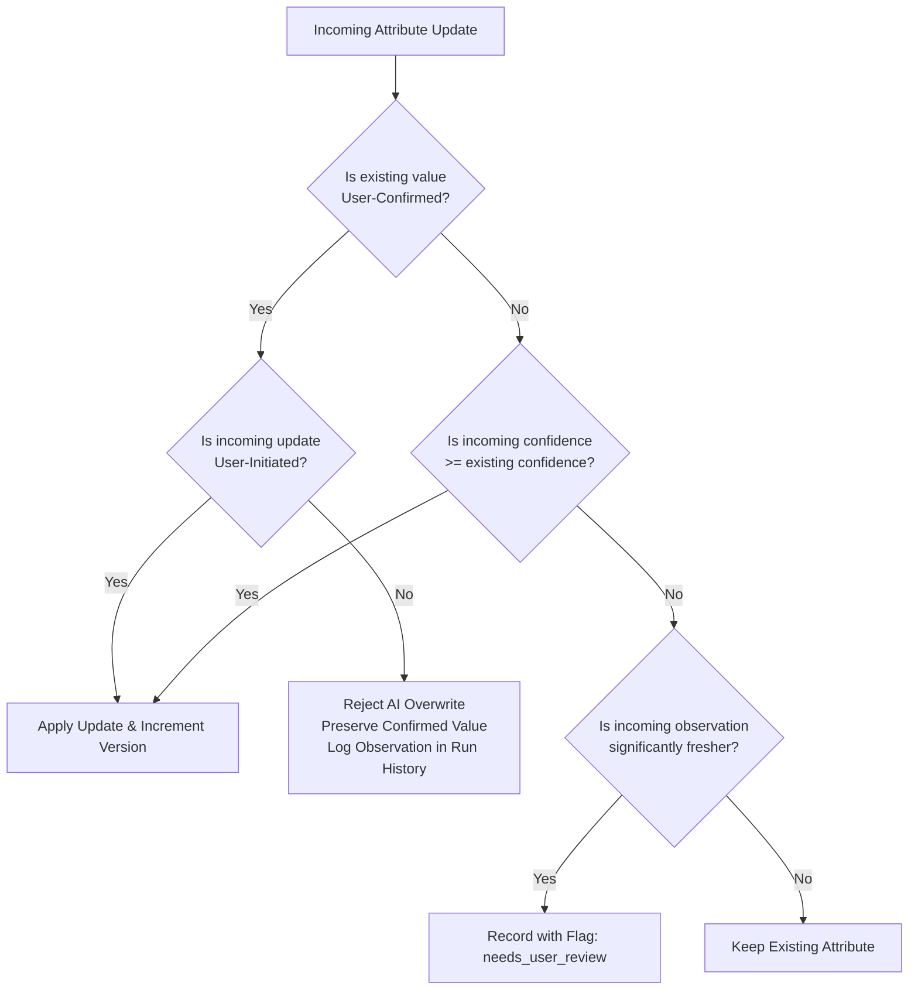
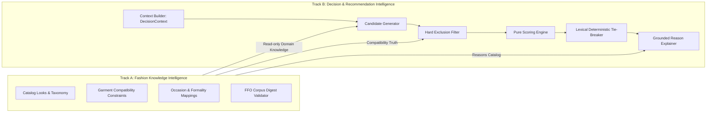
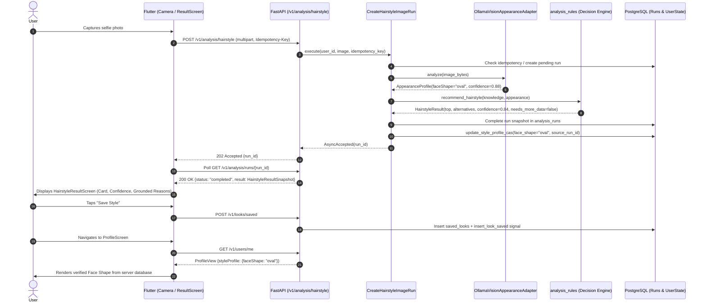
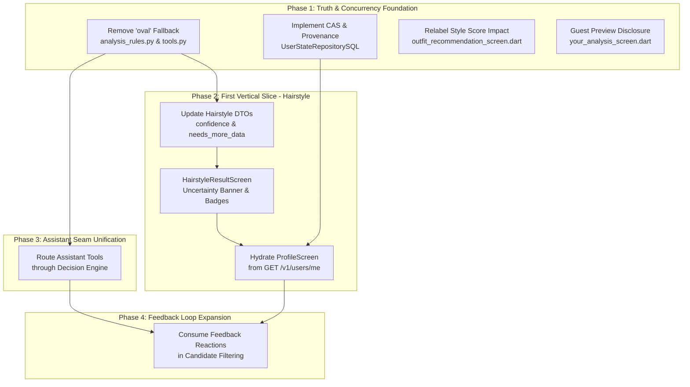
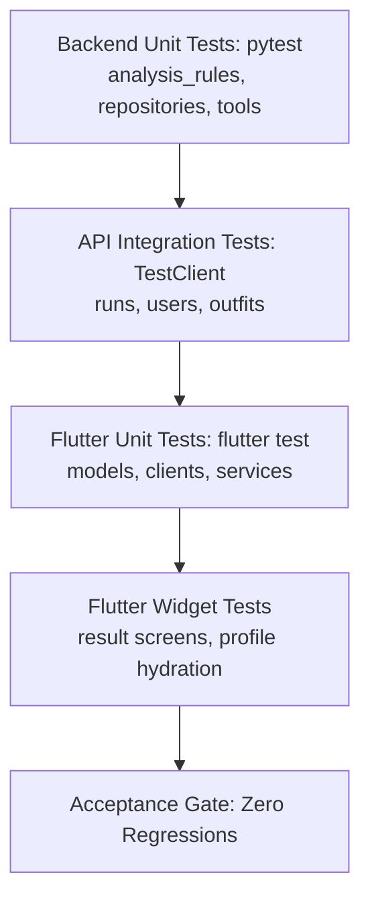

# Fansivibe Stage 1C — Implementation Blueprint

**Document Type:** Engineering Architecture and Implementation Blueprint  
**Date:** 2026-10-31  
**Repository:** `/home/tony/projects/fansivibe_v1_backup`  
**Verified Committed Baseline:** Commit `97f6ded99d3f3e67b477616380320058cd396f48` (`main`)  
**Status:** ARCHITECTURAL SPECIFICATION AND EXECUTION BLUEPRINT ONLY  
*(Zero source code modified, zero migrations executed, zero live external AI services contacted)*

---

## 1. Executive Summary

This document establishes the **Stage 1C Implementation Blueprint** for the Fansivibe styling platform. It translates the verified findings of the Stage 1A Specification-to-Code Audit and the Stage 1B Gap Analysis into an actionable, dependency-aware engineering blueprint that can be executed incrementally against the existing codebase.

### Core Strategic Tenets
1. **Extend, Do Not Rebuild**: Fansivibe possesses robust engineering foundations—including an authoritative 9-stage deterministic Decision Engine (`backend/app/domain/services/analysis_rules.py`), clean repository port isolation, and transactional run management. The blueprint preserves and extends these assets rather than replacing them.
2. **Unified Person Model Authority**: Eliminate the current split-brain state where Flutter local storage and backend PostgreSQL independently maintain profile facts. The backend database (`user_state`) is designated as the sole authority; client storage acts strictly as an ephemeral cache.
3. **Honesty and Truth Invariants (AI-0)**: Eliminate all silent attribute fabrication (e.g. the `"oval"` face-shape fallback in `analysis_rules.py` and `backend/app/ai/tools.py`). When user data is unmeasured or uncertain, the system provides transparent, unconditioned recommendations with explicit explanatory disclosures.
4. **Data Provenance and Concurrency Safety**: Upgrade `user_state.style_profile` to store field-level provenance (recording which analysis run observed which specific attribute) and enforce optimistic concurrency control (CAS) via `user_state.version`.
5. **Grounded First Vertical Slice**: Deliver an end-to-end verified Hairstyle Recommendation slice (Camera Capture → Vision Analysis → Validated Face Shape → Knowledge Retrieval → Decision Scoring → Grounded Explanation → Result Display → Save Look → Profile Hydration) before expanding subsequent feature surfaces.

---

## 2. Verified Baseline

Prior to formulating this blueprint, the repository environment was formally verified against the committed baseline:

| Baseline Parameter | Value | Verification Command / Output |
|---|---|---|
| **Repository Path** | `/home/tony/projects/fansivibe_v1_backup` | Matches absolute path |
| **Active Branch** | `main` | `git branch --show-current` -> `main` |
| **Committed HEAD Commit** | `97f6ded99d3f3e67b477616380320058cd396f48` | `git rev-parse HEAD` verified |
| **Tracked Tree Status** | Clean (0 modified tracked files) | `git status --porcelain` verified |
| **Untracked Artifacts** | Preserved Stage 1 audit reports | `STAGE1_SPEC_TO_CODE_AUDIT.md`, `STAGE1_EXISTING_CAPABILITIES.md`, `STAGE1_GAP_ANALYSIS.md`, `STAGE1_GAP_ANALYSIS_FINAL.md`, `STAGE1_ARCHITECTURE_RISK_REPORT.md` |
| **Operational Guardrails** | Invariants Enforced | Zero migrations executed; no dev/test DB connection; zero live AI requests |

---

## 3. Existing Architecture

```mermaid
flowchart TD
    subgraph Client [Flutter Client - newproject/flutter_application_1]
        UI_Hairstyle[HairstyleCapture / ResultScreen]
        UI_Outfit[OutfitScan / OutfitBuilderScreen]
        UI_Profile[ProfileScreen - LocalStorage Authority]
        Svc_Hair[HairstyleService]
        Svc_Learn[LearningService - In-Memory Signals]
        Client_Local[LocalStorage Hive/Prefs]
    end

    subgraph API [FastAPI Backend - backend/app/api]
        Router_Analysis[/v1/analysis/* - Hair, Outfit, Grooming]
        Router_Users[/v1/users/me - GET Profile, PATCH Prefs]
        Router_Outfits[/v1/outfits/generate]
        Router_Looks[/v1/looks/saved]
        Router_Assistant[/v1/assistant/chat - Hardcoded Tools]
    end

    subgraph Domain [Core Application & Domain Engine]
        UC_Hair[CreateHairstyleImageRun]
        UC_Outfit[CreateOutfitRun / GenerateOutfit]
        Engine[analysis_rules.py - 9-Stage Decision Engine]
        Tools[ai/tools.py - Bypasses Engine with 'oval' Fallback]
    end

    subgraph Infra [Infrastructure & PostgreSQL DB]
        Repo_State[UserStateRepositorySQL]
        Repo_Runs[AnalysisRunRepositorySQL]
        Table_State[(user_state: style_profile JSONB)]
        Table_Runs[(analysis_runs)]
        Table_Looks[(saved_looks)]
        Vision_Adapter[OllamaVisionAppearanceAdapter]
    end

    UI_Hairstyle --> Svc_Hair --> Router_Analysis
    UI_Profile <--> Client_Local
    Router_Analysis --> UC_Hair & UC_Outfit
    Router_Users --> Repo_State
    Router_Assistant --> Tools
    Tools -.->|Fabricates 'oval'| Tools
    UC_Hair --> Vision_Adapter
    UC_Hair --> Engine
    UC_Hair --> Repo_State --> Table_State
    UC_Hair --> Repo_Runs --> Table_Runs
    UI_Profile -.->|Disconnected from DB| Table_State
```

### Analysis of Existing Seams and Defects
1. **Split-Brain Authority (`GAP-P0-1`)**:
   - `ProfileScreen.dart:358-375` resolves `_skinTone`, `_faceShape`, `_bodyType`, and `_styleType` exclusively from `LocalStorage.userProfile` and `LearningService.instance.face`.
   - The backend authoritative record in `user_state.style_profile` (served via `GET /v1/users/me`) is never fetched or hydrated into `ProfileScreen`.
2. **Provenance Corruption on Merge (`GAP-P0-3`)**:
   - `UserStateRepositorySQL.update_style_profile` (`repositories.py:265-306`) executes a top-level JSONB `||` merge and sets `patch["source_run_id"] = str(source_run_id)`.
   - When a subsequent run updates an unrelated attribute (e.g. `body_type`), the surviving attribute (e.g. `face_shape`) has its `source_run_id` overwritten with the latest run ID.
3. **Unchecked Concurrency (`GAP-P0-3`)**:
   - `models.py:130` defines `version: Mapped[int]` on `user_state`, but `update_style_profile` does not check or increment `version`, enabling race conditions during concurrent runs.
4. **Fabricated Biometric Defaults (`GAP-P0-4`)**:
   - `analysis_rules.py:168, 222-226` defines `_DEFAULT_FACE_SHAPE = "oval"`; when `appearance.faceShape` is empty, it silently assumes oval geometry and scores pompadours/quiffs with positive face-shape boosts.
   - `ai/tools.py:36` duplicates this fabrication: `face = (... else "oval")`.
5. **Mislabeled Metrics (`GAP-P0-5`)**:
   - `outfit_recommendation_screen.dart:225-251` displays `winner.match_percentage` under the heading "Style Score Impact", misleading users into believing recommendation generation alters their account style score.

---

## 4. Target Architecture

```mermaid
flowchart TD
    subgraph Client [Flutter Client - Grounded MVVM]
        UI_HairResult[HairstyleResultScreen<br/>Surfaces Confidence & needs_more_data]
        UI_ProfileView[ProfileScreen<br/>Hydrated from GET /v1/users/me]
        Repo_UserClient[UserProfileRepository<br/>Caches GET /me, Manages Invalidation]
    end

    subgraph API [FastAPI Routers]
        R_Analysis[POST /v1/analysis/hairstyle]
        R_Runs[GET /v1/analysis/runs/{id}]
        R_UsersMe[GET & PATCH /v1/users/me<br/>Includes Version & Field Provenance]
        R_Assistant[POST /v1/assistant/chat]
    end

    subgraph Domain [Canonical Application & Decision Services]
        UC_HairstyleRun[CreateHairstyleImageRun<br/>Idempotent, Zero Fabrication]
        Engine_Decision[analysis_rules.py<br/>Pure 9-Stage Decision Engine<br/>Honest Missing Data Handling]
        Adapter_AssistantTools[app/ai/tools.py<br/>Delegates to Canonical Use Cases]
    end

    subgraph Storage [PostgreSQL Ground Truth]
        DB_State[(user_state<br/>version-locked CAS<br/>field-level provenance JSONB)]
        DB_Runs[(analysis_runs<br/>idempotency-keyed)]
        DB_Looks[(saved_looks)]
    end

    UI_HairResult --> R_Analysis
    UI_ProfileView --> Repo_UserClient --> R_UsersMe
    R_Analysis --> UC_HairstyleRun
    UC_HairstyleRun --> Engine_Decision
    UC_HairstyleRun --> DB_Runs
    UC_HairstyleRun --> DB_State
    R_Assistant --> Adapter_AssistantTools --> Engine_Decision
    R_UsersMe --> DB_State
```

### Key Architectural Invariants Preserved
1. **Fashion Formal Ontology (FFO) Cryptographic Digest**: `967f891e4c91d4e9463be5ea183b62ad3f3548f35c1b1e4d8678da49bf4d2581` remains strictly validated.
2. **Trending Evidence Boundary**: `DEMAND_SIGNAL_AVAILABLE = False` is enforced; no fake consumer trends.
3. **Digital Atelier Card Ratio**: Visual cards maintain the strict 65% image / 35% content proportion (`FansivibeCard`).
4. **Deterministic Tie-Breaking**: Lexical tie-breaking (`score DESC`, `item count DESC`, `item ID ASC`) in pure domain services.

---

## 5. Person Model Design

### 5.1 Architecture Evaluation: Dedicated Table vs. Extended `user_state`

| Architectural Dimension | Option 1: Introduce Dedicated `person_profiles` Table | Option 2: Extend Existing `user_state` (Recommended) |
|---|---|---|
| **Schema Disruption** | High: Requires new migration `0033`, foreign key relationships, cross-table joins on every profile fetch. | **Zero / Minimal**: Reuses existing `user_state` table and `ck_user_state_version` constraint. |
| **API Wire Compatibility** | Breaking: Requires altering or remapping `ProfileView` schemas. | **Fully Compatible**: `ProfileView.styleProfile` maps directly to JSONB projection. |
| **Concurrency Management** | Requires independent versioning column on new table. | Reuses existing `user_state.version` with zero schema modification. |
| **Performance Impact** | Extra SQL JOIN (`users` ↔ `user_state` ↔ `person_profiles`). | Single indexed lookup on `user_state.user_id`. |
| **Blast Radius** | Large: Touches all use cases reading or writing profile state. | Isolated to repository read/write methods and Pydantic schemas. |

**Architectural Recommendation**: **Option 2 (Extend `user_state`)**. Introducing an additional Person table creates unnecessary migration risk, fragments user state, and duplicates existing foreign keys. Extending `user_state` satisfies all provenance, concurrency, and honesty requirements with the least disruption.

### 5.2 Attribute Ownership and Canonical Authority

| Attribute Category | Canonical Table | Storage Column | Primary Writer | Secondary Readers |
|---|---|---|---|---|
| **Identity** | `users` | `display_name`, `auth_provider`, `auth_subject` | Registration / Settings | All features |
| **Biometric / Physical** | `user_state` | `style_profile` (JSONB) | `CreateHairstyleImageRun`, `CreateOutfitRun` | Decision Engine, Profile UI, Assistant |
| **Style Preferences** | `user_state` | `preferences` (JSONB) | `UpdatePreferences` (`PATCH /v1/users/me`) | Decision Engine, Assistant |
| **Wardrobe Items** | `wardrobe_items` | Relational columns + `ai_metadata` JSONB | `WardrobeRepositorySQL` | Outfit Candidate Generator |
| **Run History** | `analysis_runs` | `result` (JSONB) | Analysis Use Cases | Run History, Deep Link Replay |
| **Saved Looks** | `saved_looks` | `snapshot` (JSONB) | `SavedLookRepositorySQL` | Profile Looks Tab, Learning Aggregator |

### 5.3 Canonical Attribute Schema (Field-Level Provenance)

To prevent attribute updates from corrupting the provenance of unrelated fields, `user_state.style_profile` is structured with field-level metadata objects:

```json
{
  "face_shape": {
    "value": "oval",
    "confidence": 0.88,
    "source_type": "vision_scan",
    "source_run_id": "9b1deb4d-3b7d-4bad-9bdd-2b0d7b3dcb6d",
    "observed_at": "2026-10-31T12:00:00Z",
    "confirmed_by_user": false,
    "last_validated_at": "2026-10-31T12:00:00Z",
    "freshness": "fresh"
  },
  "skin_tone": {
    "value": null,
    "confidence": 0.0,
    "source_type": "unmeasured",
    "source_run_id": null,
    "observed_at": null,
    "confirmed_by_user": false,
    "last_validated_at": null,
    "freshness": "unmeasured"
  },
  "body_type": {
    "value": null,
    "confidence": 0.0,
    "source_type": "unmeasured",
    "source_run_id": null,
    "observed_at": null,
    "confirmed_by_user": false,
    "last_validated_at": null,
    "freshness": "unmeasured"
  },
  "style_type": {
    "value": "minimalist",
    "confidence": 1.0,
    "source_type": "user_selection",
    "source_run_id": null,
    "observed_at": "2026-10-31T10:15:00Z",
    "confirmed_by_user": true,
    "last_validated_at": "2026-10-31T10:15:00Z",
    "freshness": "fresh"
  }
}
```

### 5.4 Wire Compatibility Projection (`ProfileView`)
The wire schema in `backend/app/api/routers/users.py` projects both backward-compatible scalar values and full attribute provenance:

```python
class AttributeProvenanceView(BaseModel):
    value: Optional[str] = None
    confidence: float = 0.0
    sourceType: str = "unmeasured"
    sourceRunId: Optional[str] = None
    observedAt: Optional[datetime] = None
    confirmedByUser: bool = False
    freshness: str = "unmeasured"

class StyleProfileView(BaseModel):
    # Flattened scalars for legacy Flutter clients
    faceShape: Optional[str] = None
    skinTone: Optional[str] = None
    bodyType: Optional[str] = None
    styleType: Optional[str] = None
    sourceRunId: Optional[str] = None
    # Detailed provenance descriptors (additive)
    provenance: dict[str, AttributeProvenanceView] = Field(default_factory=dict)
```

---

## 6. Provenance and Concurrency Design

### 6.1 Current Concurrency Flaws
Currently, `UserStateRepositorySQL.update_style_profile` (`repositories.py:297-306`) executes:
```python
self._session.execute(
    update(UserState)
    .where(UserState.user_id == user_id)
    .values(
        style_profile=func.coalesce(
            UserState.style_profile, cast({}, JSONB)
        ).op("||")(cast(patch, JSONB))
    )
)
```
**Defects**:
1. Blind last-writer-wins overwrite without checking `user_state.version`.
2. A single top-level `source_run_id` overwrites the source of all historical attributes.

### 6.2 Comparison of Concurrency Strategies

| Strategy | Mechanism | Pros | Cons | Recommendation |
|---|---|---|---|---|
| **A. Atomic JSONB `||`** | PostgreSQL `jsonb_concat` | Simple; no schema change | Overwrites concurrent writes; destroys field provenance | Reject |
| **B. Optimistic Locking (CAS)** | `WHERE user_id = :id AND version = :expected` | Safe; detects races; prevents stale overwrites | Requires version tracking in callers | **Adopt** |
| **C. Relational EAV Records** | Individual rows per attribute | Granular locking per attribute | Heavy migrations; excessive queries; ORM complexity | Reject |
| **D. Transactional Field Merge + CAS** | OCC on `version` + deep field merge in Python | Maximum safety; field-level provenance; zero data loss | Requires 409 retry handling in callers | **Adopt as Primary** |

### 6.3 Proposed Implementation: Transactional CAS Profile Merge

```python
def update_style_profile_cas(
    self,
    *,
    user_id: UUID,
    expected_version: int,
    patch: dict[str, AttributeRecord],
) -> bool:
    """Update style_profile using Compare-And-Swap (CAS) on user_state.version.

    Returns True if update succeeded, False if version mismatch (409 Conflict).
    """
    # Fetch existing row with row lock to serialize concurrent updates
    state = self._session.execute(
        select(UserState)
        .where(UserState.user_id == user_id)
        .with_for_update()
    ).scalar_one_or_none()

    if state is None:
        return False
    if state.version != expected_version:
        return False

    current_profile = dict(state.style_profile or {})
    for key, attr in patch.items():
        # Prevent lower-confidence AI scans from overwriting user-confirmed values
        existing = current_profile.get(key, {})
        if existing.get("confirmed_by_user", False) and not attr.confirmed_by_user:
            continue
        current_profile[key] = attr.to_dict()

    stmt = (
        update(UserState)
        .where(
            UserState.user_id == user_id,
            UserState.version == expected_version,
        )
        .values(
            style_profile=current_profile,
            version=UserState.version + 1,
            updated_at=func.now(),
        )
    )
    result = self._session.execute(stmt)
    self._session.commit()
    return result.rowcount > 0
```

---

## 7. Conflict Resolution

The system enforces deterministic, non-arbitrary conflict resolution rules across all surfaces:



### Deterministic Conflict Matrix

| Conflict Scenario | Resolution Policy | Ground Truth Result | Audit & Traceability |
|---|---|---|---|
| **AI Observation vs. Confirmed User Value** | User confirmation is inviolable. AI observation is rejected from `style_profile`. | Existing confirmed value preserved. | AI observation preserved in `analysis_runs.result`. |
| **New AI Scan vs. Old AI Scan** | Higher confidence wins; on equal confidence, newer timestamp wins. | Updated attribute written to `style_profile`. | `source_run_id` updated for that field only. |
| **Concurrent Analysis Runs (Run A vs. Run B)** | Optimistic Concurrency Control (CAS). Second writer encounters version conflict. | Run B re-fetches updated profile, performs non-overlapping field merge, and commits. | Both runs preserve their respective field-level IDs. |
| **User Preference Update vs. Historical Signal** | Explicit user action (`PATCH /me`) immediately overrides all implicit learning signals. | `preferences` JSONB updated. | Feedback event recorded; no weight corruption. |
| **Unmeasured / Missing Attribute** | Strict zero-fabrication. Attribute remains `null`. | No default value assigned. | Reasoning engine executes unconditioned rules. |

---

## 8. Freshness and Revalidation

Physical appearance attributes evolve on distinct physiological and stylistic timelines. Arbitrary global TTLs are rejected.

### 8.1 Attribute Freshness Matrix

| Attribute | Validity Duration | Stale Trigger | Revalidation Action | Impact on Recommendations |
|---|---|---|---|---|
| **Face Shape** (`face_shape`) | 365 Days *(Subject to Founder Approval)* | Time elapsed > 365 days; or user requests re-scan. | Non-blocking in-app prompt: "Refresh face scan". | Continues using cached shape with advisory chip. |
| **Skin Tone** (`skin_tone`) | 180 Days *(Subject to Founder Approval)* | Seasonal transition or time elapsed > 180 days. | Color palette card displays "Re-check seasonal tone". | Falls back to neutral color palettes. |
| **Body Type** (`body_type`) | 90 Days *(Subject to Founder Approval)* | Time elapsed > 90 days. | Fit preference picker prompt in Outfit Builder. | Uses neutral fit sizing. |
| **Occasion / Mood / Palette** | 0 Days (Request-Scoped) | Every new recommendation request. | User inputs in UI picker. | Deterministic scoring applied to current request. |

### 8.2 Representation of Stale Data
When an attribute passes its validity threshold:
1. `freshness` is marked `"stale"` in the database.
2. The recommendation engine continues to run deterministically but includes a qualified disclaimer:
   - *"Recommendations matched using your face scan from [Date]. For optimal precision, take a new selfie."*
3. The UI never hard-blocks the user from styling due to stale attributes.

---

## 9. Provisional Reasoning (Handling Missing / Uncertain Data)

### 9.1 Zero-Fabrication Invariant (AI-0)
The platform must never synthesize biometric attributes. Silently substituting `"oval"` when a user's face shape is unknown violates data integrity and user trust.

### 9.2 Elimination of `_DEFAULT_FACE_SHAPE = "oval"`

In `backend/app/domain/services/analysis_rules.py`:
- Remove lines 168 and 222-226:
  ```python
  # REMOVE:
  # _DEFAULT_FACE_SHAPE = "oval"
  # def _face_shape(appearance: AppearanceProfile) -> str:
  #     ... return _DEFAULT_FACE_SHAPE
  ```
- Replace with honest nullable resolution:
  ```python
  def _face_shape(appearance: AppearanceProfile) -> Optional[str]:
      raw = (appearance.faceShape or "").strip().lower()
      if not raw:
          return None
      return _FACE_SHAPE_ALIASES.get(raw, raw)
  ```

### 9.3 Behavior When Face Shape is Unknown
When `face = _face_shape(context.appearance)` evaluates to `None`:
1. **Candidate Scoring**: `face_boost = _BOOSTS.get(look.id, {}).get(face, 0.0)` evaluates to `0.0` for all looks. No synthetic advantage is awarded.
2. **Deterministic Ranking**: Candidates are ranked strictly by baseline versatility (`look.matchScore`), explicit user preferences, and saved look affinity.
3. **Explanation Generation**: `_face_match_reason` returns `None`. The explanation honestly states:
   - *"Curated for versatile balance across facial structures. Complete a quick face scan to tailor recommendations to your exact face shape."*
4. **Confidence Computation**: `context.completeness` evaluates to `0.0` (or `0.25` if only preferences exist), yielding a lower, honest run confidence.
5. **Needs More Data**: `needs_more_data` evaluates to `True`, triggering the uncertainty advisory banner in Flutter.

---

## 10. Track A and Track B Integration



### Architectural Separation
- **Track A (Fashion Knowledge)**: Static, curated domain truths, formal ontologies (FFO), vocabulary domains, and aesthetic rules. Never mutates based on runtime user interactions.
- **Track B (Decision Engine)**: Dynamic reasoning pipelines that accept a typed user context (`DecisionContext`), query Track A for candidate sets, apply hard filters, score candidates deterministically, and explain outcomes.

### Seam Consolidation: Assistant Tools Delegation
Currently, `backend/app/ai/tools.py` implements ad-hoc hardcoded lookup logic. The target architecture refactors `tools.py` into a thin delegation facade:

```python
# Refactored backend/app/ai/tools.py
def recommend_hairstyle(user: Optional[UserContext], knowledge: KnowledgeSource) -> List[SuggestionCard]:
    """Delegate assistant hairstyle query directly to the canonical Decision Engine."""
    appearance = (
        AppearanceProfile(faceShape=user.face.faceShape)
        if user and user.face and user.face.faceShape
        else AppearanceProfile()
    )
    result = analysis_rules.recommend_hairstyle(knowledge, appearance)
    top = result.top
    return [
        SuggestionCard(
            kind="hairstyle",
            title=top.name,
            subtitle=f"{top.description} ({round(top.matchScore * 100)}% match)",
        )
    ]
```

---

## 11. First Vertical Slice: Hairstyle Recommendation

The complete, end-to-end verified Hairstyle slice is the first production capability to be hardened.



### Component Traceability Table

| Step | Component | Current Implementation | Required Modification | Data Contract | Error Behavior | Acceptance Test |
|---|---|---|---|---|---|---|
| **1. Capture** | `photo_capture_screen.dart` | Captures image bytes in memory | None (already compliant) | In-memory `Uint8List` | Camera permission denied → error banner | `test/photo_capture_screen_test.dart` |
| **2. Submit** | `HairstyleClient.submitHairstyleAnalysis` | Sends `POST /v1/analysis/hairstyle` | Add `Idempotency-Key` generation | Multipart `image` + header | Network timeout → retry with same key | `test/hairstyle_client_test.dart` |
| **3. Vision** | `OllamaVisionAppearanceAdapter` | Extracts `face_shape`; suppresses other attributes | Ensure empty attributes are `null` not `""` | `AppearanceProfile` | Unusable face → typed `failed` run | `test_vision_appearance_adapter.py` |
| **4. Decision** | `analysis_rules.recommend_hairstyle` | Scores candidates; defaults to oval | Remove `_DEFAULT_FACE_SHAPE`; score null face as 0 boost | `HairstyleResult` | No candidates → `KnowledgeError` | `test_c09_style_profile_merge.py` |
| **5. Storage** | `UserStateRepositorySQL.update_style_profile` | Blind `||` merge; global `source_run_id` | Add CAS on `version` and field-level provenance | `UserState` row | Version mismatch → 409 Conflict | `test_c09_style_profile_merge.py` |
| **6. Result DTO** | `HairstyleAnalysisResult.fromRunResult` | Deserializes `faceShape`, `top`, `alternatives` | Add `confidence` and `needsMoreData` fields | `HairstyleAnalysisResult` | Missing result → `mock` fallback | `test/hairstyle_models_test.dart` |
| **7. Result UI** | `HairstyleResultScreen` | Suppresses empty DNA; hides uncertainty | Render `needs_more_data` warning banner and confidence badge | Flutter Widget | Malformed run → explicit error screen | `test/hairstyle_result_screen_test.dart` |
| **8. Save Look** | `hairstyle_result_screen._saveStyle` | Calls `HairstyleService.saveLook` | Ensure idempotency key passed | `POST /v1/looks/saved` | Save failure → floating error snackbar | `test/hairstyle_service_test.dart` |
| **9. Profile Hydration** | `ProfileScreen` | Reads `LocalStorage.userProfile` | Fetch `GET /v1/users/me` on mount; cache locally | `ProfileView` | Offline → render local cache | `test/profile_screen_test.dart` |

---

## 12. Additional Implementation Workstreams

### Workstream A — Truth and Correctness
- **Scope**:
  - Eliminate `_DEFAULT_FACE_SHAPE = "oval"` across backend domain and AI tools.
  - Fix CAS concurrency and field provenance in `UserStateRepositorySQL`.
  - Relabel "Style Score Impact" in `outfit_recommendation_screen.dart:251` to "Ensemble Match".
  - Ground confidence scores in mathematical decisiveness and data completeness.

### Workstream B — Guest-to-Authenticated Behavior
- **Scope**:
  - Update onboarding scan modal on `your_analysis_screen.dart` with explicit disclosure:
    - *"Your onboarding scan is an ephemeral preview. Create an account to permanently save your appearance profile."*
  - Ensure guest data migration never silently claims to have transferred appearance scans when none were uploaded.
  - Implement consent-driven replay for stashed snapshots post-authentication.

### Workstream C — Outfit and Wardrobe Integrity
- **Scope**:
  - Preserve garment analysis observations (`GarmentAnalysisPort`) in `CreateOutfitRun`.
  - Ensure garment visual attributes (pattern, material, fit) remain isolated in wardrobe sidecar data and are never conflated with person appearance attributes.
  - Maintain pure deterministic candidate scoring in `GenerateOutfit`.

### Workstream D — Feedback and Learning Loop
- **Scope**:
  - Connect persisted `feedback_events` (reactions) and `learning_signals` to recommendation filtering.
  - Ensure disliked looks/styles are suppressed in subsequent hairstyle and outfit candidate sets.
  - Bound personalization weight adjustments to prevent feedback loops from destabilizing the baseline 0–100 scoring budget.

---

## 13. Founder Decision Register

The following architecture and product decisions govern implementation:

| Decision ID | Area | Core Question | Options Available | Recommended Option | Consequence & Impact | Affected Components | Status |
|---|---|---|---|---|---|---|---|
| **D1** | Appearance Scope | What physical attributes are measured in Stage 1? | **A**: Face shape only.<br>**B**: Face shape + skin tone + body type. | **Option A (Face shape only)** | Eliminates unstable mobile vision models; keeps appearance honest and grounded. | `vision_appearance_adapter.py`, `ProfileScreen.dart` | **RECOMMENDED (Requires Approval)** |
| **D5** | Goals Scope | Are user goals (e.g. style change, wardrobe reduction) part of Stage 1? | **A**: Declare out of scope.<br>**B**: Implement Goal entities & scoring terms. | **Option A (Out of scope)** | Avoids creating ungrounded goal entities without product specs. | `analysis_rules.py`, `models.py` | **RECOMMENDED (Requires Approval)** |
| **D-06** | Garment AI Attributes | Should garment pattern and style attributes affect outfit ranking? | **A**: Keep in sidecar (unscored).<br>**B**: Define scoring weights and promote to SQL columns. | **Option A (Keep in sidecar)** | Vision pattern classification is noisy; avoids destabilizing deterministic scoring. | `analysis_rules.py`, `models.py:WardrobeItems` | **RECOMMENDED (Requires Approval)** |
| **D7** | Confidence Semantics | How should confidence be presented to users? | **A**: "Profile Completeness / Match Strength".<br>**B**: "Confidence" with evidence tooltip. | **Option B (Confidence with tooltip)** | Preserves existing UI layout while maintaining mathematical honesty. | `hairstyle_result_screen.dart`, `outfit_analysis_screen.dart` | **RECOMMENDED (Requires Approval)** |
| **D10** | Guest Appearance Migration | How should guest onboarding scans be treated upon account creation? | **A**: Disclose that onboarding scan is preview-only.<br>**B**: Replay stashed snapshot post-auth under explicit user consent. | **Option A (Disclose preview nature)** | Zero risk of biometric leakage; clean architectural boundary; zero backend upload changes. | `your_analysis_screen.dart`, `guest_data_migration.dart` | **RECOMMENDED (Requires Approval)** |

---

## 14. Architecture Dependency Graph



### Critical Dependency Gates
1. **Can the Hairstyle Slice be completed before CAS on `user_state`?**
   **NO.** If concurrent image runs or user edits occur during testing, profile attributes will be silently corrupted. CAS is a mandatory prerequisite.
2. **Can Profile Hydration occur before Truth Containment?**
   **NO.** If the backend still synthesizes `"oval"`, hydrating the Flutter Profile screen will surface fake oval face shapes for users who never took a photo.
3. **Can Feedback Consumption precede Seam Unification?**
   **NO.** Assistant chat and recommendation screens must use the same underlying engine before feedback weights can be applied uniformly.

---

## 15. Phased Implementation Roadmap

Work is structured into small, reviewable, self-contained implementation batches.

---

### Batch 1: P0 Truth, Honesty, and Concurrency Pass

- **Goal**: Eliminate user-facing misrepresentations, fabricated defaults, and concurrency vulnerabilities.
- **Requirements Covered**: `R-S3-2`, `R-S5-2`, `R-S6-4`, `R-X-1`, `C-09`.
- **Existing Files to Reuse**:
  - `backend/app/domain/services/analysis_rules.py`
  - `backend/app/infrastructure/db/repositories.py`
  - `newproject/flutter_application_1/lib/features/outfit_builder/presentation/outfit_recommendation_screen.dart`
  - `newproject/flutter_application_1/lib/features/onboarding/presentation/screens/your_analysis_screen.dart`
- **Files Expected to Change**:
  - `backend/app/domain/services/analysis_rules.py`: Remove `_DEFAULT_FACE_SHAPE = "oval"`.
  - `backend/app/ai/tools.py`: Remove `"oval"` fallback in `recommend_hairstyle`.
  - `backend/app/infrastructure/db/repositories.py`: Implement CAS version check and field-level provenance in `update_style_profile`.
  - `newproject/flutter_application_1/lib/features/outfit_builder/presentation/outfit_recommendation_screen.dart`: Relabel "Style Score Impact" to "Ensemble Match".
  - `newproject/flutter_application_1/lib/features/onboarding/presentation/screens/your_analysis_screen.dart`: Update guest sign-in copy to disclose ephemeral preview.
- **New Files**: None.
- **Database Changes**: Zero (reuses existing `user_state.version` column and `ck_user_state_version` constraint).
- **API / DTO Changes**: Additive `version` precondition support in `UserStateRepositorySQL`.
- **Flutter Changes**: Text label updates and guest dialog copy adjustments.
- **Tests**:
  - `pytest backend/tests/test_c09_style_profile_merge.py`
  - `pytest backend/tests/test_analysis_use_case.py`
  - `flutter test test/outfit_builder_screens_test.dart`
- **Acceptance Criteria**:
  - Missing face shape yields `None` and 0 face-shape boost in recommendations.
  - Concurrent writes with stale version return False/409 Conflict without overwriting data.
  - Outfit recommendation card title reads "Ensemble Match".
- **Dependencies**: None (Foundational Batch).
- **Rollback Considerations**: Revert code edits; zero DB rollback required.

---

### Batch 2: Person Model Authority & Profile Hydration

- **Goal**: Designate backend `user_state` as sole authority and hydrate Flutter `ProfileScreen` via `GET /v1/users/me`.
- **Requirements Covered**: `R-S6-1`, `R-S6-2`, `R-S6-3`, `R-S6-5`.
- **Existing Files to Reuse**:
  - `backend/app/api/routers/users.py`
  - `newproject/flutter_application_1/lib/features/profile/presentation/profile_screen.dart`
  - `newproject/flutter_application_1/lib/features/auth/data/auth_client.dart`
- **Files Expected to Change**:
  - `newproject/flutter_application_1/lib/features/profile/presentation/profile_screen.dart`: Replace `LocalStorage` lookups with `UserProfileRepository` hydration.
  - `newproject/flutter_application_1/lib/features/profile/data/user_profile_repository.dart` (or create if absent): Add `getProfile()` calling `GET /v1/users/me`.
- **New Files**:
  - `newproject/flutter_application_1/lib/features/profile/data/user_profile_repository.dart` (clean data layer component).
- **Database Changes**: Zero.
- **API / DTO Changes**: Ensure `GET /v1/users/me` outputs full `ProfileView` including `version` and `styleProfile`.
- **Flutter Changes**: `ProfileScreen` manages loading/error/hydrated state.
- **Tests**:
  - `pytest backend/tests/test_users_api.py`
  - `flutter test test/profile_screen_test.dart`
- **Acceptance Criteria**:
  - Clearing Flutter local storage does not erase profile appearance attributes once user logs in.
  - Attributes updated on backend are immediately reflected in `ProfileScreen`.
- **Dependencies**: Batch 1.
- **Rollback Considerations**: Fall back to cached local storage if network is unreachable.

---

### Batch 3: First Vertical Slice — Hardened Hairstyle Pipeline

- **Goal**: Complete end-to-end verified Hairstyle Recommendation slice with honest uncertainty propagation.
- **Requirements Covered**: `R-S1-1`, `R-S1-3`, `R-S5-1`, `R-S5-3`.
- **Existing Files to Reuse**:
  - `backend/app/application/analysis.py:CreateHairstyleImageRun`
  - `newproject/flutter_application_1/lib/features/hairstyle/data/hairstyle_mock_data.dart`
  - `newproject/flutter_application_1/lib/features/hairstyle/presentation/hairstyle_result_screen.dart`
- **Files Expected to Change**:
  - `newproject/flutter_application_1/lib/features/hairstyle/data/hairstyle_mock_data.dart`: Parse `confidence` and `needs_more_data` in `fromRunResult`.
  - `newproject/flutter_application_1/lib/features/hairstyle/presentation/hairstyle_result_screen.dart`: Render uncertainty warning banner when `needsMoreData == true`.
  - `newproject/flutter_application_1/lib/features/onboarding/presentation/screens/camera_permission_screen.dart`: Clarify raw image ephemeral processing vs derived feature retention.
- **New Files**: None.
- **Database Changes**: Zero.
- **API / DTO Changes**: Additive fields in client model (`confidence`, `needsMoreData`).
- **Flutter Changes**: Uncertainty banner in `HairstyleResultScreen`.
- **Tests**:
  - `pytest backend/tests/test_hairstyle_image_router.py`
  - `flutter test test/hairstyle_result_screen_test.dart`
  - `flutter test test/hairstyle_client_test.dart`
- **Acceptance Criteria**:
  - Low-confidence or ungrounded scans display honest uncertainty banner.
  - Completed hairstyle run persists face shape to backend DB and hydrator displays it in Profile.
- **Dependencies**: Batch 1, Batch 2.
- **Rollback Considerations**: Client falls back to existing UI without uncertainty banner.

---

### Batch 4: AI Assistant Seam & Decision Engine Unification

- **Goal**: Eliminate duplicated ad-hoc recommendation logic in `backend/app/ai/tools.py`.
- **Requirements Covered**: `C-04`, `C-09`, `R-X-2`.
- **Existing Files to Reuse**:
  - `backend/app/ai/tools.py`
  - `backend/app/domain/services/analysis_rules.py`
  - `backend/app/application/outfits.py:GenerateOutfit`
- **Files Expected to Change**:
  - `backend/app/ai/tools.py`: Refactor `recommend_hairstyle` and `recommend_outfit` to delegate to domain engine.
- **New Files**: None.
- **Database Changes**: Zero.
- **API / DTO Changes**: Zero.
- **Flutter Changes**: Zero.
- **Tests**:
  - `pytest backend/tests/test_assistant_api.py`
  - `pytest backend/tests/test_analysis_rules.py`
- **Acceptance Criteria**:
  - Assistant chat recommendations match Hairstyle and Outfit Builder scoring results for identical user contexts.
- **Dependencies**: Batch 1.
- **Rollback Considerations**: Revert `tools.py` to previous static catalog look lookups.

---

### Batch 5: Outfit Builder and Wardrobe Integrity

- **Goal**: Preserve garment vision observations while maintaining strict isolation from person attributes.
- **Requirements Covered**: `R-S1-2`, `R-S4-1`, `C-06`.
- **Existing Files to Reuse**:
  - `backend/app/application/analysis.py:CreateOutfitRun`
  - `newproject/flutter_application_1/lib/features/outfit_scan/presentation/outfit_analysis_screen.dart`
  - `newproject/flutter_application_1/lib/features/outfit_builder/presentation/build_outfit_screen.dart`
- **Files Expected to Change**:
  - `newproject/flutter_application_1/lib/features/outfit_scan/presentation/outfit_analysis_screen.dart`: Render `garment.confidence` and `needs_review` chips.
  - `newproject/flutter_application_1/lib/features/outfit_builder/presentation/build_outfit_screen.dart`: Add event occasion disclosure copy.
- **New Files**: None.
- **Database Changes**: Zero.
- **API / DTO Changes**: Additive display fields.
- **Flutter Changes**: Confidence chips on detected wardrobe pieces.
- **Tests**:
  - `flutter test test/outfit_analysis_screen_test.dart`
  - `pytest backend/tests/test_analysis_use_case.py`
- **Acceptance Criteria**:
  - Garment detection errors surface typed retry actions.
  - Garment attributes remain stored in wardrobe sidecars, never polluting `user_state.style_profile`.
- **Dependencies**: Batch 1, Batch 3.
- **Rollback Considerations**: Revert UI chips.

---

### Batch 6: Feedback and Learning Loop Expansion

- **Goal**: Close the loop between user reactions (`feedback_events`) and subsequent styling passes.
- **Requirements Covered**: `R-S3-1`, `R-S3-3`, `C-05`.
- **Existing Files to Reuse**:
  - `backend/app/domain/services/analysis_rules.py`
  - `backend/app/infrastructure/db/models.py:FeedbackEvents`
  - `newproject/flutter_application_1/lib/features/hairstyle/presentation/hairstyle_result_screen.dart`
- **Files Expected to Change**:
  - `backend/app/domain/services/analysis_rules.py`: Incorporate feedback suppression terms into `filter_candidates`.
  - `newproject/flutter_application_1/lib/features/hairstyle/presentation/hairstyle_result_screen.dart`: Add like/dislike reaction buttons.
- **New Files**: None.
- **Database Changes**: Zero.
- **API / DTO Changes**: Wire `POST /v1/events/feedback` from Hairstyle Result.
- **Flutter Changes**: Reaction buttons and analytics emission.
- **Tests**:
  - `pytest backend/tests/test_p2s1_feedback_personalization.py`
  - `flutter test test/hairstyle_result_screen_test.dart`
- **Acceptance Criteria**:
  - Disliked styles are excluded from top recommendations in subsequent runs.
- **Dependencies**: Batch 3, Batch 4.
- **Rollback Considerations**: Feature gate feedback suppression via configuration flag.

---

## 16. API and Data Contracts

### 16.1 `GET /v1/users/me` (Profile Authority)
- **Path**: `GET /v1/users/me`
- **Headers**: `Authorization: Bearer <token>`
- **Response Schema** (`ProfileView`):
  ```json
  {
    "displayName": "Alex Rivera",
    "styleProfile": {
      "faceShape": "oval",
      "skinTone": null,
      "bodyType": null,
      "styleType": "classic",
      "sourceRunId": "9b1deb4d-3b7d-4bad-9bdd-2b0d7b3dcb6d",
      "provenance": {
        "face_shape": {
          "value": "oval",
          "confidence": 0.88,
          "sourceType": "vision_scan",
          "sourceRunId": "9b1deb4d-3b7d-4bad-9bdd-2b0d7b3dcb6d",
          "observedAt": "2026-10-31T12:00:00Z",
          "confirmedByUser": false,
          "freshness": "fresh"
        }
      }
    },
    "preferences": {
      "preferredOccasions": ["casual", "work"]
    },
    "settings": {},
    "flags": {},
    "version": 4,
    "memorySummary": {
      "appearanceVerified": true,
      "savedLooksCount": 3,
      "preferredOccasions": ["casual", "work"],
      "appearanceConfidence": 0.25
    }
  }
  ```

### 16.2 `POST /v1/analysis/hairstyle` (Analysis Submission)
- **Path**: `POST /v1/analysis/hairstyle`
- **Headers**:
  - `Authorization: Bearer <token>`
  - `Idempotency-Key: <uuid-or-timestamp-string>` (Required for duplicate safety)
- **Body**: `multipart/form-data` with optional `image` (JPEG/PNG/WebP, <= 20 MB). Empty body invokes profile-only pass.
- **Response**: `202 Accepted`
  ```json
  {
    "run_id": "9b1deb4d-3b7d-4bad-9bdd-2b0d7b3dcb6d"
  }
  ```

### 16.3 `GET /v1/analysis/runs/{run_id}` (Run Result)
- **Path**: `GET /v1/analysis/runs/{run_id}`
- **Response**: `200 OK` (`AnalysisRun`):
  ```json
  {
    "run_id": "9b1deb4d-3b7d-4bad-9bdd-2b0d7b3dcb6d",
    "run_type": "hairstyle_image",
    "status": "completed",
    "engine_version": "1.0",
    "knowledge_version": "1.1+1.0",
    "result": {
      "appearance": {
        "faceShape": "oval",
        "skinTone": null,
        "bodyType": null,
        "styleType": null,
        "sourceRunId": "9b1deb4d-3b7d-4bad-9bdd-2b0d7b3dcb6d"
      },
      "confidence": 0.84,
      "needs_more_data": false,
      "recommendations": {
        "top": {
          "id": "classic_pompadour",
          "name": "Classic Pompadour",
          "description": "High volume top with cleanly tapered sides.",
          "matchScore": 0.92,
          "reasons": [
            "Strongest match for your oval face shape (+0.08 face-shape fit).",
            "Balanced volume complements your proportions."
          ],
          "stylingTips": "Apply pomade to damp hair and comb upward.",
          "maintenance": "Trim every 3 weeks."
        },
        "alternatives": []
      }
    },
    "error": null
  }
  ```

### 16.4 `POST /v1/looks/saved` (Save Look)
- **Path**: `POST /v1/looks/saved`
- **Headers**:
  - `Authorization: Bearer <token>`
  - `Idempotency-Key: <unique-key>`
- **Body**:
  ```json
  {
    "lookId": "classic_pompadour",
    "title": "Classic Pompadour",
    "sourceContext": "hairstyle",
    "snapshot": { ... }
  }
  ```
- **Response**: `201 Created`

---

## 17. Test and Acceptance Strategy

### 17.1 Test Pyramid and Execution Gates



### 17.2 Specific Test Commands and Assertions

```bash
# 1. Verify Decision Engine truth (no oval fallback, honest scoring)
pytest backend/tests/test_analysis_rules.py -k "test_face_shape" -v

# 2. Verify CAS and optimistic concurrency on user_state
pytest backend/tests/test_c09_style_profile_merge.py -v

# 3. Verify Hairstyle Image run pipeline and idempotency
pytest backend/tests/test_hairstyle_image_router.py -v
pytest backend/tests/test_c10_analysis_idempotency.py -v

# 4. Verify AI Assistant tool delegation
pytest backend/tests/test_assistant_api.py -v

# 5. Verify Flutter Hairstyle Result uncertainty presentation
flutter test test/hairstyle_result_screen_test.dart

# 6. Verify Flutter Profile hydration from GET /v1/users/me
flutter test test/profile_screen_test.dart

# 7. Verify Outfit Builder honest metric labeling
flutter test test/outfit_builder_screens_test.dart
```

---

## 18. Risks and Trade-offs

| Risk ID | Risk Description | Severity | Impact | Mitigation Strategy |
|---|---|---|---|---|
| **RSK-01** | CAS Contention on Concurrent Scans | Medium | 409 Conflict returned if two scans finish simultaneously. | Implement exponential backoff in client service with automatic re-read and retry (up to 3 attempts). |
| **RSK-02** | User Discontent with Unconditioned Advice | Low-Medium | Users without scans receive lower match percentages. | Render clear educational copy: "Scan your face to unlock personalized fit boosts." |
| **RSK-03** | Local Storage Cache Invalidation Latency | Low | Profile updates on web client may take one app restart to appear on mobile. | Fire `GET /v1/users/me` on every `ProfileScreen` route entry to guarantee fresh hydration. |
| **RSK-04** | Migration Divergence (Dev vs Test) | Medium | Dev DB at `0029`; Test DB at `0032`. | Execute all Stage 1 implementation strictly without adding new migrations; rely exclusively on tables up to `0029`. |

---

## 19. Explicit Out-of-Scope Items

To prevent scope creep, the following initiatives are explicitly excluded from Stage 1:

1. **Anonymous Server-Side AI Execution**: Gated authentication remains strictly enforced (Contract `C-01`). Anonymous guests use local preview flows only.
2. **Edge Computer Vision for Body Type and Skin Tone**: High error rates and lighting sensitivity on mobile cameras make automated body/skin extraction unreliable. Deferred to future model evaluation.
3. **Dedicated `person_profiles` Relational Table**: Introducing a separate Person table is rejected in favor of extending `user_state`.
4. **Non-Deterministic LLM Scoring**: Recommendation ranking remains strictly governed by the pure deterministic 9-stage Decision Engine in `analysis_rules.py`. LLMs are never permitted to generate recommendation scores.
5. **Commercial Merchant Payment Processing**: Affiliate click tracking is supported (`0032`), but live in-app transaction execution is out of scope.
6. **Wardrobe Item Deletion Cascades to Run History**: Past analysis runs remain immutable historical snapshots even if wardrobe items are later deleted.

---

*End of Stage 1C Implementation Blueprint.*
