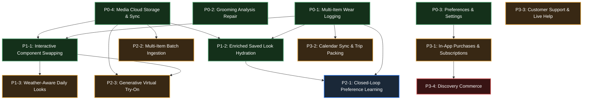

# Fansivibe — Stage 2 Dependency & Blocker Graph
## Comprehensive Architectural Dependency Topology for Remaining Features

**Document Version:** 1.0.0  
**Audit Date:** November 1, 2026  
**Status:** Authoritative Post-P0-4 Architectural Map  

---

## 1. Executive Dependency Architecture

With the successful completion and verification of the four foundational P0 milestones:
- **P0-1:** Multi-Item Outfit Wear Logging (`wardrobe_wear_groups`, `wardrobe_wear_events`, `EnsembleWearConfirmationSheet`)
- **P0-2:** Authenticated Grooming Analysis & Profile Repair (`CreateGroomingRun`, manual preference forwarding)
- **P0-3:** Style Preferences & Settings Persistence (`user_state.style_profile["style_type"]`, atomic `jsonb_set`)
- **P0-4:** Wardrobe Photo Cloud Storage & Media Sync (Cloudflare R2, isolated transcoding, immutable publication fencing, dynamic presigned GETs, `OriginalFileManager` Option B local retention)

All primary platform primitives are now operational. The remaining Stage 2 roadmap features can now be analyzed across a clean topological dependency graph.

---

## 2. Core Shared Infrastructure Foundations

All remaining features depend on, consume, or extend nine authoritative core components:

```
+─────────────────────────────────────────────────────────────────────────────+
|                         CORE INFRASTRUCTURE ASSETS                          |
+─────────────────────────────────────────────────────────────────────────────+
|  1. WARDROBE SOURCE OF TRUTH                                                |
|     - PostgreSQL `wardrobe_items` (canonical catalog & metadata)            |
|     - Authenticated / Ephemeral repository layer                            |
|                                                                             |
|  2. PRIVATE MEDIA STORAGE PIPELINE (P0-4)                                   |
|     - Cloudflare R2 private bucket storage & S3 SigV4 adapter               |
|     - Isolated transcoding subsystem (Linux RLIMIT_AS=256MB, WebP Q85)      |
|     - Dynamic 15-minute presigned GET retrieval (_to_wire enrichment)       |
|     - Option B local original sandbox (ApplicationDocuments/originals/)     |
|     - Flutter L1/L2 cache with transparent 403 refresh (WardrobeCacheManager)|
|                                                                             |
|  3. USER IDENTITY & STYLE PREFERENCES (P0-3)                                |
|     - PostgreSQL `user_state` with CAS optimistic versioning                |
|     - Stored style archetype (`style_type`) & preferred occasions           |
|     - Persisted application settings dictionary (`preferences.settings`)    |
|                                                                             |
|  4. CANONICAL RECOMMENDATION ENGINE                                         |
|     - 12-term candidate scoring in `analysis_rules.py`                      |
|     - Deterministic selection via `select_best_outfit_candidate`            |
|                                                                             |
|  5. WEAR LOGGING & RETENTION LEDGER (P0-1)                                  |
|     - Transactional wear groups (`wardrobe_wear_groups`) & events           |
|     - Idempotency key protection preventing duplicate submissions           |
|     - Wear decay penalty scoring in recommendation engine                   |
|                                                                             |
|  6. SAVED LOOKS COLLECTION                                                  |
|     - PostgreSQL `saved_looks` table storing ensemble snapshots             |
|     - Reaction telemetry (`feedback_events` like/dislike)                   |
|                                                                             |
|  7. CONVERSATIONAL AI ASSISTANT                                             |
|     - Harmonized chat with canonical tool delegation to `GenerateOutfit`    |
|                                                                             |
|  8. LOCAL VISION & REASONING (OLLAMA)                                       |
|     - Local `qwen2.5vl:3b` vision adapters for garment & face analysis      |
|     - 26 formal ontology schemas in Fansivibe Fashion Ontology (`ffo`)      |
|                                                                             |
|  9. TRY-ON SCAFFOLDING (STAGE F0)                                           |
|     - Synthetic SVG mock pipeline watermarked "TEST DATA"                   |
+─────────────────────────────────────────────────────────────────────────────+
```

---

## 3. Topological Dependency Graph



---

## 4. Detailed Feature-by-Feature Dependency & Blocker Analysis

### 4.1 Tier 1: Immediately Implementable (Zero Blockers)

#### Feature P1-1: Interactive Outfit Component Swapping
- **Status:** **COMPLETE AND VERIFIED (Executed 2026-11-02)**
- **Upstream Prerequisites:** 
  - `FEAT-08` (Recommendation Engine) — **Complete**
  - `FEAT-10` (Outfit Builder) — **Complete**
  - `FEAT-04` (Wardrobe Inventory & R2 Media) — **Complete**
  - `P0-1` (Ensemble Wear Logging) — **Complete**
- **Downstream Features Depending on P1-1:**
  - `P2-3` (Generative VTON uses swapped components as visual input)
- **External Dependencies:** None.
- **Database Requirements:** Zero schema migrations. Existing `wardrobe_items` table contains all required fields (`category`, `color`, `material`, `fit`, `image_ref`).
- **AI / Model Requirements:** None. Canonical scoring engine in `analysis_rules.py`.
- **Blocker Status:** **100% COMPLETE.**

#### Feature P1-2: Enriched Saved Look Hydration & Wardrobe Linking
- **Status:** COMPLETE AND VERIFIED (November 2, 2026)
- **Upstream Prerequisites:**
  - `FEAT-04` (Wardrobe Inventory & R2 Media) — **Complete**
  - `FEAT-15` (Saved Looks Collection) — **Complete**
  - `P0-1` (Ensemble Wear Logging) — **Complete**
- **Downstream Features Depending on P1-2:**
  - `P2-1` (Preference Learning utilizes hydrated saved look feedback)
- **External Dependencies:** None.
- **Database Requirements:** Zero schema migrations. Existing `saved_looks` table stores `snapshot` with `selectedItemIds`.
- **AI / Model Requirements:** None.
- **Blocker Status:** **100% COMPLETE.**

---

### 4.2 Tier 2: Blocked by External Service Integration

#### Feature P1-3: Weather-Aware Location Seeding for Daily Looks
- **Status:** BLOCKED BY EXTERNAL WEATHER SERVICE
- **Upstream Prerequisites:**
  - `FEAT-08` (Recommendation Engine) — **Complete**
  - `FEAT-14` (Today's Look) — **Complete**
- **External Dependencies:** Weather API integration (e.g., Open-Meteo API or Apple WeatherKit) and client geolocation permissions (`geolocator` plugin) or user city preference.
- **Database Requirements:** Optional default city/coordinates field in `user_state.preferences`.
- **AI / Model Requirements:** Heuristic weather-temperature rule mapping in `analysis_rules.py`.
- **Blocker Resolution:** Must select and configure weather data provider.

#### Feature P3-1: In-App Purchases & Subscription Billing
- **Status:** BLOCKED BY COMMERCIAL PAYMENT GATEWAY
- **Upstream Prerequisites:** `FEAT-01` (Auth), `FEAT-20` (Subscription UI)
- **External Dependencies:** Stripe merchant account, RevenueCat project configuration, or Apple App Store StoreKit 2 / Google Play Billing credentials.
- **Database Requirements:** Subscriptions ledger (`user_subscriptions`, `invoices`, `webhook_events`).
- **Blocker Resolution:** Founder must execute merchant agreement and provision billing credentials.

#### Feature P3-2: Calendar Synchronization & Trip Packing Assistant
- **Status:** BLOCKED BY NATIVE PLATFORM PERMISSIONS
- **Upstream Prerequisites:** `FEAT-16` (Events planning)
- **External Dependencies:** Native iOS EventKit and Android CalendarProvider platform channels (`device_calendar` Flutter package).
- **Database Requirements:** Calendar sync mapping table (`user_calendar_syncs`).
- **Blocker Resolution:** Physical device testing with native calendar permissions.

#### Feature P3-3: In-App Customer Support & Live Help
- **Status:** BLOCKED BY SUPPORT BACKEND SELECTION
- **Upstream Prerequisites:** `FEAT-21` (Support UI)
- **External Dependencies:** Ticketing service provider (Zendesk / Intercom / Postmark / SendGrid).
- **Database Requirements:** Support tickets table or external webview/email link.
- **Blocker Resolution:** Founder decision on support channel (in-app chat vs. support email vs. external portal).

---

### 4.3 Tier 3: Blocked by AI / Heavy Compute Infrastructure

#### Feature P2-1: Closed-Loop Stylist Preference Learning
- **Status:** DEPENDENT ON SUFFICIENT USER FEEDBACK DENSITY
- **Upstream Prerequisites:** `FEAT-08` (Recommendations), `FEAT-15` (Saved Looks), `P0-1` (Wear Logging).
- **Technical Scope:** Computing user preference vectors from cumulative `feedback_events` and `wardrobe_wear_events` to dynamically adjust attribute weights (color palettes, silhouettes, formality thresholds).
- **Blocker Resolution:** Best implemented after P1-1 and P1-2 when users are actively saving, swapping, and wearing looks.

#### Feature P2-2: Multi-Item Wardrobe Batch Ingestion
- **Status:** BLOCKED BY BACKGROUND VISION WORKER QUEUE
- **Upstream Prerequisites:** `FEAT-04`, `FEAT-05`, `FEAT-11`, `P0-4` (Media Storage).
- **Technical Scope:** Client uploads 5–10 closet photos; server background queue performs object detection, bounding-box cropping, segmentation, and classification, populating a staging review screen.
- **External / Model Dependencies:** Heavy multi-garment segmentation model (e.g., YOLO-Fashion / SAM / Grounding DINO) running on local server or dedicated worker.
- **Blocker Resolution:** Requires background worker queue (Celery/ARQ/Redis) and vision segmentation pipeline.

#### Feature P2-3: Generative Virtual Try-On Pipeline (Stage F1)
- **Status:** BLOCKED BY GPU INFRASTRUCTURE & DIFFUSION MODEL
- **Upstream Prerequisites:** `FEAT-04`, `FEAT-10`, `FEAT-19` (VTO UI), `P0-4` (Media Storage).
- **Technical Scope:** Replace synthetic SVG "TEST DATA" mock with true generative diffusion try-on (IDM-VTON / CatVTON / ComfyUI). User full-body reference image + garment master images -> warped realistic composite.
- **External / Model Dependencies:** Dedicated NVIDIA GPU server (minimum 16GB–24GB VRAM, e.g., RTX 4090 / A10G / A100) running ComfyUI / diffusion inference service.
- **Blocker Resolution:** Founder approval for dedicated GPU server infrastructure or cloud serverless GPU API (RunPod / Replicate / Modal).

---

### 4.4 Tier 4: Strictly Blocked by Architectural Decision

#### Feature P24: Discovery Commerce & Affiliate Purchasing
- **Status:** BLOCKED BY DECISION M14
- **Formal Status Rationale:**
  - Codified in `DECISIONS.md` under Decision M14 ("Discovery Commerce Scaffolding Postponed").
  - Implementation requires executing legal commercial affiliate network agreements (ShopStyle Collective, LTK, Rakuten, or Amazon Associates) and building product catalog ingestion pipelines.
  - **Hard Gate:** Cannot be scheduled or developed until founder explicitly unseals Decision M14.

---

## 5. Dependency Sequencing Table

| Feature ID | Feature Name | Priority | Immediate Dependency | Can Start Now? | Technical Blocker |
|:---|:---|:---:|:---|:---:|:---|
| **P1-1** | Interactive Outfit Component Swapping | **P1** | P0-1, P0-4, FEAT-08, FEAT-10 | **COMPLETE** | None (Implemented & Verified) |
| **P1-2** | Enriched Saved Look Hydration & Linking | **P1** | P0-1, P0-4, FEAT-04, FEAT-15 | **COMPLETE** | None (Implemented & Verified) |
| **P1-3** | Weather-Aware Daily Seeding | **P1** | FEAT-08, FEAT-14 | No | Weather API selection |
| **P2-1** | Closed-Loop Preference Learning | **P2** | P1-2, FEAT-18 | No | Requires feedback dataset |
| **P2-2** | Multi-Item Wardrobe Batch Ingestion | **P2** | P0-4, FEAT-11 | No | Vision segmentation queue |
| **P2-3** | Generative Virtual Try-On (Stage F1) | **P2** | P0-4, FEAT-19 | No | GPU diffusion infrastructure |
| **P3-1** | In-App Purchases & Subscriptions | **P3** | FEAT-20 | No | Merchant billing credentials |
| **P3-2** | Calendar Sync & Packing Assistant | **P3** | FEAT-16 | No | Native device permissions |
| **P3-3** | In-App Help & Customer Support | **P3** | FEAT-21 | No | Support backend channel |
| **P3-4** | Discovery Commerce | **P3** | FEAT-24 | **NO** | Blocked by Decision M14 |

---

## 6. Summary Conclusion

1. **P1-1 and P1-2 are completely unblocked and ready for immediate implementation.** Neither requires database migrations, external third-party services, or GPU hardware.
2. **P1-1 (Interactive Outfit Component Swapping) delivers the greatest product leverage** by transforming the Outfit Builder and Today's Look from static suggestions into an interactive styling canvas.
3. **P1-2 (Enriched Saved Look Hydration) is the natural fast follow** to complete the wardrobe-to-archive visual fidelity.
4. **All other features (P1-3 through P3-4) have concrete external, infrastructure, or legal prerequisites** that must be provisioned before implementation can proceed.
