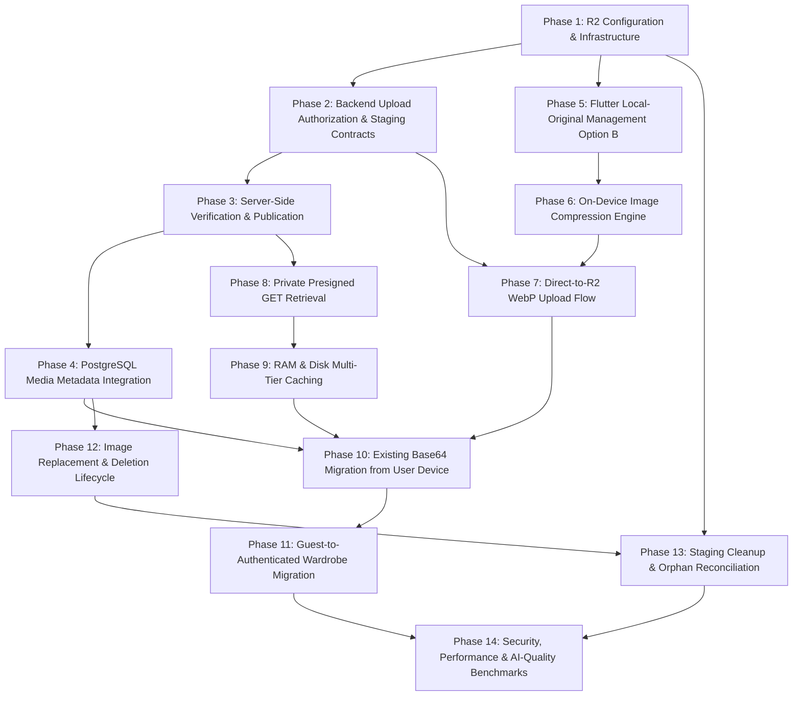

# Stage 2 — P0-4: Wardrobe Photo Cloud Storage & Media Sync
# Final Architectural Authorization & Implementation Readiness Specification

**Document Version:** 1.0.0 (FINAL ARCHITECTURAL DECISION RECORD & AUTHORIZATION)  
**Date:** 2026-11-01  
**Status:** APPROVED — IMPLEMENTATION READINESS SIGN-OFF COMPLETE  
**Repository State:** Read-Only Architectural Finalization (Zero Code Modifications, Zero DB Migrations, Zero Cloud Provisioning)  
**Target Capability:** `STAGE2-P0-4: Wardrobe Photo Cloud Storage & Media Sync`  

---

## 1. Executive Architectural Decision Record

All four foundational architectural decisions for Fansivibe Stage 2 P0-4 have been resolved and formally authorized. The implementation gate is closed pending explicit founder go-ahead.

| Decision | Status | Scope & Authority |
| :--- | :--- | :--- |
| **Original retention — Option B** | **APPROVED** | Retain original photograph privately in application-managed local device sandbox (`ApplicationDocumentsDirectory/originals/`); generate WebP derivatives locally; store WebP master in private cloud object storage; store WebP thumbnails; user-controlled cloud backup as future capability; never auto-delete local original; track local and cloud backup status separately. |
| **Cloudflare R2 Storage Provider** | **APPROVED** | Target production object storage provider using S3-compatible API; private buckets; zero permanent public URLs; backend-only credentials (never embed in Flutter); direct client-to-R2 uploads via short-lived presigned PUT URLs; backend zero-trust verification; zero FastAPI RAM buffering; $0 egress fees. |
| **M16 Scoped Authorization under MS10.3** | **APPROVED** | Formal, narrowly scoped unsealing of Module M16 strictly limited to wardrobe photo storage and sync under privacy policy MS10.3; strict OW-1 ownership scoping; zero cross-user access; private buckets; complete byte erasure on deletion; D10 Option A preserved (guest wardrobe photos device-local until authenticated migration; guest face/appearance data strictly excluded); zero expansion to unapproved biometric/face modules. |
| **Dynamic Presigned GET URLs** | **APPROVED** | Dynamic on-demand presigned GET URLs generated per authenticated request; initial URL expiration 15 minutes; URL refresh supported; URLs never stored as permanent DB references; Flutter private disk and memory caching keyed by content hash and display dimensions; invalidation on replacement/deletion; zero logging of presigned URLs in logs or analytics. |

---

## 2. Comprehensive Architectural Authorizations

### 2.1 Decision 1 — Original Image Retention: OPTION B (Approved)

The founder has explicitly approved **Option B** as the authoritative image retention policy across Fansivibe. Option A (discarding local original post-compression) was formally evaluated and rejected.

#### Architecture Specification:
1. **Local Original Sandbox:** When a user captures a camera photo or selects a gallery image, the raw original file is retained privately in the application-managed local device storage sandbox (`ApplicationDocumentsDirectory/originals/`). This directory is private to the application UID, excluded from operating system cache wipes, but managed entirely by Fansivibe.
2. **On-Device Derivative Generation:** Before any network transfer or cloud upload, the Flutter client executes the 9-step Global Image Compression Pipeline locally, generating:
   - **`garmentMaster`:** Longest edge 1920px, WebP format at Quality Q85 (target $\le 2$ MB).
   - **`garmentThumbnail`:** Longest edge 512px, WebP format at Quality Q78.
   - **`aiVisionInput`:** Longest edge 1024px, WebP format at Quality Q82 (for Ollama `qwen2.5vl:3b` inference passes).
3. **Cloud Master Storage:** Only the optimized WebP master derivative is uploaded to private Cloudflare R2 cloud object storage.
4. **Never Auto-Delete Local Original:** The application will **never** automatically delete the local original photograph following successful compression, staging upload, or server publication.
5. **Separation of Availability Metadata:** The client tracks availability and backup state across orthogonal fields:
   - `localOriginalPath`: String URI pointing to the sandboxed file on the current device.
   - `hasLocalOriginal`: Boolean flag indicating local raw file presence.
   - `cloudBackupStatus`: Enum (`none`, `pending`, `backed_up`, `failed`) reserved for the optional future user-controlled raw original cloud backup feature.
6. **Future User-Controlled Backup:** Original-image cloud backup remains an optional, user-controlled future feature. It is not part of the baseline P0-4 delivery and will require explicit opt-in settings.

---

### 2.2 Decision 2 — Cloud Storage Provider: Cloudflare R2 (Approved)

Cloudflare R2 is approved as the production object storage provider for Fansivibe wardrobe imagery.

#### Architecture Specification:
1. **S3-Compatible API:** Cloudflare R2 provides full S3 API compatibility. Backend integration uses the standardized S3 protocol (via Python `boto3` / `aioboto3` or standard AWS SDK abstractions).
2. **Private Buckets by Default:** Storage buckets are configured as strictly private. Public access, public list, and anonymous read policies are permanently disabled.
3. **Zero Permanent Public Object URLs:** No permanent public URLs (such as `https://pub-xxx.r2.dev/...`) will ever be generated, exposed, or written to PostgreSQL databases.
4. **Strict Backend-Only Credential Isolation:**
   - R2 Account ID, Access Key ID, and Secret Access Key reside **strictly on the backend server** in environment variables (`CLOUDFLARE_R2_ACCOUNT_ID`, `CLOUDFLARE_R2_ACCESS_KEY_ID`, `CLOUDFLARE_R2_SECRET_ACCESS_KEY`, `CLOUDFLARE_R2_BUCKET_NAME`, `CLOUDFLARE_R2_ENDPOINT_URL`).
   - R2 credentials must **never** be compiled into, embedded in, or transmitted to the Flutter mobile application.
5. **Direct Client-to-R2 Upload via Presigned PUT:**
   - Flutter requests an upload slot from FastAPI (`POST /v1/media/uploads`).
   - FastAPI issues a short-lived presigned PUT URL directly targeting a staging key in Cloudflare R2.
   - Flutter uploads the WebP binary directly to R2 over HTTPS PUT, bypassing FastAPI server memory and Nginx reverse-proxy body limits (`client_max_body_size 2M;`).
6. **Zero FastAPI RAM Buffering (Database Invariant PR-8):**
   - The FastAPI backend process never buffers or streams large image file binaries through server RAM during client uploads.
7. **Zero Egress Advantage:** Cloudflare R2 charges **$0 for data egress**, eliminating bandwidth egress billing risk while scaling visual wardrobe hydration across multi-device user bases.

---

### 2.3 Decision 3 — Narrowly Scoped Module M16 Unsealing under MS10.3 (Approved)

Module M16 (Media Uploads & Storage Management), previously sealed under privacy policy **MS10.3**, is hereby formally authorized with a **narrowly scoped unsealing**.

#### Strict Policy Conformance Audit:
- **Repository Constraints Examined:** `SECURITY_PRIVACY_DESIGN.md` (§4.3, §4.4), `BACKEND_MODULE_MAP.md` (M16), `MEDIA_UPLOAD_ARCHITECTURE.md`, `DECISIONS.md` (D2, D10 Option A).
- **Finding:** Policy MS10.3 mandates that a privacy, retention, and erasure policy be explicitly established before any media persistence or storage bucket unsealing. All repository constraints support unsealing M16 provided the unsealing is strictly bounded to private wardrobe imagery and does not expose appearance biometrics or violate guest isolation. There are **zero policy conflicts or blocking conditions**.

#### Authorized Scope Boundaries:
The unsealing of Module M16 is **strictly limited** to:
1. Wardrobe image upload authorization (`POST /v1/media/uploads`).
2. Wardrobe media metadata management (`MediaRef` envelope serialization and validation).
3. Object ownership validation (`OW-1`).
4. Server-side post-upload image verification (`POST /v1/media/uploads/{id}/complete`).
5. Private, authenticated image retrieval URL generation (`GET /v1/media/url` and `GET /v1/wardrobe/items` enrichment).
6. Object replacement and deletion lifecycle hooks with asynchronous storage cleanup.
7. Uncompleted staging-object reconciliation and automated lifecycle sweeps.
8. Future schema-compatible extension hooks for user-controlled original-image cloud backup.

#### Mandatory Privacy Restrictions:
1. **OW-1 Ownership Scoping:** Every storage object key is strictly namespaced under the authenticated user's ID: `users/{user_id}/wardrobe/...` and `staging/users/{user_id}/wardrobe/...`. Every API endpoint strictly validates ownership; foreign object access returns HTTP 404 (never 403, preventing enumeration per API-10).
2. **Zero Cross-User Access:** Users can never view, download, sign, verify, or delete objects belonging to other users.
3. **No Public Storage Buckets:** Wardrobe imagery is classified as private user data; anonymous bucket read is prohibited.
4. **No Unauthorized Access to Original Photographs:** Raw original photographs stay on the user's physical device under Option B. The backend has no access to original raw camera captures unless the user explicitly opts into a future cloud backup feature.
5. **No Guest Appearance or Face-Data Cloud Persistence (Decision D10 Option A):**
   - Guest sessions remain strictly ephemeral on-device.
   - Zero cloud uploads occur for guest users.
   - Zero database rows or synthetic guest UUIDs are generated for guests.
   - Guest face scans, hairstyle models, and grooming analysis data are **never** migrated or stored in cloud storage.
6. **Guest Wardrobe Migration Isolation:** When a guest explicitly registers or signs in, their local wardrobe photos may be migrated to the cloud via the formal authenticated migration worker, but their appearance/face data remains strictly excluded.
7. **No Expansion to Other Modules:** Unsealing M16 for wardrobe media does **not** authorize unsealing image uploads for face scan biometrics, grooming camera passes, or public discovery feeds without separate founder authorization.

---

### 2.4 Decision 4 — Media Delivery Architecture: Dynamic Presigned GET URLs (Approved)

The media delivery architecture for Fansivibe is approved as **dynamic, short-lived presigned GET URLs**.

#### Architecture Specification:
1. **Authenticated On-Demand Minting:**
   - Flutter requests item imagery via authenticated API calls (`GET /v1/wardrobe/items` or `GET /v1/media/url?objectKey=...`).
   - The backend validates the user's Bearer token and verifies ownership of the referenced `objectKey` (`OW-1`).
   - The backend mints a short-lived S3/R2 presigned GET URL dynamically for the authenticated caller.
2. **15-Minute Expiration Window:**
   - Initial URL expiration is strictly set to **15 minutes** (900 seconds).
   - This tight expiration window prevents URL leakage, stale URL hoarding, and unauthorized token redistribution.
3. **Seamless URL Refresh:**
   - Flutter media caching layer detects expired or near-expiry URLs (e.g. within 2 minutes of expiration) or HTTP 403/401 retrieval errors, seamlessly invoking `GET /v1/media/url?objectKey=...` to obtain a fresh presigned GET URL without interrupting the UI.
4. **Never Store URLs in Database (Database Invariant PR-8):**
   - Presigned GET URLs are ephemeral and **must never be persisted** in PostgreSQL `wardrobe_items.image_ref` JSONB or any database column. PostgreSQL stores only canonical `objectKey`, `contentHash`, and metadata.
5. **Multi-Tier Private Client Caching:**
   - **L1 In-Memory Cache:** Flutter keeps decoded raster images in memory, decoded strictly to target display dimensions (avoiding full 1920px texture bloat in GPU memory).
   - **L2 Private Disk Cache:** Flutter stores downloaded WebP files in the application's private cache directory, keyed by `contentHash` and display dimensions (`${contentHash}_${width}x${height}.webp`).
   - The cache key is derived from the immutable `contentHash`, ensuring that URL signature changes do not cause redundant cache re-downloads.
6. **Deterministic Cache Invalidation:**
   - When a garment photo is replaced or deleted, the client immediately invalidates and purges the L1 memory and L2 disk cache entries corresponding to the item's previous `contentHash`.
7. **Sanitized Observability & Logging Hygiene:**
   - Complete presigned URLs, query parameters, AWS signatures (`X-Amz-Signature`), and token headers must **never** be logged to application loggers, observability sinks, or client analytics.

---

## 3. Technical Contracts & Invariants

### 3.1 Canonical Image Formats

| Format | Role | Policy | Enforcement |
| :--- | :--- | :--- | :--- |
| **WebP (`image/webp`)** | **Canonical Cloud Format** | Mandatory production format for all photographic wardrobe imagery stored in R2. Delivers optimal fashion-grade compression, fast decoding, and wide hardware acceleration. | Validated via magic bytes `52 49 46 46 ... 57 45 42 50` (`RIFF....WEBP`). |
| **JPEG (`image/jpeg`)** | **Compatibility Fallback** | Permitted as a temporary client-side fallback only when native on-device WebP encoding is unavailable on legacy hardware. | If uploaded as a fallback, the server-side verification worker must execute a controlled conversion to canonical WebP before publication to canonical keys. |
| **PNG (`image/png`)** | **Legacy Import Only** | Permitted only during client-side migration of existing legacy Base64 preferences strings; immediately transcoded to WebP before network transfer. | Rejected by upload authorization for new wardrobe additions. |
| **SVG (`image/svg+xml`)** | **PROHIBITED** | Strictly prohibited for photographic wardrobe imagery. SVG is reserved exclusively for genuine vector artwork and UI iconography. | Explicitly rejected with HTTP 422 `VALIDATION_ERROR` by upload authorization and server verification. |

---

### 3.2 Unpublished / Staging Lifecycle & Idempotency

Direct client uploads follow a strict 5-stage unpublished staging lifecycle:

```
[Flutter Client]                 [FastAPI Backend]                 [Cloudflare R2]
       │                                 │                                │
       │ 1. POST /v1/media/uploads       │                                │
       ├────────────────────────────────►│ (Authorize upload,             │
       │                                 │  mints staging presigned PUT)  │
       │◄────────────────────────────────┤                                │
       │ {uploadId, uploadUrl, stagingKey}                                │
       │                                 │                                │
       │ 2. Direct HTTPS PUT (WebP bytes)                                 │
       ├─────────────────────────────────────────────────────────────────►│ (Stored in staging/
       │                                 │                                │  prefix, zero server RAM)
       │ 3. POST /v1/media/uploads/{id}/complete                         │
       ├────────────────────────────────►│                                │
       │                                 │ 4. Read bytes, verify:         │
       │                                 │    - actual size <= 2MB        │
       │                                 │    - magic bytes = WebP        │
       │                                 │    - independent SHA-256       │
       │                                 │    - zero EXIF GPS tags        │
       │                                 ├───────────────────────────────►│
       │                                 │ 5. Promote staging object to   │
       │                                 │    canonical production key    │
       │                                 │ 6. Delete staging object       │
       │◄────────────────────────────────┤                                │
       │ 200 OK: Published MediaRef      │                                │
```

#### Idempotency Specifications:
- `POST /v1/media/uploads/{id}/complete` must be **completely idempotent**.
- If a client or network retry submits `/complete` for an upload that has already been verified and promoted, the server must detect the existing canonical media record and return the published `MediaRef` (HTTP 200) without re-executing storage copies or duplicating media references.
- Unverified, malformed, or abandoned staging objects are automatically swept by an R2 24-hour prefix lifecycle rule (`staging/users/...`).

---

### 3.3 Zero-Trust Server-Side Verification Contract

The FastAPI backend enforces zero-trust verification during the `/complete` call. The backend **never trusts client-supplied headers, hashes, or claims**:

1. **Actual Object Size:** Server reads object metadata and stream length directly from R2, asserting `0 < size_bytes <= 2_097_152` (2 MB).
2. **Actual File Format & Magic Bytes:** Server inspects the leading binary header bytes directly from the storage stream. Must match WebP (`52 49 46 46` and `57 45 42 50`).
3. **Independent Server-Side SHA-256 Digest:** Server independently calculates the SHA-256 cryptographic digest over the actual received byte stream. The resulting digest is compared against any client assertion and becomes the canonical `contentHash`.
4. **Declared vs. Actual Content-Length:** Server verifies that actual received bytes match the declared content length within 0 byte discrepancy.
5. **EXIF & GPS Metadata Stripping Verification:** Server decodes image metadata blocks to verify that all EXIF GPS IFD tags (`GPSInfo`), device serial numbers, and personal identification tags have been completely stripped. If GPS tags are detected, the upload is rejected with HTTP 422 `PRIVACY_VIOLATION` and the staging object is immediately purged.
6. **User Ownership and Authorization Check:** Server verifies that the calling user matches the authenticated `user_id` encoded in the `stagingKey` prefix and internal upload authorization record (`OW-1`).

---

### 3.4 Fansivibe Global Image Compression Pipeline & Profiles

The Flutter client executes the mandatory 9-step compression pipeline locally prior to network transmission:

```
[Camera / Gallery Raw Capture]
       │
       ▼ [Step 1: In-Memory Read & Bounds Guard]
       │
       ▼ [Step 2: EXIF Orientation Normalization] (Rotate to upright orientation)
       │
       ▼ [Step 3: Aspect Ratio Preservation & Clamp] (Zero geometric distortion)
       │
       ▼ [Step 4: Dimension Scaling] (Max 1920px edge; NEVER upscale smaller images)
       │
       ▼ [Step 5: Fashion-Grade WebP Compression] (Preserve delicate weaves & dyes)
       │
       ▼ [Step 6: Privacy Scrubbing] (Complete removal of EXIF GPS IFD & metadata)
       │
       ▼ [Step 7: SHA-256 Client Assertion Calculation]
       │
       ▼ [Step 8: Bounds & Magic Bytes Validation] (Assert <= 2MB; Step-down fallback)
       │
       ▼ [Step 9: Option B Local Retention & Staging Upload Dispatch]
```

#### Compression Profiles & Fallback Floors:

| Profile | Max Dimension | Quality Setting | Target Size | Hard Floors (Do Not Cross) |
| :--- | :--- | :--- | :--- | :--- |
| **`garmentMaster`** | 1920px | Q=85 | $\le 2$ MB | Quality Floor: Q=70; Dimension Floor: 1280px |
| **`aiVisionInput`** | 1024px | Q=82 | $\le 800$ KB | Quality Floor: Q=70; Dimension Floor: 768px |
| **`garmentThumbnail`** | 512px | Q=78 | $\le 200$ KB | Quality Floor: Q=65; Dimension Floor: 384px |

#### Deterministic Fallback Policy:
If the primary compression output exceeds 2,097,152 bytes (2 MB):
1. **Pass 1 (Quality Step-Down):** Re-encode at Quality Q80. If still $> 2$ MB, re-encode at Quality Q75.
2. **Pass 2 (Dimension Reduction):** If Quality Q75 remains $> 2$ MB, reduce max dimension by 10% decrements (e.g. 1920px $\rightarrow$ 1728px $\rightarrow$ 1555px $\rightarrow$ 1400px $\rightarrow$ 1280px) while maintaining Q75.
3. **Hard Floor Guard:** Never cross the quality floor (Q70) or dimension floor (1280px). If an image still cannot fit within 2 MB at the floors (virtually impossible for photographic WebP), abort truthfully with `ImageCompressionException` rather than producing an unrecognizable or corrupted image.

---

### 3.5 AI Quality Validation & Empirical Testing Requirements

To guarantee that WebP compression does not degrade fashion AI reasoning (fabric detection, color palette classification, pattern identification):
1. **Objective Quantitative Validation Targets:**
   - **SSIM (Structural Similarity Index):** Target $\ge 0.95$ relative to raw original.
   - **PSNR (Peak Signal-to-Noise Ratio):** Target $\ge 38$ dB.
   - **CIEDE2000 Color Difference ($\Delta E_{00}$):** Target $\le 2.0$ across 25 standard fashion color swatches (guaranteeing imperceptible color shift for garment dyes).
2. **Empirical Ollama Vision Model Benchmark:**
   - Run empirical testing comparing raw camera captures versus compressed WebP derivatives against the actual frozen local vision model: **Qwen2.5-VL 3B (`qwen2.5vl:3b`)**.
   - Dataset: 25 representative fashion garments across diverse fabrics (fine wool, silk, denim, coarse knit, leather), patterns (houndstooth, micro-gingham, floral, solid), and lighting conditions.
   - Requirement: Measure and log exact attribute-level agreement rates (category, subcategory, primary color, secondary color, pattern, material, neckline, sleeve length).
   - Non-Fabrication Rule: Do not claim 100% classification accuracy prior to completing empirical benchmark runs. Document all observed discrepancies honestly.

---

## 4. Dependency-Ordered Implementation Roadmap

The implementation is broken down into 14 distinct, dependency-ordered phases. Each phase represents a self-contained, testable increment. Unrelated phases must not be combined into monolithic implementation tasks.



---

### Phase 1: R2 Configuration and Infrastructure
- **Scope:** Define backend configuration settings and S3/R2 storage adapter port. Configure credentials, bucket names, endpoint URLs, and S3 client factory. Provide in-memory/filesystem fake storage adapter for isolated unit testing.
- **Dependencies:** None (first phase).
- **Expected Files/Modules:**
  - `backend/app/core/config.py` (extend `Settings` with R2 configuration parameters).
  - `backend/app/domain/ports/storage.py` (define `ObjectStoragePort` protocol).
  - `backend/app/infrastructure/external/storage.py` (implement `S3StorageAdapter` using `aioboto3` or `boto3`).
  - `backend/tests/fakes/fake_storage.py` (in-memory storage adapter for unit tests).
- **Acceptance Criteria:** S3 adapter connects cleanly using S3-compatible credentials; generates compliant presigned PUT and GET URLs; reads byte streams; copies objects; deletes objects.
- **Required Tests:** Unit tests in `backend/tests/test_storage_adapter.py` verifying presigned URL generation, expiration timestamp headers, stream reading, and fake adapter fidelity.
- **Rollback Considerations:** Revert storage adapter and config additions; zero database or client impact.

---

### Phase 2: Backend Upload Authorization and Staging Contracts
- **Scope:** Implement upload authorization endpoint (`POST /v1/media/uploads`). Validate caller authentication (`get_current_user_id`), declared purpose (`wardrobe_item`), declared MIME type (`image/webp` with temporary `image/jpeg` fallback), and declared size ($\le 2$ MB). Generate staging object key and presigned PUT URL.
- **Dependencies:** Phase 1.
- **Expected Files/Modules:**
  - `backend/app/api/schemas/media.py` (`UploadAuthorizationRequest`, `UploadAuthorizationResponse`).
  - `backend/app/api/routers/media.py` (route handler for upload authorization).
  - `backend/app/application/media.py` (upload authorization use case).
  - `backend/app/main.py` (mount media router under `/v1/media`).
- **Acceptance Criteria:** Issues 15-minute presigned PUT URL targeting staging prefix `staging/users/{user_id}/wardrobe/{upload_id}.webp`; rejects unauthorized users with HTTP 401; rejects SVG or unsupported MIMEs with HTTP 422; rejects declared size $> 2$ MB with HTTP 422.
- **Required Tests:** Unit and API tests in `backend/tests/test_media_api.py` verifying upload authorization, ownership scoping, validation rules, and error envelopes.
- **Rollback Considerations:** Unmount media router; remove media schemas.

---

### Phase 3: Server-Side Verification and Publication
- **Scope:** Implement upload completion and verification endpoint (`POST /v1/media/uploads/{id}/complete`). Read staging bytes directly from R2; execute independent SHA-256 calculation; verify magic bytes and size bounds; check for EXIF GPS tags; promote verified object to canonical key `users/{user_id}/wardrobe/{item_id}/{content_hash}.webp`; delete staging object; return published `MediaRef`. Implement idempotent completion.
- **Dependencies:** Phase 1, Phase 2.
- **Expected Files/Modules:**
  - `backend/app/api/schemas/media.py` (`UploadCompleteRequest`, `MediaRefResponse`).
  - `backend/app/api/routers/media.py` (`complete_upload` route handler).
  - `backend/app/application/media.py` (`VerifyAndPromoteMedia` use case).
- **Acceptance Criteria:** Server independently verifies bytes without trusting client hash; rejects corrupt or oversized payloads; strips/verifies zero GPS tags; promotes verified object to canonical location; repeated `/complete` calls execute idempotently without errors or duplicate promotion.
- **Required Tests:** Backend tests in `backend/tests/test_media_verification.py` verifying independent hashing, magic byte rejection, GPS rejection, idempotent replay, and cross-user authorization rejection (`OW-1`).
- **Rollback Considerations:** Revert `/complete` handler; staging objects expire naturally via 24h lifecycle.

---

### Phase 4: PostgreSQL Media Metadata Integration
- **Scope:** Connect verified `MediaRef` metadata to `wardrobe_items.image_ref` JSONB column. Ensure `AddWardrobeItem` and `UpdateWardrobeItem` persist verified `MediaRef` without database schema changes. Preserve `MediaRef` schema compatibility with existing items.
- **Dependencies:** Phase 3 (specifically Phase 3.1 Lifecycle Remediation).
- **Mandatory Security Requirement — Gate 1 (F-04 Remediation):**
  `AddWardrobeItem` and `UpdateWardrobeItem` must never blindly trust a client-supplied `image_ref`.
  Before accepting a media reference, the backend must enforce the following validation pipeline:
  1. Parse a typed media reference (`MediaRef` schema).
  2. Resolve the referenced published authorization record or durable media record (`media_upload_authorizations`).
  3. Enforce that the media belongs to the authenticated user (`user_id == caller_id`).
  4. Confirm status is `published` (`status == 'published'`).
  5. Confirm canonical metadata is present and internally consistent (`canonical_key`, `canonical_sha256`, dimensions).
  6. Reject staging keys (`staging/...` keys are strictly prohibited).
  7. Reject arbitrary object keys not matching the deterministic pattern.
  8. Reject another user's media reference (cross-user reference attempts fail closed with HTTP 404 / 403).
  9. Reject nonexistent or unpublished media references (return 404 NOT_FOUND).
  10. Prevent references to unrelated or unsupported object namespaces.
  The backend must construct or validate the canonical media reference from trusted persisted database data.
  A user must not be able to associate another user's object merely by submitting a fabricated `image_ref` JSON dictionary.
- **Expected Files/Modules:**
  - `backend/app/application/wardrobe.py` (update garment creation/update use cases with Gate 1 validation).
  - `backend/app/api/schemas/wardrobe.py` (ensure `imageRef` payload validates cleanly).
- **Acceptance Criteria:** `wardrobe_items.image_ref` stores complete `MediaRef` dictionary (`objectKey`, `mediaType`, `width`, `height`, `sizeBytes`, `contentHash`, `uploadedAt`, `status: ready`); database invariant PR-8 strictly preserved (zero bytes in PostgreSQL); Gate 1 ownership checks pass 100%.
- **Required Tests:** Tests in `backend/tests/test_wardrobe_media_integration.py` verifying end-to-end item creation with verified `MediaRef`, JSONB roundtrip, and ownership validation.
- **Rollback Considerations:** Existing items continue functioning with null or legacy `image_ref`; zero schema migration to rollback.

---

### Phase 5: Flutter Local-Original Management (Option B)
- **Scope:** Implement local-original retention service in Flutter. Store captured or picked raw original photos in application-managed local sandbox directory (`ApplicationDocumentsDirectory/originals/`). Track `localOriginalPath`, `hasLocalOriginal`, and `cloudBackupStatus`. Ensure originals are never auto-deleted.
- **Dependencies:** None (Flutter client foundation).
- **Expected Files/Modules:**
  - `newproject/flutter_application_1/lib/features/media/domain/original_file_manager.dart`.
  - `newproject/flutter_application_1/lib/features/media/data/original_file_manager_impl.dart`.
- **Acceptance Criteria:** Raw camera captures and gallery selections persist safely in sandbox; files survive app restarts; local metadata tracks file existence; zero automatic deletion triggers.
- **Required Tests:** Flutter tests in `test/original_file_manager_test.dart` verifying file creation, path resolution, sandboxing, and non-deletion invariants.
- **Rollback Considerations:** Delete manager class; fallback to existing transient `XFile` handling.

---

### Phase 6: On-Device Image Compression Engine
- **Scope:** Implement the 9-step Global Image Compression Pipeline in Flutter. Normalize EXIF orientation, preserve aspect ratios, downscale (max 1920px), compress to WebP (Q85), strip EXIF/GPS tags, compute SHA-256 client assertion, and enforce deterministic fallback step-downs ensuring output $\le 2$ MB. Support `garmentMaster`, `aiVisionInput`, and `garmentThumbnail` profiles.
- **Dependencies:** Phase 5.
- **Expected Files/Modules:**
  - `newproject/flutter_application_1/lib/features/media/domain/image_processing_service.dart`.
  - `newproject/flutter_application_1/lib/features/media/domain/image_profiles.dart`.
  - `newproject/flutter_application_1/lib/features/media/data/image_processing_service_impl.dart`.
- **Acceptance Criteria:** Accurately corrects orientation across all EXIF tags (1–8); preserves aspect ratio without distortion; produces valid WebP files $\le 2$ MB; strips all GPS tags; executes deterministic step-downs if initial encoding exceeds bounds; never crosses quality floor (Q70) or dimension floor (1280px).
- **Required Tests:** Tests in `test/image_processing_service_test.dart` verifying orientation correction, aspect ratio math, GPS removal, WebP magic bytes, step-down fallbacks, and SHA-256 calculation.
- **Rollback Considerations:** Revert compression engine to previous `prepareWardrobePhoto` PNG helper.

---

### Phase 7: Direct-to-R2 WebP Upload Flow
- **Scope:** Create `MediaClient` in Flutter. Orchestrate upload authorization (`POST /v1/media/uploads`), direct HTTP PUT of WebP bytes to Cloudflare R2 staging URL, and completion notification (`POST /v1/media/uploads/{id}/complete`). Handle network retries, progress indicators, and truthful error reporting.
- **Dependencies:** Phase 2, Phase 3, Phase 6.
- **Expected Files/Modules:**
  - `newproject/flutter_application_1/lib/features/media/data/media_client.dart`.
  - `newproject/flutter_application_1/lib/features/wardrobe/presentation/add_wardrobe_item_screen.dart` (wire upload flow into garment save).
- **Acceptance Criteria:** Uploads WebP binary directly to R2 over HTTPS PUT without proxying through FastAPI; completes upload and receives verified `MediaRef`; saves garment with valid `imageRef`.
- **Required Tests:** Flutter tests in `test/media_client_test.dart` with mock HTTP client verifying authorization, direct PUT dispatch, `/complete` payload, and retry logic.
- **Rollback Considerations:** Disable cloud upload toggle; fallback to local preferences persistence.

---

### Phase 8: Private Presigned GET Retrieval
- **Scope:** Implement private media retrieval endpoint on backend (`GET /v1/media/url?objectKey=...`) and enrich `GET /v1/wardrobe/items` with fresh presigned GET URLs (15-minute expiration). Validate user ownership (`OW-1`).
- **Dependencies:** Phase 1, Phase 4.
- **Expected Files/Modules:**
  - `backend/app/api/routers/media.py` (add `get_media_url` endpoint).
  - `backend/app/api/routers/wardrobe.py` (enrich wardrobe items with dynamic `downloadUrl`).
  - `backend/app/application/media.py` (retrieval use case).
- **Acceptance Criteria:** Mints 15-minute presigned GET URLs for owning user; returns HTTP 404 for foreign or non-existent keys; URLs never persisted to database.
- **Required Tests:** Backend tests in `backend/tests/test_media_retrieval.py` verifying presigned GET generation, signature validity, expiration bounds, and OW-1 isolation.
- **Rollback Considerations:** Remove `get_media_url` endpoint and `downloadUrl` wire enrichment.

---

### Phase 9: RAM and Disk Multi-Tier Caching
- **Scope:** Implement multi-tier caching in Flutter (`WardrobeCacheManager`). L1 memory cache decoded to exact display dimensions; L2 disk cache keyed by immutable `contentHash` and target dimensions; network fetch via presigned GET URL with automatic URL refresh upon expiration. Wire into `WardrobeItemImage` adhering strictly to 65% image / 35% content card rules (Digital Atelier).
- **Dependencies:** Phase 8.
- **Expected Files/Modules:**
  - `newproject/flutter_application_1/lib/features/media/presentation/wardrobe_cache_manager.dart`.
  - `newproject/flutter_application_1/lib/features/wardrobe/presentation/widgets/wardrobe_widgets.dart` (update `WardrobeItemImage`).
- **Acceptance Criteria:** Second device hydrates and displays garment photos seamlessly from cloud; cache hits bypass network; memory decoding respects display dimensions without GPU bloat; zero layout distortion; falls back gracefully to `FansiImageWell` on failure.
- **Required Tests:** Flutter tests in `test/wardrobe_item_image_test.dart` and `test/wardrobe_cache_manager_test.dart` verifying memory decoding bounds, disk cache hits, URL refresh triggers, and fallback rendering.
- **Rollback Considerations:** Revert `WardrobeItemImage` to previous local-byte-only renderer.

---

### Phase 10: Existing Base64 Migration from User Device
- **Scope:** Implement progressive background migration worker in Flutter. Scans local `LocalStore` for legacy wardrobe items with `imageBase64` but missing cloud `imageRef`. Safely extracts original to sandbox (Option B), compresses to WebP, uploads to staging, verifies via backend, updates backend item `imageRef`, and purges bloated Base64 string from local preferences upon confirmed success.
- **Dependencies:** Phase 4, Phase 7, Phase 9.
- **Expected Files/Modules:**
  - `newproject/flutter_application_1/lib/features/wardrobe/data/legacy_photo_migration_worker.dart`.
- **Acceptance Criteria:** Migrates legacy photos progressively without UI blocking; preserves local original in sandbox; verifies cloud persistence before clearing local Base64; leaves local Base64 intact if network fails.
- **Required Tests:** Flutter tests in `test/legacy_photo_migration_worker_test.dart` verifying progressive migration, failure safety, Base64 pruning, and local original preservation.
- **Rollback Considerations:** Disable background migration worker; legacy Base64 items continue rendering locally.

---

### Phase 11: Guest-to-Authenticated Wardrobe Migration
- **Scope:** Connect guest wardrobe photo conversion during registration/sign-in. Ensure local guest wardrobe photos are compressed and uploaded to cloud storage only after authenticated session is established. Strictly enforce Decision D10 Option A: zero guest face/appearance data migrated.
- **Dependencies:** Phase 7, Phase 10.
- **Expected Files/Modules:**
  - `newproject/flutter_application_1/lib/features/auth/presentation/guest_conversion_coordinator.dart` (or wardrobe conversion handler).
- **Acceptance Criteria:** Guest wardrobe photos migrate to cloud under authenticated user's namespace; guest appearance and face scan data are strictly excluded from migration; unauthenticated guests generate zero network upload calls.
- **Required Tests:** Flutter tests in `test/guest_wardrobe_media_migration_test.dart` verifying post-auth photo upload, absence of guest cloud calls, and appearance isolation.
- **Rollback Considerations:** Keep guest items strictly local; prompt user to re-add photos post-registration.

---

### Phase 12: Image Replacement and Deletion Lifecycle
- **Scope:** Implement photo replacement and deletion hooks. When a wardrobe item photo is updated, the previous R2 object is queued for asynchronous deletion. When an item is deleted (`DELETE /v1/wardrobe/items/{id}`), the referenced R2 object is deleted. Flutter immediately evicts old cache entries.
- **Dependencies:** Phase 3, Phase 4, Phase 9.
- **Expected Files/Modules:**
  - `backend/app/application/wardrobe.py` (add storage deletion triggers to item delete/update).
  - `backend/app/infrastructure/external/storage_cleanup.py`.
  - `newproject/flutter_application_1/lib/features/wardrobe/data/wardrobe_repository.dart` (cache eviction hooks).
- **Acceptance Criteria:** Deleting an item or replacing a photo purges the R2 object without leaving orphaned cloud blobs; client evicts cached entries immediately.
- **Required Tests:** Backend tests in `backend/tests/test_media_deletion_lifecycle.py` verifying R2 `delete_object` execution on item deletion and replacement.
- **Rollback Considerations:** Disable deletion hook; rely on manual or scheduled orphan sweeps.

---

### Phase 13: Staging Cleanup and Orphan-Object Reconciliation (Pre-Public-Release Operational Gate)
- **Scope:** Configure Cloudflare R2 bucket lifecycle rules for automated 24-hour expiration on `staging/` prefix. Implement backend periodic sweep worker to detect and reconcile uncompleted or orphaned storage objects older than 24 hours.
- **Dependencies:** Phase 1, Phase 3, Phase 12.
- **Mandatory Operational Requirements (F-06 Remediation):**
  Orphan reconciliation is a formal **Pre-Public-Release Operational Gate**.
  The reconciliation subsystem must:
  1. Discover unreferenced canonical objects under the private `users/` prefix via S3/R2 listing.
  2. Compare object metadata (`user_id`, `upload_id`, `sha256`) with durable PostgreSQL media records (`media_upload_authorizations` and `wardrobe_items.image_ref`).
  3. Identify storage objects without a valid database reference (orphaned blobs).
  4. Identify published database records whose canonical storage object is missing (missing blobs).
  5. Apply a safe grace period (minimum 7 days) before deleting unreferenced canonical objects to protect in-flight drafts.
  6. Never delete storage objects merely because a database query temporarily failed or timed out (fail-closed protection).
  7. Record reconciliation sweep results, counters, and errors in structured audit logs.
  8. Provide a CLI `--dry-run` mode for safe operator inspection prior to execution.
  9. Require cryptographic and ownership verification before executing permanent object deletion.
- **Expected Files/Modules:**
  - `backend/app/infrastructure/jobs/storage_reconciliation.py`.
- **Acceptance Criteria:** Uncompleted uploads older than 24 hours are purged automatically; database references remain consistent; storage metrics report zero abandoned staging leaks; dry-run mode verified; fail-closed safety verified.
- **Required Tests:** Backend tests in `backend/tests/test_storage_reconciliation.py` verifying orphan detection, grace-period preservation, and cleanup execution.
- **Rollback Considerations:** Disable backend reconciliation worker; rely solely on R2 prefix lifecycle rules.

---

### Phase 14: Security, Performance, Cross-Device and AI-Quality Regression Tests
- **Scope:** Execute comprehensive verification across security (OW-1, cross-user isolation, signature tampering), performance (multi-device hydration, cache warm-up, Nginx 2MB compliance), empirical AI quality benchmarks (Qwen2.5-VL 3B classification agreement, SSIM $\ge 0.95$, PSNR $\ge 38$ dB, $\Delta E_{00} \le 2.0$), and full regression suites (wardrobe wear logging, styling recommendations, guest mode).
- **Dependencies:** All preceding phases (Phases 1–13).
- **Expected Files/Modules:**
  - `backend/tests/test_media_security_regression.py`.
  - `backend/tests/test_ai_vision_compression_benchmark.py`.
  - `newproject/flutter_application_1/test/media_end_to_end_regression_test.dart`.
- **Acceptance Criteria:** 100% test pass rate across backend and Flutter suites; `flutter analyze` 0 issues; zero layout regressions; zero privacy leaks; empirical AI benchmark logged with honest agreement metrics.
- **Required Tests:** Full backend pytest suite, full Flutter test suite, static analysis, and security verification.
- **Rollback Considerations:** Individual phase rollback as specified above.

---

## 5. Implementation-Readiness Checklist & Execution Boundary

### 5.1 Verification Checklist
- [x] **Original Image Retention:** Option B formally documented as APPROVED. Local sandboxed original retained; WebP master in R2; thumbnails; user-controlled future backup; no auto-deletion; separate status tracking.
- [x] **Cloud Storage Provider:** Cloudflare R2 formally documented as APPROVED. S3-compatible API; private buckets; zero public URLs; backend-only credentials; presigned PUT direct upload; zero FastAPI RAM buffering; $0 egress.
- [x] **Module M16 Authorization:** Formal narrowly scoped authorization under privacy policy MS10.3 documented as APPROVED. Wardrobe media only; OW-1 ownership scoping; zero cross-user access; complete byte erasure; D10 Option A preserved; no expansion to face/appearance biometrics.
- [x] **Media Delivery Architecture:** Dynamic presigned GET URLs formally documented as APPROVED. 15-minute expiration; URL refresh; not stored in DB; Flutter L1/L2 caching keyed by contentHash and display dimensions; invalidation on replace/delete; zero URL logging.
- [x] **Technical Contracts:** Canonical formats (WebP canonical, JPEG fallback + server conversion, SVG prohibited), 5-stage staging lifecycle, idempotent completion, zero-trust independent server verification (magic bytes, size $\le 2$ MB, independent SHA-256, EXIF GPS stripping), 3 compression profiles (`garmentMaster`, `aiVisionInput`, `garmentThumbnail`), and empirical AI validation targets (SSIM, PSNR, CIEDE2000, Qwen2.5-VL 3B).
- [x] **14-Phase Implementation Roadmap:** Dependency-ordered, detailed with scope, dependencies, files, criteria, tests, and rollback considerations.
- [x] **Execution Boundaries Respected:** 100% read-only architectural specification. Zero application code modified, zero DB migrations created, zero R2 cloud buckets provisioned, all existing working tree files preserved.

### 5.2 Implementation Gate
> [!IMPORTANT]
> **READ-ONLY SPECIFICATION COMPLETE — AWAITING FOUNDER AUTHORIZATION**  
> All architectural decisions have been evaluated, reconciled, and recorded as APPROVED. Implementation must not commence until the founder explicitly issues the authorization to proceed with Phase 1.
