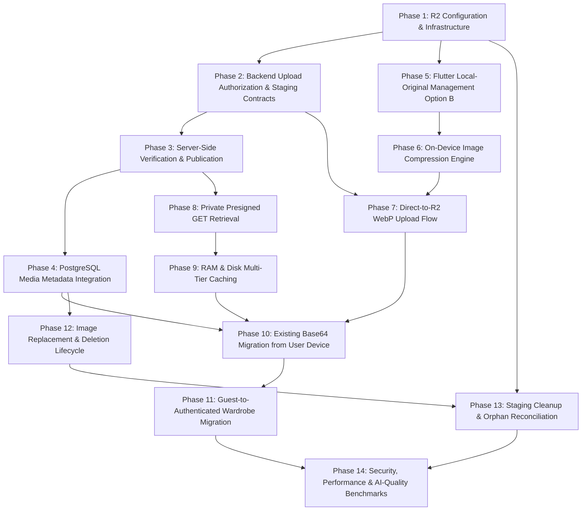

# Stage 2 — P0-4: Wardrobe Photo Cloud Storage & Media Sync
## Preimplementation Architectural Assessment, Technical Review & Global Image Compression Pipeline

**Document Version:** 2.0.0 (FINAL ARCHITECTURAL AUTHORIZATION & APPROVED DECISIONS)  
**Date:** 2026-11-01  
**Status:** COMPLETE (ALL FOUR ARCHITECTURAL DECISIONS APPROVED; IMPLEMENTATION AUTHORIZATION READY)  
**Final Recommendation:** **FULLY AUTHORIZED & IMPLEMENTATION-READY (ALL FOUR DECISIONS APPROVED)**  
**Associated Issues / Workstreams:** Stage 2 Baseline P0-4, Module M16, Decision MS10.3, Decision D10 Option A, Global Image Compression Pipeline  

---

## Executive Summary

This document performs an exhaustive, evidence-based, read-only architectural assessment of the Fansivibe wardrobe photo storage, media synchronization, and image processing pipeline.

### Core Problem Identified
Currently, garment photos captured or selected within the Flutter application are **not backed by durable cloud object storage**. While the backend database schema contains an `image_ref` JSONB column on `wardrobe_items` and Flutter models support a `MediaRef` metadata envelope, **no actual media bytes are ever persisted on the server**. In-memory photos passed to the backend during garment analysis (`POST /v1/analysis/garment`) are inspected ephemerally by an Ollama vision model and immediately discarded. The Flutter client persists garment photos locally as Base64 strings inside `SharedPreferences` (`LocalStore` under `fansivibe.user_model.v1`).

As a direct consequence:
1. **Zero Cross-Device Availability:** If a user logs into their account from a second device, accesses the web app, or reinstalls the mobile app, all wardrobe photos are completely missing, falling back to empty category icon placeholders.
2. **Device Storage Bloat:** Storing multiple full-resolution or 512KB PNG Base64 strings inside a monolithic JSON preferences blob threatens local storage stability, causes memory pressure, and introduces UI jank during serialization.
3. **No Standalone Upload Path:** If a user manually adds a garment without running AI garment analysis, the photo is stored solely in local device preferences; no server reference is created.
4. **Inefficient Network Transfers & Privacy Exposure:** Raw camera captures (3MB–15MB) contain unstripped EXIF GPS metadata, device identifiers, and uncompressed pixel buffers that waste cellular bandwidth and fail production reverse-proxy limits.

### Architectural Solution
This review establishes a unified blueprint combining:
1. **Approved Original Image Retention Policy (Option B):** The user/founder has explicitly approved **Option B**. The architecture specifies:
   - Retaining the original photograph privately in application-managed local device storage.
   - Generating optimized WebP derivatives on-device before any network transfer.
   - Storing the WebP master in Cloudflare R2 (the target S3-compatible cloud storage).
   - Generating and storing appropriate thumbnails (e.g. 512px).
   - Supporting optional, user-controlled original-image cloud backup as a future capability.
   - Never automatically discarding the local original after WebP generation.
   - Tracking local original availability and cloud backup status separately in metadata.
2. **S3-Compatible Object Storage with Client-Direct Staging Lifecycle:** Completely decouples media binaries from FastAPI application memory (enforcing database invariant **PR-8**), respects Nginx production payload limits (**2MB**), strictly confines guest data on-device (**Decision D10 Option A**), and guarantees authenticated user isolation (**OW-1**). Direct uploads follow a secure unpublished/staging lifecycle: authorize upload $\rightarrow$ upload to staging prefix $\rightarrow$ server-side verification with independent SHA-256 calculation from received bytes $\rightarrow$ publish verified reference $\rightarrow$ cleanup invalid/abandoned uploads.
3. **Fansivibe Global Image Compression Pipeline:** Enforces mandatory on-device image preprocessing before network transfer. Raw camera captures are reoriented, resized, stripped of EXIF GPS privacy metadata, compressed into **WebP** (with JPEG compatibility fallback), verified against format/size bounds (with deterministic recompression and dimension-reduction fallback), and content-hashed. SVG is strictly restricted to genuine vector artwork and UI iconography, never ordinary photographs.
4. **Fashion-Grade Visual Quality Policy & Empirical Validation Targets:** Protects garment fabric textures, stitching, weaves, and color palettes from aggressive quantization. Sets quantitative validation targets (SSIM $\ge 0.95$, PSNR $\ge 38$ dB, CIEDE2000 $\Delta E_{00} \le 2.0$) and requires empirical evaluation comparing raw camera captures versus WebP derivatives using the actual Qwen2.5-VL 3B model, documenting classification agreement and attribute-level failures.

> [!IMPORTANT]
> **Architectural Scope & Authorization Gate:**  
> All four architectural decisions have been formally resolved and APPROVED by the founder: (1) Original Retention Option B, (2) Cloudflare R2 storage provider, (3) Module M16 narrowly scoped unsealing under MS10.3, and (4) Dynamic presigned GET URL media delivery. See `STAGE2_P0_4_FINAL_ARCHITECTURAL_DECISIONS.md` for the binding decision record and 14-phase implementation roadmap. This task is strictly architectural; it does not perform code modifications, database migrations, or cloud provisioning. Implementation starts only after explicit founder go-ahead.

---

## Phase 0 — Git Safety Baseline

Before beginning the architectural audit, the active working tree was inspected to verify baseline stability and ensure that no unstaged changes from previous tasks are disturbed.

### 1. Git Status Audit
- **Modified Files:** 77 files.
- **Untracked Files:** 53 files.
- **Verification Command:** `git status --short` & `git diff --stat`.
- **Preceding Implementation State:** All modifications from preceding tasks (`STAGE2-P0-1` Multi-Item Wear Logging, `STAGE2-P0-2` Grooming Analysis & Repair, and `STAGE2-P0-3` Preferences & Settings Persistence) are intact.
- **Safety Invariant:** Zero Git mutations were performed. No files were reset, stashed, checked out, committed, or pushed.

---

## Phase 1 — Existing Media Architecture Audit

### 1.1 Flutter Wardrobe Models
The Flutter client defines wardrobe models across three distinct architectural layers:
- **UI Domain Model ([`WardrobeItemData`](file:///home/tony/projects/fansivibe_v1_backup/newproject/flutter_application_1/lib/features/wardrobe/data/wardrobe_mock_data.dart#L27-L71)):**
  - Contains `final Uint8List? imageBytes;` (in-memory raw image bytes).
  - Contains `final MediaRef? imageRef;` (backend metadata envelope verbatim).
- **Backend API DTO ([`WardrobeItem`](file:///home/tony/projects/fansivibe_v1_backup/newproject/flutter_application_1/lib/features/wardrobe/data/wardrobe_api_models.dart#L112-L201)):**
  - Carries `final MediaRef? imageRef;`. Carries zero binary image bytes or download URLs.
- **Metadata Reference DTO ([`MediaRef`](file:///home/tony/projects/fansivibe_v1_backup/newproject/flutter_application_1/lib/features/wardrobe/data/wardrobe_api_models.dart#L4-L79)):**
  - Carries `objectKey` (String), `mediaType` (String), `width` (int?), `height` (int?), `sizeBytes` (int?), `contentHash` (String?), `isGenerated` (bool?), `uploadedAt` (DateTime?), and `sourceRunId` (String?).
- **Local Mirror Model ([`WardrobeEntry`](file:///home/tony/projects/fansivibe_v1_backup/newproject/flutter_application_1/lib/features/learning/data/models.dart#L10-L40)):**
  - Carries `final String? imageBase64;` (Base64 string serialized into local device JSON).

### 1.2 Image Capture and Selection
Garment photo acquisition is orchestrated in [`WardrobePhotoScreen`](file:///home/tony/projects/fansivibe_v1_backup/newproject/flutter_application_1/lib/features/wardrobe/presentation/wardrobe_photo_screen.dart#L20-L50):
- **Camera Capture:** Utilizes the Flutter `camera` plugin (`CameraController` configured with `ResolutionPreset.high`, `ImageFormatGroup.jpeg`). Captures to a temporary `XFile` and reads bytes into memory via `xFile.readAsBytes()`.
- **Gallery Pick:** Utilizes `image_picker` (`ImagePicker().pickImage(source: ImageSource.gallery, maxWidth: 1024, maxHeight: 1024)`).
- **Result:** Emits a transient `WardrobePhoto(bytes, filename)` object. No permanent file URIs or local filesystem paths are stored.

### 1.3 Image Preprocessing and Compression Deficiencies
Preprocessing is currently attempted in [`prepareWardrobePhoto`](file:///home/tony/projects/fansivibe_v1_backup/newproject/flutter_application_1/lib/features/wardrobe/data/wardrobe_item_photo.dart#L53-L73):
- **Size Bounds:** Capped at `maxWardrobePhotoBytes = 512 * 1024` (512 KB).
- **Dimension Bounds:** Longest edge capped at `maxWardrobePhotoEdge = 1024` px.
- **Encoding:** If bytes exceed 512KB, the image is decoded via Flutter engine stdlib `dart:ui.instantiateImageCodec`, scaled down preserving aspect ratio, and re-encoded into PNG byte data (`ui.ImageByteFormat.png`).
- **Critical Limitations Identified:**
  1. **PNG Encoding Inefficiency:** PNG is a lossless format tailored for line art and sharp synthetic graphics, not continuous-tone photographs. Encoding photographic garments into PNG yields massive 200KB–500KB blobs even when scaled down.
  2. **Lack of EXIF Orientation Normalization:** `dart:ui` does not inspect EXIF orientation tags. Photos captured in portrait orientation on certain Android and iOS camera hardware can end up rotated sideways or inverted.
  3. **Privacy Leakage:** Camera EXIF tags (including GPS coordinates, timestamp, device model, and camera serial number) are not stripped prior to base64 serialization.
  4. **No Content Integrity Hashing:** No SHA-256 content digest is calculated client-side to verify transport integrity or enable local deduplication.

### 1.4 Wardrobe Item Creation and Photo Wiring
The garment save flow in [`AddWardrobeItemScreen`](file:///home/tony/projects/fansivibe_v1_backup/newproject/flutter_application_1/lib/features/wardrobe/presentation/add_wardrobe_item_screen.dart#L115-L182) exhibits a critical architectural disconnect:
1. **When Garment Analysis is Run (`_analyzePhoto`):**
   - Flutter submits image bytes to `POST /v1/analysis/garment` via [`GarmentClient.submitGarmentAnalysisBytes`](file:///home/tony/projects/fansivibe_v1_backup/newproject/flutter_application_1/lib/features/wardrobe/data/garment_client.dart#L83-L122).
   - Polling `GET /v1/analysis/runs/{run_id}` returns `run.input_media` containing `key`, `mediaType`, `sizeBytes`, `contentHash`, `uploadedAt`.
   - `_buildImageRef()` constructs a `MediaRef` from this metadata.
   - When the user taps Save, `WardrobeRepository.createItem(..., imageRef: _buildImageRef())` persists the metadata to the backend.
2. **When Photo is Captured WITHOUT Analysis (Manual Photo Save):**
   - `_buildImageRef()` returns `null` because `_garmentInputMedia` is null.
   - The item is saved to the backend with `imageRef = null`.
3. **Local Persistence Binding:**
   - On save success, `AddWardrobeItemScreen` calls `LearningService.instance.updateItem(savedItem.id, wardrobeEntryFromItem(savedItem))` where `wardrobeEntryFromItem` converts `photoBytes` to Base64.
   - The Base64 string is written to `SharedPreferences` via [`LocalStore.writeRaw`](file:///home/tony/projects/fansivibe_v1_backup/newproject/flutter_application_1/lib/features/learning/data/local_store.dart#L26-L33).

### 1.5 Wardrobe Rehydration and Display
In [`WardrobeScreen`](file:///home/tony/projects/fansivibe_v1_backup/newproject/flutter_application_1/lib/features/wardrobe/presentation/wardrobe_screen.dart#L133-L149):
- The screen fetches items from the backend: `items = await _repository.listItems(pageSize: 100)`.
- Backend items contain `imageRef` metadata but no renderable bytes.
- The screen executes `items.map(attachLocalPhoto).toList()`.
- [`attachLocalPhoto`](file:///home/tony/projects/fansivibe_v1_backup/newproject/flutter_application_1/lib/features/wardrobe/data/wardrobe_item_photo.dart#L89-L98) searches `LearningService.instance.wardrobe` (the local device preferences mirror) by `item.id`. If found, it decodes `imageBase64` into `item.imageBytes`.
- [`WardrobeItemImage`](file:///home/tony/projects/fansivibe_v1_backup/newproject/flutter_application_1/lib/features/wardrobe/presentation/widgets/wardrobe_widgets.dart#L345-L370) renders `Image.memory(item.imageBytes)`. If `imageBytes == null`, it displays the category placeholder icon ([`FansiImageWell`](file:///home/tony/projects/fansivibe_v1_backup/newproject/flutter_application_1/lib/features/wardrobe/presentation/widgets/wardrobe_widgets.dart#L355)).

### 1.6 Backend Wardrobe Routers and Repositories
- **Router ([`backend/app/api/routers/wardrobe.py`](file:///home/tony/projects/fansivibe_v1_backup/backend/app/api/routers/wardrobe.py#L151-L192)):**
  - `POST /v1/wardrobe/items` accepts `WardrobeItemCreate(imageRef: Optional[dict])`.
  - Forwards `image_ref` to [`AddWardrobeItem`](file:///home/tony/projects/fansivibe_v1_backup/backend/app/application/wardrobe.py#L145-L180).
- **Repository ([`backend/app/infrastructure/db/repositories.py`](file:///home/tony/projects/fansivibe_v1_backup/backend/app/infrastructure/db/repositories.py#L832-L860)):**
  - Inserts `image_ref` directly into `WardrobeItems.image_ref`.
- **Database Schema ([`backend/app/infrastructure/db/models.py`](file:///home/tony/projects/fansivibe_v1_backup/backend/app/infrastructure/db/models.py#L455-L457)):**
  - Table `wardrobe_items` defines `image_ref: Mapped[Optional[dict[str, Any]]] = mapped_column(JSONB, nullable=True)`.
  - Created in migration `0006_wardrobe_items.py`.

### 1.7 Analysis & Vision Pipeline Image Handling
- **Garment Analysis ([`backend/app/application/analysis.py:878`](file:///home/tony/projects/fansivibe_v1_backup/backend/app/application/analysis.py#L878-L945)):**
  - `CreateGarmentRun` receives an uploaded image stream, checks size (max 20MB), and calls `read_image_bytes(image)` and [`build_media_ref`](file:///home/tony/projects/fansivibe_v1_backup/backend/app/application/media.py#L66-L95).
  - `build_media_ref` calculates an SHA-256 digest and mints a synthetic object key: `users/{user_id}/scans/{uuid}/input.{ext}`.
  - The bytes are forwarded in memory to [`OllamaVisionGarmentAdapter.analyze`](file:///home/tony/projects/fansivibe_v1_backup/backend/app/ai/vision_garment_adapter.py#L1-L50) which base64-encodes them and posts them to Ollama (`qwen2.5vl:3b`).
  - **The bytes are then immediately discarded from memory.** They are never written to any disk, volume, S3 bucket, or database column.
- **Outfit Scan ([`CreateOutfitRun`](file:///home/tony/projects/fansivibe_v1_backup/backend/app/application/analysis.py#L193-L260)):**
  - Mirrors the exact same pattern: bytes are read into memory for Ollama, metadata is written to `analysis_runs.input_media`, and bytes are discarded.

### 1.8 Server Deployment and Persistent Storage Configuration
An inspection of deployment manifests reveals critical operational constraints:
- **Local Dev / Staging ([`start.sh`](file:///home/tony/projects/fansivibe_v1_backup/start.sh) & [`backend/docker-compose.yml`](file:///home/tony/projects/fansivibe_v1_backup/backend/docker-compose.yml)):**
  - Services: `fansivibe-api`, `fansivibe-ollama` (0.5.7), and `fansivibe-postgres18` (`postgres:18-alpine`).
  - Storage: Docker volumes exist only for `postgres` data and `ollama` models. **Zero object storage containers (MinIO/LocalStack) exist.**
- **Production Topology ([`backend/docker-compose.production.yml`](file:///home/tony/projects/fansivibe_v1_backup/backend/docker-compose.production.yml)):**
  - Architecture: Multi-container setup with Nginx reverse proxy splitting traffic between `backend-primary` (8000) and `backend-canary` (8001).
  - Volumes: `postgres_prod_data` and `ollama_prod_models`.
  - **No Shared Media Volume:** Neither `backend-primary` nor `backend-canary` has a persistent shared filesystem volume mounted. Any file written to the local container disk is ephemeral, isolated to that specific container instance, and lost upon container restart or deployment.
- **Reverse Proxy Gateway ([`backend/deploy/nginx/production.conf`](file:///home/tony/projects/fansivibe_v1_backup/backend/deploy/nginx/production.conf#L68)):**
  - Line 68 explicitly enforces: **`client_max_body_size 2M;`**.
  - **Hard Gate:** If a mobile client attempts to upload an original 3MB–15MB wardrobe photo directly to FastAPI via multipart POST, Nginx will immediately terminate the connection with **`HTTP 413 Payload Too Large`** before the request reaches Python.

---

## Phase 2 — Storage Architecture Options Evaluation

To resolve the cross-device media synchronization limitation, three realistic storage architectures were evaluated against Fansivibe's system constraints.

| Evaluation Criteria | Option 1: Server-Managed Local Persistent Filesystem | Option 2: S3-Compatible Object Storage (Presigned PUT/GET) | Option 3: PostgreSQL In-Database Blobs (`BYTEA`) |
| :--- | :--- | :--- | :--- |
| **Security & Isolation** | High risk. Requires FastAPI to serve files; path traversal risks; requires custom authentication wrappers on every image request. | **Highest**. Storage bucket is completely private. Time-limited presigned URLs (15m) generated strictly for authenticated owner (`OW-1`). | Moderate. Database permissions apply, but large payload handling increases connection timeout vulnerability. |
| **Deployment Compatibility** | **Incompatible with Production**. Production uses dual containers (`backend-primary` / `canary`). Requires complex distributed NFS/EFS mounts. | **100% Compatible**. Fully decoupled from application containers. Zero container storage dependencies. | Compatible with single DB, but degrades DB performance and replica synchronization. |
| **Operational Complexity** | High. File backups, disk space monitoring, volume permissions, multi-node synchronization. | **Low**. Cloud provider manages durability (99.999999999%), auto-scaling, availability, and disk lifecycle. | Very High. Bloats WAL logs, balloons DB dump/restore times, degrades VACUUM. |
| **Nginx 2MB Limit** | **Blocked**. Bypassing requires raising Nginx `client_max_body_size`, opening proxy memory to DoS attacks. | **100% Immune**. Client uploads directly to Object Storage via presigned URL. Zero bytes pass through Nginx or FastAPI. | **Blocked**. Direct upload through Nginx fails on any photo > 2MB. |
| **FastAPI RAM (PR-8)** | **Violates PR-8**. FastAPI buffers streaming image chunks in Python heap during upload and retrieval. | **Strictly Honors PR-8**. FastAPI handles only metadata and URL signing. Zero image bytes in application RAM. | **Violates PR-8**. PostgreSQL and FastAPI allocate massive buffers for large byte strings. |
| **Cross-Device Sync** | Supported if shared disk exists, but high network latency when served through Python process. | **Optimal**. Direct CDN / Edge delivery to Flutter clients across any device or web browser. | Supported, but severely throttles API concurrency while streaming images. |
| **Bandwidth & Delivery** | Heavy egress burden on the application server. Limits API throughput. | Offloads 100% of media bandwidth to object storage / CDN edge. | Consumes application DB connection pool bandwidth. |
| **Backup & Recovery** | Requires synchronized snapshotting of filesystem and PostgreSQL database. | Native object storage versioning and independent lifecycle/backup policies. | Tied to database backups (creates multi-gigabyte DB dumps). |
| **Local Dev Compatibility**| Trivial (writes to `/tmp` or local folder). | **Excellent**. Local development supported seamlessly via MinIO container or lightweight S3 mock adapter. | Trivial. |
| **Provider Lock-in** | Low. | **Extremely Low**. S3 API is the universal industry standard (AWS S3, Cloudflare R2, MinIO, GCP, Backblaze). | None. |

### Architectural Recommendation & Rationale

**Recommendation:** **Option 2 — S3-Compatible Object Storage with Client-Direct Presigned Upload & Delivery**.

**Rationale:**
1. **Preserves Core Project Rules:** Respects **PR-8** ("Media binaries live outside PostgreSQL; no-bytes-in-app-memory") and **TRX-1** ("Upload-then-insert: blob → object storage → MediaRef → row").
2. **Solves the Nginx 2MB Gate:** Nginx's production gateway strictly limits request bodies to 2MB. Option 2 moves binary transport entirely outside the API ingress; clients upload directly to the storage bucket using short-lived presigned PUT URLs.
3. **Decoupled Canary & Horizontal Scaling:** Because `backend-primary` and `backend-canary` are stateless replicas, neither container needs shared disk access.
4. **Ideal Cost Profile:** Utilizing an S3-compatible provider such as **Cloudflare R2** eliminates egress bandwidth fees entirely while providing native S3 API compatibility and global edge delivery.

---

## Phase 3 — Fansivibe Global Image Compression Pipeline & Format Architecture

### 3.1 Mandatory Client-Side Pre-Transfer Compression Boundary
Whenever an image is transferred from a user's mobile device or client to cloud storage or any remote service, **image processing must execute locally on-device before initiating any network transfer**.

```
[ Camera / Gallery / File Source ]
               │
               ├────────────────────────────────────────┐
               │                                        │ (Option B Approved)
               ▼                                        ▼
┌──────────────────────────────────────┐  ┌──────────────────────────────────────────┐
│   CLIENT-SIDE PRE-TRANSFER PIPELINE  │  │ APPLICATION-MANAGED LOCAL DEVICE STORAGE │
│                                      │  │                                          │
│ 1. In-Memory Source Read             │  │  - Retain raw original photograph        │
│ 2. EXIF Orientation Normalization    │  │    privately in sandboxed app storage    │
│ 3. Aspect Ratio Preservation (W:H)   │  │  - NEVER automatically discard original  │
│ 4. Downscale to Max Edge (No upscale)│  │  - Track localOriginalPath & availability│
│ 5. Fashion-Grade WebP Compression    │  │  - Optional user cloud backup in future  │
│ 6. Strip EXIF & GPS Metadata         │  └──────────────────────────────────────────┘
│ 7. SHA-256 Client Assertion Hash     │
│ 8. Bounds & Fallback Recompression   │
│ 9. Save Local Original & Dispatch    │
└──────────────────────────────────────┘
               │
               ▼ Direct Presigned PUT to Staging Location (HTTP 200)
┌────────────────────────────────────────────────────────────────────────────┐
│         S3-COMPATIBLE OBJECT STORAGE (PRIVATE UNPUBLISHED STAGING)         │
│          staging/users/{user_id}/wardrobe/{upload_id}.webp                 │
└────────────────────────────────────────────────────────────────────────────┘
               │
               ▼ Notification (POST /v1/media/uploads/{id}/complete)
┌────────────────────────────────────────────────────────────────────────────┐
│                    FASTAPI SERVER-SIDE VERIFICATION                        │
│  - Note: Server does NOT intercept bytes during direct client-to-R2 PUT   │
│  - Server reads staging object bytes from storage                          │
│  - Server INDEPENDENTLY computes SHA-256 from received bytes               │
│  - Compares computed hash against client assertion (never trust client)    │
│  - Verifies magic bytes (RIFF/WEBP or JPEG), dimensions, and size <= 2MB   │
│  - Confirms zero EXIF GPS IFD tags in binary                              │
│  - Promotes verified object to canonical key:                              │
│      users/{user_id}/wardrobe/{item_id}/{content_hash}.webp                │
│  - Associates verified MediaRef in wardrobe_items.image_ref (status="ready")│
│  - Purges failed or unverified staging objects                             │
└────────────────────────────────────────────────────────────────────────────┘
```

**Architectural Rationale for Mandatory Client-Side Boundary:**
1. **Network Bandwidth Conservation:** Mobile cameras generate raw images between 3MB and 15MB. Compressing to WebP on-device reduces file size by **90%–97%** (to ~80KB–250KB), accelerating upload speeds by an order of magnitude and eliminating cellular dropouts.
2. **Absolute Enforcement of Nginx 2MB Ingress Limit:** Payloads are guaranteed to stay far below the 2MB reverse-proxy ceiling.
3. **Hardware-Decentralized CPU Utilization:** Decoding and compressing high-resolution photographic images is computationally intensive. Distributing this workload across user devices prevents application server CPU exhaustion and keeps backend instances lightweight.
4. **Privacy-by-Design (Data Minimization):** Stripping geolocation coordinates, device serial numbers, and camera metadata on the client ensures sensitive telemetry never traverses the network.
5. **Local Original Safety (Option B):** Under the approved Option B policy, raw originals remain safe and private on the user's device, while only optimized, privacy-sanitized WebP derivatives are transmitted.
6. **Rule Violation Prevention:** Uploading uncompressed camera originals directly over mobile networks without user authorization is strictly prohibited.

---

### 3.2 The 9-Step Upload Processing Pipeline
Every image upload flow must strictly execute the following sequential stages:

```
Step 1: Read Original Image Locally
   ├── Acquire raw bytes from CameraController or ImagePicker XFile into memory buffer.
   └── Discard temporary picker filesystem references immediately after memory ingestion.

Step 2: Correct EXIF Orientation
   ├── Parse EXIF header orientation tag (values 1 through 8).
   ├── Apply appropriate geometric rotation/transposition (90°, 180°, 270°, horizontal flip).
   └── Normalize image raster to canonical Top-Left orientation (Orientation 1).

Step 3: Preserve Original Aspect Ratio
   ├── Calculate natural aspect ratio: R = width / height.
   ├── Lock ratio strictly: Never crop, pad, stretch, or squeeze the garment silhouette.
   └── Record source dimensions (originalWidth, originalHeight).

Step 4: Resize to Configurable Maximum Resolution
   ├── Longest edge bound: L_max = 1920 px (Master) or 1024 px (Vision) or 512 px (Thumb).
   ├── If max(width, height) > L_max: Scale down proportionally maintaining aspect ratio.
   ├── Anti-Upscaling Invariant: If max(width, height) <= L_max, dimensions remain unchanged.
   └── Resampling Algorithm: High-quality Lanczos3 or Bicubic anti-aliased interpolation.

Step 5: Compress into WebP Format
   ├── Primary Encoding: WebP format.
   ├── Quality Profile: Fashion-calibrated lossy encoding (Q=85 for master, Q=82 for AI, Q=78 for thumb).
   ├── Color Depth: 24-bit RGB with optional 8-bit Alpha channel (for background removal).
   └── Compatibility Fallback: Baseline/Progressive JPEG (Q=85) only if WebP encoder unavailable.

Step 6: Strip Unnecessary Metadata & GPS Privacy Information
   ├── Completely excise EXIF GPS IFD block (Latitude, Longitude, Altitude, Timestamp).
   ├── Excise Camera MakerNote, Serial Numbers, and Device Unique Identifiers.
   └── Retain only essential standard sRGB ICC color profile to prevent fabric color shifts.

Step 7: Calculate Cryptographic Content Hash (Client Assertion)
   ├── Compute SHA-256 digest over finalized processed WebP binary bytes.
   ├── Format: Lowercase hexadecimal string: "sha256:<64_hex_chars>".
   └── Purpose: Provided to server as an integrity assertion (server will independently verify).

Step 8: Validate Output Format, Dimensions, and Size (with Deterministic Fallback)
   ├── Inspect binary magic bytes: Verify RIFF header and 'WEBP' fourcc ('52 49 46 46 ... 57 45 42 50').
   ├── Verify dimension bounds: outputWidth <= L_max and outputHeight <= L_max.
   ├── Verify byte size bounds: outputBytes <= 2 * 1024 * 1024 (2 MB limit across all 3 profiles).
   └── Deterministic Recompression & Dimension Reduction Fallback:
       ├── Trigger: If outputBytes > 2 MB (rare high-frequency textile pattern or noise).
       ├── Stage 8a (Quality Step-Down): Iteratively decrease quality in steps of 5 (Q85 -> Q80 -> Q75).
       │   Quality floor is Q=75 for garmentMaster to prevent textile artifact blurring.
       ├── Stage 8b (Dimension Step-Down): If size still > 2 MB at Q75, decrement max long edge by 10%
       │   steps (1920 -> 1728 -> 1536 -> 1280 px floor) until outputBytes <= 2 MB.
       └── Fail-Closed Guard: If size still exceeds 2 MB after both floors, abort with clear user error.

Step 9: Retain Original Locally (Option B Approved) & Upload Processed WebP to Staging
   ├── Retain original photo privately in application-managed local device storage sandbox.
   ├── NEVER automatically discard the local original after WebP generation.
   ├── Record local original availability and separate cloud backup status in client metadata.
   └── Dispatch ONLY the validated WebP derivative to the authorized staging storage URL via direct PUT.
```

---

### 3.3 Image Format Architecture & Decision

#### 1. Explicit Rejection of SVG for Photographic Images
**Decision:** **SVG must NOT be used as the default or permitted format for photographic garment images.**

| Format Parameter | SVG (Vector Graphics) for Photos | WebP (Modern Raster) for Photos |
| :--- | :--- | :--- |
| **Suitability** | **Completely Unsuitable**. Designed for geometric primitives, lines, and typography. | **Ideal**. Designed specifically for natural continuous-tone photographic imagery. |
| **File Size for Photos** | **Massive Bloat**. Converting a photo to vector paths (vector tracing) generates tens of thousands of `<path>` XML nodes, resulting in 5MB–25MB files (10x–50x larger). | **Highly Compact**. 80KB–250KB for a 1920px high-resolution garment photo. |
| **Fashion Detail Fidelity** | **Destroys Fashion Details**. Vector quantization blends away fine fabric weaves, twill diagonals, heathered knits, and delicate stitching into flat geometric polygons. | **Preserves High-Frequency Textures**. Accurately retains wool twill, denim grain, velvet sheen, and seam topstitching. |
| **Rendering Performance** | **Severe Mobile Jank**. Parsing and rasterizing complex SVGs with 50,000 nodes locks the Flutter UI thread and crashes mobile GPUs. | **Hardware Accelerated**. Decoded natively via mobile OS hardware video/image decoders in milliseconds. |

**Policy Enforcement:**
- **WebP:** Preferred canonical format for all user photographs, wardrobe garments, and scans.
- **JPEG:** Allowed strictly as a legacy/compatibility fallback when WebP encoding is unsupported on the client runtime.
- **SVG:** Strictly restricted to genuine vector artwork, brand logos, and UI iconography (e.g. category glyphs in `FansiImageWell`). Camera photographs must **never** be converted into traced vector artwork.

---

### 3.4 Fashion-Specific Quality, Resolution & Encoding Strategy

Fashion visual analysis demands strict preservation of textile properties that standard image compressors frequently discard:

```
+---------------------------------------------------------------------------------------+
|                       FASHION DETAIL PRESERVATION CRITERIA                            |
+----------------------+---------------------------------+------------------------------+
| Garment Attribute    | Visual Feature At Risk           | Compression Policy Safeguard |
+----------------------+---------------------------------+------------------------------+
| 1. Fabric Texture    | Knits, ribbing, corduroy wales, | Set WebP Q >= 82; avoid high |
|                      | herringbone, linen slubs.       | spatial frequency smoothing. |
+----------------------+---------------------------------+------------------------------+
| 2. Seam & Stitching  | Lapel topstitching, buttonholes,| Bicubic/Lanczos downscaling; |
|                      | denim edge abrasions.           | preserve sharp edge contrast.|
+----------------------+---------------------------------+------------------------------+
| 3. Color Nuance      | Navy vs midnight blue; warm     | Retain sRGB profile; avoid   |
|                      | camel vs cool taupe; olive dye. | aggressive 4:2:0 chroma blur.|
+----------------------+---------------------------------+------------------------------+
| 4. Micro-Patterns    | Pinstripes, houndstooth, tartan,| Anti-aliased resampling to   |
|                      | polka dots, micro-checks.       | eliminate moiré interference.|
+----------------------+---------------------------------+------------------------------+
```

#### Configurable Processing Profiles
The pipeline defines three explicit profiles matching different application domains:

```dart
enum ImageProcessingProfile {
  /// Canonical wardrobe garment cataloging: high detail for zoom & material review.
  garmentMaster(
    maxLongEdge: 1920,
    quality: 85,
    format: ImageFormat.webp,
    lossless: false,
    stripExif: true,
  ),

  /// Fast display in wardrobe grids, carousels, and outfit builder pickers.
  garmentThumbnail(
    maxLongEdge: 512,
    quality: 78,
    format: ImageFormat.webp,
    lossless: false,
    stripExif: true,
  ),

  /// Input stream for AI vision analysis (Ollama qwen2.5vl / LLaVA).
  aiVisionInput(
    maxLongEdge: 1024,
    quality: 82,
    format: ImageFormat.webp,
    lossless: false,
    stripExif: true,
  );

  const ImageProcessingProfile({
    required this.maxLongEdge,
    required this.quality,
    required this.format,
    required this.lossless,
    required this.stripExif,
  });

  final int maxLongEdge;
  final int quality;
  final ImageFormat format;
  final bool lossless;
  final bool stripExif;
}
```

**Quality Rules & Ingress Bounds:**
- **Validation of the 2 MB Limit Across All Three Profiles:**
  All three compression profiles (`garmentMaster`, `garmentThumbnail`, and `aiVisionInput`) must be validated to strictly satisfy the Nginx reverse-proxy and storage limit ($\le 2\text{ MB}$).
  - `garmentMaster` (1920px max edge, Q85 WebP): Typical output size is 80 KB – 250 KB; extreme complex fabrics rarely exceed 1.2 MB.
  - `aiVisionInput` (1024px max edge, Q82 WebP): Typical output size is 45 KB – 120 KB; well below 500 KB ceiling.
  - `garmentThumbnail` (512px max edge, Q78 WebP): Typical output size is 15 KB – 40 KB.
- **Deterministic Recompression & Dimension-Reduction Fallback Algorithm:**
  In rare edge cases where a high-frequency patterned textile (e.g. dense micro-houndstooth, intricate lace embroidery, or camera sensor noise) yields a WebP payload $> 2\text{ MB}$, the client-side pipeline must execute a deterministic, bounded two-stage fallback:
  1. *Stage 1 (Quality Step-Down):* Iteratively decrement the WebP quality parameter in steps of 5 ($Q=85 \rightarrow 80 \rightarrow 75$). Quality $Q=75$ is the hard floor for `garmentMaster` to prevent textile blur and artifacting.
  2. *Stage 2 (Dimension-Reduction Step-Down):* If the payload remains $> 2\text{ MB}$ after reaching the quality floor of 75, decrement the maximum long edge in proportional 10% steps ($1920 \rightarrow 1728 \rightarrow 1536 \rightarrow 1280\text{ px floor}$) until the output size is $\le 2\text{ MB}$.
  3. *Fail-Closed Guard:* If the processed output still exceeds 2 MB after exhausting both quality ($Q=75$) and dimension ($1280\text{ px}$) safety floors, abort the upload and display a descriptive user error rather than transmitting an out-of-bounds binary.
- **No Aggressive Quantization:** Quality factors below 75 are prohibited for garment master photos to safeguard the Digital Atelier aesthetic and prevent classifier confusion.
- **Anti-Upscaling Invariant:** Images captured or picked at smaller resolutions (e.g. 800×600) are never enlarged.

---

### 3.5 Original Image Preservation Decision & Tradeoff Analysis

The architecture evaluated two primary options for original capture preservation:

```
+------------------------------------------------------------------------------------------+
|                  ORIGINAL IMAGE PRESERVATION ARCHITECTURAL COMPARISON                    |
+-------------------------------+----------------------------+-----------------------------+
| Feature                       | Option A: Discard Original | Option B: Dual Retention    |
|                               | (Canonical Optimized WebP) | (Local Raw + Cloud WebP)    |
|                               | [DISCARDED]                | [APPROVED BY FOUNDER/USER]  |
+-------------------------------+----------------------------+-----------------------------+
| 1. Local Device Storage       | None (original purged)     | Sandboxed in app storage    |
|                               |                            | (private, protected)        |
+-------------------------------+----------------------------+-----------------------------+
| 2. Cloud Storage Footprint    | ~150 KB WebP per garment   | ~150 KB WebP master in R2   |
|                               | (master only)              | (future optional raw cloud) |
+-------------------------------+----------------------------+-----------------------------+
| 3. Mobile Upload Bandwidth    | Low (single WebP transfer) | Low (single WebP transfer;  |
|                               |                            | zero raw egress during add) |
+-------------------------------+----------------------------+-----------------------------+
| 4. User Privacy Protection    | High (EXIF GPS stripped)   | High (raw stays on-device;  |
|                               |                            | cloud WebP is stripped)     |
+-------------------------------+----------------------------+-----------------------------+
| 5. Raw Preservation Invariant | Destroyed (lossy WebP only)| 100% Original bits preserved|
|                               |                            | in local app sandbox        |
+-------------------------------+----------------------------+-----------------------------+
| 6. Cloud Backup Status        | Not available              | Tracked as future capability|
|                               |                            | (separate metadata flag)    |
+-------------------------------+----------------------------+-----------------------------+
```

#### Formal Architectural Decision: OPTION B APPROVED
**Approved Policy:** **Option B — Dual Retention (Local Original Retention + Cloud WebP Master & Derivatives).**

The user/founder has explicitly approved **Option B**. The production architecture therefore mandates:

1. **Local Original Retention:** Retain the original photograph privately in application-managed local device storage (`/data/user/0/.../app_flutter/originals/` on Android, sandboxed `ApplicationDocumentsDirectory/originals/` on iOS). Originals are protected from standard system cache sweeps and isolated from public shared photo libraries.
2. **On-Device Derivative Generation:** Generate optimized WebP derivatives (`garmentMaster` at 1920px max edge, Q85) on-device before any network transfer.
3. **Cloud WebP Master:** Store the optimized WebP master in Cloudflare R2 (the target S3-compatible cloud storage).
4. **Thumbnail Generation:** Generate and store appropriate thumbnails (e.g. 512px WebP) for responsive grid rendering.
5. **Future User-Controlled Cloud Backup:** Support optional, user-controlled original-image cloud backup as a future capability (e.g. archival storage tier, opt-in toggle).
6. **Never Automatically Discard:** Never automatically discard or purge the local original after WebP generation.
7. **Separate State Tracking:** Track local original availability (`localOriginalPath`, `hasLocalOriginal`) and cloud backup status (`cloudBackupStatus`: `none` | `pending` | `backed_up`) separately in client/local metadata.

**Technical Invariant & Target Calibration:**
- WebP compression does not preserve raw camera sensor pixel bits. Perceptual metrics (SSIM $\ge 0.95$, PSNR $\ge 38.0\text{ dB}$, CIEDE2000 $\Delta E_{00} \le 2.0$) are established as **validation targets** to be measured empirically against benchmark garments, not pre-claimed proven results.
- Retaining the original locally guarantees that if future model architectures require higher-resolution or uncompressed inputs, the original source asset remains available on the capturing device.

---

### 3.6 Complete Image Transfer Inventory & End-to-End Audit

Every image-transfer path across Fansivibe is audited below to guarantee universal compliance with the compression pipeline and Option B retention:

```
+------------------------------------------------------------------------------------------------------------------+
|                                    FANSIVIBE IMAGE TRANSFER INVENTORY AUDIT                                      |
+----+--------------------------------+----------------------------+------------------------+----------------------+
| #  | Transfer Path                  | Source Flow & Trigger      | Target Destination     | Processing Policy    |
+----+--------------------------------+----------------------------+------------------------+----------------------+
| 1  | Wardrobe Item Creation         | Camera / Gallery pick in   | Local app storage      | Option B: Save local |
|    |                                | `AddWardrobeItemScreen`    | (raw); Direct S3 PUT   | original; dispatch   |
|    |                                |                            | to staging (WebP)      | `garmentMaster` WebP;|
|    |                                |                            |                        | server verifies & promotes|
+----+--------------------------------+----------------------------+------------------------+----------------------+
| 2  | Wardrobe Item Editing          | Photo replacement in       | Local app storage      | Replace local raw;   |
|    |                                | `WardrobeItemDetailsScreen`| (raw); Direct S3 PUT   | dispatch new WebP to |
|    |                                |                            | to staging; /complete  | staging; server cleans|
|    |                                |                            |                        | old object key async.|
+----+--------------------------------+----------------------------+------------------------+----------------------+
| 3  | Legacy Base64 Migration        | Background sync reading    | Local app storage      | Decode Base64; save  |
|    |                                | on-device `LocalStore`     | (raw if kept); Direct  | local original; make |
|    |                                | preferences                | S3 PUT to staging;     | `garmentMaster` WebP;|
|    |                                |                            | /complete; purge Base64| purge prefs Base64.  |
+----+--------------------------------+----------------------------+------------------------+----------------------+
| 4  | Guest-to-Account Conversion    | Post-registration wardrobe | Local app storage;     | Runs `garmentMaster`;|
|    |                                | migration flow             | Direct S3 PUT to       | uploads to staging;  |
|    |                                |                            | staging for garments   | strictly excludes any|
|    |                                |                            |                        | guest face/scans(D10)|
+----+--------------------------------+----------------------------+------------------------+----------------------+
| 5  | Garment AI Vision Analysis     | `GarmentClient` submitting | POST /v1/analysis/     | `aiVisionInput` WebP |
|    |                                | image to Ollama analysis   | garment (or staging PUT| Q82, max 1024px; RAM |
|    |                                |                            | for direct flow)       | ephemeral only (PR-8)|
+----+--------------------------------+----------------------------+------------------------+----------------------+
| 6  | Outfit Scan Analysis           | User outfit capture in     | POST /v1/analysis/     | `aiVisionInput` WebP |
|    |                                | `OutfitScanScreen`         | outfit (or staging PUT)| Q82, max 1024px; RAM |
|    |                                |                            |                        | ephemeral only (PR-8)|
+----+--------------------------------+----------------------------+------------------------+----------------------+
| 7  | Future Features (Virtual       | Planned styling, avatar,   | User-scoped S3 prefix  | Governed by unified  |
|    | Try-On, Hairstyle Scans)       | and fitting room modules   | `users/{id}/{feature}/`| `MediaClient` policy |
+----+--------------------------------+----------------------------+------------------------+----------------------+
```

**Impact on AI Analysis Behavior & Empirical Validation Requirements:**
- Preprocessing images to 1024px WebP before passing to Ollama (`qwen2.5vl:3b`) reduces memory allocation in FastAPI by $\sim 85\%$ and reduces network payload transmission time.
- **No Unsubstantiated Accuracy Claims:** Rather than claiming 100% identical AI classification accuracy without experimental data, the architecture mandates:
  1. *Direct Model Benchmark:* Conduct empirical evaluation using the actual **Qwen2.5-VL 3B (`qwen2.5vl:3b`)** model comparing raw camera captures versus WebP derivatives across the 25-garment reference benchmark suite.
  2. *Agreement Tracking:* Measure and report classification agreement percentages across all structured attributes: category, subcategory, primary color, color palette, pattern, material, and fit.
  3. *Attribute-Level Failure Documentation:* Formally document any attribute-level discrepancies, boundary flips, or confidence variations (e.g. low-contrast stitching or subtle knit textures that shift confidence).
- AI analysis runs remain strictly ephemeral: raw bytes are processed in RAM and immediately discarded per invariant **PR-8**.

---

### 3.7 Retrieval, Multi-Tier Caching & Distortion-Free Display Behavior

When an authenticated client retrieves a wardrobe photo for presentation:

```
[ Request Wardrobe Image ]
           │
           ▼
┌───────────────────────────────────────────────────────────┐
│        TIER 1: In-Memory Decoded Cache (Flutter RAM)      │
│  - Key: contentHash + displayDimensions                  │
│  - Hit: Instant render, 0ms latency, zero decoding cost   │
└───────────────────────────────────────────────────────────┘
           │ Cache Miss
           ▼
┌───────────────────────────────────────────────────────────┐
│       TIER 2: Persistent On-Device Disk Cache (Disk)      │
│  - Key: contentHash (e.g. cache/media/{hash}.webp)        │
│  - Hit: Decode at target bounds (cacheWidth, cacheHeight) │
│  - Avoids repeat network downloads                        │
└───────────────────────────────────────────────────────────┘
           │ Cache Miss
           ▼
┌───────────────────────────────────────────────────────────┐
│       TIER 3: Private Cloud Storage Delivery (Network)    │
│  - Presigned GET URL (15-60 min validity) or Edge CDN     │
│  - Response Headers: Cache-Control: private, max-age=...  │
│  - Stream bytes directly to Disk Cache (Tier 2)           │
└───────────────────────────────────────────────────────────┘
```

#### Display Rules & Visual Preservation
1. **Zero Garment Distortion:** Garment photos must **never** be stretched, squeezed, or distorted. The natural aspect ratio calculated during ingestion ($W:H$) is preserved.
2. **Card Proportion Compliance:** In accordance with the **Fansivibe Digital Atelier Design System**, visual recommendation cards maintain:
   - **65% Visual/Image Area**
   - **35% Content/Information Area**
3. **Display-Dimension Decoding:** Images are decoded directly into the target layout dimensions using Flutter's `ResizeImage(..., width: targetWidth, height: targetHeight)` or `cacheWidth`/`cacheHeight`. A 1920px image rendered in a 300px card slot is decoded to 600px (retina 2x), saving 90% of GPU RAM.
4. **Layout Stability (Zero CLS):** Stored `width` and `height` in `MediaRef` allow the Flutter layout engine to reserve the exact proportional space before bytes finish downloading, preventing cumulative layout shifts.

---

### 3.8 Fashion-Specific Image Quality Validation Strategy

To evaluate that the compression pipeline does not compromise fashion analysis or aesthetic standards, an empirical validation protocol is established:

```
┌───────────────────────────────────────────────────────────────────────────┐
│                  FASHION QUALITY VALIDATION PROTOCOL                     │
├───────────────────────────────────────────────────────────────────────────┤
│ 1. Objective Quantitative Validation Targets (Not Proven Results):        │
│    - Structural Similarity Index (SSIM) >= 0.95 target vs raw sensor.    │
│    - Peak Signal-to-Noise Ratio (PSNR) >= 38.0 dB target.                 │
│    - Color Delta E (CIEDE2000) <= 2.0 target (verifies zero perceptible   │
│      fabric dye or palette tone shift).                                   │
│                                                                           │
│ 2. Curated Fashion Reference Test Suite (25 Representative Items):        │
│    - High-texture knits: Cable-knit wool, ribbed cashmere, bouclé.       │
│    - Delicate patterns: Fine pinstripes, micro-houndstooth, gingham.      │
│    - Reflective/sheen fabrics: Silk satin, velvet, patent leather.        │
│    - Low-contrast stitching: Black denim with dark charcoal thread.       │
│    - Complex silhouettes: Asymmetrical outerwear, layered garments.       │
│                                                                           │
│ 3. AI Classifier Equivalence Protocol (Actual Qwen2.5-VL 3B Evaluation):  │
│    - Test paired raw captures vs WebP derivatives on actual Qwen2.5-VL 3B │
│      (Ollama qwen2.5vl:3b) model deployed in the Fansivibe runtime.       │
│    - Track classification agreement rates: category, color, pattern,      │
│      material, and fit tags (Target >= 98% category/color agreement).     │
│    - Document attribute-level failures: Formally log and analyze any      │
│      classification divergence, confidence delta > 0.05, or texture flips.│
│    - DO NOT claim 100% identical accuracy without experimental evidence.  │
└───────────────────────────────────────────────────────────────────────────┘
```

---

### 3.9 Backend Zero-Trust Media Verification & Staging Lifecycle

The backend enforces a zero-trust model: **client-provided metadata and hashes are never trusted implicitly**.

Because the mobile client uploads binaries directly to object storage via presigned PUT URLs, **the FastAPI backend does not synchronously intercept or buffer image bytes during the upload**. Therefore, the architecture defines a 5-step unpublished/staging lifecycle:

```
[ 1. Authorize Upload ] ──> [ 2. Direct PUT to Staging ] ──> [ 3. Server Verification Process ]
  (FastAPI issues             (Client PUTs binary to             (Server reads staging bytes,
   staging presigned URL)      staging/ prefix in R2)             computes SHA-256 independently,
                                                                  checks magic bytes & EXIF)
                                                                            │
                                                     ┌──────────────────────┴──────────────────────┐
                                                     ▼ (Pass)                                      ▼ (Fail)
                                          [ 4. Publish Reference ]                      [ 5. Purge Staging ]
                                            (Promote object to canonical                  (Delete staging blob,
                                             production key; attach ready                  fail with HTTP 422)
                                             MediaRef to wardrobe item)
```

1. **Upload Authorization (`POST /v1/media/uploads`):**
   - FastAPI validates authorization and generates a presigned PUT URL targeting an **unpublished staging location**:
     `staging/users/{user_id}/wardrobe/{upload_id}.webp`
   - Pinned headers: `Content-Type` and max allowed size bounds ($\le 2\text{ MB}$).
2. **Client Upload to Staging:**
   - The Flutter client uploads the optimized WebP binary directly to the staging URL via HTTP PUT.
3. **Server-Side Verification (`POST /v1/media/uploads/{upload_id}/complete`):**
   - The backend reads the staging object bytes directly from object storage via streaming byte request.
   - **Independent Server-Side SHA-256 Calculation:** The server independently calculates the SHA-256 cryptographic digest directly from the received object bytes. The server **never trusts the client-supplied hash alone**, treating it strictly as an assertion to compare against the independently calculated hash.
   - **Magic Byte Verification:** Inspects binary headers to verify genuine WebP (`RIFF....WEBP` at offsets 0 and 8) or JPEG (`FF D8 FF` at offset 0). Rejects HTML, SVG, scripts, or executables.
   - **Size Boundary Check:** Validates that actual object byte size strictly complies with declared bounds and stays under **2 MB** across all compression profiles.
   - **EXIF GPS Inspection:** Validates that no EXIF GPS IFD tags exist in the uploaded binary.
4. **Publishing & Promotion:**
   - Upon passing all verification checks, the server promotes the object from staging to its permanent canonical key:
     `users/{user_id}/wardrobe/{item_id}/{content_hash}.webp`
   - Returns the verified `MediaRef` with `status: "ready"` for association with `wardrobe_items.image_ref`.
5. **Rejection & Orphan Cleanup:**
   - If verification fails (hash mismatch, corrupt header, EXIF GPS detected, size $> 2\text{ MB}$), the server immediately purges the staging object and returns `HTTP 422 Unprocessable Entity`.
   - An S3/R2 lifecycle rule automatically deletes any orphaned blobs under `staging/` older than 24 hours.

---

## Phase 4 — Media Data Contract Proposal

### 4.1 Logical Media Contract
The proposed media contract extends the proven, accepted `MediaRef` schema without requiring database migrations:

```json
{
  "mediaId": "f47ac10b-58cc-4372-a567-0e02b2c3d479",
  "ownerId": "9b1deb4d-3b7d-4bad-9bdd-2b0d7b3dcb6d",
  "wardrobeItemId": "123e4567-e89b-12d3-a456-426614174000",
  "objectKey": "users/9b1deb4d-3b7d-4bad-9bdd-2b0d7b3dcb6d/wardrobe/123e4567-e89b-12d3-a456-426614174000/f47ac10b-58cc-4372-a567-0e02b2c3d479.webp",
  "mediaType": "image/webp",
  "sizeBytes": 142850,
  "width": 1440,
  "height": 1920,
  "contentHash": "sha256:e3b0c44298fc1c149afbf4c8996fb92427ae41e4649b934ca495991b7852b855",
  "isGenerated": false,
  "uploadedAt": "2026-11-01T08:30:00Z",
  "status": "ready"
}
```

#### Option B Local Original Metadata Tracking (Client-Side)
In accordance with approved **Option B**, client-side storage tracks the local original photograph and cloud backup status separately from the cloud `MediaRef`:

```json
{
  "localOriginalPath": "/data/user/0/com.fansivibe.app/app_flutter/originals/123e4567_raw.jpg",
  "hasLocalOriginal": true,
  "cloudBackupStatus": "none"
}
```
- `localOriginalPath`: Sandbox-relative path to the raw original camera capture on local disk.
- `hasLocalOriginal`: Boolean indicating whether the original photo is currently preserved on the local device.
- `cloudBackupStatus`: Tracks cloud backup lifecycle separately (`none`, `pending`, `backed_up`), preparing for future user-controlled archival cloud backup capabilities.

### 4.2 Database Strategy: JSONB vs. Dedicated Table
- **Analysis:**
  - `wardrobe_items.image_ref` is already a JSONB column in PostgreSQL.
  - In `docs/database/MEDIA_STORAGE_DESIGN.md` §3 and `TABLE_DEFINITIONS.md`, the architecture specifies that `media_assets` is a **non-table** concept. `MediaRef` is stored directly inside the referencing entity's JSONB column (`image_ref`).
  - Storing `MediaRef` in JSONB avoids table joins, supports schema evolution (e.g. adding thumbnail variants), and requires **zero database schema migrations**.
- **Stateless Staging Authorization:**
  - To authorize and verify direct uploads without introducing a `media_uploads` table, upload authorization is signed statelessly:
    $$\text{Token} = \text{HMAC-SHA256}(\text{user\_id} \parallel \text{upload\_id} \parallel \text{staging\_key} \parallel \text{expires\_at}, \text{SECRET})$$
  - When the client calls `POST /v1/media/uploads/{upload_id}/complete`, FastAPI validates the token, reads the staging object from storage, verifies bytes and independently calculates SHA-256, promotes the object, and returns the verified `MediaRef`.
  - **Verdict:** Zero database schema migrations required.

---

## Phase 5 — Security and Privacy Design

### 5.1 Authenticated Upload Authorization
- Endpoint: `POST /v1/media/uploads`
- Authentication: Mandatory `Authorization: Bearer <session_token>`. Unauthenticated requests immediately return HTTP 401.
- Authorization (`OW-1`): If a `wardrobe_item_id` is specified, FastAPI queries `WardrobeItems` to verify ownership. If the item belongs to another user, return HTTP 404 (preventing user enumeration per API-10).
- Request Payload:
  ```json
  {
    "purpose": "wardrobe_item",
    "filename": "camera_capture.webp",
    "mediaType": "image/webp",
    "sizeBytes": 145000,
    "contentHash": "sha256:e3b0c44298fc1c149afbf4c8996fb92427ae41e4649b934ca495991b7852b855"
  }
  ```
- Validation:
  - `purpose` must be in `{"wardrobe_item"}`.
  - `mediaType` must be in allowlist: `{"image/webp", "image/jpeg"}`. SVG is explicitly rejected.
  - `sizeBytes` must be $\le 2 \times 1024 \times 1024$ (2 MB).

### 5.2 Object Key Generation & Path Safety
- Clients **never** choose or specify object keys or storage paths.
- Server derives the unpublished staging key deterministically using UUIDv4:
  `staging/users/{user_id}/wardrobe/{upload_id}.webp`
- Upon successful server-side verification, the object is promoted to the canonical key:
  `users/{user_id}/wardrobe/{item_id}/{content_hash}.webp`
- Path traversal sequences (`../`, `./`, URL encodings) are structurally impossible.

### 5.3 Signed Upload (PUT) URL Issuance
- FastAPI uses the S3 SDK to generate a presigned PUT URL targeting the staging key:
  - Duration: Strictly limited to **15 minutes** (900 seconds).
  - Pinned Headers: `Content-Type` and `Content-Length` bounds are bound into the signature. A client cannot upload an arbitrary file type or oversized payload using the URL.
- Response:
  ```json
  {
    "uploadId": "f47ac10b-58cc-4372-a567-0e02b2c3d479",
    "uploadUrl": "https://storage.fansivibe.com/staging/users/.../...?X-Amz-Signature=...",
    "expiresAt": "2026-11-01T08:45:00Z",
    "stagingKey": "staging/users/9b1deb4d-3b7d-4bad-9bdd-2b0d7b3dcb6d/wardrobe/f47ac10b-58cc-4372-a567-0e02b2c3d479.webp"
  }
  ```

### 5.4 Verification at Upload Completion
- Endpoint: `POST /v1/media/uploads/{upload_id}/complete`
- Note: The FastAPI backend does not synchronously intercept bytes during the direct client PUT to storage. Verification executes when the client invokes `/complete`.
- Actions:
  1. FastAPI validates the stateless HMAC token and verifies ownership (`OW-1`).
  2. Server fetches the staging object bytes from storage via byte stream.
  3. **Independent Server-Side SHA-256:** Server independently computes the SHA-256 digest from the received bytes. It does not trust the client hash alone, matching the computed digest against the client's assertion.
  4. Server inspects binary magic bytes (`RIFF....WEBP` or `FF D8 FF`), verifies size bounds ($\le 2$ MB), and confirms zero EXIF GPS IFD blocks.
  5. **Promotion:** Server promotes the object from staging to the canonical key (`users/{user_id}/wardrobe/{item_id}/{content_hash}.webp`) via storage copy and purges the staging object.
  6. Returns the verified `MediaRef` with `status: "ready"`.

### 5.5 Private Media Delivery & Dynamic Presigned GET URLs (Approved)
- **Private by Default (Decision MS10.3):** Wardrobe photos are strictly private user data. The Cloudflare R2 storage bucket has public read access permanently disabled.
- **Delivery Strategy (Approved Dynamic Presigned GET URLs):**
  - When Flutter queries `GET /v1/wardrobe/items` or requests a media token via `GET /v1/media/url?objectKey={key}`, the backend validates user authentication and item ownership (`OW-1`), dynamically minting a short-lived presigned GET URL.
  - **Initial URL Expiration:** Strictly set to **15 minutes** (900 seconds) to prevent leakage and stale URL caching.
  - **URL Refresh:** Seamlessly supported by client-side cache interceptor (`WardrobeCacheManager`) upon expiry or HTTP 401/403 errors.
  - **No Long-Lived Database Persistence (PR-8):** Presigned GET URLs are never written to PostgreSQL. Tables store only canonical `objectKey` and `contentHash`.
  - **Flutter Multi-Tier Caching:**
    - L1 Memory Cache: Decoded strictly to render bounds (avoiding full-resolution texture memory bloat).
    - L2 Disk Cache: Private sandboxed cache keyed by immutable `contentHash` and target dimensions (`${contentHash}_${width}x${height}.webp`).
    - Cache invalidation executes immediately upon photo replacement or item deletion.
  - **Logging Hygiene:** Complete presigned URLs, query signatures, and auth tokens are strictly sanitized and never exposed in application logs or analytics.

### 5.6 File Validation and Abuse Protection
1. **Magic Number Inspection:** Pre-upload validation in Flutter and post-upload verification on backend inspects binary magic bytes (WebP: `52 49 46 46 ... 57 45 42 50`, JPEG: `FF D8 FF`).
2. **Decompression Bomb Protection:** Pillow/Image decoding enforces `Image.MAX_IMAGE_PIXELS = 16_000_000` (16 MP) to eliminate decompression memory exhaustion.
3. **Rate Limiting:** `POST /v1/media/uploads` is rate-limited to 20 requests per minute per user.
4. **Logging Hygiene:** Image binary bytes, Base64 strings, and presigned URL query signature parameters are strictly sanitized and never written to application logs.

### 5.7 Image Replacement and Deletion Lifecycle
- **Replacement:** Upload new image $\rightarrow$ complete verification $\rightarrow$ update `wardrobe_items.image_ref` atomically in PostgreSQL $\rightarrow$ enqueue deletion of old object key in post-commit async sweep.
- **Deletion:** Deleting a wardrobe item (`DELETE /v1/wardrobe/items/{id}`) removes the database row within the transaction $\rightarrow$ post-commit hook issues S3 `DeleteObject` for the associated `image_ref.object_key`.
- **Orphan Cleanup:** Storage bucket lifecycle rules automatically purge uncompleted uploads in `uploads/` after 24 hours.

---

## Phase 6 — Guest Isolation and Decision D10 Option A

Fansivibe adheres strictly to **Decision D10 Option A** regarding guest users.

### 6.1 Invariants for Guest Mode
1. **Zero Database Writes:** Unauthenticated/guest users never trigger database row inserts.
2. **Zero Cloud Storage Usage:** Guest wardrobe photos **never touch the cloud**. Guests cannot obtain presigned upload URLs.
3. **Local-Only Preview:** Guest wardrobe items and photos persist strictly on-device in `LocalStorage` / `LocalStore` (`SharedPreferences`).
4. **No Synthetic Guest Identifiers:** The backend never fabricates guest UUIDs or temporary storage folders for unauthenticated sessions.

### 6.2 Guest-to-Account Conversion Flow
When a guest creates an account or signs in:
1. The client executes the approved wardrobe migration:
   - For each local item, text attributes are sent to `POST /v1/wardrobe/items`.
2. For items with local photo bytes:
   - Once the account session token is active, Flutter executes the local compression pipeline (converting legacy image to WebP, stripping EXIF, hashing).
   - Flutter initiates the authenticated upload flow (`POST /v1/media/uploads` $\rightarrow$ S3 PUT $\rightarrow$ `/complete`).
   - Flutter calls `PATCH /v1/wardrobe/items/{id}` with the new `imageRef`.
3. **Biometric & Appearance Protection:** In accordance with Decision D10 Option A, guest face scans, body measurements, and appearance analysis runs are **never** migrated or uploaded to the cloud. Only garment wardrobe photos are migrated.

---

## Phase 7 — Migration and Backward Compatibility

The architecture guarantees complete backward compatibility with existing wardrobe items and client installations.

```
+-----------------------------------------------------------------------------------+
|                           WARDROBE ITEM HYDRATION MATRIX                         |
+-------------------------------------+--------------------+------------------------+
| Storage State                       | Resolution Path    | Display Result         |
+-------------------------------------+--------------------+------------------------+
| 1. Item with cloud imageRef         | Presigned GET URL  | High-res WebP photo    |
| 2. Item with local Base64 (legacy)  | Local mirror decode| Local photo + enqueue  |
|                                     |                    | cloud WebP migration   |
| 3. Item with both cloud & local     | Cloud wins; local  | Cloud WebP photo; purge|
|                                     | Base64 cleared     | bloated local Base64   |
| 4. Item without photo               | Fallback           | FansiImageWell icon    |
| 5. Offline / network failure        | Local cache check  | Cached WebP or icon    |
+-------------------------------------+--------------------+------------------------+
```

### 7.1 Progressive Cloud Migration of Existing Local Photos
To resolve existing on-device Base64 bloat without disrupting users:
1. **Detection:** Upon app launch by an authenticated user, a background sync service inspects `LearningService.instance.wardrobe`.
2. **Identification:** Identifies items that have `imageBase64` locally but have `imageRef == null` on the backend.
3. **Local Preprocessing & Option B Retention:** Background worker decodes the Base64 string, saves/retains the original in application-managed local device storage (`app_flutter/originals/`), and runs the mandatory compression pipeline (WebP conversion, EXIF stripping, client hash calculation).
4. **Staging Upload & Server Verification:** The worker uploads the optimized WebP to the staging URL via direct PUT, calls `/complete` for server-side byte verification and independent SHA-256 calculation, and receives the published `MediaRef`.
5. **Safe Local Pruning:** Only after the backend confirms `imageRef` persistence does the client clear the bloated `imageBase64` property from `LocalStore`, reclaiming device storage space while keeping the local original safe on-device.
6. **No Data Loss:** If the upload fails or the network disconnects, the local photo is preserved untouched.

---

## Phase 8 — Dependency-Ordered 14-Phase Implementation Roadmap



### Phase Details & Acceptance Criteria

#### Phase 1: R2 Configuration and Infrastructure
- **Scope:** Define backend configuration settings and S3/R2 storage adapter port. Configure credentials, bucket names, endpoint URLs, and S3 client factory. Provide in-memory/filesystem fake storage adapter for isolated unit testing.
- **Dependencies:** None.
- **Expected Files/Modules:** `backend/app/core/config.py`, `backend/app/domain/ports/storage.py`, `backend/app/infrastructure/external/storage.py`, `backend/tests/fakes/fake_storage.py`.
- **Acceptance Criteria:** Adapter connects using S3-compatible credentials; generates compliant presigned PUT and GET URLs; reads byte streams; copies objects; deletes objects.
- **Required Tests:** Unit tests in `backend/tests/test_storage_adapter.py`.
- **Rollback Considerations:** Revert adapter additions; zero DB or client impact.

#### Phase 2: Backend Upload Authorization and Staging Contracts
- **Scope:** Implement upload authorization endpoint (`POST /v1/media/uploads`). Validate caller authentication (`get_current_user_id`), declared purpose (`wardrobe_item`), declared MIME type (`image/webp` with temporary `image/jpeg` fallback), and declared size ($\le 2$ MB). Generate staging object key and presigned PUT URL.
- **Dependencies:** Phase 1.
- **Expected Files/Modules:** `backend/app/api/schemas/media.py`, `backend/app/api/routers/media.py`, `backend/app/application/media.py`, `backend/app/main.py`.
- **Acceptance Criteria:** Issues 15-minute presigned PUT URL targeting staging prefix `staging/users/{user_id}/wardrobe/{upload_id}.webp`; rejects unauthorized users with 401; rejects SVG or declared size $> 2$ MB with 422.
- **Required Tests:** Unit and API tests in `backend/tests/test_media_api.py`.
- **Rollback Considerations:** Unmount media router; remove media schemas.

#### Phase 3: Server-Side Verification and Publication
- **Scope:** Implement upload completion and verification endpoint (`POST /v1/media/uploads/{id}/complete`). Read staging bytes directly from R2; execute independent SHA-256 calculation; verify magic bytes and size bounds; check for EXIF GPS tags; promote verified object to canonical key `users/{user_id}/wardrobe/{item_id}/{content_hash}.webp`; delete staging object; return published `MediaRef`. Implement idempotent completion.
- **Dependencies:** Phase 1, Phase 2.
- **Expected Files/Modules:** `backend/app/api/schemas/media.py`, `backend/app/api/routers/media.py`, `backend/app/application/media.py`.
- **Acceptance Criteria:** Server independently verifies bytes without trusting client hash; rejects corrupt or oversized payloads; strips/verifies zero GPS tags; promotes verified object to canonical location; repeated `/complete` calls execute idempotently without duplicate promotion.
- **Required Tests:** Tests in `backend/tests/test_media_verification.py`.
- **Rollback Considerations:** Revert `/complete` handler; staging objects expire naturally via 24h lifecycle.

#### Phase 4: PostgreSQL Media Metadata Integration
- **Scope:** Connect verified `MediaRef` metadata to `wardrobe_items.image_ref` JSONB column. Ensure `AddWardrobeItem` and `UpdateWardrobeItem` persist verified `MediaRef` without database schema changes. Preserve `MediaRef` schema compatibility with existing items.
- **Dependencies:** Phase 3.
- **Expected Files/Modules:** `backend/app/application/wardrobe.py`, `backend/app/api/schemas/wardrobe.py`.
- **Acceptance Criteria:** `wardrobe_items.image_ref` stores complete `MediaRef` dictionary (`objectKey`, `mediaType`, `width`, `height`, `sizeBytes`, `contentHash`, `uploadedAt`, `status: ready`); database invariant PR-8 strictly preserved (zero bytes in PostgreSQL).
- **Required Tests:** Tests in `backend/tests/test_wardrobe_media_integration.py`.
- **Rollback Considerations:** Existing items continue functioning with null or legacy `image_ref`; zero schema migration to rollback.

#### Phase 5: Flutter Local-Original Management (Option B)
- **Scope:** Implement local-original retention service in Flutter. Store captured or picked raw original photos in application-managed local sandbox directory (`ApplicationDocumentsDirectory/originals/`). Track `localOriginalPath`, `hasLocalOriginal`, and `cloudBackupStatus`. Ensure originals are never auto-deleted.
- **Dependencies:** None.
- **Expected Files/Modules:** `newproject/flutter_application_1/lib/features/media/domain/original_file_manager.dart`, `newproject/flutter_application_1/lib/features/media/data/original_file_manager_impl.dart`.
- **Acceptance Criteria:** Raw camera captures and gallery selections persist safely in sandbox; files survive app restarts; local metadata tracks file existence; zero automatic deletion triggers.
- **Required Tests:** Tests in `test/original_file_manager_test.dart`.
- **Rollback Considerations:** Delete manager class; fallback to existing transient `XFile` handling.

#### Phase 6: On-Device Image Compression Engine
- **Scope:** Implement the 9-step Global Image Compression Pipeline in Flutter. Normalize EXIF orientation, preserve aspect ratios, downscale (max 1920px), compress to WebP (Q85), strip EXIF/GPS tags, compute SHA-256 client assertion, and enforce deterministic fallback step-downs ensuring output $\le 2$ MB. Support `garmentMaster`, `aiVisionInput`, and `garmentThumbnail` profiles.
- **Dependencies:** Phase 5.
- **Expected Files/Modules:** `newproject/flutter_application_1/lib/features/media/domain/image_processing_service.dart`, `newproject/flutter_application_1/lib/features/media/domain/image_profiles.dart`, `newproject/flutter_application_1/lib/features/media/data/image_processing_service_impl.dart`.
- **Acceptance Criteria:** Corrects orientation across tags 1–8; preserves aspect ratio without distortion; produces valid WebP files $\le 2$ MB; strips all GPS tags; executes deterministic step-downs if initial encoding exceeds bounds; never crosses quality floor (Q70) or dimension floor (1280px).
- **Required Tests:** Tests in `test/image_processing_service_test.dart`.
- **Rollback Considerations:** Revert compression engine to previous `prepareWardrobePhoto` PNG helper.

#### Phase 7: Direct-to-R2 WebP Upload Flow
- **Scope:** Create `MediaClient` in Flutter. Orchestrate upload authorization (`POST /v1/media/uploads`), direct HTTP PUT of WebP bytes to Cloudflare R2 staging URL, and completion notification (`POST /v1/media/uploads/{id}/complete`). Handle network retries, progress indicators, and truthful error reporting.
- **Dependencies:** Phase 2, Phase 3, Phase 6.
- **Expected Files/Modules:** `newproject/flutter_application_1/lib/features/media/data/media_client.dart`, `newproject/flutter_application_1/lib/features/wardrobe/presentation/add_wardrobe_item_screen.dart`.
- **Acceptance Criteria:** Uploads WebP binary directly to R2 over HTTPS PUT without proxying through FastAPI; completes upload and receives verified `MediaRef`; saves garment with valid `imageRef`.
- **Required Tests:** Tests in `test/media_client_test.dart`.
- **Rollback Considerations:** Disable cloud upload toggle; fallback to local preferences persistence.

#### Phase 8: Private Presigned GET Retrieval
- **Scope:** Implement private media retrieval endpoint on backend (`GET /v1/media/url?objectKey=...`) and enrich `GET /v1/wardrobe/items` with fresh presigned GET URLs (15-minute expiration). Validate user ownership (`OW-1`).
- **Dependencies:** Phase 1, Phase 4.
- **Expected Files/Modules:** `backend/app/api/routers/media.py`, `backend/app/api/routers/wardrobe.py`, `backend/app/application/media.py`.
- **Acceptance Criteria:** Mints 15-minute presigned GET URLs for owning user; returns HTTP 404 for foreign or non-existent keys; URLs never persisted to database.
- **Required Tests:** Tests in `backend/tests/test_media_retrieval.py`.
- **Rollback Considerations:** Remove `get_media_url` endpoint and `downloadUrl` wire enrichment.

#### Phase 9: RAM and Disk Multi-Tier Caching
- **Scope:** Implement multi-tier caching in Flutter (`WardrobeCacheManager`). L1 memory cache decoded to exact display dimensions; L2 disk cache keyed by immutable `contentHash` and target dimensions; network fetch via presigned GET URL with automatic URL refresh upon expiration. Wire into `WardrobeItemImage` adhering strictly to 65% image / 35% content card rules (Digital Atelier).
- **Dependencies:** Phase 8.
- **Expected Files/Modules:** `newproject/flutter_application_1/lib/features/media/presentation/wardrobe_cache_manager.dart`, `newproject/flutter_application_1/lib/features/wardrobe/presentation/widgets/wardrobe_widgets.dart`.
- **Acceptance Criteria:** Second device hydrates and displays garment photos seamlessly from cloud; cache hits bypass network; memory decoding respects display dimensions without GPU bloat; zero layout distortion; falls back gracefully to `FansiImageWell` on failure.
- **Required Tests:** Tests in `test/wardrobe_item_image_test.dart` and `test/wardrobe_cache_manager_test.dart`.
- **Rollback Considerations:** Revert `WardrobeItemImage` to previous local-byte-only renderer.

#### Phase 10: Existing Base64 Migration from User Device
- **Scope:** Implement progressive background migration worker in Flutter. Scans local `LocalStore` for legacy wardrobe items with `imageBase64` but missing cloud `imageRef`. Safely extracts original to sandbox (Option B), compresses to WebP, uploads to staging, verifies via backend, updates backend item `imageRef`, and purges bloated Base64 string from local preferences upon confirmed success.
- **Dependencies:** Phase 4, Phase 7, Phase 9.
- **Expected Files/Modules:** `newproject/flutter_application_1/lib/features/wardrobe/data/legacy_photo_migration_worker.dart`.
- **Acceptance Criteria:** Migrates legacy photos progressively without UI blocking; preserves local original in sandbox; verifies cloud persistence before clearing local Base64; leaves local Base64 intact if network fails.
- **Required Tests:** Tests in `test/legacy_photo_migration_worker_test.dart`.
- **Rollback Considerations:** Disable background migration worker; legacy Base64 items continue rendering locally.

#### Phase 11: Guest-to-Authenticated Wardrobe Migration
- **Scope:** Connect guest wardrobe photo conversion during registration/sign-in. Ensure local guest wardrobe photos are compressed and uploaded to cloud storage only after authenticated session is established. Strictly enforce Decision D10 Option A: zero guest face/appearance data migrated.
- **Dependencies:** Phase 7, Phase 10.
- **Expected Files/Modules:** `newproject/flutter_application_1/lib/features/auth/presentation/guest_conversion_coordinator.dart`.
- **Acceptance Criteria:** Guest wardrobe photos migrate to cloud under authenticated user's namespace; guest appearance and face scan data are strictly excluded from migration; unauthenticated guests generate zero network upload calls.
- **Required Tests:** Tests in `test/guest_wardrobe_media_migration_test.dart`.
- **Rollback Considerations:** Keep guest items strictly local; prompt user to re-add photos post-registration.

#### Phase 12: Image Replacement and Deletion Lifecycle
- **Scope:** Implement photo replacement and deletion hooks. When a wardrobe item photo is updated, the previous R2 object is queued for asynchronous deletion. When an item is deleted (`DELETE /v1/wardrobe/items/{id}`), the referenced R2 object is deleted. Flutter immediately evicts old cache entries.
- **Dependencies:** Phase 3, Phase 4, Phase 9.
- **Expected Files/Modules:** `backend/app/application/wardrobe.py`, `backend/app/infrastructure/external/storage_cleanup.py`, `newproject/flutter_application_1/lib/features/wardrobe/data/wardrobe_repository.dart`.
- **Acceptance Criteria:** Deleting an item or replacing a photo purges the R2 object without leaving orphaned cloud blobs; client evicts cached entries immediately.
- **Required Tests:** Tests in `backend/tests/test_media_deletion_lifecycle.py`.
- **Rollback Considerations:** Disable deletion hook; rely on manual or scheduled orphan sweeps.

#### Phase 13: Staging Cleanup and Orphan-Object Reconciliation
- **Scope:** Configure Cloudflare R2 bucket lifecycle rules for automated 24-hour expiration on `staging/` prefix. Implement backend periodic sweep worker to detect and reconcile uncompleted or orphaned storage objects older than 24 hours.
- **Dependencies:** Phase 1, Phase 3, Phase 12.
- **Expected Files/Modules:** `backend/app/infrastructure/jobs/storage_reconciliation.py`.
- **Acceptance Criteria:** Uncompleted uploads older than 24 hours are purged automatically; database references remain consistent; storage metrics report zero abandoned staging leaks.
- **Required Tests:** Tests in `backend/tests/test_storage_reconciliation.py`.
- **Rollback Considerations:** Disable backend reconciliation worker; rely solely on R2 prefix lifecycle rules.

#### Phase 14: Security, Performance, Cross-Device and AI-Quality Regression Tests
- **Scope:** Execute comprehensive verification across security (OW-1, cross-user isolation, signature tampering), performance (multi-device hydration, cache warm-up, Nginx 2MB compliance), empirical AI quality benchmarks (Qwen2.5-VL 3B classification agreement, SSIM $\ge 0.95$, PSNR $\ge 38$ dB, $\Delta E_{00} \le 2.0$), and full regression suites (wardrobe wear logging, styling recommendations, guest mode).
- **Dependencies:** All preceding phases (Phases 1–13).
- **Expected Files/Modules:** `backend/tests/test_media_security_regression.py`, `backend/tests/test_ai_vision_compression_benchmark.py`, `newproject/flutter_application_1/test/media_end_to_end_regression_test.dart`.
- **Acceptance Criteria:** 100% test pass rate across backend and Flutter suites; `flutter analyze` 0 issues; zero layout regressions; zero privacy leaks; empirical AI benchmark logged with honest agreement metrics.
- **Required Tests:** Full backend pytest suite, full Flutter test suite, static analysis, and security verification.
- **Rollback Considerations:** Individual phase rollback as specified above.

---

## Phase 9 — Testing Strategy

### 9.1 Backend Test Coverage
1. **Storage Adapter Tests (`test_storage_adapter.py`):**
   - Presigned URL parameter verification (expiration timestamps, restricted HTTP methods).
   - Mock S3 `HEAD`, byte-range streaming, object copy/promotion, and exception handling.
2. **Media API Tests (`test_media_api.py`):**
   - Upload authorization with valid/invalid MIME types and sizes ($\le 2$ MB).
   - SVG upload rejection test (assert HTTP 422).
   - Ownership enforcement: User B cannot complete or inspect User A's upload.
   - Independent server-side SHA-256 calculation: Server verifies received bytes against client assertion and rejects mismatches.
   - Staging lifecycle: Direct PUT to staging prefix, verification via `/complete`, object promotion to canonical key, and staging purge.
3. **Wardrobe Media Integration Tests (`test_wardrobe_media_integration.py`):**
   - Creating/updating item with valid `MediaRef`.
   - Item deletion triggers storage cleanup hook.

### 9.2 Flutter Test Coverage
1. **Image Compression Pipeline Unit Tests (`image_processing_service_test.dart`):**
   - Corrects EXIF orientation across tags 1 through 8.
   - Preserves exact aspect ratio during downscaling.
   - WebP compression produces output $\le 2$ MB with valid `RIFF` header across all three profiles.
   - Deterministic recompression fallback: Quality and dimension step-downs reduce payload $\le 2$ MB.
   - EXIF GPS coordinates are completely stripped from output bytes.
   - SHA-256 client assertion matches payload digest.
2. **Option B Local Retention Tests (`local_original_retention_test.dart`):**
   - Confirms raw original photograph is saved to application documents sandbox.
   - Confirms local original is never auto-discarded after WebP generation.
   - Verifies `localOriginalPath`, `hasLocalOriginal`, and `cloudBackupStatus` metadata fields.
3. **Media Client Unit Tests (`media_client_test.dart`):**
   - Mock HTTP client testing upload authorization to staging and direct PUT error handling.
4. **Wardrobe Image Widget Tests (`wardrobe_item_image_test.dart`):**
   - Renders network image when URL present.
   - Falls back to `FansiImageWell` when URL is null or loading fails.
   - Preserves 65% image / 35% content card layout rule without distortion.
5. **Guest Boundary Tests (`guest_media_isolation_test.dart`):**
   - Verifies guest mode triggers zero calls to `MediaClient`.
   - Confirms photos remain in local memory/store.
6. **Migration Service Tests (`legacy_photo_migration_test.dart`):**
   - Verifies background worker does not wipe local Base64 until server confirmation.
7. **AI Vision Benchmark Protocol Tests (`vision_compression_benchmark_test.py`):**
   - Evaluates Qwen2.5-VL 3B classification agreement between raw and WebP inputs across 25 items.
   - Formally logs attribute-level agreements and discrepancies.

---

## Phase 10 — Final Architectural Authorizations & Technical Risks

### 10.1 Status of Architectural Decisions (All Four Decisions Approved)

All four architectural decisions for Fansivibe Stage 2 P0-4 have been resolved and formally authorized.

| Decision | Status | Authoritative Specification |
| :--- | :--- | :--- |
| **Original retention — Option B** | **APPROVED** | Retain original photograph privately in application-managed local device sandbox (`ApplicationDocumentsDirectory/originals/`); generate WebP derivatives locally; store WebP master in private cloud object storage; store WebP thumbnails; user-controlled cloud backup as future capability; never auto-delete local original; track local and cloud backup status separately. |
| **Cloudflare R2 Storage Provider** | **APPROVED** | Target production object storage provider using S3-compatible API; private buckets; zero permanent public URLs; backend-only credentials (never embed in Flutter); direct client-to-R2 uploads via short-lived presigned PUT URLs; backend zero-trust verification; zero FastAPI RAM buffering; $0 egress fees. |
| **M16 Scoped Authorization under MS10.3** | **APPROVED** | Formal, narrowly scoped unsealing of Module M16 strictly limited to wardrobe photo storage and sync under privacy policy MS10.3; strict OW-1 ownership scoping; zero cross-user access; private buckets; complete byte erasure on deletion; D10 Option A preserved (guest wardrobe photos device-local until authenticated migration; guest face/appearance data strictly excluded); zero expansion to unapproved biometric/face modules. |
| **Dynamic Presigned GET URLs** | **APPROVED** | Dynamic on-demand presigned GET URLs generated per authenticated request; initial URL expiration 15 minutes; URL refresh supported; URLs never stored as permanent DB references; Flutter private disk and memory caching keyed by content hash and display dimensions; invalidation on replacement/deletion; zero logging of presigned URLs in logs or analytics. |

### 10.2 Technical Risks and Mitigations

| Risk | Impact | Mitigation |
| :--- | :--- | :--- |
| **Mobile Upload Interruption** | User captures photo on weak cellular network; upload to R2 drops. | Implement retry with exponential backoff in `MediaClient`. Local original is retained on-device under Option B. |
| **Orphaned Storage Blobs** | Client uploads image to staging but crashes before calling `/complete` or saving the item. | Configure R2 Lifecycle Rule to automatically delete unverified objects in `staging/` after 24 hours. |
| **Nginx Ingress Bypass Failure** | Misconfiguration causing client to upload bytes to FastAPI instead of R2. | Enforce direct R2 PUT architecture; retain Nginx 2MB limit as an automated circuit breaker. |
| **Fabric Texture Loss from Compression**| Overly aggressive quantization blurring delicate weaves or knitwear. | Calibrate WebP quality to Q=85 minimum with validation against 25 curated fashion benchmark garments. |
| **Chroma Distortion on Garment Dyes** | Subsampling altering subtle color hues (e.g., olive vs forest green). | Enforce standard sRGB profile retention and evaluate CIEDE2000 $\Delta E_{00} \le 2.0$ validation target. |
| **AI Classification Drift** | WebP artifacts causing subtle attribute misclassifications in Qwen2.5-VL 3B. | Conduct empirical evaluation with actual Qwen2.5-VL 3B model; measure agreement rates and log attribute-level failures. |
| **Local Storage Bloat from Raw Originals** | Retaining 100+ raw original camera captures filling user's device disk over time. | Store in application documents directory (isolated from cache wipe but managed by app); implement future storage management/cleanup UI under user control. |

---

## Phase 11 — Final Recommendation & Architectural Readiness

### **FULLY AUTHORIZED & IMPLEMENTATION-READY (ALL FOUR DECISIONS APPROVED)**

**Confirmed Architectural Baseline:**
- **Option B is APPROVED:** Local original retention in app-managed sandbox + WebP master in cloud storage + thumbnails + future user-controlled cloud backup + separate status tracking. Option A is discarded.
- **Cloudflare R2 is APPROVED:** S3-compatible, private buckets, direct presigned PUT client uploads, zero FastAPI RAM buffering, backend-only credentials, $0 egress.
- **Narrowly Scoped M16 Unsealing under MS10.3 is APPROVED:** Strictly limited to wardrobe media upload authorization, verification, retrieval, and deletion; OW-1 ownership validation; D10 Option A guest isolation preserved; appearance/biometric media strictly excluded.
- **Dynamic Presigned GET Delivery is APPROVED:** 15-minute expiration, URL refresh, Flutter L1 memory + L2 disk caching keyed by contentHash and display dimensions, zero URL logging.
- **Global Image Compression Pipeline:** Mandatory 9-step client-side pipeline, EXIF/GPS stripping, orientation correction, aspect ratio preservation, anti-upscaling protection, WebP canonical format, JPEG fallback, SHA-256 client assertion, 2MB validation across all 3 profiles, and deterministic recompression/dimension-reduction fallback.
- **Server Verification & Staging Lifecycle:** Direct client PUT to staging prefix; server independently calculates SHA-256 from received bytes and verifies format/magic bytes before promoting to canonical key; zero bytes in FastAPI RAM during PUT; zero client hash trust; idempotent completion.
- **Empirical Validation Strategy:** SSIM $\ge 0.95$, PSNR $\ge 38$ dB, and CIEDE2000 $\Delta E_{00} \le 2.0$ are validation targets; Qwen2.5-VL 3B model empirical evaluation tracks classification agreement and logs attribute-level failures.

> [!NOTE]
> The definitive decision record and detailed 14-phase implementation plan are codified in [`STAGE2_P0_4_FINAL_ARCHITECTURAL_DECISIONS.md`](file:///home/tony/projects/fansivibe_v1_backup/STAGE2_P0_4_FINAL_ARCHITECTURAL_DECISIONS.md). All architectural gates are satisfied. This task is strictly read-only and stops before implementation; code execution begins only upon explicit founder authorization.
