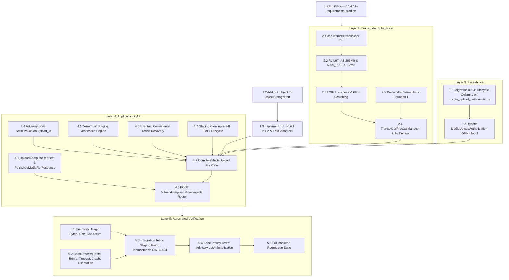

# Fansivibe — Stage 2 P0-4 Phase 3
# Upload Verification & Canonical Media Publication
## Technical Dependency Map & Execution Hierarchy

**Document Version:** 1.0.0  
**Date:** 2026-11-01  
**Status:** ARCHITECTURAL SPECIFICATION & DEPENDENCY HIERARCHY  
**Target:** `STAGE2-P0-4-PHASE-3: Upload Verification & Canonical Media Publication`  

---

## 1. High-Level Dependency Graph

The implementation of Phase 3 is structured into an acyclic dependency graph across five functional layers:
1. **Foundation & Runtime Layer** (Dependencies, Storage Port Protocol, Storage Adapter).
2. **Worker & Transcoding Subsystem** (Child Process CLI, Subprocess Orchestrator, Semaphore).
3. **Database Layer** (Migration 0034, Completion Metadata, Model Updates).
4. **Domain & API Service Layer** (Staging Verification, Promotion, Router & Schemas).
5. **Testing & Verification Layer** (Unit, Transcoding, Concurrency, and Regression Suites).



---

## 2. Detailed Component Dependency Matrix

| Stage | Component | Prerequisites (Hard Blockers) | Enables (Downstream Dependents) | Failure Blast Radius |
| :--- | :--- | :--- | :--- | :--- |
| **3.1A** | `requirements-prod.txt` (Pillow==10.4.0) | None | Transcoding CLI & Image processing | Container build failure if omitted |
| **3.1B** | `ObjectStoragePort.put_object` | Phase 1 Storage Port | `CompleteMediaUpload` publication to R2 | Blocks canonical media write |
| **3.1C** | `CloudflareR2StorageAdapter.put_object` | S3 `put_object` client method | Real R2 publication | Blocks production deployment |
| **3.1D** | `FakeStorageAdapter.put_object` | Storage Port Protocol | Automated unit & integration testing | Blocks CI / test suite |
| **3.2A** | `app.workers.transcoder` (CLI) | Pillow, `RLIMIT_AS` | Child process image transcoding | Isolated to individual upload |
| **3.2B** | `TranscoderProcessManager` | `app.workers.transcoder` | Asynchronous child invocation | Worker timeouts if mismanaged |
| **3.2C** | `BoundedSemaphore(1)` per worker | Python `asyncio` | Global cluster concurrency limit (max 8) | Container OOM if unconstrained |
| **3.3A** | Alembic Migration 0034 | Migration 0033 | Completion state persistence | Prevents durable completion record |
| **3.3B** | `MediaUploadAuthorization` ORM update | Migration 0034 | Model attributes in application code | SQLAlchemy query failures |
| **3.4A** | Zero-Trust Staging Verifier | Storage Port (`read_object`, `get_object_metadata`) | Safe byte validation before decoding | Prevents malicious payloads entering decoder |
| **3.4B** | `CompleteMediaUpload` Use Case | Verifier, Transcoder, Storage Port, Database | API route handler execution | Complete upload flow fails |
| **3.5A** | Pydantic Request/Response Schemas | Pydantic v2 | Input normalization & OpenAPI docs | HTTP 422 on malformed client payloads |
| **3.5B** | `POST /v1/media/uploads/{id}/complete` | Schemas, Use Case, `get_current_user_id` | Flutter client upload completion | Mobile client cannot publish wardrobe photos |
| **3.6A** | Tier 1 Unit Tests | Schemas, Verifier logic | Baseline code correctness | CI gate failure |
| **3.6B** | Tier 2 Child-Process Tests | Transcoder CLI, Pillow | Proves memory bounds & bomb protection | Prevents production DoS vulnerabilities |
| **3.6C** | Tier 3 PostgreSQL Concurrency Tests | Migration 0034, Disposable DB | Proves race-free atomic completion | Race conditions in multi-device uploads |
| **3.7** | Full Backend Regression Suite | All components | Release readiness sign-off | Blocks deployment gate |

---

## 3. Runtime Execution Sequence & Dataflow

The diagram below maps the precise runtime dataflow and component execution order during a single completion request:

```
[Client]                [FastAPI Router]            [CompleteMediaUpload]         [Child Transcoder]          [R2 Storage]         [PostgreSQL]
   │                           │                              │                           │                        │                    │
   │ 1. POST /complete         │                              │                           │                        │                    │
   ├──────────────────────────►│                              │                           │                        │                    │
   │                           │ 2. get_current_user_id       │                           │                        │                    │
   │                           │ 3. Check upload_id format    │                           │                        │                    │
   │                           │ 4. execute(...)              │                           │                        │                    │
   │                           ├─────────────────────────────►│                           │                        │                    │
   │                           │                              │ 5. pg_advisory_xact_lock  │                        │                    │
   │                           │                              ├───────────────────────────┼────────────────────────┼───────────────────►│ Acquire lock
   │                           │                              │ 6. SELECT auth record     │                        │                    │
   │                           │                              ├───────────────────────────┼────────────────────────┼───────────────────►│ Check OW-1
   │                           │                              │ 7. Check if PUBLISHED     │                        │                    │
   │                           │                              │    (If so, return MediaRef)                        │                    │
   │                           │                              │ 8. get_object_metadata    │                        │                    │
   │                           │                              ├───────────────────────────┼───────────────────────►│ HEAD staging_key   │
   │                           │                              │ 9. read_object (max 2MB)  │                        │                    │
   │                           │                              ├───────────────────────────┼───────────────────────►│ GET staging_key    │
   │                           │                              │ 10. Verify magic & SHA    │                        │                    │
   │                           │                              │ 11. Acquire Semaphore(1)  │                        │                    │
   │                           │                              │ 12. Spawn subprocess      │                        │                    │
   │                           │                              ├──────────────────────────►│                        │                    │
   │                           │                              │     (stdin: raw_bytes)    │                        │                    │
   │                           │                              │                           │ 13. setrlimit 256MB    │                    │
   │                           │                              │                           │ 14. Transpose EXIF     │                    │
   │                           │                              │                           │ 15. Strip GPS/EXIF     │                    │
   │                           │                              │                           │ 16. Resize Lanczos     │                    │
   │                           │                              │                           │ 17. Encode WebP Q85    │                    │
   │                           │                              │ 18. Read stdout           │                        │                    │
   │                           │                              │◄──────────────────────────┤                        │                    │
   │                           │                              │ 19. reap process (wait)   │                        │                    │
   │                           │                              │ 20. release Semaphore     │                        │                    │
   │                           │                              │ 21. put_object            │                        │                    │
   │                           │                              ├───────────────────────────┼───────────────────────►│ PUT canonical_key  │
   │                           │                              │ 22. object_exists         │                        │                    │
   │                           │                              ├───────────────────────────┼───────────────────────►│ HEAD canonical_key │
   │                           │                              │ 23. UPDATE status='published'                      │                    │
   │                           │                              ├───────────────────────────┼────────────────────────┼───────────────────►│ COMMIT & release lock
   │                           │                              │ 24. delete_object (async) │                        │                    │
   │                           │                              ├───────────────────────────┼───────────────────────►│ DELETE staging_key │
   │                           │ 25. Return Response DTO      │                           │                        │                    │
   │                           │◄─────────────────────────────┤                           │                        │                    │
   │ 26. 200 PublishedMediaRef │                              │                           │                        │                    │
   │◄──────────────────────────┤                              │                           │                        │                    │
```

---

## 4. Error and Exception Dependency Tree

Every potential failure maps to a deterministic HTTP status code, standardized error code, and automated recovery or cleanup procedure:

```
[Failure Point]                                 [HTTP Status]   [Error Code]            [Recovery / System Action]
├── Staging object absent in R2                 400             STAGING_NOT_FOUND       Client must retry PUT before /complete
├── Staging byte length is 0                    422             EMPTY_OBJECT            Delete staging object; reject
├── Staging byte length > 2MB                   422             OBJECT_TOO_LARGE        Delete staging object; reject
├── Invalid header magic bytes                  422             INVALID_SIGNATURE       Delete staging object; reject
├── Declared vs actual MIME mismatch            422             MIME_MISMATCH           Delete staging object; reject
├── Actual hash != client assertion             422             CHECKSUM_MISMATCH       Delete staging object; reject
├── Unauthenticated caller                      401             AUTHENTICATION_ERROR    Reject; zero storage/DB side-effects
├── Foreign user_id (OW-1 violation)            404             UPLOAD_NOT_FOUND        Reject with 404 (prevents ID enumeration)
├── Upload authorization > 24h old              410             UPLOAD_EXPIRED          Reject; client must request new authorization
├── Lock contention timeout (> 5.0s)            429             RATE_LIMITED            Return Retry-After: 5; client retries
├── Decoder dimension ceiling (>4096px / 12MP)  422             DIMENSION_EXCEEDED      Delete staging object; abort without load
├── Decompression bomb (>256MB VmPeak)          422             DECOMPRESSION_BOMB      Kernel MemoryError in child; reap PID; delete staging
├── Transcoder processing timeout (>5.0s)       500             TRANSCODING_TIMEOUT     Parent sends SIGKILL; reaps zombie; retryable
├── Transcoder unexpected crash / exit != 0     500             TRANSCODING_FAILED      Reap child; log error details; delete staging
├── R2 put_object network failure               503             STORAGE_ERROR           Transient; client retries /complete
├── PostgreSQL crash after canonical PUT        503             DATABASE_FAILURE        Canonical exists in R2; retry adopts existing blob
└── R2 delete_object staging failure            200 OK          (Logged as warning)     Non-blocking; swept by R2 24h lifecycle rule
```

---

## 5. Rollback & Decoupling Flow

If a defect or regression is discovered during Phase 3 rollout, individual stages can be rolled back cleanly without corrupting previously persisted Phase 2 authorizations or existing wardrobe records:

```
[Phase 3 Rollback Hierarchy]

Level 4 (API Surface Rollback):
  └── Unmount /complete route in backend/app/api/routers/media.py
      - Client receives 404; existing Phase 2 upload authorizations unaffected.
      - Zero database mutation required.

Level 3 (Database Rollback):
  └── Execute alembic downgrade 0033
      - Drops added columns from media_upload_authorizations.
      - media_upload_authorizations returns strictly to Phase 2 schema.
      - Zero existing wardrobe items, looks, or users affected.

Level 2 (Worker Subsystem Rollback):
  └── Remove app/workers/transcoder.py
      - Standalone script removed with zero dangling references.

Level 1 (Storage Port Rollback):
  └── Remove put_object from ObjectStoragePort protocol and adapters
      - Restores storage port strictly to Phase 1/Phase 2 contract.
```

---

## 6. Verification Checklist Before Phase 3 Coding Commences

- [x] Storage port extension (`put_object`) signature and error mapping formally defined.
- [x] Child-process architecture selected: Standalone subprocess CLI (`app.workers.transcoder`), eliminating Python 3.12 `fork` threading deadlock risk.
- [x] Empirical memory limits verified: 161.1 MB VmPeak on 12MP image, 256 MB `RLIMIT_AS` confirmed compatible with 94.9 MB headroom.
- [x] Complete 10-step completion lifecycle and OW-1 ownership boundaries specified.
- [x] Eventual consistency crash recovery sequence documented.
- [x] Additive Migration 0034 DDL, constraints, indexes, and downgrade paths documented.
- [x] 26-scenario test matrix mapped across unit, worker, API, and concurrency tiers.
- [x] 100% read-only inspection preserved: Zero source code modified, zero migrations executed, zero shared databases touched, zero cloud infrastructure contacted.
