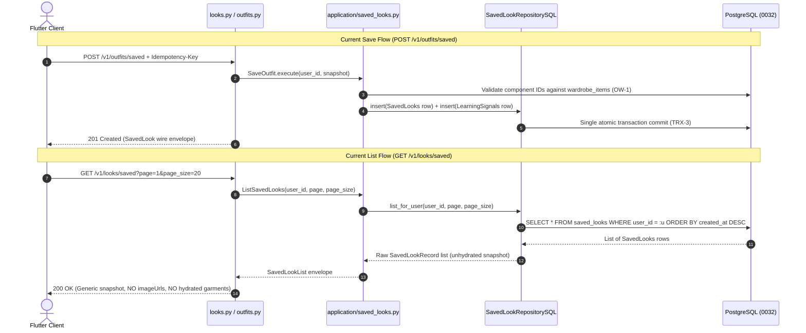
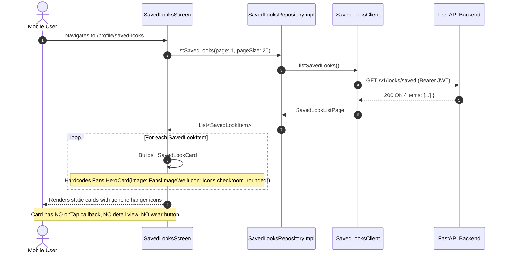
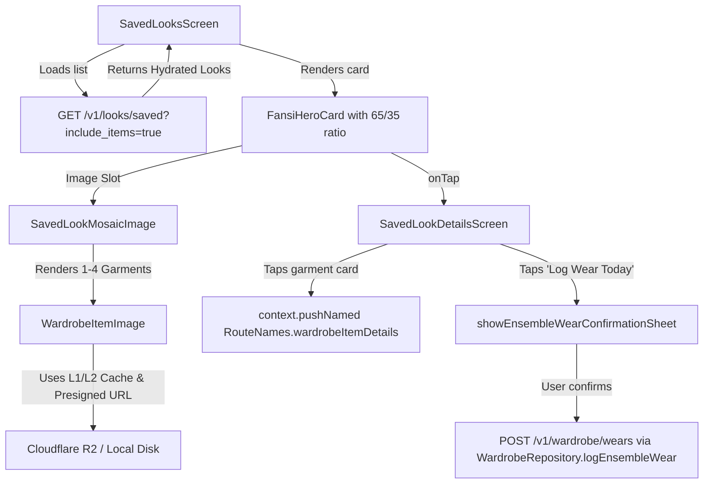
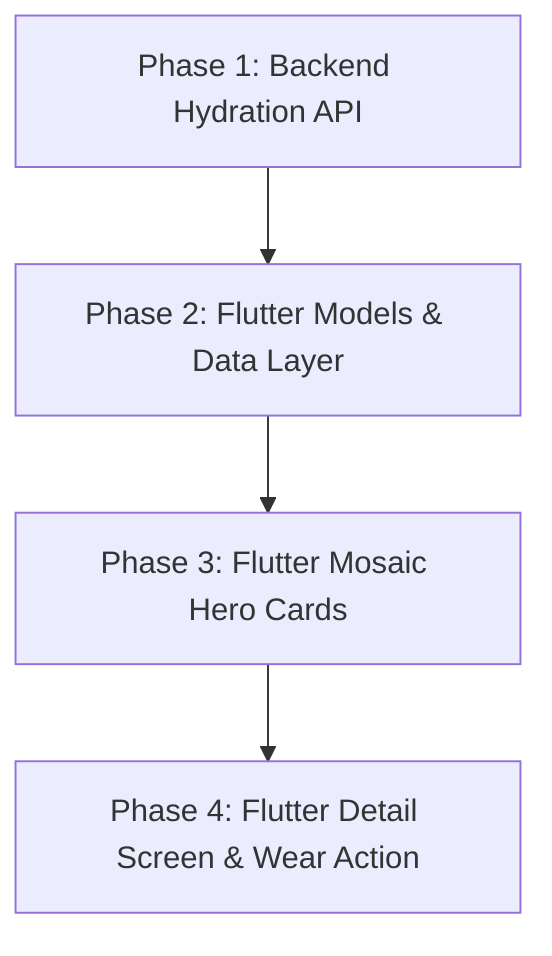

# STAGE 2 P1-2 — ENRICHED SAVED LOOK HYDRATION & WARDROBE LINKING
# PHASE 0 ARCHITECTURE & IMPLEMENTATION AUDIT REPORT

**Date:** 2026-11-02  
**Feature:** Milestone P1-2 (FEAT-15 Extension) — Enriched Saved Look Hydration & Wardrobe Linking  
**Status:** COMPLETE (100% Read-Only Architecture Audit & Implementation Plan)  
**Deliverable File:** `STAGE2_P1_2_PHASE0_ARCHITECTURE_AUDIT.md`  
**Verdict:** **READY FOR P1-2 IMPLEMENTATION**

---

## 1. Executive Summary

Milestone P1-2 upgrades the Fansivibe saved outfit archive from a static list of generic placeholder icons into an interactive, visually rich style lookbook. It closes the visual fidelity gap identified in the Stage 2 master audit (DEBT-02) and connects saved looks directly to real wardrobe items, cloud photos, wardrobe garment navigation, and one-tap wear logging.

This Phase 0 Architecture Audit inspects the complete vertical stack across backend and Flutter frontend. The inspection confirms:
1. **Zero Database Migrations Required:** All necessary tables (`saved_looks`, `wardrobe_items`, `wardrobe_wear_groups`, `wardrobe_wear_events`, `users`) already exist in PostgreSQL. Hydration is an additive read-side aggregation and wire-enrichment operation.
2. **Full Compatibility with Database Revision 0032:** P1-2 can be developed, tested, and operated safely on the current shared database revision `0032` without touching pending migrations `0033–0036`.
3. **Strict Compliance with Decision D10 Option A:** Guest users remain 100% device-local and ephemeral. Zero synthetic identities, zero database writes, and zero cross-account data leakage.
4. **Seamless Reuse of Existing Components:** P1-2 reuses the P0-1 wear logging workflow (`showEnsembleWearConfirmationSheet` / `WardrobeRepository.logEnsembleWear`), the P0-4 image pipeline (`WardrobeItemImage` / `WardrobeCacheManager`), and the Digital Atelier design system (`FansiHeroCard` 65/35 rule) without duplicate logic or architectural drift.

---

## 2. Exact Relevant Files

### 2.1 Backend Core Files
- `backend/app/infrastructure/db/models.py`
  - [`SavedLooks`](file:///home/tony/projects/fansivibe_v1_backup/backend/app/infrastructure/db/models.py#L222-L255): Persists `user_id`, `look_id`, `title`, `source_context`, `snapshot` (JSONB), `idempotency_key`, `created_at`.
  - [`WardrobeItems`](file:///home/tony/projects/fansivibe_v1_backup/backend/app/infrastructure/db/models.py#L420-L465): Stores user garments with `category_id`, `color_id`, `material_id`, `image_ref` (JSONB).
  - [`WardrobeWearGroups`](file:///home/tony/projects/fansivibe_v1_backup/backend/app/infrastructure/db/models.py) & [`WardrobeWearEvents`](file:///home/tony/projects/fansivibe_v1_backup/backend/app/infrastructure/db/models.py#L467-L490): Wear logging ledger.
- `backend/app/infrastructure/db/repositories.py`
  - [`SavedLookRepositorySQL`](file:///home/tony/projects/fansivibe_v1_backup/backend/app/infrastructure/db/repositories.py#L528-L660): Provides `insert`, `get_for_user`, `get_by_idempotency`, `list_for_user`, `get_outfit_coverage`, and `delete`.
  - [`WardrobeItemRepositorySQL`](file:///home/tony/projects/fansivibe_v1_backup/backend/app/infrastructure/db/repositories.py#L781-L983): Provides `get_by_id`, `get_for_user`, and batch queries by IDs.
  - [`WearEventRepositorySQL`](file:///home/tony/projects/fansivibe_v1_backup/backend/app/infrastructure/db/repositories.py#L985-L1030) & [`WearGroupRepositorySQL`](file:///home/tony/projects/fansivibe_v1_backup/backend/app/infrastructure/db/repositories.py): Wear event persistence.
- `backend/app/domain/ports/repositories.py`
  - Protocols: `SavedLookRepository`, `WardrobeItemRepository`, `WearEventRepository`.
  - Value Objects: `SavedLookRecord`, `WardrobeItemRecord`.
- `backend/app/api/schemas/saved_looks.py`
  - [`SaveLookRequest`](file:///home/tony/projects/fansivibe_v1_backup/backend/app/api/schemas/saved_looks.py#L16-L20): Request schema for save surface.
  - [`SavedLook`](file:///home/tony/projects/fansivibe_v1_backup/backend/app/api/schemas/saved_looks.py#L23-L31): Single saved look response schema.
  - [`SavedLookList`](file:///home/tony/projects/fansivibe_v1_backup/backend/app/api/schemas/saved_looks.py#L33-L40): Paginated envelope.
- `backend/app/application/saved_looks.py`
  - [`SaveRecommendation`](file:///home/tony/projects/fansivibe_v1_backup/backend/app/application/saved_looks.py#L76-L213): Idempotent save with snapshot validation.
  - [`ListSavedLooks`](file:///home/tony/projects/fansivibe_v1_backup/backend/app/application/saved_looks.py#L216-L234): Paginated saved looks query.
  - [`DeleteSavedLook`](file:///home/tony/projects/fansivibe_v1_backup/backend/app/application/saved_looks.py#L236-L261): Physical deletion under OW-1.
- `backend/app/api/routers/looks.py`
  - Routes: `GET /v1/looks/saved`, `POST /v1/looks/saved`, `DELETE /v1/looks/saved/{saved_look_id}`.
- `backend/app/api/routers/outfits.py`
  - Route: `POST /v1/outfits/saved`. Helper `_candidate_to_wire` demonstrating presigned GET URL enrichment.
- `backend/app/api/routers/wardrobe.py`
  - Helper `_to_wire` demonstrating presigned GET URL generation via `storage.generate_presigned_get_url(key, expires_in_s=900)`.
  - Route: `POST /v1/wardrobe/wears` (reused for wear logging).

### 2.2 Flutter Core Files
- `newproject/flutter_application_1/lib/features/profile/presentation/saved_looks_screen.dart`
  - [`SavedLooksScreen`](file:///home/tony/projects/fansivibe_v1_backup/newproject/flutter_application_1/lib/features/profile/presentation/saved_looks_screen.dart#L26-L375): Main list screen.
  - [`_SavedLookCard`](file:///home/tony/projects/fansivibe_v1_backup/newproject/flutter_application_1/lib/features/profile/presentation/saved_looks_screen.dart#L377-L529): Card rendering generic `FansiImageWell(icon: _icon, color: _color)`.
- `newproject/flutter_application_1/lib/features/profile/data/saved_looks_models.dart`
  - [`SavedLookItem`](file:///home/tony/projects/fansivibe_v1_backup/newproject/flutter_application_1/lib/features/profile/data/saved_looks_models.dart#L10-L106): Wire model parsing `snapshot` and `selectedItemIds`.
  - [`SavedLookListPage`](file:///home/tony/projects/fansivibe_v1_backup/newproject/flutter_application_1/lib/features/profile/data/saved_looks_models.dart#L109-L158): Paginated page model.
- `newproject/flutter_application_1/lib/features/profile/data/saved_looks_client.dart`
  - [`SavedLooksClient`](file:///home/tony/projects/fansivibe_v1_backup/newproject/flutter_application_1/lib/features/profile/data/saved_looks_client.dart#L17-L97): HTTP client for saved looks.
- `newproject/flutter_application_1/lib/features/profile/data/saved_looks_repository.dart`
  - [`SavedLooksRepository`](file:///home/tony/projects/fansivibe_v1_backup/newproject/flutter_application_1/lib/features/profile/data/saved_looks_repository.dart#L12-L18): Abstract contract.
  - [`SavedLooksRepositoryImpl`](file:///home/tony/projects/fansivibe_v1_backup/newproject/flutter_application_1/lib/features/profile/data/saved_looks_repository.dart#L21-L43): Backend implementation.
- `newproject/flutter_application_1/lib/features/wardrobe/presentation/widgets/wardrobe_widgets.dart`
  - [`WardrobeItemImage`](file:///home/tony/projects/fansivibe_v1_backup/newproject/flutter_application_1/lib/features/wardrobe/presentation/widgets/wardrobe_widgets.dart#L349-L417): Multi-tier image renderer (memory bytes -> local original -> cloud WebP presigned URL -> fallback well).
  - Helpers: `wardrobeIconFor`, `wardrobeSwatchFor`.
- `newproject/flutter_application_1/lib/features/wardrobe/presentation/ensemble_wear_confirmation_sheet.dart`
  - [`showEnsembleWearConfirmationSheet`](file:///home/tony/projects/fansivibe_v1_backup/newproject/flutter_application_1/lib/features/wardrobe/presentation/ensemble_wear_confirmation_sheet.dart#L30-L51): Multi-item wear logging review modal sheet.
  - [`EnsembleWearGarment`](file:///home/tony/projects/fansivibe_v1_backup/newproject/flutter_application_1/lib/features/wardrobe/presentation/ensemble_wear_confirmation_sheet.dart#L13-L27): Garment item DTO for wear logging.
- `newproject/flutter_application_1/lib/features/wardrobe/presentation/wardrobe_item_details_screen.dart`
  - [`WardrobeItemDetailsScreen`](file:///home/tony/projects/fansivibe_v1_backup/newproject/flutter_application_1/lib/features/wardrobe/presentation/wardrobe_item_details_screen.dart#L36-L806): Existing wardrobe garment detail screen (`RouteNames.wardrobeItemDetails`).
- `newproject/flutter_application_1/lib/features/media/presentation/wardrobe_cache_manager.dart`
  - [`WardrobeCacheManager`](file:///home/tony/projects/fansivibe_v1_backup/newproject/flutter_application_1/lib/features/media/presentation/wardrobe_cache_manager.dart#L17-L164): L1 memory and L2 disk cache manager with transparent download.
- `newproject/flutter_application_1/lib/app/router/route_names.dart` & `app_router.dart`
  - Centralized GoRouter routing configuration.

---

## 3. Current Saved-Look Data Model

### 3.1 Persistence Layer (`saved_looks` Table)
The database model in `app/infrastructure/db/models.py` (`SavedLooks`) consists of:
```sql
CREATE TABLE saved_looks (
    id UUID PRIMARY KEY DEFAULT gen_random_uuid(),
    user_id UUID NOT NULL REFERENCES users(id) ON DELETE CASCADE,
    look_id TEXT REFERENCES looks(code) ON DELETE SET NULL,
    title TEXT NOT NULL,
    source_context TEXT, -- 'hairstyle', 'grooming', 'outfit', 'daily'
    snapshot JSONB NOT NULL,
    idempotency_key TEXT NOT NULL,
    source_run_id UUID REFERENCES analysis_runs(id) ON DELETE SET NULL,
    created_at TIMESTAMPTZ NOT NULL DEFAULT now(),
    CONSTRAINT ck_saved_looks_title_len CHECK (char_length(title) BETWEEN 1 AND 200),
    CONSTRAINT ck_saved_looks_source_context CHECK (source_context IN ('hairstyle', 'grooming', 'outfit', 'daily')),
    CONSTRAINT uq_saved_looks_idempotency UNIQUE (user_id, idempotency_key)
);
```

### 3.2 Contents of `snapshot` (JSONB)
When an outfit is frozen via `POST /v1/outfits/saved` (or `POST /v1/looks/today/save`), the persisted `snapshot` contains:
```json
{
  "title": "Casual Summer Brunch",
  "matchScore": 0.92,
  "components": [
    {
      "id": "7b8e50ce-768a-4467-a7eb-6c9c748c0371",
      "name": "White Linen Shirt",
      "category": "tops",
      "color": "white",
      "material": "linen",
      "reason": "Breathable fabric suited for daytime."
    },
    {
      "id": "902d20e7-3b22-48cf-8d99-470d0fae60e8",
      "name": "Navy Chino Shorts",
      "category": "bottoms",
      "color": "navy",
      "material": "cotton",
      "reason": "Balances top tone cleanly."
    }
  ],
  "selectedItemIds": [
    "7b8e50ce-768a-4467-a7eb-6c9c748c0371",
    "902d20e7-3b22-48cf-8d99-470d0fae60e8"
  ],
  "reasons": ["Cohesive summer aesthetic", "Complimentary silhouette"],
  "colorHarmony": "Monochromatic navy and crisp white",
  "bodyFit": "Tailored relaxed",
  "occasionMatch": "Ideal for casual gatherings",
  "styleScoreImpact": "High harmony impact",
  "improvementSuggestion": "Pair with leather loafers"
}
```

### 3.3 Data Model Invariants
1. **Garment IDs vs. Snapshots:** Both are stored. Garment IDs are preserved inside `snapshot.selectedItemIds` and `snapshot.components[*].id`. Component attributes (`name`, `category`, `color`, `material`, `reason`) are stored in the frozen snapshot.
2. **Reconstruction Feasibility:** The snapshot contains 100% of the textual and structural data required to reconstruct the outfit.
3. **Absence of Stored Media URLs:** Neither `image_ref` nor presigned `imageUrl` are stored in `saved_looks`. This conforms strictly to Database Invariant PR-8 (temporary presigned URLs must never be persisted in PostgreSQL).
4. **Deleted Garment Handling:** There is **no foreign key** from `saved_looks` to `wardrobe_items`. If a user deletes a garment from `wardrobe_items`, the `saved_looks` row and snapshot remain intact. In accordance with DEC-013 ("stale/deleted wardrobe refs never hide a row; history survives"), the look continues to render, with the missing garment flagged as `isArchived: true`.
5. **Foreign Reference Rejection:** At save time (`POST /v1/outfits/saved` / `POST /v1/looks/saved`), `SaveOutfit` and `SaveRecommendation` execute an owner-scoped query `wardrobe_items.get_by_id(user_id=user_id, item_id=item_id)`. If any garment ID belongs to another user or does not exist, the save is rejected immediately with HTTP 404 NOT FOUND (OW-1, 404-not-403). Foreign garment IDs can never be saved.

---

## 4. Current Backend API Flow



### Analysis of Current Endpoints
- `POST /v1/outfits/saved` & `POST /v1/looks/saved`: Validates component IDs and commits the snapshot.
- `GET /v1/looks/saved`: Returns paginated raw snapshots. **Does not join against wardrobe items or generate presigned image URLs.**
- `GET /v1/looks/saved/{saved_look_id}`: **Does not exist yet** in `looks.py`, though `SavedLookRepositorySQL.get_for_user` is already implemented in the data layer.
- `DELETE /v1/looks/saved/{saved_look_id}`: Fully operational. Physically deletes the row under OW-1 and returns 204.

---

## 5. Current Flutter Rendering Flow



---

## 6. Root Cause of Generic Icons

The presence of generic icons (`Icons.checkroom_rounded` for outfits, `Icons.face_rounded` for hairstyles, `Icons.spa_rounded` for grooming) in `SavedLooksScreen` is caused by a compound 4-layer architectural boundary:

1. **Snapshot Omission of Media Keys:** The recommendation engines (`outfits.py`, `analysis_rules.py`) generate ensemble components containing text attributes (`id`, `name`, `category`, `color`, `material`). The `imageRef` (uploadId / canonical objectKey) was not embedded into component snapshots at generation time.
2. **Database Invariant PR-8:** Presigned GET URLs are ephemeral (15-minute validity) transport credentials. They cannot be stored in PostgreSQL `saved_looks.snapshot`.
3. **Backend List Non-Hydration:** `GET /v1/looks/saved` performs a direct `SELECT` on `saved_looks` without joining `wardrobe_items` or enriching the wire envelope with freshly minted presigned URLs.
4. **Flutter Presentation Hardcoding:** In `lib/features/profile/presentation/saved_looks_screen.dart` lines 429–432, `_SavedLookCard` passes `image: FansiImageWell(icon: _icon, color: _color)` directly to `FansiHeroCard`. No multi-image thumbnail mosaic was built, and no tap interaction was wired.

---

## 7. Proposed Implementation Architecture

### 7.1 Backend Hydration Architecture

#### Additive Wire Schema (`app/api/schemas/saved_looks.py`)
Add `HydratedGarmentItem` and attach optional `items` to `SavedLook`:
```python
class HydratedGarmentItem(BaseModel):
    id: str
    name: str
    category: str
    color: str
    material: Optional[str] = None
    isFavorite: bool = False
    imageRef: Optional[dict[str, Any]] = None
    imageUrl: Optional[str] = None
    fit: Optional[str] = None
    isArchived: bool = False  # True if deleted from user's current wardrobe

class SavedLook(BaseModel):
    id: UUID
    lookId: Optional[str] = None
    title: str
    sourceContext: Optional[str] = None
    snapshot: dict[str, Any]
    sourceRunId: Optional[UUID] = None
    createdAt: datetime
    items: Optional[list[HydratedGarmentItem]] = None  # Populated when include_items=True
```

#### Hydration Service (`app/application/saved_looks.py`)
Implement `HydrateSavedLookGarments`:
1. Collect all distinct garment IDs across the saved looks on the requested page.
2. Execute a **single batch SQL query**:
   ```python
   stmt = select(WardrobeItems).where(
       WardrobeItems.user_id == user_id,
       WardrobeItems.id.in_([UUID(gid) for gid in all_garment_ids])
   )
   active_items = {str(item.id): item for item in db.execute(stmt).scalars().all()}
   ```
3. For each garment found in `active_items`:
   - If `item.image_ref` contains an `objectKey`: call `await storage.generate_presigned_get_url(key=key, expires_in_s=900)`.
   - Build `HydratedGarmentItem` with `isArchived=False`.
4. For any garment ID in the snapshot that no longer exists in `active_items` (user deleted garment):
   - Gracefully construct `HydratedGarmentItem` using the frozen component attributes in the snapshot (`name`, `category`, `color`, `material`).
   - Flag `isArchived=True`, `imageUrl=None`.
5. For hairstyle/grooming looks: return `items=[]` without querying wardrobe.

#### Endpoint Expansion (`app/api/routers/looks.py`)
1. Extend `GET /v1/looks/saved`:
   ```python
   @router.get("/saved", response_model=SavedLookList)
   async def list_saved_looks(
       page: int = Query(default=1, ge=1),
       page_size: int = Query(default=20, ge=1, le=100),
       include_items: bool = Query(default=True),
       user_id: UUID = Depends(get_current_user_id),
       db: Session = Depends(get_db),
       storage: ObjectStoragePort = Depends(get_storage_adapter),
   ) -> SavedLookList:
   ```
2. Add `GET /v1/looks/saved/{saved_look_id}`:
   ```python
   @router.get("/saved/{saved_look_id}", response_model=SavedLook)
   async def get_saved_look(
       saved_look_id: UUID = Path(...),
       include_items: bool = Query(default=True),
       user_id: UUID = Depends(get_current_user_id),
       db: Session = Depends(get_db),
       storage: ObjectStoragePort = Depends(get_storage_adapter),
   ) -> SavedLook:
   ```
   Enforces OW-1: Returns 404 NOT FOUND for foreign or nonexistent look IDs.

### 7.2 Flutter Presentation Architecture



#### 1. Thumbnail Mosaic Widget (`SavedLookMosaicImage`)
Located in `features/profile/presentation/widgets/saved_look_mosaic_image.dart`:
- Fits inside the `FansiHeroCard` image area, strictly preserving the **65% image / 35% content card rule**.
- **1 item:** Single full-bleed image using `WardrobeItemImage`.
- **2 items:** 50/50 vertical split with a subtle 1px divider.
- **3 items:** 1 large left tile (50% width) + 2 vertically stacked right tiles (50% width).
- **4+ items:** 2x2 grid displaying the first 4 garments.
- **Fallback:** If look has no garments or images, renders `FansiImageWell(icon: _icon, color: _color)` without disruption.

#### 2. Dedicated Saved Look Detail Screen (`SavedLookDetailsScreen`)
Located in `features/profile/presentation/saved_look_details_screen.dart`:
- **Header:** Hero card with outfit title, match score badge (`FansiBadge`), occasion, and mood tags.
- **Components Section:** Lists all hydrated garment cards with photo (`WardrobeItemImage`), garment name, category, color, material, and selection reason.
- **Archived Notice:** If a garment is deleted from wardrobe (`isArchived: true`), displays an amber notice badge: *"Archived piece (no longer in wardrobe)"*.
- **Garment Linking:** Tapping an active garment card calls `context.pushNamed(RouteNames.wardrobeItemDetails, extra: garment.id)`, taking the user directly to the existing `WardrobeItemDetailsScreen`.
- **Log Wear Today Action:** Primary button at the bottom: *"Log Wear Today"*.
  - Calls `showEnsembleWearConfirmationSheet` passing active (non-archived) garments as `List<EnsembleWearGarment>`.
  - Reuses the existing P0-1 multi-item wear logging workflow and idempotency key generator.
- **Remove Look Action:** Secondary button: *"Remove from Saved Looks"*, calling `SavedLooksRepository.deleteSavedLook`.

#### 3. Route Registration
Register sub-route in `lib/app/router/app_router.dart` under `/profile/saved-looks`:
```dart
GoRoute(
  path: 'details',
  name: RouteNames.savedLookDetails,
  builder: (context, state) {
    final look = state.extra as SavedLookItem?;
    return look != null ? SavedLookDetailsScreen(look: look) : _missingDataScreen();
  },
),
```

---

## 8. Database Migration Requirement: NO

### Evidence
1. **Schema Inspection:**
   - Table `saved_looks` contains all necessary columns: `id`, `user_id`, `look_id`, `title`, `source_context`, `snapshot` (JSONB), `idempotency_key`, `created_at`.
   - Table `wardrobe_items` contains all necessary columns: `id`, `user_id`, `name`, `category_id`, `color_id`, `material_id`, `image_ref` (JSONB).
   - Tables `wardrobe_wear_groups` and `wardrobe_wear_events` contain all necessary columns for ensemble wear logging.
2. **Zero New Columns or Tables:**
   Hydration is a read-side query pattern:
   `saved_looks` -> extract UUIDs from `snapshot` -> `SELECT FROM wardrobe_items WHERE id IN (...)` -> generate presigned GET URLs -> serialize onto HTTP wire.
3. **Rollback & Safety:**
   Zero database mutations occur. Zero migration risk.

---

## 9. Revision 0032 Compatibility

### Current Database State
- `fansivibe`: Revision `0032`.
- `fansivibe_test`: Revision `0032`.
- Linear Repository Head: Revision `0036`.

### Compatibility Analysis
- **Can P1-2 be developed and tested safely on 0032?** **YES.**
  - All tables queried by saved-look hydration (`saved_looks`, `wardrobe_items`, `users`) and wear logging (`wardrobe_wear_groups`, `wardrobe_wear_events`) were created between migrations `0001` and `0014`. All exist in revision `0032`.
  - Storage URL signing via `ObjectStoragePort.generate_presigned_get_url(key)` is an out-of-band cryptographic HMAC calculation (or in-memory mock via `FakeStorageAdapter`) and executes zero database queries.
- **Which image-hydration paths DO require migration 0033?**
  - Migration 0033 introduced `media_upload_authorizations`.
  - If a presigned URL expires on the client after 15 minutes, `WardrobeCacheManager.getImage` contains a fallback refresh calling `_mediaClient.getDownloadUrl(uploadId: uploadId)`. This calls `GET /v1/media/url`.
  - `GET /v1/media/url` executes `SELECT FROM media_upload_authorizations`. On database revision `0032`, this query fails with `relation "media_upload_authorizations" does not exist`.
  - In addition, creating brand new media uploads (`POST /v1/media/uploads`) requires migration 0033.
- **Isolation Strategy for Testing:**
  - P1-2 backend tests will seed wardrobe items with synthetic `image_ref` objects containing `canonical_key` or `objectKey`.
  - Tests inject `FakeStorageAdapter`, which generates presigned URLs without touching the database.
  - Zero P1-2 hydration tests will invoke `POST /v1/media/uploads` or `GET /v1/media/url`, ensuring 100% clean test execution on revision `0032`.

---

## 10. Guest-Mode Behavior (Decision D10 Option A)

### Invariants Under D10 Option A
1. **Zero Database Writes:** Unauthenticated guests never write rows to `saved_looks`, `wardrobe_wear_groups`, or `wardrobe_wear_events`.
2. **Zero Synthetic Identities:** No fake guest UUIDs are inserted into PostgreSQL.
3. **Honest Empty State Maintained:** `SavedLooksScreen` continues to inspect `isGuestUser`. For guest users, it displays the honest empty state ("Looks you save will appear here.") with zero network calls and zero 401 errors.
4. **Sign-In Conversion Seams:**
   - If a guest attempts to save an outfit on `OutfitRecommendationScreen`: `promptGuestSignIn(context, action: 'Sign in to save looks. Browsing stays free.')`.
   - If a guest attempts to log a wear on `OutfitRecommendationScreen` or `SavedLookDetailsScreen`: `promptGuestSignIn(context, action: 'Sign in to log wears. Browsing stays free.')`.
5. **Local Wardrobe Hydration:** If a guest views an outfit recommendation or slot swap sheet, components are loaded device-locally from `LocalWardrobeRepository`.

---

## 11. Security & Privacy Risks

| Risk Area | Threat / Vector | Architectural Defense |
| :--- | :--- | :--- |
| **Cross-User Access (OW-1)** | User B requests User A's saved look via `GET /v1/looks/saved/{id}`. | Repository enforces `SavedLooks.id == id AND SavedLooks.user_id == caller_id`. Returns identical `404 NOT FOUND` (never 403) to prevent ID probing. |
| **Foreign Garment Poisoning** | User A saves an outfit containing User B's garment UUID in `snapshot`. | Save-time validation strictly queries `wardrobe_items.get_by_id(user_id=caller_id)`. Nonexistent or foreign IDs fail closed with HTTP 404. Furthermore, hydration queries `WHERE user_id == caller_id`, ensuring foreign items never hydrate. |
| **Presigned URL Exfiltration** | Long-lived presigned URLs leaked in logs or persisted in DB. | Presigned GET URLs are capped at 900 seconds (15 minutes). Database Invariant PR-8 is strictly enforced: presigned URLs are never written to PostgreSQL. |
| **Cross-Account Media Leak** | User A logs out; User B logs in on same device; User B sees User A's cached photos. | `AuthSession.clearSession()` invokes `WardrobeCacheManager.instance.clear()`, wiping all L1 memory and L2 disk caches on logout. |
| **Stale / Deleted Garment Failure** | User deletes a wardrobe item referenced in a saved look, causing server to 500 or crash. | Missing wardrobe items are caught gracefully during hydration and flagged as `isArchived: true` rather than raising errors or dropping the look. |

---

## 12. Testing Strategy

### 12.1 Backend Tests (`backend/tests/test_saved_look_hydration.py`)
1. `test_list_saved_looks_hydrates_garments`: Verifies `GET /v1/looks/saved?include_items=true` returns populated garment items with `imageUrl`.
2. `test_list_saved_looks_handles_deleted_garments`: Deletes a referenced wardrobe item and verifies hydration returns `isArchived: true` with preserved snapshot text and `imageUrl: null`.
3. `test_get_saved_look_detail_success`: Verifies `GET /v1/looks/saved/{id}` returns single hydrated look.
4. `test_get_saved_look_detail_ow1_cross_user_404`: Verifies User B requesting User A's saved look receives 404.
5. `test_get_saved_look_detail_unauthenticated_401`: Verifies missing token receives 401.
6. `test_saved_look_hydration_ignores_non_outfit_types`: Verifies hairstyle and grooming saved looks return `items: []` cleanly.
7. `test_saved_look_hydration_preserves_unhydrated_compat`: Verifies `include_items=false` returns `items: null` byte-compatible with existing schema.

### 12.2 Flutter Widget & Unit Tests (`test/saved_look_hydration_test.dart`)
1. `SavedLookItem.fromJson parses hydrated items`: Unit test verifying JSON deserialization of `items` and `isArchived`.
2. `SavedLooksScreen renders thumbnail mosaic`: Widget test verifying hero cards render `WardrobeItemImage` cells when hydrated items are present.
3. `SavedLooksScreen fallback to icon well`: Widget test verifying fallback to `FansiImageWell` when items have no photos or look is hairstyle/grooming.
4. `SavedLooksScreen card tap opens details`: Widget test verifying card tap navigates to `SavedLookDetailsScreen`.
5. `SavedLookDetailsScreen renders garment cards and archived badges`: Verifies all garments render with names and badges.
6. `SavedLookDetailsScreen garment tap navigates to wardrobe item`: Verifies tapping garment calls `context.pushNamed` with item ID.
7. `SavedLookDetailsScreen wear action opens confirmation sheet`: Verifies tapping "Log Wear Today" opens `EnsembleWearConfirmationSheet`.
8. `SavedLookDetailsScreen wear confirmation logs wear`: Verifies confirming wear invokes `WardrobeRepository.logEnsembleWear` and shows success message.
9. `SavedLookDetailsScreen remove look`: Verifies removing look invokes repository delete and pops route.
10. `Guest mode isolation`: Verifies guest user in `SavedLooksScreen` sees empty state without HTTP calls, and actions trigger `promptGuestSignIn`.

---

## 13. Implementation Sequence

The implementation of P1-2 can proceed in 4 strictly sequential, test-driven phases:



### Phase 1: Backend Hydration API
- Extend `app/api/schemas/saved_looks.py` with `HydratedGarmentItem` and `SavedLook.items`.
- Implement `HydrateSavedLookGarments` use case in `app/application/saved_looks.py` with batch query and presigned URL generation.
- Update `GET /v1/looks/saved` and add `GET /v1/looks/saved/{saved_look_id}` in `app/api/routers/looks.py`.
- Add backend test suite in `backend/tests/test_saved_look_hydration.py`.
- **Validation Gate:** All pytest tests passing against revision `0032`.

### Phase 2: Flutter Models & Data Layer
- Update `SavedLookItem` in `saved_looks_models.dart` to deserialize `items` as `List<HydratedGarmentItem>`.
- Update `SavedLooksClient` and `SavedLooksRepository` with `includeItems` parameter and `getSavedLook(id)`.
- Unit tests for model deserialization.
- **Validation Gate:** `flutter test test/saved_looks_models_test.dart` passing.

### Phase 3: Flutter Mosaic Hero Cards
- Implement `SavedLookMosaicImage` in `features/profile/presentation/widgets/saved_look_mosaic_image.dart` reusing `WardrobeItemImage`.
- Update `_SavedLookCard` in `saved_looks_screen.dart` to render the mosaic image within the 65% hero card area.
- Add `onTap` callback to navigate to `SavedLookDetailsScreen`.
- **Validation Gate:** Widget tests verifying mosaic rendering and tap handling.

### Phase 4: Flutter Detail Screen & Wear Action
- Build `SavedLookDetailsScreen` in `features/profile/presentation/saved_look_details_screen.dart`.
- Render hydrated garment cards with `WardrobeItemImage`, details, and archived indicators.
- Wire garment tap navigation to `RouteNames.wardrobeItemDetails`.
- Wire "Log Wear Today" to `showEnsembleWearConfirmationSheet` and `logEnsembleWear`.
- Register route `RouteNames.savedLookDetails` in `app_router.dart`.
- **Validation Gate:** Full widget test suite passing; `flutter analyze` 100% clean.

---

## 14. Out-of-Scope Dependencies

To maintain strict boundary isolation, the following areas are strictly out of scope for Milestone P1-2:
1. **P0-1 Wear Logging Engine:** Reused as a client consumer; no backend wear models, routes, or algorithms are modified.
2. **P0-4 Media Ingestion / Transcoding Subsystem:** Reused as-is; no modifications to transcoder workers or upload endpoints.
3. **P1-1 Outfit Component Swapping:** Reused as-is; swapping takes place in `OutfitRecommendationScreen` before saving.
4. **P1-3 Weather-Aware Recommendations:** Deferred to Milestone P1-3.
5. **Database Migrations:** Zero migrations authorized or required.

---

## 15. Remaining Blockers

- **Architectural Blockers:** **NONE.**
- **Database Blockers:** **NONE.**
- **External API Dependencies:** **NONE.**
- **Preconditions:** None required prior to implementation authorization.

---

## 16. Final Recommendation

# **READY FOR P1-2 IMPLEMENTATION**
