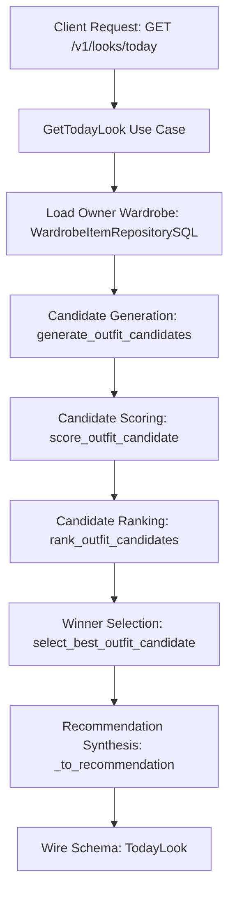
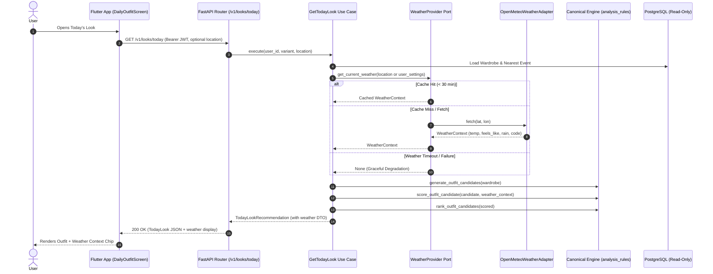

# STAGE 2 P1-3: PHASE 0 ARCHITECTURE AND FEASIBILITY AUDIT
## Weather-Aware Daily Looks

**Feature:** P1-3 — Weather-Aware Location Seeding for Daily Looks (FEAT-14 Extension)  
**Date:** 2026-11-02  
**Audit Scope:** 100% Read-Only Architecture, Data, Privacy, and Feasibility Audit  
**Status:** PHASE 0 COMPLETE — VERDICT: READY WITH PRECONDITIONS  
**Safety Invariants:** Zero application code modified, zero tests altered, zero database records modified, zero migrations created or run, zero external weather API calls made. All 87 modified and untracked repository files strictly preserved.

---

## 1. Executive Summary

This architecture and feasibility audit assesses the repository structure, canonical outfit recommendation pipeline, scoring engine rules, database schemas, and Flutter presentation layer to determine how to safely introduce **Weather-Aware Daily Looks (P1-3)** into Fansivibe.

### Key Audit Conclusions

1. **No Second Scoring Engine Needed (Critical Invariant Upheld):**
   Weather context can be directly integrated into the single canonical 12-term outfit scoring engine in [backend/app/domain/services/analysis_rules.py](file:///home/tony/projects/fansivibe_v1_backup/backend/app/domain/services/analysis_rules.py#L1921-L1978). Weather will enter as a soft scoring term `_weather_points(...)` inside `score_outfit_candidate(...)`. No parallel or duplicate recommendation engine is created or required.

2. **Zero Database Migrations Required:**
   The entire weather integration operates on existing schema constructs:
   - Daily outfit generation is strictly read/derive-only (TRX-2) and does not persist rows to a database table (DEC-017-A).
   - Saved looks store immutable JSONB snapshots in `saved_looks.snapshot` (TRX-3).
   - User location preferences (e.g., city, coarse latitude/longitude, temperature unit) can be stored in the existing `user_state.preferences['settings']` JSONB column via the established `update_settings` repository method (P0-3 precedent).
   - Garments already possess `category_id` and `material_id` foreign keys with existing seasonal mappings in `analysis_rules.py`.
   - Shared databases `fansivibe` and `fansivibe_test` remain untouched at revision `0032`, and the repository migration head remains strictly at `0036 (head)`.

3. **Privacy-First Geolocation Architecture:**
   Precise GPS coordinates (meter-level latitude/longitude) are unnecessary, privacy-invasive, and inappropriate for weather forecasts that operate on 1–10 km meteorological grid cells. The audit recommends a manual city selector as the primary option, with optional coarse location (~10 km resolution / 2 decimal places max). When location permission is denied or no city is configured, the system gracefully degrades to absent weather context without failing or displaying error dialogs.

4. **Weather is a Transient Hint, Never Authoritative (DEC-017-G Preserved):**
   Weather is an advisory input that adjusts soft candidate scores. Weather is never a hard exclusion veto that could block recommendations when wardrobe items are limited. If external weather services fail, time out, or return errors, the recommendation pipeline seamlessly falls back to the baseline canonical outfit derivation without weather claims (never returning HTTP 500 or 503 for weather alone).

5. **Guest Mode Isolation (Decision D10 Option A Preserved):**
   Guest users maintain zero server session tokens, make zero authenticated API calls to `/v1/looks/today`, and store any city preference strictly on-device in Flutter `LocalStorage.settings`. Navigating to `DailyOutfitScreen` renders the established `GuestSignInCard` sign-in prompt.

---

## 2. Verified Current Architecture

### 2.1 Canonical Outfit Recommendation Flow

Fansivibe derives daily looks through an established, deterministic 5-stage pipeline:



#### Detailed Stage Breakdown:
- **Stage 1 (Context Retrieval):** [backend/app/application/today.py:L156-L173](file:///home/tony/projects/fansivibe_v1_backup/backend/app/application/today.py#L156-L173) loads all wardrobe items owned by the authenticated caller via [WardrobeItemRepository.get_for_user](file:///home/tony/projects/fansivibe_v1_backup/backend/app/domain/ports/repositories.py#L650) (paginated in batches of 100, strictly scoped to `user_id` per OW-1). It loads the optional nearest upcoming event via [UserEventRepository.list_for_user](file:///home/tony/projects/fansivibe_v1_backup/backend/app/domain/ports/repositories.py#L425) (`event_date >= server_utc_today`, ordered `event_date ASC, event_time ASC NULLS LAST, id ASC`). It merges the nearest event type code with user-persisted `preferred_occasions` into `occasions`.
- **Stage 2 (Candidate Generation):** [backend/app/domain/services/analysis_rules.py:L1603-L1655](file:///home/tony/projects/fansivibe_v1_backup/backend/app/domain/services/analysis_rules.py#L1603-L1655) takes adapted wardrobe items and evaluates 5 legal skeletons defined in `CANDIDATE_SKELETONS`:
  1. `("tops", "bottoms")`
  2. `("tops", "bottoms", "footwear")`
  3. `("tops", "bottoms", "outerwear", "footwear")`
  4. `("tops", "bottoms", "footwear", "accessories")`
  5. `("tops", "bottoms", "outerwear", "footwear", "accessories")`
  Per category, owned items sort lexically, and at most the first 3 items (`_MAX_REPRESENTATIVES_PER_CATEGORY = 3`) participate. Tops and bottoms are mandatory; an empty category skips combinations for that skeleton. Generation produces up to a hard ceiling of 25 candidate combinations (`_MAX_CANDIDATES = 25`).
- **Stage 3 (Candidate Scoring):** [backend/app/domain/services/analysis_rules.py:L1921-L1978](file:///home/tony/projects/fansivibe_v1_backup/backend/app/domain/services/analysis_rules.py#L1921-L1978) `score_outfit_candidate` evaluates each candidate against canonical rules:
  - `_coverage_points`: +7.0 per filled category (up to 35.0 max).
  - `_color_points`: +5.0 for harmonious colors (all pairs contain a neutral color), -10.0 penalty for bright-bright conflicts.
  - `_material_points`: +5.0 if all known materials are natural.
  - `_season_points`: +5.0 if all pieces share a common seasonal intersection, -5.0 if disjoint. *(Note: evaluates internal harmony only, not external weather)*.
  - `_formality_points`: +5.0 for single dominant formality register.
  - `_occasion_points`: +5.0 if an occasion matches all members.
  - `_palette_points`: +5.0 soft match against preferred palette.
  - `_fit_points`: +5.0 soft match against observed fit evidence.
  - `candidate_preference_points`: +5.0 per item previously saved in an outfit (up to 15.0 max).
  - `candidate_favorite_points`: +5.0 per favorite garment (up to 15.0 max).
  - `candidate_feedback_points`: -6.0 to +6.0 based on liked/disliked outfits.
  - `candidate_wear_points`: 0.0 to +2.0 based on worn ensemble history.
  - `compose_candidate_score`: Clamps total score to integer 0–100.
- **Stage 4 (Ranking & Selection):** [backend/app/domain/services/analysis_rules.py:L1504-L1533](file:///home/tony/projects/fansivibe_v1_backup/backend/app/domain/services/analysis_rules.py#L1504-L1533) orders candidates by score descending, item count descending, and lexical item IDs ascending (tie-break). Winner is `ranked[0]` (or selected via stable SHA-256 seed).
- **Stage 5 (Formatting & Synthesis):** [backend/app/application/today.py:L272-L350](file:///home/tony/projects/fansivibe_v1_backup/backend/app/application/today.py#L272-L350) synthesizes title, component lists, grounded reasons, wardrobe context, and alternatives into [TodayLookRecommendation](file:///home/tony/projects/fansivibe_v1_backup/backend/app/domain/ports/repositories.py#L179-L209).

### 2.2 Flutter Presentation Layer

- **Home Screen Hero:** [newproject/flutter_application_1/lib/features/home/presentation/home_screen.dart:L623-L655](file:///home/tony/projects/fansivibe_v1_backup/newproject/flutter_application_1/lib/features/home/presentation/home_screen.dart#L623-L655) renders `ExistingUserHeroCard` with `TodaysLookData`. Currently, line 670 hardcodes `weather: ''` because weather was absent in v1.
- **Daily Outfit Detail Screen:** [newproject/flutter_application_1/lib/features/home/presentation/daily_outfit_screen.dart](file:///home/tony/projects/fansivibe_v1_backup/newproject/flutter_application_1/lib/features/home/presentation/daily_outfit_screen.dart) provides the dedicated editorial view, including match percentage, occasion pill, garment components, grounded "Why It Works" bullet cards, alternatives carousel, and action buttons ("Wear This Look", "Generate Another Look", "Save Look", "Try On").

---

## 3. Exact Repository File References

| File Path | Component / Symbol | Verification Status | Role in P1-3 Weather Architecture |
|---|---|---|---|
| `backend/app/domain/services/analysis_rules.py` | `score_outfit_candidate`, `_season_points`, `compose_candidate_score` | **VERIFIED** | Canonical scoring engine. Integration point for `_weather_points`. |
| `backend/app/domain/value_objects.py` | `OutfitCandidate`, `SeasonSuitability` | **VERIFIED** | Core domain value objects. Needs `WeatherContext` definition. |
| `backend/app/domain/ports/external.py` | `KnowledgeSource` | **VERIFIED** | Domain ports file. Location where `WeatherProvider` protocol must be declared. |
| `backend/app/domain/ports/repositories.py` | `TodayLookRecommendation` | **VERIFIED** | Application recommendation model. Needs optional `weather` field. |
| `backend/app/application/today.py` | `GetTodayLook`, `RegenerateTodayLook`, `_derive_today_look` | **VERIFIED** | Application derivation use cases. Ingests weather context. |
| `backend/app/api/schemas/today.py` | `TodayLook`, `TodayLookComponent` | **VERIFIED** | Pydantic wire models. Needs `weather: Optional[TodayLookWeather]`. |
| `backend/app/api/routers/looks.py` | `get_today_look`, `regenerate_today_look` | **VERIFIED** | FastAPI endpoints. Receives location/weather query params or invokes provider. |
| `backend/app/infrastructure/db/models.py` | `WardrobeItems`, `UserState`, `Materials` | **VERIFIED** | PostgreSQL tables. Wardrobe categories & materials, user settings JSONB. |
| `backend/app/infrastructure/db/repositories.py` | `UserStateRepositorySQL.update_settings` | **VERIFIED** | Atomically merges settings into `user_state.preferences['settings']`. |
| `backend/tests/test_m9_today_look_api.py` | `BANNED_KEYS`, `BANNED_REASON`, test suite | **VERIFIED** | Tests currently ban "weather" to enforce absence honesty. Must be updated. |
| `lib/features/home/data/today_look_models.dart` | `TodayLook`, `TodayLookComponent` | **VERIFIED** | Dart wire DTOs. Needs `weather` field parsing. |
| `lib/features/home/data/today_look_client.dart` | `TodayLookClient.getTodayLook` | **VERIFIED** | HTTP client. Needs optional query params for location/weather. |
| `lib/features/home/presentation/daily_outfit_screen.dart` | `DailyOutfitScreen`, `_buildHeroSection` | **VERIFIED** | Editorial UI. Integration point for weather context chip. |
| `lib/features/home/presentation/widgets/existing_user_home_widgets.dart` | `ExistingUserHeroCard` | **VERIFIED** | Home card UI. Integration point for home weather chip. |
| `lib/features/profile/presentation/settings_screen.dart` | `SettingsScreen` | **VERIFIED** | Profile settings UI. Integration point for city/location selector. |
| `pubspec.yaml` | Flutter dependencies | **VERIFIED** | Verified that no location or weather plugin is currently installed. |
| `backend/requirements-prod.txt` | Python dependencies | **VERIFIED** | Contains `httpx==0.28.1`. Supports async HTTP weather fetching without new libraries. |

---

## 4. Existing Reusable Components

The audit verified several existing systems that can be reused without modification:

1. **`httpx==0.28.1` Async HTTP Client:**
   Already pinned in [backend/requirements-prod.txt](file:///home/tony/projects/fansivibe_v1_backup/backend/requirements-prod.txt#L10). Can be utilized to construct an asynchronous weather client with zero additional Python dependencies.
2. **`user_state.preferences['settings']` JSONB Persistence:**
   Implemented in [backend/app/infrastructure/db/repositories.py:L499-L525](file:///home/tony/projects/fansivibe_v1_backup/backend/app/infrastructure/db/repositories.py#L499-L525) via PostgreSQL `jsonb_set`. Allows storing user location preferences (city name, country, coarse lat/long) with zero database migrations or schema alterations.
3. **`_MATERIAL_SEASON_MAP` and `_CATEGORY_SEASON_MAP`:**
   Already defined in [backend/app/domain/services/analysis_rules.py:L831-L854](file:///home/tony/projects/fansivibe_v1_backup/backend/app/domain/services/analysis_rules.py#L831-L854). Directly maps all 16 canonical materials and 5 categories to seasons (`spring`, `summer`, `fall`, `winter`).
4. **`CANDIDATE_SKELETONS` Layering Architecture:**
   Already generates combinations with and without outerwear (`outerwear_ids`). Allows the scoring engine to promote outerwear when cold/raining and demote outerwear when hot without modifying candidate generation.
5. **Flutter Glass Container & Typography System:**
   `_glassPill` and `_garmentTag` in [daily_outfit_screen.dart:L780-L862](file:///home/tony/projects/fansivibe_v1_backup/newproject/flutter_application_1/lib/features/home/presentation/daily_outfit_screen.dart#L780-L862) already provide the exact Digital Atelier aesthetic needed to render weather chips.
6. **`LocalStorage.settings` (Flutter):**
   Already implemented in [lib/shared/utils/local_storage.dart](file:///home/tony/projects/fansivibe_v1_backup/newproject/flutter_application_1/lib/shared/utils/local_storage.dart). Allows guests to persist their chosen city locally on device without server synchronization.

---

## 5. Weather Integration Gaps

| Capability | Current Repository Status | Gap Description |
|---|---|---|
| **Weather API Integration** | **NOT FOUND** | Zero weather clients, ports, or API integrations exist. |
| **Location Services / GPS** | **NOT FOUND** | No location plugins (`geolocator`, `location`) in `pubspec.yaml`; no location permissions in `AndroidManifest.xml` or `Info.plist`. |
| **User Location Preference** | **PARTIALLY VERIFIED** | `update_settings` can store location JSONB, but no UI exists for city selection. |
| **Weather Caching** | **NOT FOUND** | No in-memory or Redis/PostgreSQL weather cache exists. |
| **Background Refresh** | **NOT FOUND** | No scheduled jobs or background tasks for weather refresh exist. |
| **Weather Error / Timeout Handling** | **NOT FOUND** | No specific weather timeout or retry logic exists. |
| **Offline Weather Fallback** | **VERIFIED** | System is designed to function cleanly without weather context (honest absence per DEC-017-G). |

### Data Field Utility Assessment

Not all weather parameters are relevant to wardrobe selection. The audit classifies required meteorological fields:

| Weather Field | Direct Styling Utility | Recommended Action | Justification |
|---|---|---|---|
| **Temperature (°C / °F)** | **CRITICAL** | **USE IN SCORING** | Directly governs thermal requirements: outerwear necessity, sleeve length, heavy vs light fabrics. |
| **Feels-Like / Apparent Temp** | **HIGH** | **USE IN SCORING (PREFERRED OVER RAW TEMP)** | Accounts for wind chill and humidity; reflects actual human thermal sensation much better than ambient dry-bulb temperature. |
| **Precipitation / Rain Probability** | **CRITICAL** | **USE IN SCORING** | Directly dictates rain protection: promotes waterproof/resistant outerwear, boots, penalizes water-vulnerable fabrics (suede, silk) and light canvas shoes. |
| **Weather Condition Code (WMO)** | **HIGH** | **USE IN SCORING & UI** | WMO codes (0=clear, 1-3=cloudy, 51-67=rain, 71-77=snow, etc.) provide instant semantic categorization and display icons/text. |
| **Wind Speed** | **MODERATE** | **SECONDARY SCORING** | High winds (>30 km/h) penalize light loose layers and promote windbreakers/structured outerwear. |
| **Humidity** | **LOW** | **OMIT FROM SCORING** | Humidity primarily influences grooming/hair styling rather than clothing; its thermal effect is already captured in Feels-Like temperature. |
| **UV Index** | **LOW** | **OMIT FROM MVP** | Useful in the future for sunglasses/hat accessories, but non-essential for daily clothing ensemble ranking. |
| **Forecast Timestamp / Is Day** | **MODERATE** | **USE FOR FRESHNESS CHECK** | Essential to prevent stale cache usage (>3 hours) and ensure daylight vs night appropriateness. |

---

## 6. Privacy and Location Assessment

### 6.1 Regulatory & Architectural Constraints
- Fansivibe processes personal wardrobe and appearance photos. Under GDPR/CCPA and privacy-first guidelines, location data must be strictly minimized.
- Precise GPS coordinates (e.g., latitude/longitude down to 6 decimal places, ~0.1m accuracy) expose the user's exact home or office building.
- Meteorological grid models (e.g., ECMWF, NOAA, Open-Meteo) operate on grid resolutions of 1 km to 11 km. Providing meter-level GPS adds zero meteorological precision.

### 6.2 Recommended Privacy-Conscious Design
1. **Manual City Selection as Default:**
   Users can search and choose a city (e.g. "Chicago, IL", "London, UK", "Tokyo, Japan") in Settings. The centroid coordinates (rounded to 2 decimal places, ~1.1 km resolution) and city name are saved.
2. **Optional Coarse Geolocation:**
   If device location is requested in the future:
   - Request `ACCESS_COARSE_LOCATION` (Android) / `kCLLocationAccuracyKilometer` (iOS) only.
   - Truncate coordinates to 2 decimal places before transmission.
3. **Graceful Fallback on Permission Denial:**
   If location permission is denied or no city is selected:
   - The app displays NO error banner or blocking dialog.
   - The recommendation engine derives outfits based on style profile, preferences, and events alone.
   - The weather chip is omitted cleanly from the UI (DEC-017-G).
4. **Guest Mode Isolation:**
   Guest location is stored in Flutter `LocalStorage.settings` only and is never transmitted to PostgreSQL.

---

## 7. Garment and Wardrobe Data Assessment

### 7.1 Existing PostgreSQL Schema
In [backend/app/infrastructure/db/models.py:L420-L465](file:///home/tony/projects/fansivibe_v1_backup/backend/app/infrastructure/db/models.py#L420-L465), table `wardrobe_items` defines:
- `id`: UUID (PK)
- `user_id`: UUID (FK `users.id`)
- `name`: Text
- `category_id`: Text (FK `wardrobe_categories.code`)
- `color_id`: Text (FK `colors.code`)
- `material_id`: Text, nullable (FK `materials.code`)
- `is_favorite`: Boolean
- `fit`: Text, nullable
- `fit_confidence`: Float, nullable
- `image_ref`: JSONB, nullable

### 7.2 Taxonomy Analysis
- **Categories:** Exactly 5 canonical codes (`tops`, `bottoms`, `outerwear`, `footwear`, `accessories`). There are no subcategories in the database.
- **Materials:** 16 canonical codes (`cotton`, `linen`, `wool`, `cashmere`, `silk`, `denim`, `leather`, `suede`, `canvas`, `polyester`, `velvet`, `knit`, `jersey`, `tweed`, `corduroy`, `fleece`).
- **Season Suitability:**
  In `analysis_rules.py`:
  - `spring`: `cotton`, `linen`
  - `summer`: `cotton`, `linen`, `silk`
  - `fall`: `wool`, `cashmere`
  - `winter`: `heavy_wool`, `leather`, `fleece`

### 7.3 Data Gaps & Heuristic Bridge (No Migration Needed)
| Attribute Needed | Database Column Exists? | Recommended Derivation Heuristic |
|---|---|---|
| **Warmth / Insulation** | **NO** | Derived from category (`outerwear` = thermal layer) and material (`wool`, `cashmere`, `fleece`, `tweed`, `corduroy` = high warmth; `linen`, `silk`, `cotton` = breathable/light). |
| **Layering Level** | **NO** | Derived from candidate skeleton structure (`tops` = base; `outerwear` = mid/outer layer). |
| **Rain Resistance** | **NO** | Derived from material and category: `leather`, `polyester` outerwear = rain-suitable; `suede`, `silk`, `canvas` = rain-vulnerable (penalized during precipitation). |
| **Missing Materials** | **N/A** | `material_id` is often `NULL` on user-added items. When `material_id` is missing, the engine evaluates category season defaults (`_CATEGORY_SEASON_MAP`) and treats material warmth as neutral (0.0). Missing data never incurs a penalty. |

---

## 8. Proposed Architecture and Data Flow



---

## 9. Minimum Backend/API Changes

### 9.1 Domain Layer
1. In [backend/app/domain/value_objects.py](file:///home/tony/projects/fansivibe_v1_backup/backend/app/domain/value_objects.py):
   Define `WeatherContext`:
   ```python
   @dataclass(frozen=True)
   class WeatherContext:
       temperature_c: float
       apparent_temperature_c: float
       precipitation_probability: float  # 0.0 - 100.0
       is_raining: bool
       weather_code: int                # WMO weather code
       condition_text: str              # e.g., "Partly Cloudy", "Rain"
       city_name: Optional[str] = None
       timestamp: Optional[datetime] = None
   ```
2. In [backend/app/domain/ports/external.py](file:///home/tony/projects/fansivibe_v1_backup/backend/app/domain/ports/external.py):
   Define `WeatherProvider` protocol:
   ```python
   class WeatherProvider(Protocol):
       async def get_weather(
           self, *, latitude: float, longitude: float, city: Optional[str] = None
       ) -> Optional[WeatherContext]: ...
   ```
3. In [backend/app/domain/ports/repositories.py](file:///home/tony/projects/fansivibe_v1_backup/backend/app/domain/ports/repositories.py):
   Add `weather: Optional[dict[str, Any]] = None` to `TodayLookRecommendation`.

### 9.2 Decision Engine Scoring
In [backend/app/domain/services/analysis_rules.py](file:///home/tony/projects/fansivibe_v1_backup/backend/app/domain/services/analysis_rules.py):
Add `_weather_points(members: list, weather: Optional[WeatherContext]) -> float`:
- If `weather is None`: returns `0.0` (byte-identical neutral scoring).
- Temperature Brackets (Apparent Temp):
  - **Cold (< 10°C):** Candidates with `outerwear` receive `+5.0`; candidates with heavy materials (`wool`, `cashmere`, `fleece`, `corduroy`) receive `+3.0`; light materials (`linen`, `silk`) receive `-5.0`.
  - **Mild (10°C – 18°C):** Light layering favored (`+2.0`).
  - **Warm (18°C – 23°C):** Baseline neutral.
  - **Hot (> 23°C):** Candidates with `outerwear` receive `-8.0`; candidates with breathable materials (`linen`, `cotton`, `silk`) receive `+4.0`; heavy materials receive `-6.0`.
- Precipitation (Rain/Snow):
  - If `weather.is_raining` or `precipitation_probability >= 40%`:
    - Outerwear receives `+4.0`.
    - Vulnerable materials (`suede`, `silk`, `canvas`) receive `-5.0`.
    - Footwear: Leather/boots favored (`+2.0`).
- Returns bounded adjustment clamped within `[-10.0, +10.0]`.
- Extend `score_outfit_candidate`:
  ```python
  def score_outfit_candidate(
      candidate: OutfitCandidate,
      items_by_id=None,
      preferred_item_ids: Optional[FrozenSet[str]] = None,
      preferred_occasions=None,
      preferred_palette: Optional[str] = None,
      preferred_fit: Optional[str] = None,
      feedback_context: Optional[FeedbackContext] = None,
      weather_context: Optional[WeatherContext] = None,
  ) -> OutfitCandidate:
  ```

### 9.3 API Router & Wire Schemas
- In [backend/app/api/schemas/today.py](file:///home/tony/projects/fansivibe_v1_backup/backend/app/api/schemas/today.py):
  Add `TodayLookWeather`:
  ```python
  class TodayLookWeather(BaseModel):
      temperatureC: float
      temperatureF: float
      condition: str
      icon: str
      city: Optional[str] = None
      summary: str  # e.g., "14°C • Rain in Seattle"
  ```
  Add `weather: Optional[TodayLookWeather] = None` to `TodayLook`.
- In [backend/app/api/routers/looks.py](file:///home/tony/projects/fansivibe_v1_backup/backend/app/api/routers/looks.py):
  Allow optional query params on `GET /v1/looks/today` and `POST /v1/looks/today`:
  - `city: Optional[str] = None`
  - `lat: Optional[float] = None`
  - `lon: Optional[float] = None`
  If omitted, backend checks `user_state.preferences['settings']['weather_location']`. If absent or weather service fails, returns `TodayLook` with `weather=None`.

---

## 10. Flutter Integration Proposal

### 10.1 Presentation Updates
1. **Daily Outfit Detail Screen:**
   In [daily_outfit_screen.dart](file:///home/tony/projects/fansivibe_v1_backup/newproject/flutter_application_1/lib/features/home/presentation/daily_outfit_screen.dart):
   - In `_buildHeroSection` bottom tag row: If `look.weather != null`, render weather chip alongside occasion tag using `_garmentTag(look.weather!.summary, icon: Icons.cloud_outlined)`.
   - In `_buildWhyItWorks`: If weather influenced the recommendation, add a grounded explanation item (e.g., `"Selected warm outerwear for 10°C & rain in Seattle"`).
2. **Home Screen Hero Card:**
   In [home_screen.dart:L670](file:///home/tony/projects/fansivibe_v1_backup/newproject/flutter_application_1/lib/features/home/presentation/home_screen.dart#L670):
   - Replace `weather: ''` with `weather: look.weather?.summary ?? ''`.
   - In [existing_user_home_widgets.dart:L311-L330](file:///home/tony/projects/fansivibe_v1_backup/newproject/flutter_application_1/lib/features/home/presentation/widgets/existing_user_home_widgets.dart#L311-L330):
     Render the weather chip in the hero card header when `data.weather.isNotEmpty`.
3. **Settings Screen (City Selector):**
   In [settings_screen.dart](file:///home/tony/projects/fansivibe_v1_backup/newproject/flutter_application_1/lib/features/profile/presentation/settings_screen.dart):
   - Add a "Weather Location" tile.
   - Tapping opens a simple modal allowing the user to search or type a city name (e.g., "Seattle", "London", "Paris").
   - Saves to `UserProfileRepository.updateSettings({'weather_location': {'city': cityName, 'lat': lat, 'lon': lon}})` for authenticated users, and `LocalStorage.settings` for guests.

---

## 11. Testing Strategy

### 11.1 Backend Test Coverage Requirements
1. **Temperature Brackets:**
   - Freezing (< 5°C): Assert candidate with outerwear scores higher than identical candidate without outerwear.
   - Hot (> 25°C): Assert candidate without outerwear scores higher than candidate with heavy outerwear.
2. **Precipitation:**
   - Rain (> 50%): Assert suede items penalized, boots and outerwear boosted.
3. **Missing Weather Degradation:**
   - With `weather_context=None`, assert score is byte-identical to current baseline scoring.
4. **Missing Garment Metadata:**
   - Items with `material_id=None` do not crash and degrade to neutral scoring.
5. **Weather Provider Failure:**
   - Injected network timeout / HTTP 500 from weather service results in 200 OK `TodayLook` with `weather=None` (never 500/503).
6. **M9 Honesty Test Reconciliation:**
   - Update `test_m9_today_look_api.py` to allow genuine weather fields when weather context is provided, while continuing to assert absence when no weather provider data is available.

### 11.2 Flutter Test Coverage Requirements
1. **Weather Chip Rendering:**
   - Verify `DailyOutfitScreen` displays weather pill when `TodayLook.weather` is non-null.
   - Verify `DailyOutfitScreen` renders cleanly without layout overflow when `TodayLook.weather` is null.
2. **Home Screen Hero Card:**
   - Verify `ExistingUserHeroCard` displays weather string when present.
3. **Guest Mode Isolation:**
   - Verify guest users accessing `DailyOutfitScreen` receive `GuestSignInCard` without making weather or look network requests.
4. **Settings Screen:**
   - Verify changing city updates local storage and dispatches settings patch.

---

## 12. Risks and Dependencies

| Risk Item | Severity | Mitigation Strategy |
|---|---|---|
| **External Weather API Latency / Outage** | High | Enforce strict 1.5s timeout on weather HTTP calls. Implement 30-minute in-memory cache. Degrade to neutral recommendation without weather if request fails. |
| **Over-Scoring Weather (Overriding Occasion/Style)** | High | Bound total weather score adjustment to `[-10.0, +10.0]` within the existing 0–100 budget. Weather is advisory, never a hard constraint. |
| **Rate Limiting on Free Weather API** | Medium | Cache weather responses by geohash/rounded coordinates for 30 minutes. A cluster of users in the same city shares cached weather data. |
| **Garments with Missing Material Attributes** | Medium | Fall back to category-level season heuristics. Never penalize a garment solely for having `material_id = NULL`. |
| **Test Suite Breakage (`BANNED_KEYS` in M9)** | Medium | Systematically update `test_m9_today_look_api.py` to test both states: (1) weather present when requested, (2) weather absent when omitted. |

---

## 13. Migration Assessment

- **Database Migrations Needed:** **NONE**.
- **PostgreSQL DDL Changes:** **NONE**.
- **Alembic Revisions Added:** **NONE**.
- **Shared DB State:** `fansivibe` and `fansivibe_test` remain completely untouched at migration revision `0032`.
- **Repository Linear Head:** Maintained strictly at `0036 (head)`.

---

## 14. Implementation Phases & Acceptance Criteria

```mermaid
gantt
    title P1-3 Implementation Phases
    dateFormat  X
    axisFormat  Day %d
    section Phase 1
    Weather Port & Open-Meteo Adapter       :p1, 0, 1
    section Phase 2
    Canonical Engine Weather Scoring       :p2, 1, 2
    section Phase 3
    Backend API & Schema Integration       :p3, 2, 3
    section Phase 4
    Flutter Presentation & Settings UI     :p4, 3, 4
    section Phase 5
    Regression & End-to-End Validation     :p5, 4, 5
```



### Phase 1: Weather Provider Port & In-Memory Adapter
- Define `WeatherContext` in `value_objects.py`.
- Define `WeatherProvider` protocol in `ports/external.py`.
- Implement `OpenMeteoWeatherAdapter` in `app/infrastructure/external/weather.py` using `httpx` with 1.5s timeout and 30-minute LRU cache.
- Acceptance: Unit tests verify Open-Meteo response parsing, timeout handling, and caching.

### Phase 2: Canonical Scoring Engine Extension
- Implement `_weather_points` in `analysis_rules.py`.
- Extend `score_outfit_candidate` with optional `weather_context`.
- Acceptance: Unit tests verify cold, hot, rain, and neutral scenarios. 0% regression on existing scoring when weather is omitted.

### Phase 3: Backend API & Use Case Integration
- Update `GetTodayLook` and `RegenerateTodayLook` in `app/application/today.py`.
- Add `TodayLookWeather` to `app/api/schemas/today.py`.
- Update `GET /v1/looks/today` in `app/api/routers/looks.py`.
- Update `test_m9_today_look_api.py` test suite.
- Acceptance: 100% passing backend tests.

### Phase 4: Flutter Presentation & Location Settings
- Extend `TodayLook` model in `today_look_models.dart`.
- Update `DailyOutfitScreen` to display weather chip and grounded weather explanation.
- Update `ExistingUserHeroCard` on Home Screen.
- Add City Selector in `SettingsScreen`.
- Acceptance: 100% passing widget tests; clean visual layout.

### Phase 5: Regression & Acceptance Audit
- Run full backend test suite (`pytest`).
- Run full Flutter test suite (`flutter test`).
- Execute `flutter analyze` (0 warnings).
- Produce final audit and acceptance report.

---

## 15. Final Acceptance Questions & Explicit Answers

1. **Can Fansivibe implement weather-aware recommendations without creating a second scoring engine?**  
   **YES.** Weather context integrates cleanly into `score_outfit_candidate(...)` in `analysis_rules.py` as an additional advisory term `_weather_points(...)`.

2. **Can the feature work without mandatory precise-location permission?**  
   **YES.** Manual city selection (or coarse coordinates rounded to ~10 km) is completely sufficient. Permission denial degrades gracefully to standard recommendation.

3. **Can the initial version work without database migrations?**  
   **YES.** Settings are persisted in existing JSONB columns; daily looks are derived ephemerally; garments use existing categories and materials.

4. **Can authenticated and guest users both use the feature safely?**  
   **YES.** Authenticated users use account settings and backend endpoints; guests store city in local storage and receive standard sign-in prompts on account-backed actions.

5. **What exact files and components need modification?**  
   - Backend: `ports/external.py`, `value_objects.py`, `analysis_rules.py`, `ports/repositories.py`, `application/today.py`, `schemas/today.py`, `routers/looks.py`, `tests/test_m9_today_look_api.py`.
   - Flutter: `today_look_models.dart`, `today_look_client.dart`, `daily_outfit_screen.dart`, `home_screen.dart`, `existing_user_home_widgets.dart`, `settings_screen.dart`.

6. **What are the highest-risk integration points?**  
   - External weather API latency and outages.
   - Over-weighting weather at the expense of user occasion or style preferences.
   - Banned keys assertion conflict in `test_m9_today_look_api.py`.

7. **What must be completed before implementation begins?**  
   - Founder alignment on Open-Meteo as the initial weather provider.
   - Founder approval of Phase 0 audit and authorization to proceed with Phase 1.

---

## 16. Final Readiness Recommendation

### Overall Verdict: **READY WITH PRECONDITIONS**

The Fansivibe codebase is fully prepared for Weather-Aware Daily Looks (P1-3). The canonical scoring engine, wardrobe taxonomy, settings persistence, and Flutter UI components offer clean, non-disruptive integration seams.

**Preconditions for Implementation:**
1. Founder approval of the Open-Meteo provider choice and privacy-conscious city selector model.
2. Formal sign-off on the Phase 1–5 implementation roadmap.
3. Explicit instruction to begin Phase 1.
