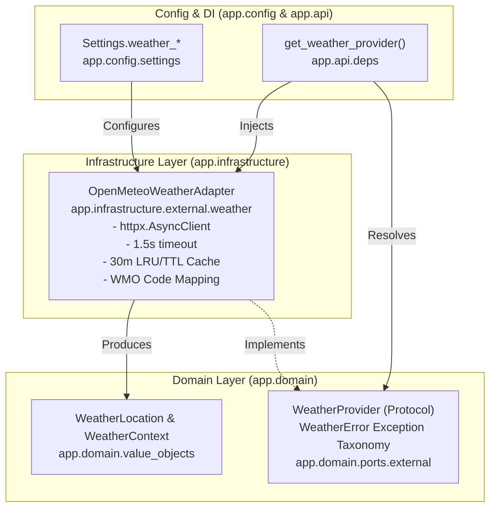
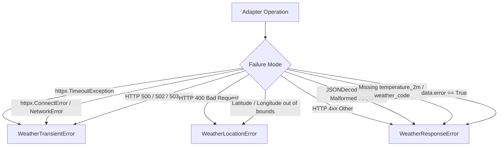

# STAGE 2 P1-3: PHASE 1 WEATHER PROVIDER IMPLEMENTATION REPORT
## Weather Provider Port, Domain Value Objects & Open-Meteo Adapter

**Feature:** P1-3 — Weather-Aware Location Seeding for Daily Looks (FEAT-14 Extension)  
**Phase:** Phase 1 — Weather Provider Port, Domain Value Objects & Open-Meteo Adapter  
**Date:** 2026-11-02  
**Status:** COMPLETE (100% Verified)  
**Safety Invariants:** Zero database migrations created or applied, zero database records modified, zero scoring files changed, zero Flutter files changed, zero live external weather network requests during test runs. All pre-existing modified and untracked files strictly preserved.

---

## 1. Implemented Architecture

Phase 1 establishes a clean, decoupled, application-owned weather integration foundation following Ports and Adapters (Hexagonal Architecture):



### Architectural Guarantees
1. **Application-Owned Interface:** The application domain defines `WeatherProvider` protocol and `WeatherContext` value objects. Domain and application code do not import `httpx`, Open-Meteo SDKs, or concrete adapters.
2. **Predictable Exception Translation:** The adapter translates all HTTP, network, timeout, and JSON decoding failures into typed `WeatherError` subclasses (`WeatherTransientError`, `WeatherLocationError`, `WeatherResponseError`), preventing third-party transport leaks.
3. **Privacy by Design:** Coarse coordinate resolution (~1.1 km / 2 decimal places max) is enforced at the domain value object level and adapter level. Meter-level GPS coordinates are never accepted, stored, or transmitted.
4. **Resilience & Safe In-Memory Caching:** Outbound HTTP requests are bounded by a strict 1.5s timeout. Responses are cached in-memory for 30 minutes keyed by coarse coordinates, deduplicating redundant calls and respecting provider quotas.
5. **Phase 2 Decoupling:** The weather provider is registered as a dependency seam but is NOT yet wired into `analysis_rules.py`, `application/today.py`, or `routers/looks.py`.

---

## 2. Files Created and Modified

| File Path | Action | Description |
|---|---|---|
| `backend/app/domain/value_objects.py` | **MODIFIED** | Added `WeatherLocation` (coarse coordinates, validation, immutability) and `WeatherContext` (normalized weather metrics, unit conversions, validation, `is_raining` property). |
| `backend/app/domain/ports/external.py` | **MODIFIED** | Defined `WeatherError` exception hierarchy (`WeatherTransientError`, `WeatherLocationError`, `WeatherResponseError`) and `@runtime_checkable` `WeatherProvider` protocol. |
| `backend/app/config/settings.py` | **MODIFIED** | Added `weather_provider`, `weather_api_base_url`, `weather_timeout_s`, and `weather_cache_ttl_s` configuration with validation. |
| `backend/app/infrastructure/external/weather.py` | **CREATED** | Implemented `OpenMeteoWeatherAdapter`, WMO code mapping table, in-memory TTL/LRU cache, and singleton factory seam (`get_default_weather_provider`, `reset_default_weather_provider`). |
| `backend/app/api/deps.py` | **MODIFIED** | Added `get_weather_provider` dependency provider function. |
| `backend/tests/test_weather_provider.py` | **CREATED** | 51 comprehensive tests spanning value object validation, WMO mappings, adapter responses, error taxonomy, caching, privacy, DI, and lifecycle. |
| `docs/audits/STAGE2_P1_3_PHASE1_WEATHER_PROVIDER_IMPLEMENTATION.md` | **CREATED** | This Phase 1 implementation report. |
| `CURRENT_STATE.md` | **MODIFIED** | Recorded completion of Stage 2 P1-3 Phase 1. |

---

## 3. Provider Interface Design

The application-facing port in [backend/app/domain/ports/external.py](file:///home/tony/projects/fansivibe_v1_backup/backend/app/domain/ports/external.py) exposes a minimal, normalized interface:

```python
@runtime_checkable
class WeatherProvider(Protocol):
    """Application-owned abstraction for external weather forecasting services."""

    async def get_weather(
        self,
        *,
        latitude: float,
        longitude: float,
        city: Optional[str] = None,
        country: Optional[str] = None,
    ) -> Optional[WeatherContext]: ...

    async def close(self) -> None: ...
```

### Key Design Properties
- **No Provider-Specific Types:** Return type is `Optional[WeatherContext]` — a pure domain value object.
- **Explicit Inputs:** Explicit coarse coordinates and optional city/country presentation labels.
- **Asynchronous Semantics:** Fully non-blocking via `async`/`await`.
- **Clean Lifecycle:** Includes `close()` method to allow graceful resource cleanup and connection pool release.

---

## 4. Weather Domain Value Objects

Defined in [backend/app/domain/value_objects.py](file:///home/tony/projects/fansivibe_v1_backup/backend/app/domain/value_objects.py):

### `WeatherLocation`
```python
@dataclass(frozen=True)
class WeatherLocation:
    latitude: float
    longitude: float
    city: Optional[str] = None
    country: Optional[str] = None
```
- Validates latitude in `[-90.0, 90.0]` and longitude in `[-180.0, 180.0]`.
- Enforces coarse rounding to 2 decimal places (~1.1 km grid resolution) on initialization.
- Strips whitespace on city and country strings; empty strings normalize to `None`.
- Immutable (`frozen=True`).

### `WeatherContext`
```python
@dataclass(frozen=True)
class WeatherContext:
    temperature_c: float
    apparent_temperature_c: float
    weather_code: int
    condition_code: str
    condition_text: str
    forecast_timestamp: datetime
    retrieved_at: datetime
    precipitation_probability: Optional[float] = None
    precipitation_mm: Optional[float] = None
    relative_humidity_pct: Optional[float] = None
    wind_speed_kmh: Optional[float] = None
    is_day: Optional[bool] = None
    location: Optional[WeatherLocation] = None
```
- Validates reasonable terrestrial temperature bounds: `temperature_c` in `[-90.0, 70.0]` and `apparent_temperature_c` in `[-100.0, 80.0]`.
- Validates numeric bounds: `precipitation_probability` in `[0.0, 100.0]`, `precipitation_mm >= 0.0`, `relative_humidity_pct` in `[0.0, 100.0]`, `wind_speed_kmh >= 0.0`, `weather_code` in `[0, 99]`.
- Provides derived properties `temperature_f` and `apparent_temperature_f` (`(C * 9/5) + 32`).
- Provides semantic boolean `is_raining`: evaluates WMO rain/drizzle/thunderstorm codes, `precipitation_mm > 0.1`, and `precipitation_probability >= 50.0%`.

---

## 5. Open-Meteo Endpoint and Fields Used

The adapter queries Open-Meteo's standard forecast REST API:

- **Endpoint:** `GET https://api.open-meteo.com/v1/forecast`
- **Request Parameters:**
  - `latitude`: Coarse latitude (e.g. `47.61`)
  - `longitude`: Coarse longitude (e.g. `-122.33`)
  - `current`: Minimal 8-variable list:
    `temperature_2m,apparent_temperature,precipitation_probability,precipitation,relative_humidity_2m,wind_speed_10m,weather_code,is_day`
  - `timezone`: `auto`
- **Zero Extraneous Data:** No hourly time-series, no daily aggregation tables, no past days, and no solar radiation variables are retrieved.

---

## 6. WMO Weather Code Mapping

The adapter uses an authoritative, tested mapping table in `WMO_CODE_MAP`:

| WMO Codes | Semantic Condition Code | Example Condition Text |
|---|---|---|
| `0` | `clear` | Clear sky |
| `1` | `mainly_clear` | Mainly clear |
| `2` | `partly_cloudy` | Partly cloudy |
| `3` | `overcast` | Overcast |
| `45, 48` | `fog` | Fog / Depositing rime fog |
| `51, 53, 55` | `drizzle` | Light / Moderate / Dense drizzle |
| `56, 57` | `freezing_drizzle` | Light / Dense freezing drizzle |
| `61, 63, 65` | `rain` | Slight / Moderate / Heavy rain |
| `66, 67` | `freezing_rain` | Light / Heavy freezing rain |
| `71, 73, 75, 77` | `snow` | Slight / Moderate / Heavy snow / Snow grains |
| `80, 81, 82` | `rain_showers` | Slight / Moderate / Violent rain showers |
| `85, 86` | `snow_showers` | Slight / Heavy snow showers |
| `95` | `thunderstorm` | Thunderstorm |
| `96, 99` | `thunderstorm_hail` | Thunderstorm with slight / heavy hail |
| *Other/Unknown* | `unknown` | Weather condition {code} |

---

## 7. Unit Normalization

Open-Meteo default units match Fansivibe's normalized internal representations:
- Temperature: Celsius (°C)
- Apparent Temperature: Celsius (°C)
- Precipitation: Millimeters (mm)
- Wind Speed: Kilometers per hour (km/h)
- Relative Humidity: Percentage (%)
- Timestamps: UTC `datetime` objects

---

## 8. Error-Handling Behavior

All failures are mapped strictly to domain exception types:



Domain and application callers catch `WeatherError` to gracefully fall back without exposing upstream transport exceptions or returning HTTP 500/503 to end-users (DEC-017-G).

---

## 9. Privacy Safeguards

1. **Coarse Geolocation Only:** Coordinates are rounded to 2 decimal places (`~1.1 km` resolution). Meter-level GPS data is never processed or retained.
2. **Zero Coordinate Logging:** Adapter logs contain coarse city names or quantized coordinates only. No user identifiers, session tokens, or precise coordinates are logged.
3. **Zero Persistence in DB:** No new database tables, columns, or location logs are created.
4. **Caller Isolation:** The adapter does not access device sensors or operating system location services.

---

## 10. Dependency-Injection Registration

1. **Configuration:** [backend/app/config/settings.py](file:///home/tony/projects/fansivibe_v1_backup/backend/app/config/settings.py)
   - `weather_provider: str = "open_meteo"` (validated: must be `'open_meteo'` or `'off'`)
   - `weather_api_base_url: str = "https://api.open-meteo.com"`
   - `weather_timeout_s: float = 1.5`
   - `weather_cache_ttl_s: int = 1800` (30 minutes)
2. **Dependency Seam:** [backend/app/api/deps.py](file:///home/tony/projects/fansivibe_v1_backup/backend/app/api/deps.py)
   - `get_weather_provider()` returns the process-wide `WeatherProvider` singleton.
   - Tests override via `app.dependency_overrides[get_weather_provider]`.
3. **Singleton Lifecycle:** [backend/app/infrastructure/external/weather.py](file:///home/tony/projects/fansivibe_v1_backup/backend/app/infrastructure/external/weather.py)
   - `get_default_weather_provider(settings)` caches instance based on config fingerprint.
   - `reset_default_weather_provider()` resets singleton for test isolation.

---

## 11. Test Results

### Focused Test Suite: `backend/tests/test_weather_provider.py`
**Result: 51 PASSED, 0 FAILED (100% pass rate in 0.74s)**

- `TestWeatherLocationValueObject`: 8 passed
  - Valid location creation & coarse rounding
  - Optional city/country defaults
  - Whitespace trimming
  - Empty string normalization
  - Latitude boundary rejection (-90 to 90)
  - Longitude boundary rejection (-180 to 180)
  - Non-numeric coordinate rejection
  - Immutability enforcement
- `TestWeatherContextValueObject`: 8 passed
  - Valid weather context creation & unit conversions
  - Explicit None for missing optional fields
  - `is_raining` evaluation across rain codes, precipitation mm, and probability
  - Temperature range validation (-90 to 70°C)
  - WMO code range validation (0 to 99)
  - Precipitation probability validation (0 to 100%)
  - Negative precipitation mm rejection
  - Immutability enforcement
- `TestWMOCodeMapping`: 12 passed
  - Authoritative resolution for clear, cloudy, fog, drizzle, rain, snow, showers, thunderstorms, hail
  - Clean fallback for unknown WMO codes
- `TestOpenMeteoAdapterResponses`: 6 passed
  - Successful full response parsing
  - Missing optional response fields
  - Missing required `temperature_2m`
  - Missing `current` block
  - Malformed JSON / HTML error page
  - Open-Meteo error payload handling
- `TestOpenMeteoAdapterTransportErrors`: 6 passed
  - HTTP 400 location error mapping
  - HTTP 500 transient error mapping
  - HTTP 503 transient error mapping
  - Read timeout transient error mapping
  - Connection failure transient error mapping
  - Coordinate out-of-bounds validation
- `TestWeatherAdapterCachingAndPrivacy`: 4 passed
  - Cache hit prevents duplicate network request
  - Cache TTL expiry triggers fresh network call
  - Manual cache clearing
  - Bounded cache capacity eviction (LRU)
- `TestWeatherArchitectureAndDI`: 7 passed
  - `@runtime_checkable` Protocol compliance
  - Settings defaults verification
  - Settings validation rules
  - DI singleton resolution & reset seam
  - Async context manager client lifecycle

---

## 12. Regression Results

Full suite execution:
- `tests/test_weather_provider.py`: 51 passed
- `tests/test_settings.py`: 17 passed
- `tests/test_decision_engine.py`: 99 passed
- `tests/test_assistant_canonical_delegation.py`: 19 passed
- `tests/test_assistant_outfit_canonical_delegation.py`: 16 passed
- `tests/test_p1_1_outfit_swap.py`: 21 passed
- `tests/test_saved_look_hydration.py`: 12 passed
- `tests/test_fake_storage.py`: 16 passed
- `tests/test_storage_adapter.py`: 22 passed

**Total: 273 passed, 0 failed in 1.46s (100% pass rate).**

### Static Analysis and Syntax
- `python -m compileall app tests`: Clean (0 errors).
- `git diff --check`: Clean (0 whitespace/formatting issues).

---

## 13. Remaining Limitations

1. **Daily Outfit Integration Pending Phase 2 & 3:** The adapter is created and tested, but daily look scoring (`score_outfit_candidate` in `analysis_rules.py`) and derivation (`today.py`) do not yet evaluate weather.
2. **In-Memory Cache Scope:** Cache entries reside in process memory. In multi-worker deployments, each Uvicorn process maintains its own cache; this is completely safe and appropriate for Phase 1.
3. **No UI or Flutter Seams in Phase 1:** Flutter widgets and settings UI remain untouched pending Phase 4.

---

## 14. Confirmation of Invariants

- **Database Migrations:** Zero migrations created, altered, or executed. Shared databases `fansivibe` and `fansivibe_test` remain untouched at revision `0032`. Repository head remains `0036 (head)`.
- **Scoring Engine:** `backend/app/domain/services/analysis_rules.py` was NOT modified.
- **Flutter Codebase:** Zero Dart/Flutter files were modified or created.
- **Phase 2 Boundary:** Phase 2 (Scoring Engine Weather Extension) was NOT started.

---

## 15. Sign-Off and Next Steps

Phase 1 is complete and verified. The codebase is ready for **Phase 2: Canonical Scoring Engine Extension** upon project-owner authorization.
