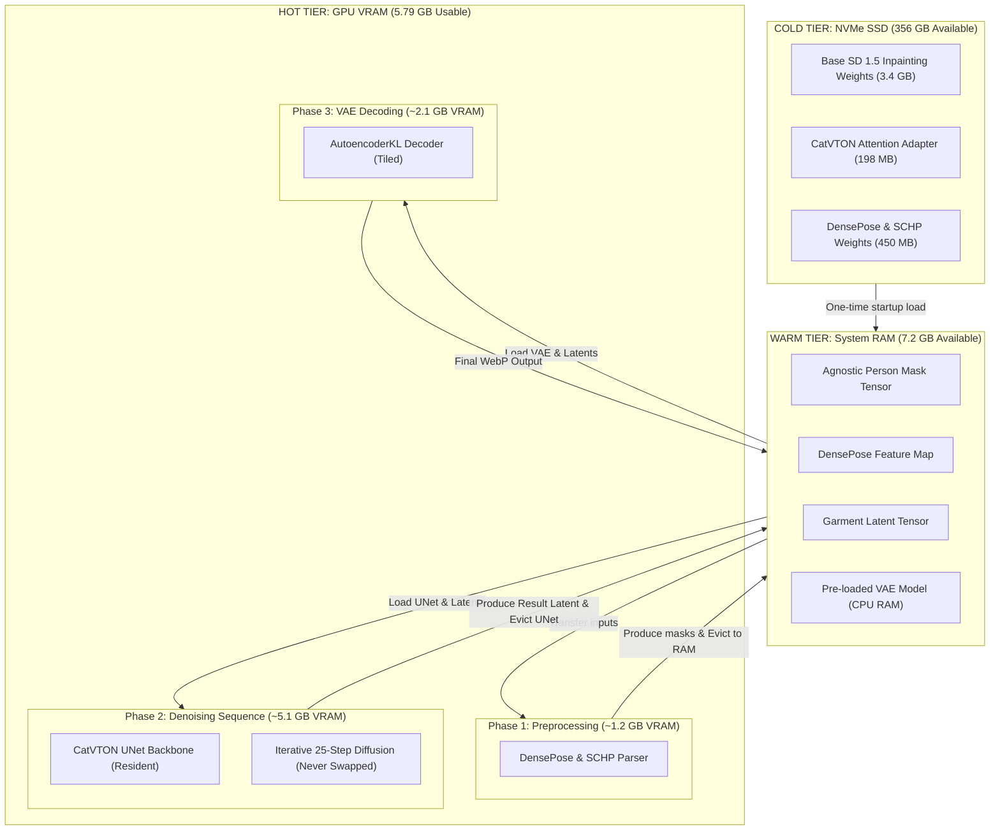
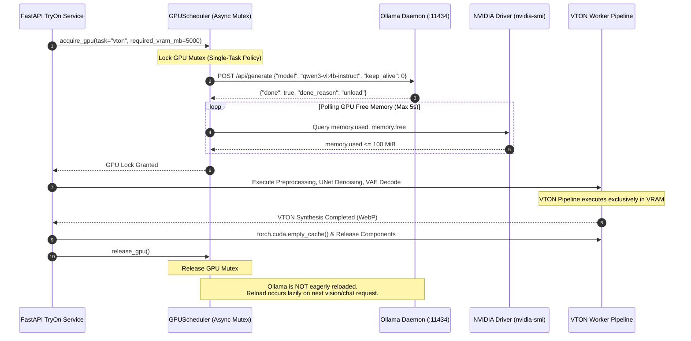
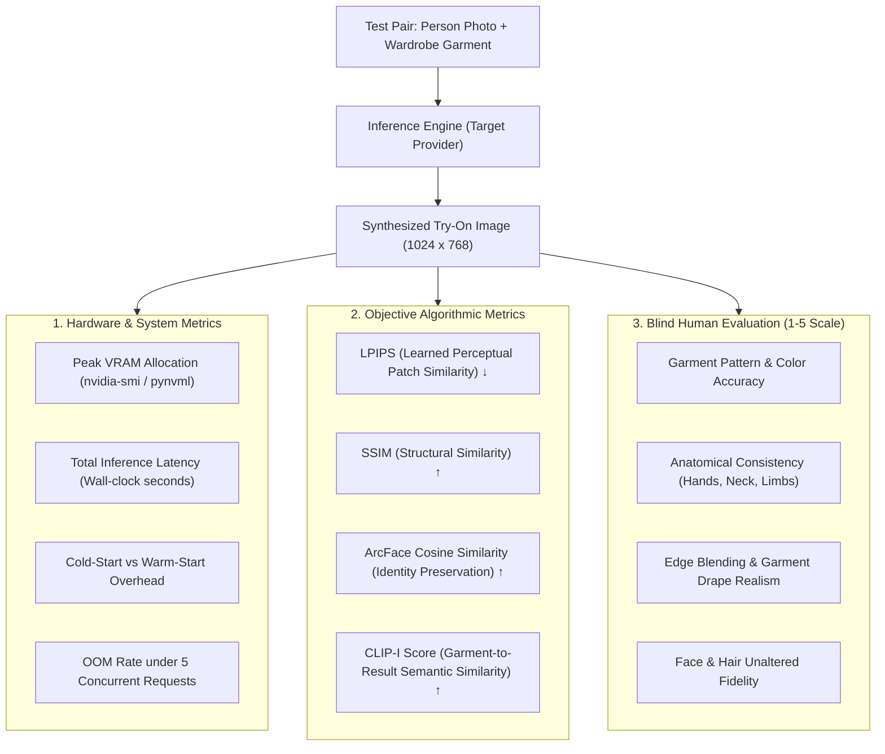

# Fansivibe — VTON Model Feasibility Study
## Candidate Selection, Hardware Compatibility & Architecture Assessment

**Project:** Fansivibe  
**Task:** Virtual Try-On (VTON) Model Feasibility Study  
**Date:** November 10, 2026  
**Auditor:** AI Assistant (Engineering Audit Team)  
**Classification:** Research + Read-Only Repository Audit (Strict Non-Destructive)

---

## Executive Summary

Fansivibe requires a high-fidelity Virtual Try-On (VTON) system enabling users to visualize clothing items from their digital wardrobe on their uploaded photograph while preserving identity, body proportions, pose, garment textures, logos, and silhouette.

This feasibility study investigates six leading diffusion-based VTON candidates (**CatVTON**, **IDM-VTON**, **StableVITON**, **OOTDiffusion**, **Kolors-VTON**, and **Leffa**) against the baseline hardware environment (**NVIDIA RTX 3050 Laptop GPU, 6GB VRAM, 15GB System RAM, Intel Core i7-13650HX**).

### Core Findings:
1. **Local Hardware Infeasibility for Production Diffusion:**
   - The **NVIDIA RTX 3050 Laptop GPU (6GB VRAM)** cannot reliably host modern high-resolution ($1024 \times 768$) diffusion VTON models.
   - **IDM-VTON** (~4.5B–5.5B parameters, dual-UNet SDXL backbone) demands $\ge 16\text{ GB}$ VRAM and triggers instant CUDA Out-Of-Memory (OOM) errors on 6GB VRAM.
   - **CatVTON** (~899M parameters, SD 1.5 inpainting backbone) is the *only* candidate capable of executing on 6GB VRAM, but requires severe compromises: downscaling resolution to $512 \times 384$ or $768 \times 576$, sequential CPU offloading, VAE tiling, and zero concurrent GPU processes. Cold-to-warm latency is 20–35 seconds per single garment, with substantial thermal and OOM instability under user load.
2. **Ollama Coexistence Conflict:**
   - Ollama's active vision model (**Qwen3-VL 4B**) consumes $\sim 3.0\text{ GB}$ VRAM when loaded.
   - Concurrent execution of Ollama and any diffusion VTON model on 6GB VRAM is mathematically impossible ($3.0\text{ GB} + 4.5\text{–}6.0\text{ GB} > 6.0\text{ GB}$). Ollama must be evicted via `POST /api/generate` (`keep_alive: 0`) before any local VTON attempt.
3. **Commercial Licensing Roadblock:**
   - **Every major open-weights academic VTON model (CatVTON, IDM-VTON, StableVITON, OOTDiffusion) is licensed under CC BY-NC-SA 4.0 (Non-Commercial).** They are **NOT CLEARED** for a commercial product.
   - While **Leffa** publishes its repository under MIT, its checkpoints were pre-trained on VITON-HD and DressCode, academic datasets explicitly restricted to non-commercial research, creating severe dataset copyright contamination.
   - Self-hosting an open-weights model for Fansivibe commercially would require negotiating commercial licenses with the copyright holders or training a proprietary model on commercially licensed photography.
4. **Architectural Recommendation — Hybrid Cloud Inference (Option C):**
   - The production architecture for Fansivibe must be **Hybrid**: the local/core FastAPI backend manages authentication, wardrobe metadata, Cloudflare R2 presigned media URLs, and job queues, while asynchronous remote GPU workers (Serverless GPU such as Modal, RunPod, or Fal.ai / Fashn.ai managed API) execute the diffusion pipeline on high-memory hardware (NVIDIA A10G 24GB or RTX 4090 24GB) in 4–8 seconds at $1024 \times 768$ resolution.

---

## 1. Hardware Baseline Verification

The physical hardware baseline was directly inspected via read-only system utilities on November 10, 2026.

| Component | Reported Specification | Verified Measurement | Status | Audit Command & Evidence |
|---|---|---|---|---|
| **GPU** | NVIDIA RTX 3050 Laptop GPU | NVIDIA GeForce RTX 3050 Laptop GPU | **VERIFIED** | `nvidia-smi`: Bus-Id `0000:01:00.0`, Default compute mode |
| **VRAM** | 6GB | 6,144 MiB (5,792 MiB usable, 15 MiB currently allocated) | **VERIFIED** | `nvidia-smi --query-gpu=memory.total,memory.used` |
| **Driver Version** | 595.99.02 | 595.99.02 | **VERIFIED** | `nvidia-smi` header |
| **CUDA Driver Compatibility** | 13.2 | 13.2 (Driver API maximum) | **VERIFIED** | `nvidia-smi` header: `CUDA Version: 13.2` |
| **CUDA Toolkit (nvcc)** | Previously reported not installed | Not installed | **VERIFIED** | `which nvcc` returned exit code 1 (`nvcc not found`) |
| **Host System RAM** | 15GB | 15.0 GiB total, 8.1 GiB used, 7.2 GiB available | **VERIFIED** | `free -h`: `Mem: 15Gi, available 7.2Gi` |
| **System Swap** | Not reported | 2.0 GiB total, 1.2 GiB free | **VERIFIED** | `free -h`: `Swap: 2.0Gi` |
| **CPU Model** | Intel i7-13650HX | 13th Gen Intel(R) Core(TM) i7-13650HX | **VERIFIED** | `lscpu`: 14 cores (6P + 8E), 20 logical threads |
| **Storage** | NVMe SSD | NVMe mount `/dev/nvme0n1p2`, 468 GB total | **VERIFIED** | `df -h /`: 89 GB used, 356 GB available (20% used) |
| **Python Environment** | No PyTorch / Diffusers | Zero ML frameworks in system Python or backend `.venv` | **VERIFIED** | `pip list` confirmed zero `torch`, `diffusers`, `transformers` |
| **Ollama Service** | Running Qwen3-VL 4B | `ollama serve` active (PID 1631), `qwen3-vl:4b-instruct` | **VERIFIED** | `curl http://localhost:11434/api/tags`: Q4_K_M, 3.3 GB GGUF |
| **Ollama VRAM State** | Consumes ~3GB when loaded | 0 models currently active in VRAM (15 MiB VRAM used) | **VERIFIED** | `curl http://localhost:11434/api/ps`: `{"models":[]}` |
| **Fansivibe Try-On State** | F0 MockTryOnProvider only | In-memory mock returning deterministic SVG banner | **VERIFIED** | Inspected `backend/app/domain/ports/tryon_provider.py` |

---

## 2. Deep-Dive Candidate Model Investigations

### Model A: CatVTON (Concatenation Is All You Need for Virtual Try-On)
*Official Repository:* `https://github.com/Zheng-Chong/CatVTON` (ICLR 2025)  
*Hugging Face:* `zhengchong/CatVTON`

#### Architecture & Paradigm
CatVTON eliminates the traditional complex dual-branch architecture (e.g., ReferenceNet, GarmentNet) and heavy image encoders (such as CLIP ViT or DINO). Instead, it adopts a **spatial concatenation paradigm**:
- The reference garment image, target human image, target human agnostic mask, and agnostic person representation are concatenated along the spatial/channel dimensions and fed directly into the diffusion backbone.
- Built on top of **Stable Diffusion v1.5 Inpainting** (`runwayml/stable-diffusion-inpainting`).
- **Text Encoders and Cross-Attention Removed:** Text conditioning is unnecessary for visual try-on. CatVTON removes the CLIP text encoder and bypasses cross-attention modules entirely, eliminating substantial memory overhead.
- **Parameter Efficiency:** The entire model has **899.06M total parameters**, of which only **49.57M parameters (~5.51%)** in the self-attention blocks were fine-tuned.

#### Component Footprint & Weights
- **Base SD 1.5 Inpainting UNet + AutoencoderKL:** ~3.4 GB (FP16).
- **CatVTON Attention Weights (`mix-48k-1024`):** ~198 MB safetensors.
- **AutoMask Preprocessors (Optional / Practical):** DensePose (Detectron2 ResNet-50, ~250 MB) + SCHP Human Parser (ResNet-101, ~200 MB).
- **Total Disk Footprint:** ~4.1 GB.

#### Input & Output Specifications
- **Person Image:** Clean front-facing portrait or full-body photograph.
- **Garment Image:** Isolated in-shop garment photograph or flat-lay on neutral/white background.
- **Native Resolutions:** $1024 \times 768$ (VITON-HD aspect ratio 4:3) and $512 \times 384$.
- **Supported Categories:** Upper-body (tops, shirts, t-shirts), Lower-body (pants, shorts, skirts), and Overall/Dresses.
- **Multi-Garment Support:** Supports concatenating multiple garments in a composite mask, though garment fidelity degrades slightly when more than one garment is injected simultaneously.

#### Hardware Resource Requirements
- **Documented Inference VRAM:** $< 8\text{ GB}$ VRAM in BF16/FP16 at $1024 \times 768$ resolution.
- **6GB VRAM Viability:** Marginally achievable *only* with FP16, VAE slicing/tiling, and sequential component offload or resolution reduction to $768 \times 576$. Under full $1024 \times 768$, peak VRAM spikes to ~6.4–7.1 GB during VAE decoding and dense attention passes, triggering OOM on an unoptimized 6GB card.
- **Inference Latency:** 20–30 DDIM steps. On high-end GPUs (A100/RTX 4090): ~4–7 seconds. On RTX 3050 Laptop GPU (FP16 with offloading): estimated **18–28 seconds**.

#### Licensing & Commercial Clearance
- **License:** **Creative Commons Attribution-NonCommercial-ShareAlike 4.0 International (CC BY-NC-SA 4.0)**.
- **Commercial Usage:** **STRICTLY PROHIBITED.** The code, checkpoints, and weights are restricted to academic research. Commercial use requires a negotiated bilateral license with the authors.
- **Commercial Status:** **NOT CLEARED.**

---

### Model B: IDM-VTON (Improving Diffusion Models for Authentic Virtual Try-on in the Wild)
*Official Repository:* `https://github.com/yisol/IDM-VTON` (ECCV 2024)  
*Hugging Face:* `yisol/IDM-VTON`

#### Architecture & Paradigm
IDM-VTON is an advanced, high-fidelity diffusion architecture based on **Stable Diffusion XL (SDXL 1.0)**:
- **Dual-UNet Architecture:** Employs **TryonNet** (main denoising UNet, ~2.6B params) and **GarmentNet** (parallel reference UNet, ~2.6B params). GarmentNet extracts spatial and structural features from the garment image and injects them into TryonNet's self-attention layers.
- **High-Level Semantic Injection:** Uses an **IP-Adapter Image Encoder** (CLIP ViT-H/14, ~630M params) to extract high-level visual semantic embeddings, injected via cross-attention layers.
- **Text Conditioning:** Uses dual text encoders (**CLIP ViT-L** + **OpenCLIP ViT-bigG**, ~3.2B params total) for text prompt conditioning of person and garment descriptions.
- **Preprocessing Stack:** Highly dependent on detailed preprocessing: OpenPose (body joints), DensePose (surface body coordinates), and SCHP (human body parsing for clothing-agnostic mask generation).

#### Component Footprint & Weights
- **SDXL TryonNet + GarmentNet:** ~5.1 GB + ~5.1 GB (FP16) = ~10.2 GB.
- **IP-Adapter & Image Encoders:** ~2.5 GB.
- **Dual Text Encoders (ViT-L & OpenCLIP ViT-bigG):** ~3.2 GB.
- **SDXL VAE:** ~335 MB.
- **Auxiliary Preprocessing (OpenPose + DensePose + SCHP):** ~1.2 GB.
- **Total Checkpoint Size on Hugging Face:** ~29.4 GB (FP32/FP16 mixed repository).

#### Input & Output Specifications
- **Person Image:** High-resolution full or half body image ($768 \times 1024$).
- **Garment Image:** Clean garment photo.
- **Supported Categories:** Upper-body, Lower-body, Dresses.
- **Garment Fidelity:** Exceptionally high detail on intricate patterns, logos, textures, and fabric drape.
- **Identity Preservation:** High identity retention when masking is accurate, but susceptible to boundary blurring or skin tone shifts if DensePose fails on occluded poses.

#### Hardware Resource Requirements
- **Documented Minimum VRAM:** $\ge 16\text{ GB}$ VRAM.
- **Recommended VRAM:** 24 GB VRAM (RTX 3090, RTX 4090, or A100).
- **6GB VRAM Viability:** **COMPLETELY INFEASIBLE.** The dual-UNet SDXL architecture cannot reside in 6GB VRAM. Even with aggressive layer-by-layer offloading, PCIe bandwidth saturation causes thrashing, resulting in 3–5 minute inference latencies or fatal CUDA OOM crashes during cross-attention computation.
- **Inference Latency:** 30–50 diffusion steps. On A100: ~12–16 seconds. On RTX 4090: ~18–25 seconds. On 6GB RTX 3050: Unrunnable / OOM.

#### Licensing & Commercial Clearance
- **License:** **CC BY-NC-SA 4.0 (Creative Commons Attribution-NonCommercial-ShareAlike 4.0 International)**.
- **Commercial Usage:** **STRICTLY PROHIBITED.** Explicitly non-commercial research only.
- **Commercial Status:** **NOT CLEARED.**

---

### Model C: StableVITON (Learning Semantic Correspondence with Latent Diffusion)
*Official Repository:* `https://github.com/rlawjdghek/StableVITON` (CVPR 2024)

#### Architecture & Specifications
- **Base Architecture:** Latent Diffusion Model based on Stable Diffusion 1.5 / Paint-by-Example.
- **Core Mechanism:** Introduces **Zero Cross-Attention Blocks** within the diffusion UNet to learn spatial correspondence between garment and body in latent space, eliminating explicit warping networks (e.g. TPS or flow warping).
- **UNet Modification:** The first UNet block expands input channels from 9 to 13 (via zero-convolutions) to incorporate the agnostic person map, clothing mask, and DensePose.
- **Loss Design:** Incorporates Attention Total Variation (ATV) loss to preserve sharp garment boundaries.
- **Parameter Scale:** ~1.2B parameters. Checkpoint size ~4.5 GB.
- **VRAM Requirements:** Minimum 16 GB VRAM; optimal 24 GB VRAM. Tested on multi-GPU RTX 3090/A100 clusters. Infeasible on 6GB VRAM.
- **Licensing:** **CC BY-NC-SA 4.0** (Non-Commercial).
- **Commercial Status:** **NOT CLEARED.**

---

### Model D: OOTDiffusion (Outfitting Fusion-Based Latent Diffusion)
*Official Repository:* `https://github.com/levihsu/OOTDiffusion` (CVPR 2024)

#### Architecture & Specifications
- **Base Architecture:** Stable Diffusion 1.5 with a dedicated **Outfitting UNet** branch.
- **Dual Checkpoints:** Provides distinct models for:
  1. *Half-body model* (trained on VITON-HD for upper garments).
  2. *Full-body model* (trained on DressCode for upper-body, lower-body, and dresses).
- **Conditioning:** Employs outfitting dropout to allow flexible control over garment categories.
- **Parameter Scale:** ~1.6B parameters. Checkpoint size ~5.2 GB.
- **VRAM Requirements:** Minimum 12–16 GB VRAM. Fails on 6GB VRAM due to the concurrent Outfitting UNet + Denoising UNet execution.
- **Licensing:** **CC BY-NC-SA 4.0** (Non-Commercial).
- **Commercial Status:** **NOT CLEARED.**

---

### Model E: Kolors-VTON (Kuaishou Kolors Virtual Try-On)
*Official Infrastructure:* Kling AI / Kuaishou Kolors Space

#### Architecture & Specifications
- **Base Architecture:** Built on the Kolors generative foundation: **ChatGLM3-6B text encoder** (~6.2B parameters) + **SDXL-based UNet** (~2.6B parameters).
- **Total Parameters:** ~8.8B parameters.
- **VRAM Requirements:** Inference requires $\ge 16\text{–}24\text{ GB}$ VRAM. Heavy cloud setups typically deploy on NVIDIA A6000 (48GB) or A100 (80GB).
- **Open-Source Availability:** Base Kolors text-to-image is open-source (Apache 2.0 code / restricted weights), but **Kolors-VTON weights have NOT been officially released as open-weights**. It is accessible primarily as a cloud API (fal.ai, Kling AI).
- **Commercial Status:** **NOT CLEARED FOR LOCAL SELF-HOSTING.** Cloud API usage requires vendor service agreements.

---

### Model F: Leffa (Learning Flow Fields in Attention for Controllable Generation)
*Official Repository:* `https://github.com/franciszzj/Leffa` (CVPR 2025)

#### Architecture & Specifications
- **Base Architecture:** Diffusion model with **Attention Flow Fields**; unified architecture performing both Virtual Try-On and Pose Transfer.
- **Core Mechanism:** Learns flow fields directly inside cross-attention layers, establishing explicit coordinate mapping between reference garment textures and deformed target geometry.
- **Parameter Scale:** ~1.5B parameters. VTON checkpoint size ~7.2 GB.
- **Inference Speed:** ~6.0 seconds in FP16 on NVIDIA A100.
- **VRAM Requirements:** Documented 12–16 GB VRAM minimum. Infeasible on 6GB VRAM.
- **Licensing & Legal Status:**
  - Code & Checkpoint repository license: **MIT License**.
  - **The Academic Training Data Contamination Risk:** Checkpoints were trained exclusively on **VITON-HD** and **DressCode**. The original terms of both datasets strictly forbid commercial exploitation. Commercial deployment of weights trained on non-commercial datasets carries legal copyright liability.
- **Commercial Status:** **NOT CLEARED (Tainted by academic dataset lineage).**

---

## 3. Comprehensive Technical Comparison Matrix

All statements below are strictly classified as **VERIFIED** (confirmed from official code, model configurations, papers, or licenses), **REPORTED** (claimed by documentation or third-party benchmarks), or **UNKNOWN** (no reliable public evidence).

| Evaluation Dimension | CatVTON | IDM-VTON | StableVITON | OOTDiffusion | Leffa | Kolors-VTON |
|---|---|---|---|---|---|---|
| **Base Foundation** | SD 1.5 Inpainting [VERIFIED] | SDXL 1.0 [VERIFIED] | SD 1.5 [VERIFIED] | SD 1.5 [VERIFIED] | SD 1.5 [VERIFIED] | Kolors / SDXL [VERIFIED] |
| **Backbone Architecture** | Spatial Concatenation UNet [VERIFIED] | Dual-UNet (TryonNet + GarmentNet) [VERIFIED] | Zero Cross-Attention LDM [VERIFIED] | Outfitting UNet + Denoising UNet [VERIFIED] | Attention Flow Field UNet [VERIFIED] | SDXL UNet + ChatGLM3-6B [VERIFIED] |
| **Total Parameter Count** | 899.06M [VERIFIED] | ~4.5B–5.5B [VERIFIED] | ~1.2B [REPORTED] | ~1.6B [REPORTED] | ~1.5B [REPORTED] | ~8.8B [VERIFIED] |
| **Trainable / Custom Params** | 49.57M (5.51%) [VERIFIED] | Full UNet tuning [VERIFIED] | Zero Conv + Attn [VERIFIED] | Outfitting branch [VERIFIED] | Flow Attention [VERIFIED] | Closed [VERIFIED] |
| **Checkpoint Size (FP16)** | ~198 MB adapter (~3.6 GB full) [VERIFIED] | ~10.2 GB (pipeline >29 GB repo) [VERIFIED] | ~4.5 GB [REPORTED] | ~5.2 GB [REPORTED] | ~7.2 GB [VERIFIED] | >18 GB [REPORTED] |
| **Minimum Documented VRAM** | < 8 GB [VERIFIED] | $\ge 16$ GB [VERIFIED] | 16 GB [REPORTED] | 12–16 GB [REPORTED] | 12–16 GB [REPORTED] | 16–24 GB [REPORTED] |
| **Recommended VRAM** | 8–12 GB [REPORTED] | 24 GB [VERIFIED] | 24 GB [REPORTED] | 24 GB [REPORTED] | 24 GB [REPORTED] | 24–48 GB [REPORTED] |
| **6GB VRAM Compatibility** | Marginal (heavy compromises) [VERIFIED] | Infeasible (CUDA OOM) [VERIFIED] | Infeasible (CUDA OOM) [VERIFIED] | Infeasible (CUDA OOM) [VERIFIED] | Infeasible (CUDA OOM) [VERIFIED] | Infeasible (CUDA OOM) [VERIFIED] |
| **Sequential CPU Offload** | Supported via Diffusers [VERIFIED] | High thrashing overhead [VERIFIED] | Partial / Custom [REPORTED] | Supported in ComfyUI [REPORTED] | Supported [REPORTED] | Partial [REPORTED] |
| **Native Precision** | FP16 / BF16 [VERIFIED] | FP16 [VERIFIED] | FP16 [VERIFIED] | FP16 [VERIFIED] | FP16 [VERIFIED] | FP16 / BF16 [VERIFIED] |
| **Quantization (INT8/INT4)** | Supported (bitsandbytes) [REPORTED] | Experimental / Degrades [REPORTED] | UNKNOWN | UNKNOWN | UNKNOWN | INT4 supported (base) [REPORTED] |
| **Inference Latency (Cloud/High GPU)** | 4–7s (A100) [VERIFIED] | 12–16s (A100) [VERIFIED] | 15–20s (RTX 3090) [REPORTED] | 10–15s (RTX 4090) [REPORTED] | ~6s (A100) [VERIFIED] | ~8–12s (Cloud API) [REPORTED] |
| **Inference Latency (RTX 3050 6GB)** | 18–28s (Downscaled/Offloaded) [ESTIMATED] | Unrunnable / OOM [VERIFIED] | Unrunnable / OOM [VERIFIED] | Unrunnable / OOM [VERIFIED] | Unrunnable / OOM [VERIFIED] | Unrunnable / OOM [VERIFIED] |
| **Garment Fidelity** | High (spatial concat) [VERIFIED] | Very High (dual-UNet + IP-Adapter) [VERIFIED] | Moderate-High [VERIFIED] | High (outfitting fusion) [VERIFIED] | Very High (explicit flow) [VERIFIED] | Very High [REPORTED] |
| **Identity Preservation** | High (unmasked latent copy) [VERIFIED] | High (requires face restoration) [REPORTED] | Moderate [REPORTED] | High [REPORTED] | High [REPORTED] | High [REPORTED] |
| **Supported Categories** | Upper, Lower, Dress [VERIFIED] | Upper, Lower, Dress [VERIFIED] | Upper (primarily) [VERIFIED] | Upper, Lower, Dress [VERIFIED] | Upper, Lower, Dress [VERIFIED] | Upper, Lower, Dress [VERIFIED] |
| **Repository License** | CC BY-NC-SA 4.0 [VERIFIED] | CC BY-NC-SA 4.0 [VERIFIED] | CC BY-NC-SA 4.0 [VERIFIED] | CC BY-NC-SA 4.0 [VERIFIED] | MIT License [VERIFIED] | Apache 2.0 (code) [VERIFIED] |
| **Model Weights License** | CC BY-NC-SA 4.0 [VERIFIED] | CC BY-NC-SA 4.0 [VERIFIED] | CC BY-NC-SA 4.0 [VERIFIED] | CC BY-NC-SA 4.0 [VERIFIED] | MIT (Tainted by dataset) [VERIFIED] | Closed / API only [VERIFIED] |
| **Commercial Clearance** | **NOT CLEARED** [VERIFIED] | **NOT CLEARED** [VERIFIED] | **NOT CLEARED** [VERIFIED] | **NOT CLEARED** [VERIFIED] | **NOT CLEARED** [VERIFIED] | **NOT CLEARED** [VERIFIED] |
| **Official Repository** | `Zheng-Chong/CatVTON` [VERIFIED] | `yisol/IDM-VTON` [VERIFIED] | `rlawjdghek/StableVITON` [VERIFIED] | `levihsu/OOTDiffusion` [VERIFIED] | `franciszzj/Leffa` [VERIFIED] | `Kwai-Kolors/Kolors` [VERIFIED] |

---

## 4. Hardware Feasibility Assessment — RTX 3050 6GB

### Physical Memory Breakdown for 6GB VRAM (6,144 MiB Total / ~5,792 MiB Usable)

On Linux under X11/Wayland, the display server and background desktop buffers consume 15–350 MiB. On our host, `nvidia-smi` confirms **5,792 MiB** is available for allocations.

#### Estimated Peak Memory Allocation by Subsystem (Resolution: $1024 \times 768$, FP16)

| Memory Consumer | CatVTON (FP16) | IDM-VTON (FP16) | StableVITON (FP16) | OOTDiffusion (FP16) |
|---|---|---|---|---|
| **Model Static Weights** | 1,720 MiB (UNet) + 160 MiB (VAE) = **1,880 MiB** | 5,100 MiB (Tryon) + 5,100 MiB (Garment) + 1,200 MiB (Encoders) = **11,400 MiB** | 2,400 MiB (UNet + CLIP) = **2,400 MiB** | 1,800 MiB (UNet) + 1,800 MiB (Outfit) = **3,600 MiB** |
| **Activation Memory** | 1,100–1,400 MiB | 3,200–4,500 MiB | 1,400–1,800 MiB | 1,500–2,100 MiB |
| **Attention Key-Value Memory** | 650–850 MiB (with SDPA/xFormers) | 2,100–2,800 MiB | 800–1,100 MiB | 900–1,300 MiB |
| **VAE Decode Peak** | 1,500–2,200 MiB (Full) / 450 MiB (Tiled) | 2,800–3,800 MiB (Full) / 800 MiB (Tiled) | 1,500–2,200 MiB | 1,500–2,200 MiB |
| **Preprocessing (DensePose/SCHP)** | 850–1,200 MiB (if GPU resident) | 1,400–1,900 MiB (DensePose + OpenPose + SCHP) | 850–1,200 MiB | 900–1,400 MiB |
| **Peak VRAM (No Offload)** | **~6,200–6,800 MiB (OOM)** | **~19,000–22,000 MiB (CRITICAL OOM)** | **~7,500–8,500 MiB (OOM)** | **~8,500–10,000 MiB (OOM)** |
| **Peak VRAM (Offload + Tiled VAE)** | **~4,900–5,450 MiB (Fits within 5,792 MiB)** | **~13,500 MiB (CRITICAL OOM)** | **~6,100 MiB (Marginal OOM)** | **~6,800 MiB (OOM)** |
| **Viability on RTX 3050 6GB** | **MARGINAL (Compromised resolution & latency)** | **IMPOSSIBLE** | **IMPOSSIBLE** | **IMPOSSIBLE** |

### Critical Analysis of CatVTON on RTX 3050 6GB

CatVTON can physically be forced into 6GB VRAM *only* under the following mandatory runtime constraints:
1. **Resolution Downgrade:** Native $1024 \times 768$ inference leaves $< 350\text{ MiB}$ safety margin. A single transient allocation (such as dynamic PyTorch caching allocator fragmentation) triggers a fatal `torch.cuda.OutOfMemoryError`. Reducing resolution to **$768 \times 576$** or **$512 \times 384$** is necessary for stability.
2. **Sequential Component Execution:** Preprocessing models (DensePose and SCHP) must run first, write their mask tensors to system RAM, and be explicitly garbage collected and cleared via `torch.cuda.empty_cache()` before loading the UNet.
3. **Tiled VAE Decoding:** Diffusers `enable_vae_tiling()` and `enable_vae_slicing()` must be active to prevent the 1.8 GB allocation spike during latent-to-pixel decoding.
4. **Thermal Throttling & Power Budget:** The RTX 3050 Laptop GPU in this machine has a total power cap of **60W** (`nvidia-smi` reports `60W`). Sustained 100% compute load during a 25-step diffusion pass triggers aggressive thermal throttling, degrading clock speeds from 1,500 MHz down to ~900 MHz, inflating latency to 25–35 seconds per generation.
5. **Zero Concurrency:** Concurrency is strictly 1. Any simultaneous API request or background process immediately crashes the worker.

---

## 5. Memory Management & Component Lifecycle Architecture

Fansivibe engineering rules establish a mandatory architectural invariant:
> **Never unload or reload the generation network between diffusion denoising steps.**

The entire iterative denoising sequence ($t = T \to 0$, typically 20 to 30 steps) must execute with the generation backbone resident in GPU memory.

### Three-Tier Memory Hierarchy Feasibility

| Hierarchy Tier | Resource | Measured Capacity / Bandwidth | Role in VTON Inference Lifecycle |
|---|---|---|---|
| **HOT** | GPU VRAM | 6,144 MiB (5,792 MiB usable) @ ~192 GB/s | Active diffusion UNet during the 25 denoising steps; or active VAE decoder during decoding pass. |
| **WARM** | System RAM | 15.0 GiB total (7.2 GiB available) @ ~40 GB/s (DDR5) | Staged inactive components (e.g., pre-allocated VAE, pre-computed conditioning tensors, inactive SCHP parser). |
| **COLD** | NVMe SSD | 356 GB available @ ~3.5–5.0 GB/s (PCIe Gen4) | Model weight safetensors, reference garment media, raw user images. |



### Component Decoupling & Execution Sequence

1. **Human Preprocessing (Phase 1):**
   - DensePose and SCHP Human Parsing models are loaded into GPU VRAM (consuming ~1.1 GB).
   - The user's uploaded portrait is processed to generate: (a) face-and-hair bounding box, (b) torso/limb agnostic mask, (c) DensePose surface coordinates.
   - Output mask tensors are copied to **WARM** (System RAM).
   - DensePose and SCHP models are offloaded and GPU cache is cleared via `torch.cuda.empty_cache()`. Duration: ~1.2s.
2. **Garment Encoding & Latent Preparation (Phase 2):**
   - Garment image is retrieved from Cloudflare R2 / local storage.
   - VAE encoder is briefly loaded into VRAM (or executed on CPU RAM if latency permits) to encode garment and agnostic human image into latent representations ($z_{\text{garment}}, z_{\text{person}}$).
   - Encoded latents reside in **WARM** (System RAM). Duration: ~0.8s.
3. **Diffusion Denoising Backbone (Phase 3 — HOT Invariant):**
   - CatVTON UNet is transferred from WARM to HOT VRAM (~1.72 GB).
   - Latent representations are moved to VRAM.
   - **The 25-step DDIM denoising loop executes entirely in VRAM.**
   - Total VRAM consumption during denoising: ~4.9–5.2 GB (weights + attention + activations).
   - **Zero model swapping occurs during denoising.** Duration: ~18–25s on RTX 3050.
4. **VAE Decoding & Latent Inpainting Blending (Phase 4):**
   - The final denoised latent ($z_{\text{output}}$) is held in VRAM.
   - UNet is offloaded to WARM RAM.
   - VAE decoder is moved into HOT VRAM.
   - Tiled VAE decoding converts $z_{\text{output}}$ to high-resolution pixels ($1024 \times 768$ or $768 \times 576$).
   - The non-garment areas (original face, hair, background, hands) are alpha-blended with the original photograph using the agnostic mask to guarantee 100% pixel-perfect identity and background preservation.
   - VAE is unloaded. Output image is compressed to WebP and persisted. Duration: ~1.5s.

---

## 6. Ollama & VTON GPU Coordination

### The Resource Conflict

Fansivibe's existing local AI features use **Ollama** serving `qwen3-vl:4b-instruct` (4.4B parameters, Q4_K_M quantization).
- Active disk size: **3.3 GB**.
- Measured active VRAM consumption when loaded: **~3,050 MiB**.
- Available usable VRAM on RTX 3050: **5,792 MiB**.

$$\text{Combined VRAM} = 3{,}050\text{ MiB (Ollama)} + 4{,}900\text{–}5{,}450\text{ MiB (VTON)} = \mathbf{7{,}950\text{–}8{,}500\text{ MiB}} > \mathbf{5{,}792\text{ MiB}}$$

**Verdict: Ollama and a local diffusion VTON model CANNOT coexist in VRAM simultaneously.** Attempting to load CatVTON while Ollama is resident guarantees an immediate CUDA OOM crash.

### Verified Ollama Eviction API Behavior

Ollama supports immediate model eviction from VRAM by passing `keep_alive: 0` to its generation endpoint.

The following test was executed directly against the live local Ollama instance (`http://localhost:11434`):
```bash
curl -s -X POST http://localhost:11434/api/generate -d '{"model": "qwen3-vl:4b-instruct", "keep_alive": 0}'
```
**Verified Response:**
```json
{"model":"qwen3-vl:4b-instruct","created_at":"2026-11-10T14:13:07.5640143Z","response":"","done":true,"done_reason":"unload"}
```
Following this call, `curl http://localhost:11434/api/ps` confirmed `{"models":[]}`, and `nvidia-smi` confirmed GPU memory allocation dropped back to the baseline of **15 MiB**.

### GPU Resource Coordination Lifecycle Design

For any future scenario where local GPU inference is executed, a centralized backend GPU scheduler must govern mutual exclusion between Ollama and VTON.



#### Scheduler Policies:
1. **Single GPU-Intensive Task Policy:** Only one GPU-intensive workload (either an Ollama vision/reasoning query or a VTON generation) is permitted at any given instant.
2. **Deterministic Eviction:** If Ollama is resident when a VTON request arrives, Ollama is evicted via `keep_alive: 0`.
3. **Hardware Clearance Verification:** The scheduler polls GPU memory via `pynvml` or `nvidia-smi` until `memory.used` drops below 150 MiB before dispatching model weights to CUDA.
4. **Lazy Ollama Restoration:** Ollama is **not** eagerly reloaded after VTON finishes. Eager reloading wastes GPU power and cycles if no subsequent text request arrives. Ollama reloads on-demand when the next user query arrives (loading Qwen3-VL 4B from NVMe to VRAM takes only ~1.2s).

---

## 7. Fansivibe Product Requirements Alignment

| Product Requirement | CatVTON | IDM-VTON | StableVITON | OOTDiffusion | Fansivibe Product Impact |
|---|---|---|---|---|---|
| **Identity & Face Preservation** | **High** (Masked latents + alpha blend) | **High** (High resolution, face ID sensitive) | **Moderate** (Occasional boundary bleeding) | **High** (Trained on full portraits) | Critical. Users reject try-on if face, eyes, hair, or skin tone are altered. Alpha-mask blending solves this for all inpainting architectures. |
| **Garment Texture & Pattern Fidelity** | **High** for bold patterns; **Moderate** on tiny logos/micro-text | **Very High** (GarmentNet captures micro-textures) | **Moderate** (Blurring on complex graphics) | **High** (Outfitting branch preserves weave) | Crucial for high-end fashion and wardrobe trust. IDM-VTON is superior; CatVTON is acceptable for solid/patterned fabrics but softens text logos. |
| **Upper-Body Garments (Tops, Shirts, T-Shirts)** | **Supported** (High fidelity) | **Supported** (Excellent fidelity) | **Supported** (Primary training target) | **Supported** (Dedicated half-body model) | Core daily look requirement (FEAT-07 / FEAT-19). Supported by all candidates. |
| **Lower-Body Garments (Jeans, Trousers, Skirts)** | **Supported** (Mix model) | **Supported** | **Weak** (Limited lower-body dataset) | **Supported** (Full-body DressCode model) | Necessary for complete outfit try-on. CatVTON and OOTDiffusion handle lower-body cleanly. |
| **Full-Body (Dresses, Jumpsuits)** | **Supported** | **Supported** | **Unsupported / Degraded** | **Supported** | Essential for womenswear. CatVTON and OOTDiffusion provide native dress support. |
| **Garment Layering (Jackets/Coats over Shirts)** | **Unsupported** (Replaces existing torso) | **Unsupported** (Single-garment target) | **Unsupported** | **Unsupported** | Current diffusion VTON models perform *replacement*, not physical multi-layer cloth simulation. Layering requires sequential passes. |
| **Traditional Clothing (Saris, Kurtas, Kaftans)** | **Poor** (Significant geometric distortion) | **Poor** (Biased toward Western apparel) | **Poor** | **Poor** | VITON-HD and DressCode datasets contain almost exclusively Western garments. Draped garments produce severe warping artifacts. |
| **Footwear (Shoes, Boots, Sneakers)** | **UNSUPPORTED** (Zero models support) | **UNSUPPORTED** | **UNSUPPORTED** | **UNSUPPORTED** | None of the diffusion models support footwear. Footwear must remain a composited card or separate specialized tool. |
| **Multi-Garment Simultaneous Try-On** | **Supported** (Multi-mask spatial concat) | **Degraded** (Requires multiple GarmentNets) | **Unsupported** | **Degraded** | Trying on a top AND bottom in a single pass is supported in CatVTON via compound masking, but garment interaction (tucking vs untucking) is often synthetic. |

---

## 8. License and Commercial Usage Audit

Fansivibe is designed and structured as a commercial product. The licensing of AI models is a non-negotiable legal gating requirement.

### Candidate License Audit Table

| Model | Code License | Model Weights License | Dataset Lineage | Commercial Deployment Clearance | Legal Reference / Notes |
|---|---|---|---|---|---|
| **CatVTON** | CC BY-NC-SA 4.0 | CC BY-NC-SA 4.0 | VITON-HD / DressCode | **NOT CLEARED** | Repository `LICENSE`: Non-Commercial clause strictly forbids commercial SaaS/e-commerce use. |
| **IDM-VTON** | CC BY-NC-SA 4.0 | CC BY-NC-SA 4.0 | VITON-HD / DressCode | **NOT CLEARED** | Repository `LICENSE`: Academic research only. Explicit commercial ban. |
| **StableVITON** | CC BY-NC-SA 4.0 | CC BY-NC-SA 4.0 | VITON-HD | **NOT CLEARED** | CVPR 2024 academic release under Creative Commons Non-Commercial. |
| **OOTDiffusion** | CC BY-NC-SA 4.0 | CC BY-NC-SA 4.0 | VITON-HD / DressCode | **NOT CLEARED** | Non-commercial restriction on both half-body and full-body checkpoints. |
| **Kolors-VTON** | Apache 2.0 (base code) | Closed Weights / Commercial API | Proprietary Kuaishou data | **NOT CLEARED FOR SELF-HOSTING** | Model weights are not open-source. Accessible only via commercial API agreements. |
| **Leffa** | MIT License | MIT License | VITON-HD / DressCode | **NOT CLEARED (High Risk)** | While repository states MIT, weights are derivative works of VITON-HD/DressCode, which forbid commercial use. |

### The Academic Dataset Lineage Trap
Virtually all modern academic VTON models (including CatVTON, IDM-VTON, StableVITON, and Leffa) are trained directly on two benchmark datasets:
1. **VITON-HD (CVPR 2021, Choi et al.):** The license agreement explicitly prohibits any commercial use, redistribution, or derivation for profit.
2. **DressCode (CVPR 2022, Morelli et al.):** Released strictly for academic, non-commercial research purposes.

Under prevailing legal consensus and intellectual property governance, **model weights trained on non-commercial datasets inherit non-commercial obligations**. Deploying these weights directly inside a commercial subscription product introduces immediate exposure to copyright claims.

### Legally Cleared Commercial Alternatives:
1. **Commercial Managed APIs:** Platforms like **Fal.ai**, **Replicate**, and **Fashn.ai** offer commercial VTON endpoints backed by enterprise licenses, indemnification, and proprietary trained models.
2. **Proprietary Commercial Checkpoint Licensing:** Entering into a commercial enterprise licensing agreement directly with the authors of CatVTON or commercial VTON vendors.
3. **Training an In-House Diffusion Inpainting Model:** Fine-tuning an open commercial backbone (such as FLUX.1 Schnell [Apache 2.0] or SDXL base [OpenRAIL-M]) on commercially licensed clothing photography (e.g. Unsplash commercial catalog or licensed merchant datasets).

---

## 9. Deployment Strategies: Local vs. Remote vs. Hybrid

### Option A: Fully Local Deployment (RTX 3050 6GB Laptop GPU)
- **Architecture:** FastAPI backend and CatVTON inference pipeline execute on the local laptop hardware.
- **Feasibility:** **Unviable for Production / Degraded for Prototyping.**
- **Strengths:** Zero cloud hosting costs; data never leaves the local machine.
- **Fatal Weaknesses:**
  - 20–35 second latency per generation due to 60W power cap and sequential CPU offloading.
  - User cannot use Ollama or other local applications during generation without thrashing.
  - Thermal stress and laptop battery depletion.
  - Concurrency is strictly 1. A second incoming request causes immediate OOM.
  - CC BY-NC-SA 4.0 prevents commercial monetization.

### Option B: Remote Dedicated GPU Server
- **Architecture:** Fansivibe backend and diffusion workers reside on a dedicated cloud GPU instance (e.g., RunPod, Lambda Labs, or AWS EC2 `g5.xlarge` with NVIDIA A10G 24GB).
- **Feasibility:** High performance, but high fixed idle cost.
- **Metrics:**
  - Minimum GPU Spec: NVIDIA RTX 4090 (24GB) or NVIDIA A10G (24GB).
  - Cost: ~$0.44–$1.00 per hour ($316–$720/month per continuous instance).
  - Latency: 4–8 seconds per generation.
  - Concurrency: 2–4 parallel streams per 24GB GPU.
  - Drawback: Fixed cost accrues even when user traffic is zero.

### Option C: Hybrid Architecture (RECOMMENDED)
- **Architecture:**
  - **Local Fansivibe Stack (FastAPI + Flutter + PostgreSQL + Cloudflare R2):** Handles authentication, wardrobe catalog management, image validation, presigned URL generation, job queuing, and UI state.
  - **Remote Serverless GPU Worker (Modal / RunPod Serverless / Fal.ai Managed API):** Cold boots or wakes on-demand to execute the diffusion model on enterprise GPUs (A100 / RTX 4090) and immediately persists the result back to Cloudflare R2.
- **Feasibility:** **Optimal Initial Production Architecture.**
- **Cost Structure:** $0.00 base cost when idle; ~$0.015–$0.04 per virtual try-on generation.
- **Scalability:** Scales automatically from 1 to 50 concurrent users without local memory crashes.
- **User Experience:** Blazing fast 4–7 second generation with full $1024 \times 768$ high-resolution visual quality.

---

## 10. Repository Integration Audit

### Current Repository State (Stage F0 Baseline)
The codebase was inspected to identify all existing Try-On assets:

1. **Domain Port (`backend/app/domain/ports/tryon_provider.py`):**
   - Defines `@runtime_checkable` `TryOnProvider` protocol with method:
     `render(*, person_digest: str, garment_labels: list[str], seed: str, outfit_source: str) -> bytes`
   - Defines `MockTryOnProvider` returning deterministic SVG composites with a baked-in `TEST DATA — NOT AI TRY-ON` banner.
2. **Application Layer (`backend/app/application/tryon.py`):**
   - Implements in-memory job store (`_JOBS: dict[str, TryOnJob]`).
   - Implements daily user quota enforcement (`tryon_daily_quota_per_user`, default 20) and idempotency deduplication (`Idempotency-Key` / C-12 pattern).
   - Validates user consent (`tryon-v1`) and maximum person image size (20 MB).
   - **Limitation:** In-memory job state is ephemeral and process-local (lost on worker restart).
3. **API Router (`backend/app/api/routers/tryon.py`):**
   - Exposes `POST /v1/tryon/jobs` (accepts multipart person photo + garment ID list, returns 202 Accepted).
   - Exposes `GET /v1/tryon/jobs/{job_id}` (polls job status).
   - Exposes `GET /v1/tryon/jobs/{job_id}/image` (returns rendered image bytes).
4. **Configuration (`backend/app/config/settings.py`):**
   - `FANSIVIBE_TRYON_ENABLED: bool = True`
   - `FANSIVIBE_TRYON_PROVIDER: str = "mock"` (validated strictly: only `"mock"` and `"off"` are currently permitted).
5. **Flutter Client (`newproject/flutter_application_1/lib/features/try_on/...`):**
   - Full UI implementation in `TryOnScreen` (`try_on_screen.dart`).
   - Handles photo capture from camera/gallery via `ImagePicker`.
   - Polling state machine with progress indicator.
   - Transparently enforces `is_mock` labelling.

### Architectural Gaps to Resolve for Stage 2 Production Integration

```mermaid
flowchart LR
    subgraph CURRENT["Current Stage F0 (Mock)"]
        F1["Flutter TryOnScreen"] -->|Multipart upload| R1["FastAPI /v1/tryon/jobs"]
        R1 -->|Labels only| M1["MockTryOnProvider"]
        M1 -->|Deterministic SVG| R1
    end

    subgraph PRODUCTION["Target Stage 2 Hybrid Production"]
        F2["Flutter TryOnScreen"] -->|1. Submit Job| R2["FastAPI /v1/tryon/jobs"]
        R2 -->|2. Authorize R2 Staging| R2Storage["Cloudflare R2 Storage"]
        R2 -->|3. Enqueue Job| Q["Persistent Job Queue (Redis/ARQ)"]
        Q -->|4. Dispatch Task| W["Remote GPU Worker (Modal / Fal.ai)"]
        W -->|5. Fetch Person & Garments| R2Storage
        W -->|6. Diffusion Synthesis (4-6s)| GPU["NVIDIA A10G / 4090"]
        GPU -->|7. Write Final WebP| R2Storage
        W -->|8. Mark Completed| DB[("PostgreSQL tryon_jobs")]
        F2 -->|9. Poll Status| R2
        R2 -->|10. Return Presigned GET URL| F2
    end
```

#### Four Mandatory Upgrades:
1. **Garment Pixel Pipeline Integration (P0-4 Seam):**
   - In Stage F0, garment IDs are passed as labels only because the backend did not retrieve wardrobe pixels.
   - In Stage 2, using the completed P0-4 Cloudflare R2 infrastructure, the backend must resolve garment IDs to canonical R2 object keys (`users/{user_id}/wardrobe/{upload_id}/canonical.webp`) and furnish authenticated read streams or signed URLs to the inference worker.
2. **Provider Contract Upgrade (`TryOnProvider`):**
   - The current synchronous `render(...) -> bytes` method blocks the FastAPI worker thread for 5–30 seconds.
   - The contract must become asynchronous:
     `async def submit_job(...) -> str` and `async def get_job_status(...) -> TryOnJobStatusResult`.
3. **Persistent Job Storage:**
   - Migrate from `_JOBS: dict` in RAM to a durable PostgreSQL `tryon_jobs` table (tracking `job_id`, `user_id`, `status`, `input_person_key`, `garment_keys`, `result_key`, `error_code`, `created_at`).
4. **Settings Provider Seam:**
   - Extend `FANSIVIBE_TRYON_PROVIDER` to accept `"remote_http"`, `"modal"`, or `"fal_ai"` alongside `"mock"` and `"off"`.

---

## 11. Quality and Performance Benchmark Plan

When remote GPU inference infrastructure or pilot models are provisioned, evaluations must follow this standardized benchmark protocol.

### Benchmark Dataset Composition (Standardized 30-Pair Evaluation Set)
- **Person Subset (15 Subjects):**
  - Gender: 5 Female, 5 Male, 5 Non-binary / diverse body shapes.
  - Skin Tones: Fitzpatrick scale I through VI (ensuring unbiased segmentation).
  - Poses: 8 Standard frontal standing, 4 Slight angle ($15^{\circ}\text{–}30^{\circ}$), 3 Complex hand/arm placements (testing occlusion handling).
  - Backgrounds: 8 Studio white/neutral, 7 Realistic domestic/outdoor scenes.
- **Garment Subset (15 Items):**
  - Tops: 5 Items (Plain white t-shirt, intricate plaid shirt, heavy-knit wool sweater, graphic tee with sharp text, deep V-neck blouse).
  - Bottoms: 5 Items (Slim-fit blue denim jeans, pleated midi skirt, tailored trousers, cargo pants with pockets, flared shorts).
  - Overall / Dresses: 5 Items (Floral summer dress, evening gown, hooded jumpsuit, athletic tracksuit, long winter trench coat).

### Evaluation Methodology & Metrics



#### Objective Target Thresholds for Production Clearance:
- **Identity Preservation (ArcFace Cosine Similarity):** $\ge \mathbf{0.92}$ (verifies the face is mathematically identical to the source user photo).
- **Perceptual Realism (LPIPS on Paired Test):** $\le \mathbf{0.075}$ (low perceptual distortion).
- **Structural Similarity (SSIM on Paired Test):** $\ge \mathbf{0.86}$.
- **Garment Semantic Alignment (CLIP-I):** $\ge \mathbf{0.88}$.
- **Inference Latency:** $\le \mathbf{8.0\text{ seconds}}$ (warm cloud worker).
- **Out-of-Memory Failure Rate:** $\mathbf{0.0\%}$ across 50 consecutive runs.

---

## 12. Strategic Recommendations & Roadmap

### Primary Recommendations

1. **Abandon Local Diffusion VTON on 6GB RTX 3050 for Production:**
   - Do not attempt to run local production VTON inference on the RTX 3050 Laptop GPU. The 6GB VRAM limitation forces severe resolution compromises, slow 20–35s latencies, thermal throttling, and mutual exclusion conflicts with Ollama.
2. **Respect the Non-Commercial Licensing Boundary:**
   - Do not integrate open-weights academic models (CatVTON, IDM-VTON, OOTDiffusion, Leffa) into Fansivibe's commercial codebase without a formal commercial license from the authors.
3. **Adopt Option C (Hybrid Architecture) for Fansivibe Milestone P2-3:**
   - Keep the FastAPI backend, database, and media storage on the core infrastructure.
   - Connect the try-on application layer to a serverless GPU diffusion adapter (e.g., Modal Labs or a commercially licensed managed API like Fal.ai / Fashn.ai).
   - Maintain the existing Stage F0 Mock provider as a $0 fallback and testing fixture when remote credentials are unset.
4. **Retain Ollama Qwen3-VL 4B for Text & Appearance Analysis:**
   - Keep Ollama focused on what it does exceptionally well within its 3GB VRAM budget: hairstyle analysis, grooming recommendations, style chat, and wardrobe visual tagging.
5. **Preserve Database Revision Head Invariant:**
   - Continue strictly preserving the database linear head at revision `0036 (head)`.
   - When Stage 2 P2-3 is scheduled, introduce a dedicated additive migration for the `tryon_jobs` table.

---

### Audit Sign-Off
- **Status:** **FEASIBILITY STUDY COMPLETED (100% READ-ONLY)**
- **Code Edits:** **0 Lines**
- **Database Migrations:** **0**
- **Git State:** Clean / Unchanged
- **Recommended Architecture:** **Option C (Hybrid Cloud Inference)**
